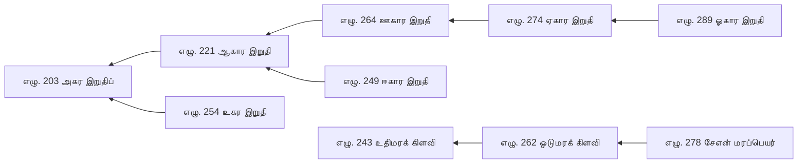

# செந்தமிழ் மரபு — திட்டங்களும் ஆய்வுகளும்

நூலைச் சுற்றிச் செய்யப்பட்ட திட்டங்கள், கருவிகள், ஆய்வுகள், அறிக்கைகள் எல்லாம் இவ்வொரே ஆவணத்தில். நூல் அன்று — நூல் பற்றிய விவரம். ஆங்கிலச் சுருக்கம் தனியே: `docs/DATA_CARD.md`; தரவு அகராதி: `docs/TARAVU.md`.

«நிரல் உருவாக்குவது» எனக் குறித்த பகுதிகள் `make check` இல் தாமே புதுப்பிக்கப்படும்; அவற்றைக் கையால் திருத்த வேண்டாம்.

## உள்ளடக்கம்

- 1. நூல்மரபுத் திட்டம்
- 2. களஞ்சியத் திட்டம்
- 3. செந்தமிழ் ஆக்கம் — தனிச் செயலி
- 4. மரபுக் குறியாக்கம்
- 5. நூல் வழி ஒருங்குறி மாதிரி — *நிரல் உருவாக்குவது*
- 6. நூல்வழி அளவை
- 7. புணர்ச்சிப் பொறி
- 8. புணர்ச்சிப் பொறி — விரிவு — *நிரல் உருவாக்குவது*
- 9. எண்ணுப்பெயர் — ஒப்பீடு
- 10. பொதுச் சூத்திர வடிவம் — திட்டம்
- 11. பொது வடிவம் — அறிக்கை — *நிரல் உருவாக்குவது*
- 12. முறைமை மோதல் — *நிரல் உருவாக்குவது*
- 13. அமைப்புப் பிரிப்பு — மாதிரிகள் — *நிரல் உருவாக்குவது*
- 14. மாட்டேற்று வரைபடம் — *நிரல் உருவாக்குவது*
- 15. ஒலிப்பிறப்பு — ஒப்பீடு — *நிரல் உருவாக்குவது*
- 16. மாத்திரை — ஒப்பீடு — *நிரல் உருவாக்குவது*
- 17. திணை, பருவம், பொழுது — ஒப்பீடு — *நிரல் உருவாக்குவது*
- 18. எழுத்தின் எண்ணிக்கை (247) — ஆய்வு — *நிரல் உருவாக்குவது*
- 19. கால அலகு — இந்நூல் முறையில் — *நிரல் உருவாக்குவது*
- 20. பிற மொழி மாதிரிகளில் பயன்பாடு — *நிரல் உருவாக்குவது*
- 21. இசை, தாளம், இராகம், நடனம் — ஒப்பீடு — *நிரல் உருவாக்குவது*
- 22. «இசை» — நூல் முழுவதும், சொல் வாரியாக — *நிரல் உருவாக்குவது*
- 23. பிறன் கோள் — சப்த தாளம், மேளகர்த்தா 72: கணக்கால் உருவாக்கம் — *நிரல் உருவாக்குவது*
- 24. ஒவ்வொரு நூற்பாவும் ஒரு தருக்கம் — *நிரல் உருவாக்குவது*
- 25. சோதனைகளின் அடிப்படை — *நிரல் உருவாக்குவது*
- 26. தமிழ் நுண்ணறிவு — திட்டம் — *நிரல் உருவாக்குவது*

<!-- பகுதி:noolmarabu -->
## 1. நூல்மரபுத் திட்டம்

நெறி: ஒவ்வொரு படியும் இந்நூலின் நூற்பாவால் வரையறுக்கப்படுகிறது. நூல் கூறாததைக் கூறியதாகக் காட்டுவதில்லை (பொருள். 654); முதல்வன் மேல் பிழை ஏற்றுவதில்லை (பொருள். 652).

**மூலம் எது:** கணினி வடிவம் (`data_v2/`) ஒன்றே மூலம். வாசிக்கும் நூல் (`build/senthamil_marabu.md`) அதிலிருந்து `make nool` உருவாக்கும். இரு இடத்தில் தனித்தனியே திருத்தினால் இரண்டு மூலம் ஆகி மாறுகோள் எழும் (பொருள். 468 "மாறுகோள் இன்றி").

---

### நூல் கூறும் அடுக்குகள் (முடிவு: நூலின் நேரடிச் சொல்லின்படி)

| அடுக்கு | நூலுள் | புலம் (v2) |
|---|---|---|
| சூத்திரம் | "ஆடி நிழலின் அறியத் தோன்றி" (பொருள். 471) — முதல்வனுடையது, மாற்றக் கூடாது | `moolam` |
| காண்டிகை | "பழிப்பு இல் சூத்திரம் பட்ட பண்பின் / கரப்பு இன்றி முடிவது காண்டிகை ஆகும்" (647); "ஏது நடையினும் எடுத்துக்காட்டினும்" (648) | `kaandigai.porul`, `.ethu`, `.eduthukkaattu[]`, `.en` |
| உரை | "சூத்திரத்துட் பொருள் அன்றியும் யாப்புற / இன்றியமையாது இயைபவை எல்லாம் / ஒன்ற உரைப்பது உரை எனப்படுமே" (649) | `urai.iyaipu[]` |
| | "விதித்தலும் விலக்கலும் என இரு வகையொடு" (645) | `urai.vagai`, `.vilakkukkuriyathu[]` |
| | "மறுதலைக் கடாஅ மாற்றமும் உடைத்தாய்" … "துணிவொடு நிற்றல்" (650) | `urai.maruthalai[]`, `.thunivu` |
| நிலை | நூலில் நேரடியாக / ஒருதலை அன்மை / நூலில் இல்லை | `nilai` |
| பிறன் கோள் | "பிறன் கோள் கூறல்" (656) — நூலின் விடையாகக் கொள்ளப்படாது | `piran_kol[]` |

எடுத்துக்காட்டு காண்டிகைக்கு உரியது (648). இதுவரை உரையில் இருந்த எடுத்துக்காட்டுகள் (எழு. 1–82-இல் 32 பகுதி) `migrate_v2.py` மூலம் காண்டிகைக்கு நகர்த்தப்பட்டன.

---

### படிகள் — அதிகார முறையில் (பொருள். 656 "அதிகார முறையே", "முறை பிறழாமை")

#### படி 1 — உரை நிறைவு (நடப்பது)
- ஓத்து வரிசைப்படி 27 ஓத்தும்: எழுத்து → சொல் → பொருள் (ஆய்வு 21).
- ஒவ்வொரு நூற்பாவுக்கும்: காண்டிகையில் ஏதுவும் எடுத்துக்காட்டும் (648); உரையில் இயைபு (649), விதி / விலக்கு (645), தேவையான இடத்தில் மறுதலைக் கடாஅ (650), துணிவு.
- நிலை (5 நவம்பர் 2026): உரை 997 / 1602 — எழுத்ததிகாரம் முழுமை (எழு. 1–483), சொல்லதிகாரம் முழுமை (சொல். 1–463, ஓத்து 1–9). ஓத்து 5–9, சொல் ஓத்து 1–9 வேறு தளத்தில் `urai_kit` வழி எழுதப்பட்டு, இங்கு சோதித்துத் திருத்தப்பட்டன (`sources/urai_othu05–09.json`, `sources/urai_sol_othu01.json`, `sources/urai_sol_othu02-09.json`; ஆவணம் rev 555). எல்லா உரைக்கும் வகை (645), இயைபு (649) உண்டு.
- ஆவணமும் v2-உம் ஒத்திசைவு: `sources/urai.json` ஆவணத்திலிருந்து (rev 329); ஓத்து 3–6 கட்டமைந்த உரை `sources/urai_othu03.py`, `urai_othu04.py`, `urai_othu05.json`–`urai_othu09.json` — ஆவணத்தில் (rev 353) அதே உரை.
- நிலை (6 நவம்பர் 2026): உரை 1600 / 1602 — பொருளதிகாரம் முழுமை (பொருள். 1–656). வேறு தளத்தில் எழுதிய 604 பதிவு இங்கு சோதித்துத் திருத்தப்பட்டது (`sources/urai_porul_othu01-09.json`); ஆவணத்தில் rev 596. ஆவணத் தாவல் அளவு வரம்பால் (2 MiB) «ஆய்வுகள்» பகுதி ஆவணத்திலிருந்து நீக்கப்பட்டது; அதன் படி `sources/aayvugal_rev585.md`.
- நிலை (6 நவம்பர் 2026, பின்): உரை 1602 / 1602 — எழு. 25 (இயைபு உரை), எழு. 295 (ஏது, உரை) நிரப்பப்பட்டன (`sources/urai_ezhu_othu01_07.json`; ஆவணம் பதிப்பு 597).
- அடுத்தது: படி 2 — ஐயம் நீக்கல். ஆவணத்தில் நீக்கப்பட்ட «ஆய்வுகள்» பகுதியைச் சுட்டும் «ஆய்வு N» குறிப்புகள் (சுமார் 34) — என்ன செய்வது என்பது ஆசிரியர் முடிவு.
- முன்பு: சொல் ஓத்து 2–9: 387 உரையில் 59-க்கு நூலுள் எடுத்துக்காட்டு; மீதிக்கு நூல் தரவில்லை. ஓத்து 8 எடுத்துக்காட்டு 17 / 108, ஓத்து 9 20 / 76 — மீதி நூற்பாக்களுக்கு நூலுள் பொருந்தும் புணர்ந்த வடிவம் இல்லை (எ.கா. 302 ண→ட, 332 ன→ற, 442 நாற்பது, 444 எண்பது, 461–470 நூறு/ஆயிரம் முன்); கிடைத்தால் மட்டும் சேர்.

#### படி 2 — ஐயம் நீக்கல் (பொருள். 650)
- எல்லா "ஒருதலை அன்மை"யையும் ஒரே பட்டியலாகத் திரட்டல்: எழு. 49, 62, 74, 75, 76, 81 போன்றவை; சொல். 205; பொருள். 643.
- "தன் நூலானும் முடிந்த நூலானும்" — தன் நூலால் தீர்வது தீரும்; எஞ்சியவை ஒருதலை அன்மையாகவே நிற்கும்.
- "முடிந்த நூல்" பயன்படுமா என்பது உங்கள் முடிவு. இதுவரை "இந்நூல் மட்டும்".

#### படி 3 — மறுதலைக் கடாஅ (பொருள். 650)
- எழுதியவர் அல்லாத ஒருவர் ஒவ்வொரு ஓத்தின் உரையையும் மறுத்துப் பார்த்தல். நூல் கேட்பது மறுப்புக் கேள்வி; எழுதியவரே தன்னைச் சோதிப்பது போதாது.

#### படி 4 — சிதைவுச் சோதனை (பொருள். 651–654)
- "சொல்லப்பட்டன எல்லா மாண்பும் / மறுதலை ஆயினும் மற்று அது சிதைவே" (651).
- அளக்கக் கூடிய சிதைவுகளை `check_nool.py` தானே சோதிக்கும்: கூறியது கூறல், மாறு கொளக் கூறல், குன்றக் கூறல், தன்னான் ஒரு பொருள் கருதிக் கூறல், பிறன் கோள் கலப்பு.
- எஞ்சியவை மனிதச் சோதனை: பொருள் இல கூறல், மயங்கக் கூறல், கேட்போர்க்கு இன்னா யாப்பு, பழித்த மொழி, மனம் கோள் இன்மை.

#### படி 5 — நூல் இலக்கணத் தேர்வு (பொருள். 468, 644)
- "ஒத்த சூத்திரம் உரைப்பின் காண்டிகை / மெய்ப்படக் கிளந்த வகையது ஆகி / ஈர் ஐங் குற்றமும் இன்றி நேரிதின் / முப்பத்திரு வகை உத்தியொடு புணரின் / நூல் என மொழிப" (644).
- `check_nool.py` பிழையின்றியும் நிலுவையின்றியும் முடிந்தால் மட்டும் படி 5 நிறைவு.

#### படி 6 — வழிநூல் வகை அறிவித்தல் (பொருள். 641–643)
- "தொகுத்தல் விரித்தல் தொகைவிரி மொழிபெயர்த்து" (643). இன்று ஆவணம் தன்னைத் "தொகுத்தல்" என்கிறது.
- காண்டிகையும் உரையும் சேர்ந்த பின் அது "தொகைவிரி" ஆகுமா என்பது ஒருதலை அன்மை. உங்கள் முடிவுக்கு.

#### படி 7 — இறுதிப் புணர்ப்பு (பொருள். 653)
- "முதல் வழி ஆயினும் யாப்பினுள் சிதையும் / வல்லோன் புணரா வாரம் போன்றே" — தமிழ் வல்லோர் ஒருவரின் இறுதி வாசிப்பு.
- மூலத்தின் SHA-256 கைரேகையைப் புதுப்பித்தல். வெளியிடுவதில்லை ("இந்நூல் இரகசியம்").

---

### கணினி வடிவம் — நூலின் விதிகளை இயக்கும் நிரலாக

| கோப்பு | செய்வது | நூற்பா |
|---|---|---|
| `schema/sutra.v2.schema.json` | நூல் கூறும் அடுக்குகளின் தரவு அமைப்பு | 470, 645–650, 656 |
| `scripts/migrate_v2.py` | v1 → v2; உரையிலுள்ள எடுத்துக்காட்டைக் காண்டிகைக்கு நகர்த்தல்; நிலையை உரையின் துணிவோடு ஒத்தல் | 648, 650 |
| `scripts/check_nool.py` | நூலை நூலாலே சோதித்தல் | 470–474, 640, 645–656 |
| `scripts/build_nool.py` | v2 → வாசிக்கும் நூல் + round-trip சோதனை | 470 |
| `rules/ezhuthu_base.py` | எழுத்துப் பகுப்பு | எழு. 3, 4, 8, 9, 19–21 |
| `rules/mozhimarabu.py` | மொழிமுதல், மொழியிறுதி விதிகள் — ஒவ்வொரு தீர்ப்புக்கும் நூற்பா எண் | எழு. 59–78 |
| `tests/test_mozhimarabu.py` | விதிகளை 1602 நூற்பாப் பாடத்தின் மேல் இயக்கி, நூலே மாறாகத் தோன்றும் இடங்களை ஐயமாகக் காட்டல் | 650 |

**விதி நிரல்களின் வரிசை (அதிகார முறை):**
1. மொழிமரபு — எழு. 59–78. **முடிந்தது.**
2. மெய்ம்மயக்கம் — எழு. 22–30.
3. மாத்திரை — எழு. 3–13.
4. பிறப்பு — எழு. 83–102 (தரவு மட்டும்).
5. புணர்ச்சி — எழு. 103–483, ஓத்து வாரியாக.
6. சொல்: திணை-பால் ஈறு (சொல். 1–5, 204–220), வேற்றுமை (சொல். 63–119), விளி (சொல். 120–156).
7. பொருள்: யாப்பு — அசை (பொருள். 312–313), சீர், அடி (344–348), தொடை (397–399).

ஒவ்வொரு விதி நிரலுக்கும் ஒரே சோதனை முறை: நூலின் சொந்தப் பாடமே சோதனைத் தொகுப்பு. நூலே விதிக்கு மாறாகத் தோன்றும் இடம் பிழை என முத்திரை பெறாது; "ஐயம்" எனப் படி 2-க்குச் செல்லும்.

**முதல் விதி நிரலின் முடிவு (`make rules`):** சொல், பொருள் அதிகாரப் பாடத்தின் 13,272 சொல்லில்:
- **மொழிமுதல் மாறு:** 1 — "சல்லல்" (சொல். 304; எழு. 62 ஐயம்).
- **மொழியிறுதி:** 847 புணர்ச்சி ஒற்று; வு-ஈறு 95 (எழு. 74 ஐயம்). வேறு மாறு இல்லை.

---

### சரிபார்ப்பு — ஒரே கட்டளை

    make check     # validate (v1) + check_nool (v2) + rules சோதனை + நூல் உருவாக்கம் + round-trip

வெற்றி என்பது: பிழை 0; நிலுவைப் பட்டியல் படிப்படியாகக் குறைதல்; round-trip வேறுபாடு 0.

### உரை எழுதும் ஒவ்வொரு முறையும்

1. அந்நூற்பாவின் v2 பதிவை நிரப்புதல் (`kaandigai.ethu`, `.eduthukkaattu`, `urai.*`).
2. `make check` — மேற்கோள்கள் நூலுள் எழுத்துக்கு எழுத்து உள்ளனவா, சுட்டுகள் உள்ளனவா, நிலை ஒத்துள்ளதா.
3. `make nool` — வாசிக்கும் நூலை மீண்டும் உருவாக்குதல்; தேவையானால் அதை ஆவணத்துக்கு மாற்றுதல்.
<!-- /பகுதி:noolmarabu -->

<!-- பகுதி:kalanjiyam -->
## 2. களஞ்சியத் திட்டம்

களஞ்சியம் (repository): நூலின் தரவு, அதை உருவாக்கும் நிரல்கள், சோதனைகள், கருவிகள், வெளியீட்டு முறை — எல்லாம் ஓரிடத்தில், ஒவ்வொரு மாற்றமும் வரலாற்றோடு. இத்திட்டம் அதன் அமைப்பையும், தேவையான கோப்புகளையும், வெளியீட்டு வழியையும் வரையறுக்கிறது. ஒவ்வோர் உருப்படியும் `scripts/kalanjiyam.py` ஆல் தானாகச் சரிபார்க்கப்படுகிறது (`make check`-இன் இறுதிப் படி).

### 1. நோக்கம்

1. **நூல்:** 1602 சூத்திரம், மூலம் மாறாமல், நூல்மரபுப்படி உரை — அச்சு நூலாகவும் மின்னூலாகவும்.
2. **தரவு:** ஆய்வாளர் நேரடியாகப் பயன்படுத்தும் வடிவங்கள், வரையறையோடும் மேற்கோள் முறையோடும்.
3. **கருவிகள்:** தேடல், இலக்கண–யாப்புச் சோதனை, ஆக்கச் செயலி — இணையத்திலும் தொலைபேசியிலும்.
4. **நம்பகம்:** எந்த மாற்றமும் சோதனைகள் தேறிய பின்னரே; ஒவ்வொரு வெளியீட்டுக்கும் நிலையான DOI.

### 2. அமைப்பு

| இடம் | பங்கு | வகை |
|---|---|---|
| `sources/` | உரை, ஏது, முன்னுரை, ஆய்வுகள் — கையால் திருத்தும் மூலங்கள் | மூலம் |
| `data/sutras/` | பழைய காண்டிகை மூலம் (v1) | மூலம் |
| `data_v2/` | ஒரே கணினி வடிவம் — ஓத்துக்கு ஒரு JSONL | உருவாக்கப்படுவது |
| `schema/` | பதிவு வடிவ வரையறை | மூலம் |
| `scripts/` | உருவாக்கம், சோதனை, நூல், தளம் | நிரல் |
| `senthamil_marabu/` | Python தொகுப்பு (தரவு உட்பட) | நிரல் + உருவாக்கப்படும் தரவு |
| `karuvi/` | இணையக் கருவிகளின் மூலம் (விதிகள், பக்கங்கள்) | மூலம் |
| `app/aakkam/` | செந்தமிழ் ஆக்கம் — தனிச் செயலி | உருவாக்கப்படுவது |
| `app/`, `index.html` | தேடல் செயலி | நிரல் |
| `book/` | அச்சு வடிவமைப்பு, எழுத்துருக்கள் (OFL) | மூலம் |
| `kuriyaakkam/`, `orunguri/` | குறியாக்க வரையறைகளும் சோதனைகளும் | ஆவணம் + சோதனை |
| `docs/` | தரவு அகராதி, தரவு அட்டை (ஆங்கிலச் சுருக்கம் — நூலன்று), இத்திட்டம் | ஆவணம் |
| `tests/` | சோதனைகள் | சோதனை |
| `examples/` | ஆய்வு எடுத்துக்காட்டுகள் | ஆவணம் |
| `.github/workflows/` | சோதனை, தளம், வெளியீடு | தானியக்கம் |
| `build/`, `export/` | உருவாக்க விளைவுகள் — களஞ்சியத்தில் சேர்க்கப்படுவதில்லை | — |

### 3. தேவையான கோப்புகள்

| கோப்பு | ஏன் |
|---|---|
| `README.md` | முதல் பக்கம்: நூல் என்ன, அமைப்பு, உருவாக்கல், ஆய்வாளர் பயன்பாடு, உரிமம், மேற்கோள் |
| `LICENSE.md` | உரிமம் — CC BY-NC 4.0; சூத்திரம் பொதுவுடைமை; மதுரைத் திட்டப் பாடம் விலக்கு; எழுத்துரு OFL |
| `CITATION.cff` | GitHub, Zenodo காட்டும் மேற்கோள் |
| `.zenodo.json` | Zenodo பதிவின் விவரம் (தலைப்பு, ஆசிரியர், ORCID, உரிமம், பதிப்பு) |
| `CHANGES.md` | பதிப்பு வாரியான மாற்றப் பதிவு |
| `CONTRIBUTING.md` | பங்களிப்பு நெறி — நூலின் அளவுகோல், திருத்தும் இடங்கள் |
| `pyproject.toml`, `requirements.txt` | Python நிறுவல் |
| `Makefile` | `make check`, `make book` |
| `.gitignore`, `.gitattributes` | உருவாக்க விளைவுகளையும் தற்காலிகக் கோப்புகளையும் விலக்கல் |
| `datapackage.json`, `docs/TARAVU.md`, `docs/DATA_CARD.md` | தரவு விவரம் |
| `.github/workflows/validate.yml` | ஒவ்வொரு மாற்றத்திலும் `make check` |
| `.github/workflows/pages.yml` | தளம்: முகப்பு, தேடல், நூல்வழிச் சோதனை, செந்தமிழ் ஆக்கம் |
| `docs/THOGUPPU.md` | திட்டங்கள், ஆய்வுகள், அறிக்கைகள் — ஒரே ஆவணம் (இது) |
| `seyali/`, `scripts/build_seyali.py` | செந்தமிழ் ஆக்கம் — தனிச் செயலிக் களஞ்சியம் (§3) |
| `.github/workflows/release.yml` | `v*` குறியிட்டால்: PDF, EPUB, தரவு zip — GitHub வெளியீட்டில் |

### 4. பதிப்பு முறை

- பதிப்பு எண் `பெரிய.சிறிய.திருத்தம்` (1.0.0). மூலத்தையோ தரவு வடிவத்தையோ மாற்றும் வெளியீடு பெரிய எண்; புதிய உரை, கருவி சிறிய எண்; பிழைத் திருத்தம் இறுதி எண்.
- ஒரே பதிப்பு எண் ஐந்து இடங்களில் ஒத்திருக்க வேண்டும்: `pyproject.toml`, `senthamil_marabu/__init__.py`, `CITATION.cff`, `.zenodo.json`, `CHANGES.md`-இன் முதல் தலைப்பு.
- DOI, ORCID, களஞ்சிய முகவரி, உரிமம் — எல்லாக் கோப்பிலும் ஒன்றே.

### 5. வெளியீட்டு வழி — நீங்கள் செய்ய வேண்டியவை

1. **களஞ்சியப் பெயர்:** GitHub-இல் `https-github.com-USERNAME-senthamil-marabu` → Settings → Repository name: `senthamil-marabu`. (GitHub பழைய முகவரியைப் புதியதற்குத் தானே திருப்பும்.)
2. **பதிவேற்றம்:** இந்த zip-இன் உள்ளடக்கத்தை அக்களஞ்சியத்தின் `main` கிளையில் இடுங்கள் (git push, அல்லது GitHub-இன் «Upload files»). `.github` கோப்புறையும் சேர வேண்டும்.
3. **சோதனை:** Actions தாவலில் «Validate» பச்சையாக முடிவதைப் பாருங்கள்.
4. **தளம்:** Settings → Pages → Source: «GitHub Actions». பின் «Site» பணிவழி `https://thanu2008v-prog.github.io/senthamil-marabu/` தளத்தை வெளியிடும்.
5. **Zenodo:** zenodo.org → GitHub பக்கத்தில் இக்களஞ்சியத்துக்கான இணைப்பு இயக்கத்தில் உள்ளதா எனப் பாருங்கள் (பெயர் மாற்றிய பின்னும்).
6. **வெளியீடு:** Releases → «Draft a new release» → குறி `v1.0.0`, தலைப்பு «செந்தமிழ் மரபு 1.0.0», «Set as a pre-release» குறியிடாமல் → Publish. «Release» பணிவழி PDF, EPUB, தரவு zip-ஐ இணைக்கும்; Zenodo அதற்குப் புதிய பதிப்பு DOI தரும். பழைய V1 DOI அப்படியே நிலைக்கும்.
7. **பின்:** Zenodo தந்த புதிய பதிப்பு DOI-ஐ எனக்குச் சொன்னால் README, CITATION-இல் சேர்க்கலாம்.

### 6. சரிபார்ப்பு (`python3 scripts/kalanjiyam.py`)

1. §2.3-இன் கோப்புகள் எல்லாம் உள்ளன.
2. பதிப்பு எண் ஐந்து இடத்திலும் ஒன்றே; DOI, ORCID, முகவரி, உரிமம் ஒத்துள்ளன.
3. உருவாக்க விளைவுகளோ தற்காலிகக் கோப்புகளோ களஞ்சியத்தில் இல்லை.
4. இணையக் கருவிகளும் தனிச் செயலியும் ஒரே விதி நிரலிலிருந்து உருவானவை.
5. தனிச் செயலியின் manifest, சின்னங்கள், service worker கோப்புகள் சரியானவை.
6. நூலின் முன்னுரையிலும் உடலிலும் ஆங்கிலம் இல்லை (பெயர்களும் உரிமப் பெயர்களும் தவிர).
7. உரிமை வரி README, நூல், கருவிகளில் உள்ளது.
<!-- /பகுதி:kalanjiyam -->

<!-- பகுதி:seyali -->
## 3. செந்தமிழ் ஆக்கம் — தனிச் செயலி

செந்தமிழ் ஆக்கம்: திணை, உணர்வு, கூற்று, வடிவம் ஆகியவற்றைத் தேர்ந்தால், அவற்றுக்கு இயைந்த புதிய செந்தமிழ்ப் பாடலோ கட்டுரையோ உருவாகும். வெளிவருவது ஆக்கம் மட்டுமே; நூலின் விவரம் அதில் இடம்பெறாது. இத்திட்டம் அதனை நூல் களஞ்சியத்திலிருந்து பிரித்து, தொலைபேசியில் தனியாக நிறுவி இயக்கக்கூடிய செயலியாக வெளியிடும் வழியை வரையறுக்கிறது.

### 1. செயலியின் வகை — ஏன் இணையச் செயலி (PWA)

| வழி | நன்மை | குறை |
|---|---|---|
| **இணையச் செயலி (PWA)** — தேர்வு | ஒரே கோப்புத் தொகுதி Android, iPhone, கணினி மூன்றிலும்; கடைக் கட்டணமோ ஒப்புதலோ இல்லை; புதுப்பிப்பு உடனே | நிறுவல் உலாவி வழியாக |
| Play Store (TWA) — இரண்டாம் கட்டம் | கடையில் தேடிக் கிடைக்கும் | Google கணக்குக் கட்டணம்; கையொப்பத் திறவு; தள வேரில் இணைப்புக் கோப்பு |
| App Store | iPhone கடையில் | Apple கணக்குக் கட்டணம்; Mac வேண்டும் — திட்டத்தில் இல்லை |

இரண்டாம் கட்டமும் இதே கோப்புகளையே பயன்படுத்தும்; செயலியை மீண்டும் எழுத வேண்டியதில்லை.

### 2. ஒரு மூலம், மூன்று வெளியீடு

| மூலம் (நூல் களஞ்சியம்) | விளைவு |
|---|---|
| `karuvi/aakkam_page.html` — பக்கம் | Claude-இல் `karuvi/aakkam.html`; தனிச் செயலியில் `index.html` |
| `karuvi/logic.js` — நூல்வழி விதிகள் | மூன்றிலும் ஒரே நிரல் |
| `karuvi/thaniyurimai.html` — தனியுரிமை | தனிச் செயலியில் |
| `book/fonts/` — எழுத்துருக்கள் (OFL) | செயலிக்குள்ளேயே; இணையமின்றி |
| `seyali/` — README, மாற்றப் பதிவு, பணிவழி, Android அமைப்பு | தனிக் களஞ்சியத்தில் |

`python3 scripts/build_seyali.py` தனிக் களஞ்சியத்தை `build/senthamil-aakkam/` இல் உருவாக்கி, சரிபார்த்து, zip ஆக்கும். பக்கத்தில் திருத்தம் வேண்டுமானால் நூல் களஞ்சியத்தில் மட்டும் செய்து, மீண்டும் உருவாக்குக — தனிக் களஞ்சியத்தில் நேரடியாகத் திருத்த வேண்டாம்.

### 3. தனிக் களஞ்சியத்தின் அமைப்பு — `senthamil-aakkam`

| கோப்பு | பங்கு |
|---|---|
| `index.html` | செயலி — பக்கம், விதிகள், தோற்றம் யாவும் ஒரே கோப்பில் |
| `manifest.webmanifest` | பெயர், சின்னம், நிறம், தனிச் சாளரம் |
| `sw.js` | இணையமின்றித் திறக்கச் சேமிப்பு; உள்ளடக்கக் கைரேகையால் பதிப்பு |
| `thaniyurimai.html` | தனியுரிமை — எது சேமிக்கப்படும், எது எங்கு அனுப்பப்படும், எப்படி நீக்குவது |
| `icons/` | 192, 512, மறைப்புச் சின்னம் (maskable), Apple சின்னம் |
| `fonts/` | Noto Serif Tamil, Noto Sans Tamil + `OFL.txt` |
| `android/twa-manifest.json` | Play Store பொதிக்கு (இரண்டாம் கட்டம்) |
| `android/assetlinks.template.json` | தள–செயலி இணைப்பு மாதிரி |
| `.github/workflows/pages.yml` | GitHub Pages வெளியீடு |
| `README.md`, `LICENSE.md`, `CHANGES.md`, `THITTAM.md`, `VERSION`, `.nojekyll` | விவரம், உரிமம், மாற்றம், இத்திட்டம், பதிப்பு |

### 4. செயலியின் இயக்கம்

1. **திறப்பு:** முதல் திறப்பில் செயலிக் கூடு முழுவதும் தொலைபேசியில் சேமிக்கப்படும்; பின் இணையமின்றியும் திறக்கும்.
2. **ஆக்கம்:** «ஆக்கு» தொட்டால் தேர்வுகள் உங்கள் திறவுகோலோடு `api.anthropic.com` க்கு நேரடியாகச் செல்லும். வந்த ஆக்கம் நூல்வழி விதிகளால் அமைதியாகச் சோதிக்கப்படும்; குறை கண்டால் இருமுறை வரை திருத்தி எழுதப்படும்.
3. **சேமிப்பு:** திறவுகோல், மாதிரி, இறுதி 30 ஆக்கங்கள் — தொலைபேசியில் மட்டும். «நீக்கு», «எல்லாவற்றையும் அழி» பொத்தான்கள்.
4. **இணையமின்றி:** செயலி, எழுத்துரு, முந்தைய ஆக்கங்கள் கிடைக்கும்; புதிய ஆக்கம் இணையம் வந்தபின்.
5. **கட்டணம்:** Anthropic கணக்கில் நேரடியாக; செயலி எதையும் வசூலிப்பதில்லை.

### 5. பதிப்பு முறை

- `VERSION` கோப்பில் `பெரிய.சிறிய.திருத்தம்` (முதல் பதிப்பு 1.0.0). அதே எண் `CHANGES.md` முதல் தலைப்பிலும் `android/twa-manifest.json` இன் `appVersionName` இலும்.
- Play Store க்கு ஒவ்வொரு வெளியீட்டிலும் `appVersionCode` ஒன்று கூடும்.
- இணையச் செயலி தானே புதுப்பிக்கும்: புதிய `sw.js` கைரேகை பழைய சேமிப்பை நீக்கும்.

### 6. வெளியீட்டு வழி — நீங்கள் செய்ய வேண்டியவை

**முதற் கட்டம் — இணையச் செயலி**

1. GitHub இல் புதிய பொதுக் களஞ்சியம்: `senthamil-aakkam`.
2. zip இன் உள்ளடக்கத்தை `main` கிளையில் பதிவேற்றுக (`.github` கோப்புறையும்).
3. Settings → Pages → Source: «GitHub Actions».
4. சில நிமிடங்களில் செயலி `https://thanu2008v-prog.github.io/senthamil-aakkam/` இல்.
5. தொலைபேசியில் நிறுவல் — Android: Chrome இல் திறந்து ⋮ → «முகப்புத் திரையில் சேர்» / «செயலியை நிறுவு». iPhone: Safari இல் திறந்து பகிர் → «முகப்புத் திரையில் சேர்».
6. அமைப்பில் Anthropic API திறவுகோலை இட்டுச் «சேமி».

**இரண்டாம் கட்டம் — Play Store (விரும்பினால்)**

1. Google Play Console கணக்கு (ஒருமுறைக் கட்டணம்).
2. கணினியில் JDK, Node நிறுவி: `npm i -g @bubblewrap/cli`, பின் `android/` இல் `bubblewrap build`. இது கையொப்பத் திறவை உருவாக்கி `.aab` பொதியைத் தரும். (எளிய மாற்று: pwabuilder.com இல் செயலி முகவரியை இட்டு Android பொதியைப் பெறலாம்.)
3. `bubblewrap fingerprint` தரும் SHA-256 கைரேகையை `assetlinks.template.json` இல் இட்டு, `assetlinks.json` என்ற பெயரில் **தள வேரில்** — `https://thanu2008v-prog.github.io/.well-known/assetlinks.json` — வைக்க வேண்டும். அதற்கு `thanu2008v-prog.github.io` என்ற பெயரில் தனிக் களஞ்சியம் வேண்டும். இது இல்லையெனில் செயலி மேலே உலாவிப் பட்டை தெரியும்.
4. Play Console இல் பொதியையும், தனியுரிமைப் பக்க முகவரியையும் (`…/senthamil-aakkam/thaniyurimai.html`) இட்டு வெளியிடுக.
5. கையொப்பத் திறவுக் கோப்பைப் பாதுகாப்பாக வைத்திருக்கவும்; இழந்தால் செயலியைப் புதுப்பிக்க இயலாது. அதைக் களஞ்சியத்தில் சேர்க்க வேண்டாம்.

### 7. சரிபார்ப்பு (`build_seyali.py` தானே செய்வது)

1. §3.3 இன் கோப்புகள் யாவும் உள்ளன.
2. `index.html` நூல் களஞ்சியத்தின் `app/aakkam/index.html` உடன் ஒத்தது; விதி நிரல் `karuvi/logic.js` உடன் ஒத்தது.
3. manifest: தனிச் சாளரம், `id`/`start_url`/`scope`, மறைப்புச் சின்னம், சின்ன அளவுகள் சரி.
4. `sw.js` சேமிக்கும் கோப்புகள் யாவும் உள்ளன.
5. செயலி தொடர்பு கொள்ளும் வெளி முகவரி `api.anthropic.com` மட்டும்; வெளி எழுத்துருவோ நிரலோ இல்லை.
6. தனியுரிமைப் பக்கம் உள்ளது; செயலியிலிருந்து இணைக்கப்பட்டுள்ளது.
7. பதிப்பு எண் `VERSION`, `CHANGES.md`, `twa-manifest.json` மூன்றிலும் ஒன்றே.
8. உரிமை வரி செயலியிலும் தனியுரிமைப் பக்கத்திலும் README இலும் உள்ளது.
<!-- /பகுதி:seyali -->

<!-- பகுதி:kuriyaakkam -->
## 4. மரபுக் குறியாக்கம்

தமிழ் எழுத்தை நூல் வகுத்த கூறுகளாலேயே குறிக்கும் கணினிக் குறியாக்கம். ஓர் எழுத்து = ஒரு 16-பிட் அலகு; அலகின் ஒவ்வொரு பிட் தொகுதியும் ஒரு நூற்பாவைச் சார்ந்தது. ஆகவே எழுத்தின் வகை, இனம், பிறப்பு இணை, அளவு (மாத்திரை) ஆகியவை அட்டவணை தேடாமல் குறியிலேயே தெரியும்; பல விதிகள் பிட் செயலாகின்றன.

### 1. அடிப்படை — நூலின் சொல்

| கூறு | நூற்பா |
|---|---|
| எழுத்து முப்பது, சார்பு மூன்று | «எழுத்தெனப் படுப / அகரமுதல் னகர இறுவாய் / முப்பஃ தென்ப / சார்ந்துவரல் மரபின் மூன்றலங் கடையே» (எழு. 1); «குற்றிய லிகரம் குற்றிய லுகரம் / ஆய்தம்» (எழு. 2) |
| குறில் ஐந்து — ஓரளபு | «அ இ உ எ ஒ … ஓரள பிசைக்குங் குற்றெழுத் தென்ப» (எழு. 3) |
| நெடில் ஏழு — ஈரளபு | «ஆ ஈ ஊ ஏ ஐ ஓ ஔ … ஈரள பிசைக்கும் நெட்டெழுத் தென்ப» (எழு. 4) |
| மெய் — அரை அளவு, புள்ளியொடு | «மெய்யின் அளவே அரையென மொழிப» (எழு. 11); «மெய்யின் இயற்கை புள்ளியொடு நிலையல்» (எழு. 15) |
| சார்பு — அரை அளவு | «அவ்வியல் நிலையும் ஏனை மூன்றே» (எழு. 12) |
| உயிர்மெய் = மெய் + உயிர்; உயிரின் அளவு திரியாது | «மெய்யின் வழிய துயிர்தோன்று நிலையே» (எழு. 18); «மெய்யோ டியையினும் உயிரியல் திரியா» (எழு. 10) |
| மூவினம், நூற்பா வரிசையில் | «க ச ட த ப ற» (எழு. 19); «ங ஞ ண ந ம ன» (எழு. 20); «ய ர ல வ ழ ள» (எழு. 21) |
| வல்–மெல் இணை ஒரே பிறப்பிடம் | எழு. 89, 90, 91, 93, 94, 97; இன மெல்லெழுத்து — «கசதப முதலிய மொழிமேற் றோன்றும் / மெல்லெழுத் தியற்கை» (எழு. 143) |
| ஐ, ஔ — இரு உயிரால் ஆவன | «அகர இகரம் ஐகார மாகும்» (எழு. 54); «அகர உகரம் ஔகார மாகும்» (எழு. 55) |
| வட எழுத்து இவ்வெழுத்துள் அடங்காது | «வடசொல் கிளவி வட எழுத்து ஒரீஇ» (சொல். 401) |

### 2. பிட் அமைப்பு

| பிட் | பொருள் | மதிப்புகள் | நூற்பா |
|---|---|---|---|
| 15 | மரபு எழுத்தா | 1 = எழுத்து; 0 = பிற குறி (இடைவெளி, வரி முறிவு — அதன் யூனிகோடு மதிப்பே) | — |
| 14–12 | சார்புநிலை | 0 இயல்பு, 1 குற்றியலுகரம், 2 குற்றியலிகரம், 3 ஐகாரக் குறுக்கம், 4 மகரக் குறுக்கம் | எழு. 2, 13, 34, 36, 57 |
| 11–10 | மெய்யின் இனம் | 0 இல்லை, 1 வல்லினம், 2 மெல்லினம், 3 இடையினம் | எழு. 19–21 |
| 9–7 | இனத்துள் இடம் | 0–5, நூற்பா வரிசை; வல்லினம், மெல்லினம் இரண்டிலும் ஒரே இடம் = ஒரே பிறப்பிடம் | எழு. 89–97 |
| 6 | ஒதுக்கியது | 0 | — |
| 5–3 | உயிர் | 0 இல்லை (புள்ளி), 1 அ, 2 இ, 3 உ, 4 எ, 5 ஒ, 6 ஐ, 7 ஔ | எழு. 3, 4, 15 |
| 2 | அளவு | 0 குறில் (ஓரளபு), 1 நெடில் (ஈரளபு) | எழு. 3, 4 |
| 1–0 | ஒதுக்கியவை | 0 | — |

ஆய்தம்: இனம் 0, உயிர் 0 (0x8000) — மெய்யும் அல்ல, உயிரும் அல்ல. சார்புநிலைப் பிட்கள் எழுத்தின் வடிவத்தை மாற்றுவதில்லை («எழுத்தோ ரன்ன», எழு. 2); அவை அளவை மட்டும் மாற்றுகின்றன.

**அளவு குறியிலிருந்தே** (மாத்திரை): உயிர் 0 → ½ (மெய், ஆய்தம்); குறில் → 1; நெடில் → 2; சார்புநிலை 1, 2 → ½ (எழு. 12); 3 → 1 (எழு. 57 «ஓரள பாகும்»); 4 → நூலில் எண் இல்லை (எழு. 13 «அரையளவு குறுகல்» — ஒருதலை அன்மை).

**விதி பிட் செயலாக** — எடுத்துக்காட்டுகள்:

- இன மெல்லெழுத்து (எழு. 143): இனப் பிட்டை 01 → 10 ஆக்குதல்; இடம் மாறாது. க→ங, ச→ஞ, ட→ண, த→ந, ப→ம, ற→ன.
- உயிர்மெய் பிரித்தல் (எழு. 18): மெய் = உயிர்ப் பிட்களை 0 ஆக்குதல்; உயிர் = இனப் பிட்களை 0 ஆக்குதல்.
- குறில்–நெடில் இணை (எழு. 3, 4): அளவுப் பிட்டை மாற்றுதல் (அ↔ஆ, கொ↔கோ).
- மெய் மொழிமுதல் ஆகாமை (எழு. 60): முதல் எழுத்தின் இனம் ≠ 0 எனின் உயிர் ≠ 0 ஆக வேண்டும்.

### 3. குறி அட்டவணை (247 எழுத்து)

உயிர் — அ 8008, ஆ 800C, இ 8010, ஈ 8014, உ 8018, ஊ 801C, எ 8020, ஏ 8024, ஐ 8034, ஒ 8028, ஓ 802C, ஔ 803C; ஆய்தம் — ஃ 8000.

| மெய் | புள்ளி | அ | ஆ | இ | ஈ | உ | ஊ | எ | ஏ | ஐ | ஒ | ஓ | ஔ |
|---|---|---|---|---|---|---|---|---|---|---|---|---|---|
| க | க் 8400 | க 8408 | கா 840C | கி 8410 | கீ 8414 | கு 8418 | கூ 841C | கெ 8420 | கே 8424 | கை 8434 | கொ 8428 | கோ 842C | கௌ 843C |
| ச | ச் 8480 | ச 8488 | சா 848C | சி 8490 | சீ 8494 | சு 8498 | சூ 849C | செ 84A0 | சே 84A4 | சை 84B4 | சொ 84A8 | சோ 84AC | சௌ 84BC |
| ட | ட் 8500 | ட 8508 | டா 850C | டி 8510 | டீ 8514 | டு 8518 | டூ 851C | டெ 8520 | டே 8524 | டை 8534 | டொ 8528 | டோ 852C | டௌ 853C |
| த | த் 8580 | த 8588 | தா 858C | தி 8590 | தீ 8594 | து 8598 | தூ 859C | தெ 85A0 | தே 85A4 | தை 85B4 | தொ 85A8 | தோ 85AC | தௌ 85BC |
| ப | ப் 8600 | ப 8608 | பா 860C | பி 8610 | பீ 8614 | பு 8618 | பூ 861C | பெ 8620 | பே 8624 | பை 8634 | பொ 8628 | போ 862C | பௌ 863C |
| ற | ற் 8680 | ற 8688 | றா 868C | றி 8690 | றீ 8694 | று 8698 | றூ 869C | றெ 86A0 | றே 86A4 | றை 86B4 | றொ 86A8 | றோ 86AC | றௌ 86BC |
| ங | ங் 8800 | ங 8808 | ஙா 880C | ஙி 8810 | ஙீ 8814 | ஙு 8818 | ஙூ 881C | ஙெ 8820 | ஙே 8824 | ஙை 8834 | ஙொ 8828 | ஙோ 882C | ஙௌ 883C |
| ஞ | ஞ் 8880 | ஞ 8888 | ஞா 888C | ஞி 8890 | ஞீ 8894 | ஞு 8898 | ஞூ 889C | ஞெ 88A0 | ஞே 88A4 | ஞை 88B4 | ஞொ 88A8 | ஞோ 88AC | ஞௌ 88BC |
| ண | ண் 8900 | ண 8908 | ணா 890C | ணி 8910 | ணீ 8914 | ணு 8918 | ணூ 891C | ணெ 8920 | ணே 8924 | ணை 8934 | ணொ 8928 | ணோ 892C | ணௌ 893C |
| ந | ந் 8980 | ந 8988 | நா 898C | நி 8990 | நீ 8994 | நு 8998 | நூ 899C | நெ 89A0 | நே 89A4 | நை 89B4 | நொ 89A8 | நோ 89AC | நௌ 89BC |
| ம | ம் 8A00 | ம 8A08 | மா 8A0C | மி 8A10 | மீ 8A14 | மு 8A18 | மூ 8A1C | மெ 8A20 | மே 8A24 | மை 8A34 | மொ 8A28 | மோ 8A2C | மௌ 8A3C |
| ன | ன் 8A80 | ன 8A88 | னா 8A8C | னி 8A90 | னீ 8A94 | னு 8A98 | னூ 8A9C | னெ 8AA0 | னே 8AA4 | னை 8AB4 | னொ 8AA8 | னோ 8AAC | னௌ 8ABC |
| ய | ய் 8C00 | ய 8C08 | யா 8C0C | யி 8C10 | யீ 8C14 | யு 8C18 | யூ 8C1C | யெ 8C20 | யே 8C24 | யை 8C34 | யொ 8C28 | யோ 8C2C | யௌ 8C3C |
| ர | ர் 8C80 | ர 8C88 | ரா 8C8C | ரி 8C90 | ரீ 8C94 | ரு 8C98 | ரூ 8C9C | ரெ 8CA0 | ரே 8CA4 | ரை 8CB4 | ரொ 8CA8 | ரோ 8CAC | ரௌ 8CBC |
| ல | ல் 8D00 | ல 8D08 | லா 8D0C | லி 8D10 | லீ 8D14 | லு 8D18 | லூ 8D1C | லெ 8D20 | லே 8D24 | லை 8D34 | லொ 8D28 | லோ 8D2C | லௌ 8D3C |
| வ | வ் 8D80 | வ 8D88 | வா 8D8C | வி 8D90 | வீ 8D94 | வு 8D98 | வூ 8D9C | வெ 8DA0 | வே 8DA4 | வை 8DB4 | வொ 8DA8 | வோ 8DAC | வௌ 8DBC |
| ழ | ழ் 8E00 | ழ 8E08 | ழா 8E0C | ழி 8E10 | ழீ 8E14 | ழு 8E18 | ழூ 8E1C | ழெ 8E20 | ழே 8E24 | ழை 8E34 | ழொ 8E28 | ழோ 8E2C | ழௌ 8E3C |
| ள | ள் 8E80 | ள 8E88 | ளா 8E8C | ளி 8E90 | ளீ 8E94 | ளு 8E98 | ளூ 8E9C | ளெ 8EA0 | ளே 8EA4 | ளை 8EB4 | ளொ 8EA8 | ளோ 8EAC | ளௌ 8EBC |

### 4. சோதனை — 1602 சூத்திரம் (sources/moolam.json)

- **முன்–பின் மாற்றம்** (யூனிகோடு → மரபுக் குறி → யூனிகோடு): வேறுபாடு 0 — 1602 சூத்திரமும் எழுத்துக்கு எழுத்து ஒத்தன.
- **எழுத்து:** 64,706; நூலுள் வரும் தனி எழுத்து வடிவம் 208 (இயலும் 247-இல்).
- **மாத்திரை (குறியிலிருந்தே கணித்தது):** எழுத்ததிகாரம் 15,431, சொல் 16,582, பொருள் 32,868; மொத்தம் 64,881.
- **சார்பெழுத்து** (விதிப்படி குறித்தது): குற்றியலுகரம் 1,853, குற்றியலிகரம் 2; ஆய்தம் 52 (தனிக் குறி). சொல் எல்லை பாடத்தின் சொற்பிரிப்பைச் சார்ந்தது — ஒருதலை அன்மை.

| அளவு | எண்ணிக்கை | பைட் |
|---|---|---|
| யூனிகோடு குறிப்புள்ளி | 125,989 (தமிழ் 110,355) | UTF-8: 346,699; UTF-16: 251,978 |
| மரபுக் குறி அலகு | 80,340 (எழுத்து 64,706) | 160,680 |

மரபுக் குறி UTF-8-இன் 46% இடம், UTF-16-இன் 63% இடம் எடுக்கிறது; ஏனெனில் ஓர் உயிர்மெய் யூனிகோடில் இரண்டு குறிப்புள்ளி (UTF-8-இல் 6 பைட்), இங்கு ஒரே அலகு (2 பைட்).

**நூல் விதிகளைப் பிட் செயலால் சோதித்தல்** — சொல், பொருள் அதிகாரப் பாடத்தில் (எழுத்ததிகாரப் பாடம் பழைய அச்சுச் சொற்பிரிப்பு; ஓரெழுத்துச் சொல் எழுத்தின் தம் பெயர் — எழு. 66):

| விதி | எண்ணிக்கை |
|---|---|
| எழு. 78 — புணர்ச்சி ஒற்று (வருமொழி வல்லினம்; மீறல் அல்ல) | 847 |
| எழு. 60 — மெய் மொழிமுதல் | 0 |
| எழு. 63 — வு வூ வொ வோ மொழிமுதல் | 0 |
| எழு. 65 — யா அல்லாத யகர முதல் | 0 |
| எழு. 69 — ஔ இறுதி | 0 |
| எழு. 78 — வல்லினம் / ங புள்ளியிறுதி | 0 |
| எழு. 30 — ர்ர, ழ்ழ | 0 |

எழு. 78-க்கு மாறாகத் தோன்றும் 847 வல்லின ஒற்றும் அடுத்த சொல்லின் வல்லின முதலோடு புணர்ந்தவை (எ.கா. «மக்கட் சுட்டே», «நிலைக் கிளவி») — மொழியிறுதி அல்ல, புணர்ச்சியில் வந்த ஒற்று (எழு. 108, 109).

### 5. எல்லைகள்

- இது யூனிகோடுக்கு மாற்று அல்ல; யூனிகோடு உலகத் தகவல் பரிமாற்றத் தரம். மரபுக் குறி அதன் மேல் அமையும் நூல் வழிக் குறியாக்கம்: இரண்டுக்கும் இடையே இழப்பின்றி மாற்ற முடியும் (சோதனை 1).
- வட எழுத்து (ஜ, ஷ, ஸ, ஹ) நூலின் எழுத்து அல்ல (சொல். 401); அவை பிற குறியாக (பிட் 15 = 0) நிற்கின்றன. 1602 சூத்திரத்தில் அவை இல்லை.
- எண்ணுரு (௧ ௨ …) நூலில் இல்லை; நூல் எண்ணைச் சொல்லாலேயே கூறுகிறது (எழு. 433–476).
- சார்புநிலை 3, 4 (ஐகாரக் குறுக்கம், மகரக் குறுக்கம்) ஒதுக்கப்பட்டவை; அவற்றைக் குறிக்கும் விதி இன்னும் நிரலாக்கப்படவில்லை.
- அசை (நேர், நிரை, நேர்பு, நிரைபு — பொருள். 312, 313) அடுத்த அடுக்கு; இவ்வலகுகளின் மேல் அமையும்.

### 6. நிரல்

`senthamil_marabu/kuri.py` — encode(), decode(), fields(), maathirai(), ina_mellezhuthu(), saarbu_kuri(), name(). சோதனை: `python3 kuriyaakkam/sothanai.py`.
<!-- /பகுதி:kuriyaakkam -->

<!-- பகுதி:orunguri -->
## 5. நூல் வழி ஒருங்குறி மாதிரி

தமிழ் எழுத்தின் ஒருங்குறி மாதிரியை «செந்தமிழ் மரபு» நூலின் எழுத்து விதிகளிலிருந்து புதிதாக அமைத்தல்.

### 1. நிலை

தற்போதைய ஒருங்குறித் தமிழ்க் கட்டம் (U+0B80–U+0BFF, 128 இடம்) ISCII 1988 அமைப்பையும் ஒருங்குறியின் பொதுக் கட்ட ஒதுக்கீட்டு விதிகளையும் அடிப்படையாகக் கொண்டது; நிலைத்தன்மைக் கொள்கையால் அதன் இடங்களை மாற்றவோ நீக்கவோ இயலாது. ஆகவே இம்முன்மொழிவு அக்கட்டத்தைத் திருத்துவதன்று; அதற்கு இணையான, நூல் வழி அமைந்த தனி **மாதிரி**. சோதனைக்காக இது தனிப் பயன்பாட்டுப் பகுதியில் U+EB80–U+EBFF-இல் வைக்கப்பட்டுள்ளது (ஒருங்குறிக் கட்டத்தின் அதே கீழ் இரு இலக்க அமைப்பு). இரண்டுக்கும் இடையே இழப்பின்றி மாற்றலாம்.

### 2. கொள்கைகள் — நூற்பாச் சான்றோடு

| # | கொள்கை | நூற்பா | தற்போதைய ஒருங்குறி |
|---|---|---|---|
| 1 | அடிப்படை எழுத்து உயிர் 12, மெய் 18; மெய் தனி எழுத்து, உள்ளடங்கிய உயிர் இல்லை; தனித்து நின்றால் புள்ளியொடு | «பன்னீ ரெழுத்தும் உயிரென மொழிப» (எழு. 8); «பதினெண் எழுத்தும் மெய்யென மொழிப» (எழு. 9); «மெய்யின் இயற்கை புள்ளியொடு நிலையல்» (எழு. 15) | மெய்யின் அடிவடிவம் அகரம் உள்ளடங்கியது (க = க் + அ); மெய் பெறப் புள்ளியைச் சேர்த்து அகரத்தை நீக்க வேண்டும் — நூலுக்கு நேர் எதிர் |
| 2 | உயிர்மெய் = மெய் + உயிர்க்குறி; பன்னிரண்டு உயிருக்கும் குறி, அகரம் உட்பட | «மெய்யின் வழிய துயிர்தோன்று நிலையே» (எழு. 18); «உருவுரு வாகி அகரமோ டுயிர்த்தலும் / ஏனை உயிரோ டுருவுதிரிந் துயிர்த்தலும்» (எழு. 17) | உயிர்க்குறி 11 (அகரக் குறி இல்லை); ொ, ோ, ௌ இரு பகுதிகளாகவும் சிதையும் (ெ + ா, ே + ா, ெ + ௗ) |
| 3 | ஆய்தம் — உயிரும் அல்ல மெய்யும் அல்ல; தனி எழுத்து | «குற்றிய லிகரம் குற்றிய லுகரம் / ஆய்தம் என்ற / முப்பாற் புள்ளியும்» (எழு. 2) | வடமொழிக் குறியின் பெயரில் (விசர்க்கம்) |
| 4 | மெய் மூவினமாக, நூற்பா வரிசையில்; வல்லின–மெல்லின இணை ஒரே பிறப்பிடம் — மெல்லினம் = வல்லினம் + 8 | எழு. 19, 20, 21; எழு. 89–97; «கசதப முதலிய மொழிமேற் றோன்றும் / மெல்லெழுத் தியற்கை» (எழு. 143) | ISCII வரிசை; வட எழுத்துக்கு இடம் விட்ட இடைவெளிகள் |
| 5 | உயிர்க்குறி = உயிர் + 0x30 — உயிரும் குறியும் ஒரே வரிசை | எழு. 3, 4, 8 | உயிருக்கும் குறிக்கும் இடத் தொடர்பு இல்லை |
| 6 | உட்புள்ளி — குறுகிய மகரத்தின் வரிவடிவம் | «உட்பெறு புள்ளி உருவா கும்மே» (எழு. 14); எழு. 13, 52, 330 | இல்லை |
| 7 | குற்றியலிகரம், குற்றியலுகரம் தனிக் குறி பெறா; இடத்தால் அறியப்படும் பண்பு | «எழுத்தோ ரன்ன» (எழு. 2); எழு. 34, 36 | இல்லை |
| 8 | நூலில் இல்லாதவை தனி ஒத்திசைவுப் பகுதியில் | «வட எழுத்து ஒரீஇ» (சொல். 401); எண் சொல்லால் (எழு. 433–476) | வட எழுத்து தமிழ் மெய்களுக்கிடையே கலந்துள்ளது |

### 3. குறி அட்டவணை (U+EB80–U+EBFF)

| | 0 | 1 | 2 | 3 | 4 | 5 | 6 | 7 | 8 | 9 | A | B | C | D | E | F |
|---|---|---|---|---|---|---|---|---|---|---|---|---|---|---|---|---|
| U+EB80 |  | அ | ஆ | இ | ஈ | உ | ஊ | எ | ஏ | ஐ | ஒ | ஓ | ஔ | ஃ |  |  |
| U+EB90 | க் | ச் | ட் | த் | ப் | ற் |  |  | ங் | ஞ் | ண் | ந் | ம் | ன் |  |  |
| U+EBA0 | ய் | ர் | ல் | வ் | ழ் | ள் |  |  |  |  |  |  |  |  |  |  |
| U+EBB0 |  | ◌அ | ◌ா | ◌ி | ◌ீ | ◌ு | ◌ூ | ◌ெ | ◌ே | ◌ை | ◌ொ | ◌ோ | ◌ௌ | ◌· |  |  |
| U+EBC0 | ஜ் | ஶ் | ஷ் | ஸ் | ஹ் |  |  |  |  |  |  |  |  |  |  |  |
| U+EBD0 | ௦ | ௧ | ௨ | ௩ | ௪ | ௫ | ௬ | ௭ | ௮ | ௯ | ௰ | ௱ | ௲ |  |  |  |
| U+EBE0 | ௳ | ௴ | ௵ | ௶ | ௷ | ௸ | ௹ | ௺ | ௐ | ஂ |  |  |  |  |  |  |
| U+EBF0 |  |  |  |  |  |  |  |  |  |  |  |  |  |  |  |  |

- 01–0C உயிர் (அ … ஔ — «ஔகார இறுவாய்», எழு. 8); 0D ஆய்தம்.
- 10–15 வல்லினம், 18–1D மெல்லினம், 20–25 இடையினம் (மெய் — புள்ளியொடு தோன்றும்). க (10) ↔ ங (18), ச (11) ↔ ஞ (19) … ற (15) ↔ ன (1D).
- 31–3C உயிர்க்குறி (◌அ = அகரக் குறி: புள்ளியை நீக்கும், உருவு மாறாது); 3D உட்புள்ளி.
- 40–44 வட எழுத்து, 50–5C எண்ணுரு, 60–69 குறியீடு — ஒத்திசைவுப் பகுதி («நூலில் இல்லை»).
- ஒதுக்கிய இடம்: 72 (உயிர் 12, ஆய்தம் 1, மெய் 18, உயிர்க்குறி 12, உட்புள்ளி 1, ஒத்திசைவு 28); மீதி ஒதுக்கப்படாதவை.

### 4. சேர்க்கை விதி

- உயிர்மெய் = மெய் + ஓர் உயிர்க்குறி; உயிர்க்குறி மெய்க்குப் பின் மட்டும் (எழு. 18). 247 எழுத்தும் இவ்வாறு: 12 + 18 + 18 × 12 + 1.
- மெய் தனித்து நின்றால் புள்ளியொடு தோன்றும் — புள்ளிக்குத் தனிக் குறி வேண்டா (எழு. 15).
- உட்புள்ளி மகர மெய்க்குப் பின் மட்டும் (எழு. 14).
- ஒவ்வொரு உயிர்க்குறியும் ஒரே குறி; சிதைவும் இல்லை, இயல்பாக்கமும் வேண்டா.

### 5. பண்புகள் (panbu.tsv)

ஒருங்குறி எழுத்துத் தரவுத்தளம் போல ஒவ்வொரு குறிக்கும் பண்புகள் — எல்லாம் நூற்பாவிலிருந்து: வகை, இனம் (எழு. 19–21), அளவு, மாத்திரை (எழு. 3, 4, 11, 12), பிறப்பு (எழு. 84–100), மொழிமுதல் (எழு. 59–66), மொழியிறுதி (எழு. 69–78), சான்று. எடுத்துக்காட்டு வரிகள்:

| குறி | வடிவம் | பெயர் | இனம் | மாத்திரை | பிறப்பு | மொழிமுதல் | மொழியிறுதி |
|---|---|---|---|---|---|---|---|
| U+EB81 | அ | உயிர் அ | — | 1 | மிடறு; அங்காத்தல் (எழு. 84, 85) | ஆம் (எழு. 59) | ஆம் (எழு. 69) |
| U+EB8C | ஔ | உயிர் ஔ | — | 2 | மிடறு; இதழ் குவிதல் (எழு. 84, 87) | ஆம் (எழு. 59) | இல்லை (ககர வகரத்தோடு மட்டும்) (எழு. 69, 70) |
| U+EB90 | க் | மெய் க் | வல்லினம் | 1/2 | முதல்நா அண்ணம் (எழு. 89) | அஆஇஈஉஊஎஏஐஒஓஔ (எழு. 61) | இல்லை (எழு. 78) |
| U+EB98 | ங் | மெய் ங் | மெல்லினம் | 1/2 | முதல்நா அண்ணம்; மூக்கு (எழு. 89, 100) | இல்லை (தம்பெயர் தவிர — எழு. 66) (எழு. 60, 66) | இல்லை (எழு. 78) |
| U+EBA0 | ய் | மெய் ய் | இடையினம் | 1/2 | அண்ணம் சேர்ந்த மிடற்றெழு வளி (எழு. 99) | ஆ (எழு. 65) | ஆம் (புள்ளியிறுதி) (எழு. 78) |
| U+EB8D | ஃ | ஆய்தம் | — | 1/2 | சார்ந்து வரும் (எழு. 101) | இல்லை (எழு. 60) | இல்லை (எழு. 78) |

### 6. வரிசை

ஒருங்குறியில் குறி எண் வரிசை தமிழ் அகர வரிசையோடு ஒவ்வாது (ISCII வரிசை): ன ப-க்கு முன், ற ல-க்கு முன், ழ வ-க்கு முன்; புள்ளி மெய் (க்) அகர உயிர்மெய்க்கு (க) பின். இம்மாதிரியின் வரிசை: உயிர் அ … ஔ, ஆய்தம், மெய் க … ன. முதலும் இறுதியும் நூலில் நேரடியாக — «அகரமுதல் னகர இறுவாய்» (எழு. 1), «ஔகார இறுவாய்» (எழு. 8); இடையில் உள்ள மெய் வரிசை மரபு வரிசை, நூல் முழுதும் கூறவில்லை (ஒருதலை அன்மை). உயிர்மெய்: முதலில் மெய், பின் உயிர் (எழு. 18) — ஆகவே க் < க < கா.

| இணை | ஒருங்குறிக் குறி வரிசை | நூல் வழி வரிசை |
|---|---|---|
| ன, ப | ன < ப | ப < ன |
| ற, ல | ற < ல | ல < ற |
| ழ, வ | ழ < வ | வ < ழ |
| க், க | க < க் | க் < க |

### 7. சோதனை — 1602 சூத்திரம்

- **முன்–பின் மாற்றம்** (ஒருங்குறி → மாதிரி → ஒருங்குறி): வேறுபாடு 0; சேர்க்கை விதி மீறல் 0.
- **தமிழ்க் குறி எண்ணிக்கை:** ஒருங்குறி 110,355; இம்மாதிரி 105,590 (ஏறக்குறைய 5% குறைவு). மெய் ஒரு குறி (ஒருங்குறியில் இரண்டு); அகர உயிர்மெய் இரண்டு குறி (ஒருங்குறியில் ஒன்று).
- **UTF-8 பைட்:** ஒருங்குறி 346,699; இம்மாதிரி 332,404.
- இம்மாதிரியின் தமிழ்க் குறி எண்ணிக்கை (105,590) நூலின் «மெய் + உயிர்» எழுத்தெண்ணிக்கையோடு ஒன்றே — ஒவ்வொரு குறியும் நூல் கூறும் ஓர் எழுத்துக் கூறு.

### 8. எல்லைகள்

- இது முன்மொழிவு மாதிரி; ஒருங்குறிக் கூட்டமைப்பு ஏற்கும் வரை தனிப் பயன்பாட்டுப் பகுதியில் மட்டுமே இயங்கும். திரையில் காட்ட இம்மாதிரிக்கு ஏற்ற எழுத்துரு (புள்ளியொடு மெய், அகரக் குறியால் புள்ளி நீக்கம்) தேவை; அதுவரை மாற்றி வழியாக ஒருங்குறியில் காட்டலாம்.
- அகர உயிர்மெய்க்கு இரு குறி — ஒருங்குறியைவிட ஒன்று கூடுதல்; இது நூலின் «மெய் + உயிர்» கொள்கையின் நேர் விளைவு.
- பிறப்பு, மொழிமுதல், மொழியிறுதிப் பண்புகள் நூற்பாவின் சொல்லிலிருந்து; எழு. 63 (வ) விலக்கால் மட்டுமே கூறுவதால் அதன் உடன்பாட்டுப் பட்டியல் ஒருதலை அன்மை.
- ஐ = அ + இ, ஔ = அ + உ (எழு. 54, 55) ஒலி உறவு; பண்பாக மட்டும் — எழுத்துச் சிதைவாக அன்று.

### 9. கோப்புகள்

`senthamil_marabu/orunguri.py` (அட்டவணை, to_model, to_unicode, valid, collate_key) · `orunguri/panbu.tsv` (72 குறியின் பண்புகள்) · `orunguri/sothanai.py` (சோதனை) · `orunguri/aavanam.py` (இவ்வாவணம்).
<!-- /பகுதி:orunguri -->

<!-- பகுதி:alavai -->
## 6. நூல்வழி அளவை

AI மொழி மாதிரிகள் «செந்தமிழ் மரபு» விதிகளை எவ்வளவு சரியாகப் பின்பற்றுகின்றன என்று அளக்கும் தொகுப்பு. ஒவ்வொரு கேள்விக்கும் விடை ஒன்றே; அது சூத்திரச் சான்றோடு வருகிறது.

### 1. நெறிகள்

1. நூலே அளவுகோல்; வேறு உரையாசிரியர் இல்லை.
2. விடை மனிதக் கருத்தன்று: விதிநிரலாலோ (`senthamil_marabu.ilakkanam`, `yappu`) நூல் தரவாலோ கணிக்கப்படுவது. உருவாக்கும் நிரலே ஒவ்வொரு விடையையும் மீண்டும் கணித்துச் சரிபார்க்கிறது.
3. «ஒருதலை அன்மை» எனக் குறித்த விதிகளும் சூத்திரங்களும் விடையாகப் பயன்படுவதில்லை.
4. மூலம் மாறாது. மாற்றிய சொல் வேண்டிய இடத்தில் அது «செயற்கை» எனக் குறிக்கப்படுகிறது.
5. கேள்வியும் தேர்வும் தமிழில் மட்டும்.

### 2. கட்டங்கள்

| கட்டம் | பணிவகை | விடை மூலம் | சான்று | நிலை |
|---|---|---|---|---|
| அ. எழுத்தும் யாப்பும் | மொழிமுதல், மொழியிறுதி, மெய்ம்மயக்கம் | விதிநிரல் | எழு. 22–30, 48, 59–78 | 0.1.0 இல் |
| | அசை, சீர் வகை, அடி வகை, தொடை | விதிநிரல் | பொருள். 312–404 | 0.1.0 இல் |
| ஆ. நூலறிவு | மறைசொல், அதிகாரம், எண்ணிக்கை | நூல் தரவு | அந்தந்தச் சூத்திரம் | 0.1.0 இல் |
| இ. புணர்ச்சி | நிலைமொழி + வருமொழி → புணர்மொழி | உருமாற்றும் பொறி | எழு. 108– | அடுத்து |
| ஈ. பொருள் | திணை, மெய்ப்பாடு, கூற்று | ஆசிரியர் சரிபார்த்தவை மட்டும் | பொருளதிகாரம் | பின்னர் |

### 3. உருப்படி வடிவம் (`alavai/alavai.jsonl`; முதல் வரி: canary, பதிப்பு)

| புலம் | பொருள் |
|---|---|
| `id` | கேள்வியின் கைரேகையிலிருந்து நிலையான அடையாளம் |
| `vagai` | பணிவகை |
| `paguppu` | «பயிற்சி» (≈10%, எடுத்துக்காட்டுக்கு) அல்லது «தேர்வு» |
| `kelvi`, `thervugal`, `vidai` | கேள்வி, தேர்வுகள், ஒரே சரி விடை |
| `saanru` | சான்றுச் சூத்திரங்கள் |
| `mulam`, `seyarkai` | «நூல்» சொல்லா, «செயற்கை» மாற்றமா |

### 4. அளவீடு

- `scripts/alavai_madhippidu.py thoondal` — ஒவ்வொரு கேள்விக்கும் ஒரே வடிவத் தூண்டல்.
- `scripts/alavai_madhippidu.py madhippu விடைகள்.jsonl` — பணிவகை வாரியாகச் சரி விழுக்காடு, தற்செயல் அடிப்படையோடு; மொத்தம் = பணிவகைச் சராசரி.
- சுய சோதனை: சரி விடைகள் 100%; தற்செயல் விடைகள் ≈ 34%.

### 5. கசிவுத் தடுப்பு

கோப்பின் முதல் வரியில் canary குறி உள்ளது; பயிற்சித் தரவைத் திரட்டுவோர் அதைக் கண்டு விலக்குவது உலக வழக்கம். தேர்வுப் பகுதி வெளிப்படையாக இருப்பதால், புதிய பதிப்புகளில் புதிய விதையால் புதிய உருப்படிகள் உருவாக்கலாம்.

### 6. எல்லைகள்

- கட்டம் அ விதிநிரல் உள்ளடக்கும் விதிகளை மட்டுமே அளக்கிறது; தமிழ்ப் புலமை முழுவதையும் அன்று.
- விதிநிரல் இந்நூலின் ஒரு வாசிப்பு; ஐயமுள்ள இடங்கள் விலக்கப்பட்டுள்ளன.
- செயற்கைச் சொற்கள் விதிக்கு மாறானவை என்பதற்காகவே ஆக்கப்பட்டவை; அவை தமிழ்ச் சொற்கள் அல்ல.

### 7. வெளியீடு

நூல் களஞ்சியத்தோடு, அதே Zenodo பதிவில். ஒரு மாதிரியை அளந்து முடிவுகளை வெளியிடுவது ஆசிரியரின் முடிவு.
<!-- /பகுதி:alavai -->

<!-- பகுதி:punarchi -->
## 7. புணர்ச்சிப் பொறி

எழுத்ததிகாரப் புணர்ச்சி விதிகள் (எழு. 103–483) உருமாற்றும் பொறிகளாக (finite-state transducers). ஒவ்வொரு விதியும் தன் சூத்திரத்தைச் சுட்டுகிறது; விளைவு ஒவ்வொன்றும் எவ்விதிகளால் வந்தது என்ற சுவடோடு வருகிறது.

### பயன்பாடு

```python
from senthamil_marabu.punarchi import punar
punar("மிடறு", "பிறந்த", "வேற்றுமை")
# மிடற்றுப்பிறந்த — எழு. 411 (இடை ஒற்று இனமிகல்), எழு. 414 (வல்லெழுத்து மிகுதல்); நூலில் நேரடியாக
punar("அ", "யானை", inam="சுட்டு")          # அவ்யானை — எழு. 206
punar("கல்", "தீது")                        # கல்றீது, கஃறீது, கற்றீது — எழு. 149, 368, 369 (உறழ்ச்சி)
punar("பனை", "காய்", "வேற்றுமை", "மரப்பெயர்")  # பனைக்காய் (எழு. 235) — ஆனால் «தனி விதி: எழு. 283, 284» என்ற சுட்டோடு
```

`vagai`: அல்வழி / வேற்றுமை (எழு. 112). `inam`: பெயர், மரப்பெயர், சுட்டு, சுட்டுமுதல், வினையெச்சம், தொழிற்பெயர்.

### நூல்வழி அமைப்பு

- **எழுத்து:** உயிர்மெய் = மெய் + உயிர் (எழு. 138, 139). பொறி «ஒலி வரிசை»யில் இயங்குகிறது — «கடல்» → «க்அட்அல்» — விளைவு மீண்டும் தமிழ் எழுத்தாகிறது.
- **மூன்று திரிபு** (எழு. 109): மெய் பிறிதாதல் (ண் → ட்), மிகுதல் (ஒற்று இடைமிகல்), குன்றல் (ம் கெடல், குற்றியலுகரம் கெடல்) — ஒவ்வொன்றும் «எது → எதுவாக / இடச்சூழல்» என்ற ஒரே வடிவ மாற்று.
- **கட்டாயமும் உறழ்ச்சியும்:** «வேண்டும்», «ஆகும்» — ஒரு விளைவு. «உறழ்ச்சி», «உரித்தே», «வரையார்», «மானமில்லை» — மாறா வடிவும் சேர்ந்து பல விளைவு.
- **ஐயம்:** «ஒருதலை அன்மை» விதியால் வந்த விளைவு அந்நிலையோடே வரும் (எ.கா. உடம்படுமெய் எந்த உயிர்க்கு எது என்பதை நூல் கூறவில்லை — ய், வ் இரண்டும்).
- **தனிச்சொல்:** நூல் பெயரிட்டுத் தனி விதி கூறும் சொற்கள் (`THANI.json`) — விளைவோடு «தனி விதி» என்ற சுட்டு வரும்.

### எக்கருவியிலும்

`pori/` இல் ஒவ்வொரு விதியும் AT&T வடிவப் பொறி; `PORI.json` தொடுப்பு வரிசையையும் எழுத்துத் தொகுதியையும் தருகிறது. foma (`read att`), HFST (`hfst-txt2fst`), OpenFst (`fstcompile`) முதலியன இவற்றை ஏற்கும்; வரிசைப்படி தொடுத்தால் (compose) இதே விளைவு.

### சரிபார்ப்பு

- `tests/test_punarchi.py` — நூலின் உரையிலேயே வரும் 17 புணர்ந்த வடிவங்கள் (மரப்பெயர், மிடற்றுப் பிறந்த, ஆற்றுப்படை, எழுத்துக்கடன், அஃறிணை, தன்னுரு…) பொறியின் விளைவில் உள்ளனவா.
- `scripts/build_punarchi.py` — ஏற்றுமதியான `.att` கோப்புகளைத் தனி இயக்கியால் இயக்கி, 317 உள்ளீட்டில் விளைவு ஒத்திருக்கிறதா.
- §8 — எழு. 103–483 ஒவ்வொன்றும் பொறியில் உள்ளதா, தனிச்சொல்லா, இன்னும் இல்லையா.

### எல்லை

இப்பதிப்பு பொது விதிகளை மட்டும் விதியாக்குகிறது. உருபுச் சாரியை (உருபியல்), எண்ணுப்பெயர்ப் புணர்ச்சி (எழு. 433–480), தனிச்சொல் விதிகள், செய்யுள் விதிகள் அடுத்த கட்டம். எடுத்துக்காட்டாக வரும் சொற்கள் (மண், குடம் போன்றவை) சோதனைக்காக; விதியின் அதிகாரம் நூற்பா மட்டுமே.
### தனிச்சொல் புணர்ச்சி

`senthamil_marabu/thanisol.py` — நூல் பெயரிட்டுத் தனி விதி கூறும் சொற்களுக்கு அவ்விதி; `punar()` இல் பொது விதியை முந்தி இயங்குகிறது. நூல் இரு வழி கூறுமிடத்து («உறழ்வே», «மிகினும் மானமில்லை», «உரித்தே») இரு வடிவும்.

| சொல் | விளைவு | நூற்பா |
|---|---|---|
| பனை + அட்டு | பனாட்டு | எழு. 284 (விளைவு காண்டிகையில்) |
| நாழி + உரி | நாடுரி | எழு. 240 |
| வேட்கை + அவா | வேணவா | எழு. 288 |
| முன் + இல் | முற்றில் | எழு. 355 |
| பனை, ஆவிரை + காய், பூ | பனங்காய், ஆவிரம்பூ (ஐ கெட்டு அம்; அம்மின் மகரம் திரிதல்) | எழு. 283, 129, 130 |
| புளி (மரம்) + காய் | புளியங்காய்; ஏனைப் புளி: புளிங்கறி / புளிக்கறி | எழு. 244–246 |
| ஆல், வேல், பூல் + காய் | ஆலங்காய் | எழு. 375 |
| அகம் + கை | அங்கை | எழு. 315 |
| தேன் + குடம் | தேன்குடம் / தேக்குடம் / தேங்குடம் (ஒருதலை) | எழு. 340, 341 |
| தாழ் + கோல்; தமிழ் + கூத்து | தாழக்கோல்; தமிழக்கூத்து (அக்கு) | எழு. 384, 385, 128 |
| நெல், செல், கொல், சொல் (அல்வழியிலும்) | நெற்கதிர் | எழு. 371 |
| தான், பேன், கோன், குயின், தாய், நீ, யான் | இயல்பு — திரிபில்லை | எழு. 351, 335, 358, 250, 353 |
| வடக்கு, தெற்கு + திசை | வடகிழக்கு, தென்மேற்கு; ஏ இடை வருதலும் (தெற்கேமேற்கு) | எழு. 431, 432 |
| பொன் (செய்யுள்) + கலம் | பொலங்கலம் (ஈறு கெட லகாரமும் மகாரமும்) | எழு. 356 |
| பனி, வளி, மழை, வெயில், இருள் (வேற்றுமை) | அத்தும் இன்னும் — பனியத்து…, பனியிற்… | எழு. 241, 242, 287, 377, 402 |
| நிலா; கலம் | நிலாத்து…; கலத்து… (அத்து) | எழு. 228, 168, 133 |
| எரு; செரு | எருவங்குழி (அம்); செருவக்களம் (மகரம் கெட்டு ஒற்று மிகும்) | எழு. 260 |
| இல் (இன்மை) | இல்லைக்…, இல்லாக்…, இல்… | எழு. 372 |
| உண்டு (உண்மை) | உள்பொருள் | எழு. 430 |
| மீன் | மீன்கண் / மீற்கண் (உறழ்வு) | எழு. 339 |
| ஈம், கம், உரும், மின், பின், பன், கன், வல், புள், வள் | தொழிற்பெயர் இயல் (உகரமும் வல்லெழுத்தும்) | எழு. 328, 345, 373, 403 |

உருமாற்றுப் பொறி (§7 மேலே) பொது விதிகளை மட்டும் கொண்டது; இவ்விதிகள் சொல்லுக்கெனக் கூறியவை என்பதால் Python நிரலாக மட்டும். சோதனை: `tests/test_thanisol.py` — நூல் விளைவு வடிவைத் தரும் 5 இடமும், நூற்பாவின் சொற்படி ஆக்கிய 27 இடமும்.

### உருபு புணர்ச்சி (கட்டம் 4)

`senthamil_marabu/urupu.py` — பெயர் + சாரியை + வேற்றுமை உருபு. சாரியைத் தேர்வும் சொல்லுக்கெனக் கூறிய திரிபும் நூற்பாவால்; இணைப்பு மேற்படி பொறியால் (வேற்றுமைப் புணர்ச்சி — எழு. 116).

```python
from senthamil_marabu.urupu import urupu
urupu("அது", "கு")      # அதற்கு — எழு. 176 (அன்; உகரம் கெடும்), 332 (னகரம் றகரம்)
urupu("மரம்", "ஐ")     # மரத்தை — எழு. 185 (அத்து), 133 (ஒற்றுமெய் கெடும்), 125
urupu("அவை", "உள்")    # அவற்றுள் — எழு. 177, 122 (வற்று)
urupu("எல்லாரும்", "ஐ")  # எல்லார்தம்மையும் — எழு. 191
```

| நிலைமொழி | சாரியை | நூற்பா |
|---|---|---|
| அ ஆ உ ஊ ஏ ஔ ஈறு | இன் (ஆ முன் இகரம் கெடுதலும்; அ ஆ மரப்பெயர்க்கு ஏழனில் அத்தும்) | எழு. 173, 120, 181 |
| பன்மை அகர ஈறு | வற்று | எழு. 174 |
| ஓ ஈறு | ஒன் | எழு. 180 |
| ஞ, ந, (சுட்டல்லாத) வ ஈறு | இன் | எழு. 182, 184 |
| ம ஈறு | அத்து (ஒற்று கெடும்); இன் வருவனவும் உள | எழு. 185, 133, 186 |
| குற்றியலுகர ஈறு | இன் | எழு. 195 |
| எண் | அன்; ஆனும் | எழு. 198, 199 |
| இன் உருபு | இன் சாரியை இல்லை | எழு. 131 |
| ஒடு உருபு | சாரியை உடைமையும் இன்மையும் | எழு. 132 |
| பிற | சாரியை கட்டாயமில்லை | எழு. 202 |
| நீ, தாம், நாம், யாம், தான், யான், நும், அது, அஃது, யாது, அவை, யா, எல்லாம், எல்லாரும், எல்லீரும், அழன் | சொல்லுக்கெனக் கூறிய வடிவு | எழு. 175–193, 200 |

**சரிபார்ப்பு:** நூலின் உரையிலேயே வரும் 29 உருபேற்ற வடிவமும் (அதனொடு, அதற்கு, இதனது, உருபிற்கு, ஆவின், அம்மின், நிலத்தின், ஈற்றின், அவற்றுள் …) 3 எண் சாரியை வடிவமும் (ஆறன், நான்கன், எட்டன்) விளைவில் உள்ளன (`tests/test_urupu.py`).
### வினைமுற்று ஈறு (கட்டம் 4)

`senthamil_marabu/vinai.py` — வினைமுற்றின் ஈற்றால் திணை, பால், இடம், எண். ஈறுகள் நூற்பா பெயரிட்டவை மட்டும்.

| இடம் | ஈறு | நூற்பா |
|---|---|---|
| தன்மைப் பன்மை | அம், ஆம், எம், ஏம், கும், டும், தும், றும் | சொல். 204 |
| தன்மை ஒருமை | கு, டு, து, று, ஏன், அல் | சொல். 205 (நூற்பா «ஏழும்» — பெயரிடப்பட்டவை ஆறு; ஏழாவது ஒருதலை அன்மை) |
| படர்க்கை ஒருவர் | அன், ஆன் (ஆண்); அள், ஆள் (பெண்) | சொல். 207, 5, 6 |
| படர்க்கை பல்லோர் | அர், ஆர், ப, மார் | சொல். 208, 209, 7 |
| செய்யுளில் | ஓன், ஓள், ஓர் (ஆ → ஓ) | சொல். 213 |
| அஃறிணை ஒன்று | து, று, டு | சொல். 219, 8 |
| அஃறிணை பல | அ, ஆ, வ | சொல். 218, 9 |
| முன்னிலை ஒருமை | இ, ஐ, ஆய் | சொல். 225, 214 |
| முன்னிலைப் பன்மை | இர், ஈர், மின் | சொல். 226 |
| வினா | யாஅர் (உயர்திணை முப்பால்); எவன் (அஃறிணை இருபால்) | சொல். 212, 221 |

ஒரே ஈறு நூலிலேயே இரு இடத்துக்கு உரியதெனில் இரண்டும் வரும்: «து» — தன்மை ஒருமை (205), ஒன்றன் படர்க்கை (219); «ப» பலர்பால் (208), «அ» பலவின்பால் (218) — «உண்ப» இரண்டுக்கும் பொருந்தும். தேர்வு சூழலைப் பொறுத்தது.

**சரிபார்ப்பு:** நூலின் 16 சொல் — என்ப, மொழிப, என்மனார், உணர்ந்திசினோரே, செய்கு, இன்று, அன்று, உடைத்து, இல, உள, அல்ல, உடைய, இலவே, உரித்தே, யாஅர், எவன் — நூல் கூறும் திணை, பால், இடத்தோடு வருகின்றன; ஈறுகளின் எண்ணிக்கை நூற்பாக்கள் கூறும் எண்ணோடு (8, 4, 3, 3, 3, 3) ஒத்தது (`tests/test_vinai.py`).
### விளி (கட்டம் 4)

`senthamil_marabu/vili.py` — பெயர் விளி ஏற்கும் வடிவு. நூலின் உரையில் விளி எடுத்துக்காட்டு இல்லை; ஆகவே சோதனைச் சொற்கள் நாம் இட்டவை — ஒவ்வொரு விளைவும் சுட்டிய நூற்பாவின் சொல்லிலிருந்தே பெறப்படுகிறது.

| ஈறு | விளியில் | நூற்பா |
|---|---|---|
| இ | ஈ (நம்பி → நம்பீ); அளபெடையெனில் இயற்கையும் | சொல். 123, 127 |
| ஐ | ஆய் (நங்கை → நங்காய்); முறைப்பெயர் ஆவும் (அன்னை → அன்னா) | சொல். 123, 128 |
| ஓ, குற்றியலுகரம் | ஏ சேரும் | சொல். 124, 125 |
| பிற உயிர் | விளி கொள்ளா | சொல். 126 |
| அன் | ஆ (ஊரன் → ஊரா); அண்மையில் அ (ஊர) | சொல். 132, 133 |
| ஆன் | இயற்கை; தொழில், பண்பு பெயரெனில் ஆய் (வந்தான் → வந்தாய்) | சொல். 134–136 |
| ன் முறைப்பெயர் | ஏ (மகன் → மகனே) | சொல். 138 |
| அர், ஆர் | ஈர் (மன்னர் → மன்னீர்); தொழில், பண்பு பெயரெனில் ஏயும் | சொல். 140–142 |
| ல், ள் | குறில் அயல் நீளும் (தோன்றல் → தோன்றால்); நெடில் அயலெனில் இயற்கை (வேள்) | சொல். 146, 147 |
| ஆள் (வினை, பண்பு) | ஆய் | சொல். 148 |
| ள் முறைப்பெயர் | ஏ (மகள் → மகளே) | சொல். 149 |
| பிற புள்ளி | விளி கொள்ளா | சொல். 131 |
| அஃறிணை எல்லாம் | ஏ (மரம் → மரமே) | சொல். 153 |
| தான், யான், சுட்டுமுதல், வினா, தம/நம/நும/எம முதல் தன்மைப் பெயர் | விளி கொள்ளா | சொல். 139, 144, 150, 156 |

சொல். 140 (அர், ஆர் → ஈர்), 146 (ஈற்றயல் நீட்டம்) காண்டிகையில் ஒருதலை அன்மை எனக் குறித்தவை; விளைவிலும் அந்நிலையோடே வரும்.
<!-- /பகுதி:punarchi -->

<!-- பகுதி:punarchi_virivu -->
## 8. புணர்ச்சிப் பொறி — விரிவு

உருமாற்றுப் பொறியில்: 64 · பிற நிரலில் (தனிச்சொல் விதி, உருபு, எண்ணுப்பெயர்): 162 · தனிச்சொல் — சுட்டு மட்டும்: 27 · இன்னும் இல்லை: 128

«இன்னும் இல்லை» என்பவை பெரும்பாலும் வரையறை, செய்யுள் விதி, புறனடை.

| சூத்திரம் | முதலடி | நிலை |
|---|---|---|
| 103 | மூன்றுதலை யிட்ட முப்பதிற் றெழுத்தின் | எண்ணுப்பெயர் நிரலில் |
| 104 | அவற்றுள் | இன்னும் இல்லை |
| 105 | குற்றிய லுகரமும் அற்றென மொழிப | பொறியில் (105) |
| 106 | உயிர்மெய் ஈறும் உயிரீற் றியற்றே | இன்னும் இல்லை |
| 107 | உயிரிறு சொல்முன் உயிர்வரு வழியும் | இன்னும் இல்லை |
| 108 | அவற்றுள் | இன்னும் இல்லை |
| 109 | அவைதாம் | இன்னும் இல்லை |
| 110 | நிறுத்த சொல்லுங் குறித்துவரு கிளவியும் | இன்னும் இல்லை |
| 111 | மருவின் தொகுதி மயங்கியல் மொழியும் | இன்னும் இல்லை |
| 112 | வேற்றுமை குறித்த புணர்மொழி நிலையும் | இன்னும் இல்லை |
| 113 | ஐஒடு குஇன் அதுகண் என்னும் | உருபு நிரலில் |
| 114 | வல்லெழுத்து முதலிய வேற்றுமை யுருபிற் | உருபு நிரலில் |
| 115 | ஆறன் உருபின் அகரக் கிளவி | உருபு நிரலில் |
| 116 | வேற்றுமை வழிய பெயர்புணர் நிலையே | உருபு நிரலில் |
| 117 | உயர்திணைப் பெயரே அஃறிணைப் பெயரென் | இன்னும் இல்லை |
| 118 | அவற்றுவழி மருங்கிற் சாரியை வருமே | இன்னும் இல்லை |
| 119 | அவைதாம் | இன்னும் இல்லை |
| 120 | அவற்றுள் | உருபு நிரலில் |
| 121 | அளவாகும் மொழிமுதல் நிலைஇய உயிர்மிசை | இன்னும் இல்லை |
| 122 | வஃகான் மெய்கெடச் சுட்டுமுதல் ஐம்முன் | உருபு நிரலில் |
| 123 | னஃகான் றஃகான் நான்கனுரு பிற்கு | இன்னும் இல்லை |
| 124 | ஆனின் னகரமும் அதனோ ரற்றே | இன்னும் இல்லை |
| 125 | அத்தின் அகரம் அகரமுனை யில்லை | உருபு நிரலில் |
| 126 | இக்கின் இகரம் இகரமுனை யற்றே | இன்னும் இல்லை |
| 127 | ஐயின் முன்னரும் அவ்வியல் நிலையும் | இன்னும் இல்லை |
| 128 | எப்பெயர் முன்னரும் வல்லெழுத்து வருவழி | தனிச்சொல் விதி நிரலில் |
| 129 | அம்மின் இறுதி கசதக் காலைத் | தனிச்சொல் விதி நிரலில் |
| 130 | மென்மையும் இடைமையும் வரூஉம் காலை | தனிச்சொல் விதி நிரலில் |
| 131 | இன்னென வரூஉம் வேற்றுமை யுருபிற் | உருபு நிரலில் |
| 132 | பெயருந் தொழிலும் பிரிந்தொருங் கிசைப்ப | உருபு நிரலில் |
| 133 | அத்தே வற்றே ஆயிரு மொழிமேல் | தனிச்சொல் விதி நிரலில் |
| 134 | காரமுங் கரமுங் கானொடு சிவணி | இன்னும் இல்லை |
| 135 | அவற்றுள் | இன்னும் இல்லை |
| 136 | வரன்முறை மூன்றுங் குற்றெழுத் துடைய | இன்னும் இல்லை |
| 137 | ஐகார ஔகாரங் கானொடுந் தோன்றும் | இன்னும் இல்லை |
| 138 | புள்ளி ஈற்றுமுன் உயிர்தனித் தியலாது | பொறியில் (105) |
| 139 | மெய்உயிர் நீங்கின் தன்னுரு வாகும் | இன்னும் இல்லை |
| 140 | எல்லா மொழிக்கும் உயிர்வரு வழியே | பொறியில் (140) |
| 141 | எழுத்தோ ரன்ன பொருள்தெரி புணர்ச்சி | இன்னும் இல்லை |
| 142 | அவைதாம் | இன்னும் இல்லை |
| 143 | கசதப முதலிய மொழிமேற் றோன்றும் | பொறியில் (314) |
| 144 | ஞநம யவவெனும் முதலாகு மொழியும் | இன்னும் இல்லை |
| 145 | அவற்றுள் | இன்னும் இல்லை |
| 146 | ணனவென் புள்ளிமுன் யாவும் ஞாவும் | இன்னும் இல்லை |
| 147 | மொழிமுத லாகும் எல்லா எழுத்தும் | இன்னும் இல்லை |
| 148 | வேற்றுமைக் கண்ணும் வல்லெழுத் தல்வழி | இன்னும் இல்லை |
| 149 | லனவென வரூஉம் புள்ளி முன்னர்த் | பொறியில் (149) |
| 150 | ணளவென் புள்ளிமுன் டணவெனத் தோன்றும் | பொறியில் (150) |
| 151 | உயிரீ றாகிய முன்னிலைக் கிளவியும் | இன்னும் இல்லை |
| 152 | ஔவென வரூஉம் உயிரிறு சொல்லும் | இன்னும் இல்லை |
| 153 | உயிரீ றாகிய உயர்திணைப் பெயரும் | இன்னும் இல்லை |
| 154 | அவற்றுள் | இன்னும் இல்லை |
| 155 | அஃறிணை விரவுப்பெயர் இயல்புமா ருளவே | இன்னும் இல்லை |
| 156 | புள்ளி யிறுதியும் உயிரிறு கிளவியும் | இன்னும் இல்லை |
| 157 | மெல்லெழுத்து மிகுவழி வலிப்போடு தோன்றலும் | இன்னும் இல்லை |
| 158 | வேற்றுமை யல்வழி இ ஐ யென்னும் | பொறியில் (158) |
| 159 | சுட்டுமுத லாகிய இகர இறுதியும் | இன்னும் இல்லை |
| 160 | நெடியதன் முன்னர் ஒற்றுமெய் கெடுதலுங் | பொறியில் (160) |
| 161 | ஆறன் உருபினும் நான்கன் உருபினுங் | உருபு நிரலில் |
| 162 | நும்மென் இறுதியும் அந்நிலை திரியாது | உருபு நிரலில் |
| 163 | உகரமொடு புணரும் புள்ளி யிறுதி | இன்னும் இல்லை |
| 164 | உயிரும் புள்ளியும் இறுதி யாகி | எண்ணுப்பெயர் நிரலில் |
| 165 | அரையென வரூஉம் பால்வரை கிளவிக்குப் | தனிச்சொல் — சுட்டு மட்டும்: அரை |
| 166 | குறையென் கிளவி முன்வரு காலை | தனிச்சொல் — சுட்டு மட்டும்: குறை |
| 167 | குற்றிய லுகரக் கின்னே சாரியை | இன்னும் இல்லை |
| 168 | அத்திடை வரூஉங் கலமென் அளவே | தனிச்சொல் விதி நிரலில் |
| 169 | பனையென் அளவுங் காவென் நிறையும் | இன்னும் இல்லை |
| 170 | அளவிற்கும் நிறையிற்கும் மொழிமுத லாகி | இன்னும் இல்லை |
| 171 | ஈறியல் மருங்கின் இவையிவற் றியல்பெனக் | இன்னும் இல்லை |
| 172 | பலரறி சொன்முன் யாவ ரென்னும் | இன்னும் இல்லை |
| 173 | அஆ உஊ ஏஔ என்னும் | உருபு நிரலில் |
| 174 | பல்லவை நுதலிய அகர இறுபெயர் | உருபு நிரலில் |
| 175 | யாவென் வினாவும் ஆயியல் திரியாது | உருபு நிரலில் |
| 176 | சுட்டுமுத லுகரம் அன்னொடு சிவணி | உருபு நிரலில் |
| 177 | சுட்டுமுத லாகிய ஐயென் இறுதி | உருபு நிரலில் |
| 178 | யாவென் வினாவின் ஐயென் இறுதியும் | உருபு நிரலில் |
| 179 | நீயென் ஒருபெயர் நெடுமுதல் குறுகும் | உருபு நிரலில் |
| 180 | ஓகார இறுதிக் கொன்னே சாரியை | உருபு நிரலில் |
| 181 | அஆ என்னும் மரப்பெயர்க் கிளவிக் | உருபு நிரலில் |
| 182 | ஞநஎன் புள்ளிக் கின்னே சாரியை | உருபு நிரலில் |
| 183 | சுட்டுமுதல் வகரம் ஐயும் மெய்யுங் | உருபு நிரலில் |
| 184 | ஏனை வகரம் இன்னொடு சிவணும் | உருபு நிரலில் |
| 185 | மஃகான் புள்ளிமுன் அத்தே சாரியை | உருபு நிரலில் |
| 186 | இன்னிடை வரூஉம் மொழியுமா ருளவே | உருபு நிரலில் |
| 187 | நும்மென் இறுதி இயற்கை யாகும் | உருபு நிரலில் |
| 188 | தாம்நாம் என்னும் மகர இறுதியும் | உருபு நிரலில் |
| 189 | எல்லா மென்னும் இறுதி முன்னர் | உருபு நிரலில் |
| 190 | உயர்திணை யாயின் நம்மிடை வருமே | உருபு நிரலில் |
| 191 | எல்லாரு மென்னும் படர்க்கை யிறுதியும் | உருபு நிரலில் |
| 192 | தான்யான் என்னும் ஆயீ ரிறுதியும் | உருபு நிரலில் |
| 193 | அழனே புழனே ஆயிரு மொழிக்கும் | உருபு நிரலில் |
| 194 | அன்னென் சாரியை ஏழ னிறுதி | இன்னும் இல்லை |
| 195 | குற்றிய லுகரத் திறுதி முன்னர் | உருபு நிரலில் |
| 196 | நெட்டெழுத் திம்பர் ஒற்றுமிகத் தோன்றும் | இன்னும் இல்லை |
| 197 | அவைதாம் | இன்னும் இல்லை |
| 198 | எண்ணின் இறுதி அன்னொடு சிவணும் | உருபு நிரலில் |
| 199 | ஒன்றுமுத லாகப் பத்தூர்ந்து வரூஉம் | உருபு நிரலில் |
| 200 | யாதென் இறுதியுஞ் சுட்டுமுத லாகிய | உருபு நிரலில் |
| 201 | ஏழ னுருபிற்குத் திசைப்பெயர் முன்னர்ச் | இன்னும் இல்லை |
| 202 | புள்ளி யிறுதியும் உயிரிறு கிளவியும் | உருபு நிரலில் |
| 203 | அகர இறுதிப் பெயர்நிலை முன்னர் | பொறியில் (203) |
| 204 | வினையெஞ்சு கிளவியும் உவமக் கிளவியும் | பொறியில் (204) |
| 205 | சுட்டின் முன்னர் ஞநமத் தோன்றின் | பொறியில் (205) |
| 206 | யவமுன் வரினே வகரம் ஒற்றும் | பொறியில் (207, 206) |
| 207 | உயிர்முன் வரினும் ஆயியல் திரியாது | பொறியில் (207) |
| 208 | நீட வருதல் செய்யுளுள் ளுரித்தே | இன்னும் இல்லை |
| 209 | சாவ என்னுஞ் செயவென் எச்சத் | தனிச்சொல் விதி நிரலில் |
| 210 | அன்ன வென்னும் உவமக் கிளவியும் | இன்னும் இல்லை |
| 211 | வாழிய என்னுஞ் செயவென் கிளவி | தனிச்சொல் விதி நிரலில் |
| 212 | உரைப்பொருட் கிளவி நீட்டமும் வரையார் | இன்னும் இல்லை |
| 213 | பலவற் றிறுதி நீடுமொழி உளவே | இன்னும் இல்லை |
| 214 | தொடரல் இறுதி தம்முன் தாம்வரின் | இன்னும் இல்லை |
| 215 | வல்லெழுத் தியற்கை உறழத் தோன்றும் | இன்னும் இல்லை |
| 216 | வேற்றுமைக் கண்ணும் அதனோ ரற்றே | பொறியில் (216) |
| 217 | மரப்பெயர்க் கிளவி மெல்லெழுத்து மிகுமே | பொறியில் (217) |
| 218 | மகப்பெயர்க் கிளவிக் கின்னே சாரியை | இன்னும் இல்லை |
| 219 | அத்தவண் வரினும் வரைநிலை இன்றே | இன்னும் இல்லை |
| 220 | பலவற் றிறுதி உருபியல் நிலையும் | இன்னும் இல்லை |
| 221 | ஆகார இறுதி அகர இயற்றே | பொறியில் (203) |
| 222 | செய்யா என்னும் வினையெஞ்சு கிளவியும் | பொறியில் (222) |
| 223 | உம்மை எஞ்சிய இருபெயர்த் தொகைமொழி | இன்னும் இல்லை |
| 224 | ஆவும் மாவும் விளிப்பெயர்க் கிளவியும் | தனிச்சொல் விதி நிரலில் |
| 225 | வேற்றுமைக் கண்ணும் அதனோ ரற்றே | பொறியில் (216) |
| 226 | குறியதன் முன்னரும் ஓரெழுத்து மொழிக்கும் | இன்னும் இல்லை |
| 227 | இராவென் கிளவிக் ககரம் இல்லை | தனிச்சொல் — சுட்டு மட்டும்: இரா |
| 228 | நிலாவென் கிளவி அத்தொடு சிவணும் | தனிச்சொல் விதி நிரலில் |
| 229 | யாமரக் கிளவியும் பிடாவுந் தளாவும் | தனிச்சொல் விதி நிரலில் |
| 230 | வல்லெழுத்து மிகினும் மான மில்லை | தனிச்சொல் விதி நிரலில் |
| 231 | மாமரக் கிளவியும் ஆவும் மாவும் | தனிச்சொல் விதி நிரலில் |
| 232 | ஆனொற் றகரமொடு நிலையிடன் உடைத்தே | தனிச்சொல் — சுட்டு மட்டும்: ஆ |
| 233 | ஆன்முன் வரூஉம் ஈகார பகரந் | தனிச்சொல் — சுட்டு மட்டும்: ஆ |
| 234 | குறியதன் இறுதிச் சினைகெட உகரம் | இன்னும் இல்லை |
| 235 | இகர இறுதிப் பெயர்நிலை முன்னர் | பொறியில் (235) |
| 236 | இனி அணி என்னுங் காலையும் இடனும் | பொறியில் (204) |
| 237 | இன்றி என்னும் வினையெஞ் சிறுதி | தனிச்சொல் விதி நிரலில் |
| 238 | சுட்டி னியற்கை முற்கிளந் தற்றே | இன்னும் இல்லை |
| 239 | பதக்குமுன் வரினே தூணிக் கிளவி | தனிச்சொல் — சுட்டு மட்டும்: தூணி |
| 240 | உரிவரு காலை நாழிக் கிளவி | தனிச்சொல் விதி நிரலில் |
| 241 | பனியென வரூஉங் கால வேற்றுமைக் | தனிச்சொல் விதி நிரலில் |
| 242 | வளியென வரூஉம் பூதக் கிளவியும் | தனிச்சொல் விதி நிரலில் |
| 243 | உதிமரக் கிளவி மெல்லெழுத்து மிகுமே | தனிச்சொல் விதி நிரலில் |
| 244 | புளிமரக் கிளவிக்கு அம்மே சாரியை | தனிச்சொல் விதி நிரலில் |
| 245 | ஏனைப் புளிப்பெயர் மெல்லெழுத்து மிகுமே | தனிச்சொல் விதி நிரலில் |
| 246 | வல்லெழுத்து மிகினும் மான மில்லை | தனிச்சொல் விதி நிரலில் |
| 247 | நாள்முன் தோன்றுந் தொழில்நிலைக் கிளவிக்கு | தனிச்சொல் — சுட்டு மட்டும்: நாள் |
| 248 | திங்கள் முன்வரின் இக்கே சாரியை | தனிச்சொல் — சுட்டு மட்டும்: திங்கள் |
| 249 | ஈகார இறுதி ஆகார இயற்றே | பொறியில் (203) |
| 250 | நீ என் பெயரும் இடக்கர்ப் பெயரும் | தனிச்சொல் விதி நிரலில் |
| 251 | இடம்வரை கிளவிமுன் வல்லெழுத்து மிகூஉம் | இன்னும் இல்லை |
| 252 | வேற்றுமைக் கண்ணும் அதனோ ரற்றே | பொறியில் (216) |
| 253 | நீஎன் ஒருபெயர் உருபியல் நிலையும் | தனிச்சொல் — சுட்டு மட்டும்: நீ |
| 254 | உகர இறுதி அகர இயற்றே | பொறியில் (203) |
| 255 | சுட்டின் முன்னரும் அத்தொழிற் றாகும் | இன்னும் இல்லை |
| 256 | ஏனவை வரினே மேல்நிலை இயல | இன்னும் இல்லை |
| 257 | சுட்டுமுதல் இறுதி இயல்பா கும்மே | இன்னும் இல்லை |
| 258 | அன்றுவரு காலை ஆவா குதலும் | இன்னும் இல்லை |
| 259 | வேற்றுமைக் கண்ணும் அதனோ ரற்றே | பொறியில் (216) |
| 260 | எருவும் செருவும் அம்மொடு சிவணித் | தனிச்சொல் விதி நிரலில் |
| 261 | ழகர உகரம் நீடிடன் உடைத்தே | இன்னும் இல்லை |
| 262 | ஒடுமரக் கிளவி உதிமர இயற்றே | தனிச்சொல் விதி நிரலில் |
| 263 | சுட்டுமுதல் இறுதி உருபியல் நிலையும் | இன்னும் இல்லை |
| 264 | ஊகார இறுதி ஆகார இயற்றே | பொறியில் (203) |
| 265 | வினையெஞ்சு கிளவிக்கும் முன்னிலை மொழிக்கும் | இன்னும் இல்லை |
| 266 | வேற்றுமைக் கண்ணும் அதனோ ரற்றே | பொறியில் (216) |
| 267 | குற்றெழுத் திம்பரும் ஓரெழுத்து மொழிக்கும் | பொறியில் (267) |
| 268 | பூஎன் ஒருபெயர் ஆயியல் பின்றே | தனிச்சொல் விதி நிரலில் |
| 269 | ஊஎன் ஒருபெயர் ஆவொடு சிவணும் | தனிச்சொல் — சுட்டு மட்டும்: ஊ |
| 270 | அக்கென் சாரியை பெறுதலும் உரித்தே | இன்னும் இல்லை |
| 271 | ஆடூஉ மகடூஉ ஆயிரு பெயர்க்கும் | தனிச்சொல் விதி நிரலில் |
| 272 | எகர ஒகரம் பெயர்க்கீ றாகா | இன்னும் இல்லை |
| 273 | தேற்ற எகரமும் சிறப்பின் ஒவ்வும் | இன்னும் இல்லை |
| 274 | ஏகார இறுதி ஊகார இயற்றே | பொறியில் (203) |
| 275 | மாறுகோள் எச்சமும் வினாவும் எண்ணும் | இன்னும் இல்லை |
| 276 | வேற்றுமைக் கண்ணும் அதனோ ரற்றே | பொறியில் (216) |
| 277 | ஏயென் இறுதிக்கு எகரம் வருமே | தனிச்சொல் விதி நிரலில் |
| 278 | சேஎன் மரப்பெயர் ஒடுமர இயற்றே | தனிச்சொல் விதி நிரலில் |
| 279 | பெற்றம் ஆயின் முற்றஇன் வேண்டும் | இன்னும் இல்லை |
| 280 | ஐகார இறுதிப் பெயர்நிலை முன்னர் | பொறியில் (235) |
| 281 | சுட்டுமுதல் இறுதி உருபியல் நிலையும் | இன்னும் இல்லை |
| 282 | விசைமரக் கிளவியும் ஞெமையும் நமையும் | தனிச்சொல் விதி நிரலில் |
| 283 | பனையும் அரையும் ஆவிரைக் கிளவியும் | தனிச்சொல் விதி நிரலில் |
| 284 | பனையின் முன்னர் அட்டுவரு காலை | தனிச்சொல் விதி நிரலில் |
| 285 | கொடிமுன் வரினே ஐயவண் நிற்பக் | இன்னும் இல்லை |
| 286 | திங்களும் நாளும் முந்துகிளந் தன்ன | தனிச்சொல் — சுட்டு மட்டும்: திங்கள், நாள் |
| 287 | மழையென் கிளவி வளியியல் நிலையும் | தனிச்சொல் விதி நிரலில் |
| 288 | செய்யுள் மருங்கின் வேட்கை என்னும் | தனிச்சொல் விதி நிரலில் |
| 289 | ஓகார இறுதி ஏகார இயற்றே | பொறியில் (203) |
| 290 | மாறுகொள் எச்சமும் வினாவும் ஐயமும் | இன்னும் இல்லை |
| 291 | ஒழிந்ததன் நிலையும் மொழிந்தவற் றியற்றே | இன்னும் இல்லை |
| 292 | வேற்றுமைக் கண்ணும் அதனோ ரற்றே | பொறியில் (216) |
| 293 | இல்லொடு கிளப்பின் இயற்கை யாகும் | இன்னும் இல்லை |
| 294 | உருபியல் நிலையும் மொழியுமா ருளவே | இன்னும் இல்லை |
| 295 | ஔகார இறுதிப் பெயர்நிலை முன்னர் | இன்னும் இல்லை |
| 296 | ஞகாரை ஒற்றிய தொழிற்பெயர் முன்னர் | பொறியில் (296, 296ஆ) |
| 297 | ஞநமவ இயையினும் உகரம் நிலையும் | பொறியில் (296) |
| 298 | நகர இறுதியும் அதனோ ரற்றே | பொறியில் (296) |
| 299 | வேற்றுமைக்கு உக்கெட அகரம் நிலையும் | பொறியில் (299) |
| 300 | வெரிந்என் இறுதி முழுதுங் கெடுவழி | தனிச்சொல் விதி நிரலில் |
| 301 | ஆவயின் வல்லெழுத்து மிகுதலும் உரித்தே | தனிச்சொல் விதி நிரலில் |
| 302 | ணகார இறுதி வல்லெழுத் தியையின் | பொறியில் (302) |
| 303 | ஆணும் பெண்ணும் அஃறிணை இயற்கை | தனிச்சொல் விதி நிரலில் |
| 304 | ஆண்மரக் கிளவி அரைமர இயற்றே | தனிச்சொல் — சுட்டு மட்டும்: ஆண் |
| 305 | விண்ணென வரூஉங் காயப் பெயர்வயின் | தனிச்சொல் விதி நிரலில் |
| 306 | தொழிற்பெய ரெல்லாந் தொழிற்பெய ரியல | பொறியில் (296) |
| 307 | கிளைப்பெய ரெல்லாங் கொளத்திரி பிலவே | இன்னும் இல்லை |
| 308 | வேற்றுமை யல்வழி எண்ணென் உணவுப்பெயர் | தனிச்சொல் விதி நிரலில் |
| 309 | முரணென் தொழிற்பெயர் முதலியல் நிலையும் | தனிச்சொல் விதி நிரலில் |
| 310 | மகர இறுதி வேற்றுமை யாயின் | பொறியில் (310) |
| 311 | அகர ஆகாரம் வரூஉங் காலை | இன்னும் இல்லை |
| 312 | மெல்லெழுத் துறழும் மொழியுமா ருளவே | இன்னும் இல்லை |
| 313 | இல்ல மரப்பெயர் விசைமர இயற்றே | இன்னும் இல்லை |
| 314 | அல்வழி யெல்லாம் மெல்லெழுத் தாகும் | பொறியில் (314) |
| 315 | அகமென் கிளவிக்குக் கைமுன் வரினே | தனிச்சொல் விதி நிரலில் |
| 316 | இலமென் கிளவிக்குப் படுவரு காலை | தனிச்சொல் விதி நிரலில் |
| 317 | அத்தொடு சிவணும் ஆயிரத் திறுதி | எண்ணுப்பெயர் நிரலில் |
| 318 | அடையொடு தோன்றினும் அதனோ ரற்றே | தனிச்சொல் — சுட்டு மட்டும்: ஆயிரம் |
| 319 | அளவும் நிறையும் வேற்றுமை யியல | தனிச்சொல் — சுட்டு மட்டும்: ஆயிரம் |
| 320 | படர்க்கைப் பெயரும் முன்னிலைப் பெயரும் | இன்னும் இல்லை |
| 321 | அல்லது கிளப்பின் இயற்கை யாகும் | இன்னும் இல்லை |
| 322 | அல்லது கிளப்பினும் வேற்றுமைக் கண்ணும் | தனிச்சொல் — சுட்டு மட்டும்: எல்லாம் |
| 323 | மெல்லெழுத்து மிகினும் மான மில்லை | தனிச்சொல் — சுட்டு மட்டும்: எல்லாம் |
| 324 | உயர்திணை யாயின் உருபியல் நிலையும் | தனிச்சொல் — சுட்டு மட்டும்: எல்லாம் |
| 325 | நும்மெ னொருபெயர் மெல்லெழுத்து மிகுமே | தனிச்சொல் விதி நிரலில் |
| 326 | அல்லதன் மருங்கிற் சொல்லுங் காலை | இன்னும் இல்லை |
| 327 | தொழிற்பெய ரெல்லாந் தொழிற்பெய ரியல | பொறியில் (296) |
| 328 | ஈமுங் கம்மும் உருமென் கிளவியும் | தனிச்சொல் விதி நிரலில் |
| 329 | வேற்றுமை யாயின் ஏனை யிரண்டும் | இன்னும் இல்லை |
| 330 | வகார மிசையும் மகாரங் குறுகும் | இன்னும் இல்லை |
| 331 | நாட்பெயர்க் கிளவி மேற்கிளந் தன்ன | தனிச்சொல் — சுட்டு மட்டும்: நாள் |
| 332 | னகார இறுதி வல்லெழுத் தியையின் | பொறியில் (332) |
| 333 | மன்னுஞ் சின்னும் ஆனும் ஈனும் | தனிச்சொல் — சுட்டு மட்டும்: மன், சின், ஆன், ஈன், பின், முன் |
| 334 | சுட்டுமுதல் வயினும் எகரமுதல் வயினும் | இன்னும் இல்லை |
| 335 | குயினென் கிளவி இயற்கை யாகும் | தனிச்சொல் விதி நிரலில் |
| 336 | எகின்மர மாயின் ஆண்மர இயற்றே | தனிச்சொல் — சுட்டு மட்டும்: எகின் |
| 337 | ஏனை எகினே யகரம் வருமே | தனிச்சொல் விதி நிரலில் |
| 338 | கிளைப்பெய ரெல்லாங் கிளைப்பெய ரியல | இன்னும் இல்லை |
| 339 | மீனென் கிளவி வல்லெழுத் துறழ்வே | தனிச்சொல் விதி நிரலில் |
| 340 | தேனென் கிளவி வல்லெழுத் தியையின் | தனிச்சொல் விதி நிரலில் |
| 341 | மெல்லெழுத்து மிகினும் மான மில்லை | தனிச்சொல் விதி நிரலில் |
| 342 | மெல்லெழுத் தியையின் இறுதியொ டுறழும் | தனிச்சொல் விதி நிரலில் |
| 343 | இறாஅல் தோற்றம் இயற்கை யாகும் | தனிச்சொல் விதி நிரலில் |
| 344 | ஒற்றுமிகு தகரமொடு நிற்றலு முரித்தே | தனிச்சொல் விதி நிரலில் |
| 345 | மின்னும் பின்னும் பன்னும் கன்னும் | தனிச்சொல் விதி நிரலில் |
| 346 | வேற்றுமை யாயின் ஏனை யெகினொடு | தனிச்சொல் விதி நிரலில் |
| 347 | இயற்பெயர் முன்னர்த் தந்தை முறைவரின் | இன்னும் இல்லை |
| 348 | ஆதனும் பூதனும் கூறிய இயல்பொடு | இன்னும் இல்லை |
| 349 | சிறப்பொடு வருவழி யியற்கை யாகும் | இன்னும் இல்லை |
| 350 | அப்பெயர் மெய்யொழித் தன்கெடு வழியும் | இன்னும் இல்லை |
| 351 | தானும் பேனுங் கோனு மென்னும் | தனிச்சொல் விதி நிரலில் |
| 352 | தான்யா னெனும்பெயர் உருபியல் நிலையும் | தனிச்சொல் — சுட்டு மட்டும்: தான், யான் |
| 353 | வேற்றுமை யல்வழிக் குறுகலுந் திரிதலுந் | தனிச்சொல் விதி நிரலில் |
| 354 | அழன்என் இறுதிகெட வல்லெழுத்து மிகுமே | தனிச்சொல் விதி நிரலில் |
| 355 | முன்னென் கிளவி முன்னர்த் தோன்றும் | தனிச்சொல் விதி நிரலில் |
| 356 | பொன்னென் கிளவி யீறுகெட முறையின் | தனிச்சொல் விதி நிரலில் |
| 357 | யகர இறுதி வேற்றுமைப் பொருள்வயின் | பொறியில் (357) |
| 358 | தாயென் கிளவி யியற்கை யாகும் | தனிச்சொல் விதி நிரலில் |
| 359 | மகன்வினை கிளப்பின் முதனிலை யியற்றே | தனிச்சொல் — சுட்டு மட்டும்: தாய் |
| 360 | மெல்லெழுத் துறழும் மொழியுமா ருளவே | இன்னும் இல்லை |
| 361 | அல்வழி யெல்லாம் இயல்பென மொழிப | இன்னும் இல்லை |
| 362 | ரகார இறுதி யகார இயற்றே | பொறியில் (357) |
| 363 | ஆரும் வெதிருஞ் சாரும் பீரும் | தனிச்சொல் விதி நிரலில் |
| 364 | சாரென் கிளவி காழ்வயின் வலிக்கும் | தனிச்சொல் விதி நிரலில் |
| 365 | பீரென் கிளவி அம்மொடுஞ் சிவணும் | தனிச்சொல் விதி நிரலில் |
| 366 | லகார இறுதி னகார இயற்றே | பொறியில் (332) |
| 367 | மெல்லெழுத் தியையின் னகார மாகும் | பொறியில் (367) |
| 368 | அல்வழி யெல்லாம் உறழென மொழிப | பொறியில் (368) |
| 369 | தகரம் வருவழி ஆய்தம் நிலையலும் | பொறியில் (369) |
| 370 | நெடியதன் இறுதி இயல்புமா ருளவே | இன்னும் இல்லை |
| 371 | நெல்லுஞ் செல்லுங் கொல்லுஞ் சொல்லும் | தனிச்சொல் விதி நிரலில் |
| 372 | இல்லென் கிளவி இன்மை செப்பின் | தனிச்சொல் விதி நிரலில் |
| 373 | வல்லென் கிளவி தொழிற்பெய ரியற்றே | தனிச்சொல் விதி நிரலில் |
| 374 | நாயும் பலகையும் வரூஉங் காலை | இன்னும் இல்லை |
| 375 | பூல்வே லென்றா ஆலென் கிளவியொடு | தனிச்சொல் விதி நிரலில் |
| 376 | தொழிற்பெய ரெல்லாந் தொழிற்பெய ரியல | பொறியில் (296) |
| 377 | வெயிலென் கிளவி மழையியல் நிலையும் | தனிச்சொல் விதி நிரலில் |
| 378 | சுட்டுமுத லாகிய வகர இறுதி | இன்னும் இல்லை |
| 379 | வேற்றுமை யல்வழி ஆய்த மாகும் | பொறியில் (379) |
| 380 | மெல்லெழுத் தியையின் அவ்வெழுத் தாகும் | பொறியில் (379) |
| 381 | ஏனவை புணரின் இயல்பென மொழிப | இன்னும் இல்லை |
| 382 | ஏனை வகரந் தொழிற்பெய ரியற்றே | இன்னும் இல்லை |
| 383 | ழகார இறுதி ரகார இயற்றே | பொறியில் (357) |
| 384 | தாழென் கிளவி கோலொடு புணரின் | தனிச்சொல் விதி நிரலில் |
| 385 | தமிழென் கிளவியும் அதனோ ரற்றே | தனிச்சொல் விதி நிரலில் |
| 386 | குமிழென் கிளவி மரப்பெய ராயின் | தனிச்சொல் விதி நிரலில் |
| 387 | பாழென் கிளவி மெல்லெழுத் துறழ்வே | தனிச்சொல் விதி நிரலில் |
| 388 | ஏழென் கிளவி யுருபிய னிலையும் | தனிச்சொல் — சுட்டு மட்டும்: ஏழ் |
| 389 | அளவு நிறையு மெண்ணும் வருவழி | எண்ணுப்பெயர் நிரலில் |
| 390 | பத்தென் கிளவி யொற்றிடை கெடுவழி | தனிச்சொல் — சுட்டு மட்டும்: ஏழ், பத்து |
| 391 | ஆயிரம் வருவழி யுகரங் கெடுமே | எண்ணுப்பெயர் நிரலில் |
| 392 | நூறூர்ந்து வரூஉம் ஆயிரக் கிளவிக்குக் | எண்ணுப்பெயர் நிரலில் |
| 393 | ஐஅம் பல்லென வரூஉ மிறுதி | இன்னும் இல்லை |
| 394 | உயிர்முன் வரினும் ஆயியல் திரியாது | இன்னும் இல்லை |
| 395 | கீழென் கிளவி உறழத் தோன்றும் | தனிச்சொல் விதி நிரலில் |
| 396 | ளகார இறுதி ணகார இயற்றே | பொறியில் (302) |
| 397 | மெல்லெழுத் தியையின் ணகார மாகும் | பொறியில் (367) |
| 398 | அல்வழி யெல்லாம் உறழென மொழிப | பொறியில் (398) |
| 399 | ஆய்த நிலையலும் வரைநிலை யின்றே | பொறியில் (369) |
| 400 | நெடியத னிறுதி இயல்பா குநவும் | இன்னும் இல்லை |
| 401 | தொழிற்பெய ரெல்லாந் தொழிற்பெய ரியல | பொறியில் (296) |
| 402 | இருளென் கிளவி வெயிலியல் நிலையும் | தனிச்சொல் விதி நிரலில் |
| 403 | புள்ளும் வள்ளுந் தொழிற்பெய ரியல | தனிச்சொல் விதி நிரலில் |
| 404 | மக்க ளென்னும் பெயர்ச்சொ லிறுதி | தனிச்சொல் விதி நிரலில் |
| 405 | உணரக் கூறிய புணரியல் மருங்கிற் | இன்னும் இல்லை |
| 406 | ஈரெழுத் தொருமொழி உயிர்த்தொட ரிடைத்தொடர் | பொறியில் (406) |
| 407 | அவற்றுள் | இன்னும் இல்லை |
| 408 | அல்லது கிளப்பினும் வேற்றுமைக் கண்ணும் | இன்னும் இல்லை |
| 409 | வல்லொற்றுத் தொடர்மொழி வல்லெழுத்து வருவழித் | பொறியில் (426) |
| 410 | யகரம் வருவழி இகரங் குறுகும் | பொறியில் (410) |
| 411 | ஈரெழுத்து மொழியும் உயிர்த்தொடர் மொழியும் | பொறியில் (411, 414) |
| 412 | ஒற்றிடை இனமிகா மொழியுமா ருளவே | இன்னும் இல்லை |
| 413 | இடையொற்றுத் தொடரும் ஆய்தத் தொடரும் | பொறியில் (413) |
| 414 | வன்றொடர் மொழியும் மென்றொடர் மொழியும் | பொறியில் (414ஆ, 414) |
| 415 | மரப்பெயர்க் கிளவிக் கம்மே சாரியை | இன்னும் இல்லை |
| 416 | மெல்லொற்று வலியா மரப்பெயரு முளவே | இன்னும் இல்லை |
| 417 | ஈரெழுத்து மொழியும் வல்லொற்றுத் தொடரும் | இன்னும் இல்லை |
| 418 | ஒற்றுநிலை திரியா தக்கொடு வரூஉம் | இன்னும் இல்லை |
| 419 | எண்ணுப்பெயர்க் கிளவி உருபியல் நிலையும் | இன்னும் இல்லை |
| 420 | வண்டும் பெண்டும் இன்னொடு சிவணும் | தனிச்சொல் விதி நிரலில் |
| 421 | பெண்டென் கிளவிக் கன்னும் வரையார் | தனிச்சொல் விதி நிரலில் |
| 422 | யாதென் இறுதியுஞ் சுட்டுமுத லாகிய | தனிச்சொல் — சுட்டு மட்டும்: யாது |
| 423 | முன்உயிர் வருமிடத் தாய்தப் புள்ளி | இன்னும் இல்லை |
| 424 | ஏனைமுன் வரினே தானிலை இன்றே | இன்னும் இல்லை |
| 425 | அல்லது கிளப்பின் எல்லா மொழியுஞ் | இன்னும் இல்லை |
| 426 | வல்லொற்றுத் தொடர்மொழி வல்லெழுத்து மிகுமே | பொறியில் (426) |
| 427 | சுட்டுச்சினை நீடிய மென்றொடர் மொழியும் | இன்னும் இல்லை |
| 428 | யாவினா மொழியே இயல்பு மாகும் | இன்னும் இல்லை |
| 429 | அந்நான் மொழியுந் தந்நிலை திரியா | இன்னும் இல்லை |
| 430 | உண்டென் கிளவி உண்மை செப்பின் | தனிச்சொல் விதி நிரலில் |
| 431 | இருதிசை புணரின் ஏயிடை வருமே | தனிச்சொல் விதி நிரலில் |
| 432 | திரிபுவேறு கிளப்பின் ஒற்று முகரமுங் | தனிச்சொல் விதி நிரலில் |
| 433 | ஒன்றுமுத லாக எட்ட னிறுதி | எண்ணுப்பெயர் நிரலில் |
| 434 | பத்தனொற் றுக்கெட னகாரம் இரட்டல் | எண்ணுப்பெயர் நிரலில் |
| 435 | ஆயிரம் வரினும் ஆயியல் திரியாது | எண்ணுப்பெயர் நிரலில் |
| 436 | நிறையு மளவும் வரூஉங் காலையுங் | இன்னும் இல்லை |
| 437 | ஒன்றுமுத லொன்பான் இறுதி முன்னர் | எண்ணுப்பெயர் நிரலில் |
| 438 | முதலீ ரெண்ணினொற்று ரகர மாகும் | எண்ணுப்பெயர் நிரலில் |
| 439 | இடைநிலை ரகரம் இரண்டென் எண்ணிற்கு | தனிச்சொல் — சுட்டு மட்டும்: இரண்டு |
| 440 | மூன்று மாறும் நெடுமுதல் குறுகும் | எண்ணுப்பெயர் நிரலில் |
| 441 | மூன்ற னொற்றே பகார மாகும் | எண்ணுப்பெயர் நிரலில் |
| 442 | நான்க னொற்றே றகார மாகும் | எண்ணுப்பெயர் நிரலில் |
| 443 | ஐந்த னொற்றே மகார மாகும் | எண்ணுப்பெயர் நிரலில் |
| 444 | எட்ட னொற்றே ணகார மாகும் | எண்ணுப்பெயர் நிரலில் |
| 445 | ஒன்பான் ஒகரமிசைத் தகரம் ஒற்றும் | எண்ணுப்பெயர் நிரலில் |
| 446 | அளந்தறி கிளவியும் நிறையின் கிளவியுங் | எண்ணுப்பெயர் நிரலில் |
| 447 | மூன்ற னொற்றே வந்த தொக்கும் | எண்ணுப்பெயர் நிரலில் |
| 448 | ஐந்த னொற்றே மெல்லெழுத் தாகும் | எண்ணுப்பெயர் நிரலில் |
| 449 | கசதப முதன்மொழி வரூஉங் காலை | இன்னும் இல்லை |
| 450 | நமவ என்னும் மூன்றோடு சிவணி | எண்ணுப்பெயர் நிரலில் |
| 451 | ஐந்தும் மூன்றும் நமவரு காலை | எண்ணுப்பெயர் நிரலில் |
| 452 | மூன்ற னொற்றே வகரம் வருவழித் | எண்ணுப்பெயர் நிரலில் |
| 453 | நான்க னொற்றே லகார மாகும் | எண்ணுப்பெயர் நிரலில் |
| 454 | ஐந்த னொற்றே முந்தையது கெடுமே | எண்ணுப்பெயர் நிரலில் |
| 455 | முதலீ ரெண்ணின் முன் உயிர்வரு காலைத் | எண்ணுப்பெயர் நிரலில் |
| 456 | மூன்றும் நான்கும் ஐந்தென் கிளவியுந் | எண்ணுப்பெயர் நிரலில் |
| 457 | மூன்றன் முதனிலை நீடலு முரித்தே | இன்னும் இல்லை |
| 458 | ஆறென் கிளவி முதல்நீ டும்மே | எண்ணுப்பெயர் நிரலில் |
| 459 | ஒன்பா னிறுதி உருபுநிலை திரியா | தனிச்சொல் — சுட்டு மட்டும்: ஒன்பது |
| 460 | நூறுமுன் வரினுங் கூறிய இயல்பே | எண்ணுப்பெயர் நிரலில் |
| 461 | மூன்ற னொற்றே நகார மாகும் | எண்ணுப்பெயர் நிரலில் |
| 462 | நான்கும் ஐந்தும் ஒற்றுமெய் திரியா | எண்ணுப்பெயர் நிரலில் |
| 463 | ஒன்பான் முதனிலை முந்துகிளந் தற்றே | எண்ணுப்பெயர் நிரலில் |
| 464 | ஆயிரக் கிளவி வரூஉங் காலை | எண்ணுப்பெயர் நிரலில் |
| 465 | முதனிலை நீடினும் மான மில்லை | எண்ணுப்பெயர் நிரலில் |
| 466 | மூன்ற னொற்றே வகார மாகும் | எண்ணுப்பெயர் நிரலில் |
| 467 | நான்க னொற்றே லகார மாகும் | எண்ணுப்பெயர் நிரலில் |
| 468 | ஐந்த னொற்றே யகார மாகும் | எண்ணுப்பெயர் நிரலில் |
| 469 | ஆறன் மருங்கிற் குற்றிய லுகரம் | எண்ணுப்பெயர் நிரலில் |
| 470 | ஒன்பா னிறுதி உருபுநிலை திரியா | எண்ணுப்பெயர் நிரலில் |
| 471 | நூறா யிரமுன் வரூஉங் காலை | எண்ணுப்பெயர் நிரலில் |
| 472 | நூறென் கிளவி ஒன்றுமுத லொன்பாற் | எண்ணுப்பெயர் நிரலில் |
| 473 | அவையூர் பத்தினும் அத்தொழிற் றாகும் | எண்ணுப்பெயர் நிரலில் |
| 474 | அளவும் நிறையும் ஆயியல் திரியாது | இன்னும் இல்லை |
| 475 | ஒன்றுமுத லாகிய பத்தூர் கிளவி | எண்ணுப்பெயர் நிரலில் |
| 476 | ஆயிரம் வரினே இன்னென் சாரியை | எண்ணுப்பெயர் நிரலில் |
| 477 | அளவும் நிறையும் ஆயியல் திரியா | இன்னும் இல்லை |
| 478 | முதனிலை எண்ணின்முன் வல்லெழுத்து வரினும் | எண்ணுப்பெயர் நிரலில் |
| 479 | அதனிலை உயிர்க்கும் யாவரு காலை | எண்ணுப்பெயர் நிரலில் |
| 480 | இரண்டுமுத லொன்பான் இறுதி முன்னர் | இன்னும் இல்லை |
| 481 | லனவென வரூஉம் புள்ளி யிறுதிமுன் | இன்னும் இல்லை |
| 482 | உயிரும் புள்ளியும் இறுதி யாகிக் | இன்னும் இல்லை |
| 483 | கிளந்த அல்ல செய்யுளுள் திரிநவும் | இன்னும் இல்லை |
<!-- /பகுதி:punarchi_virivu -->

<!-- பகுதி:en -->
## 9. எண்ணுப்பெயர் — ஒப்பீடு

**நூல்:** எழு. 164–170, 317, 388–392, 433–480; எண் கூற்றுகள்: எழு. 1, 8, 9, 82, 103; பொருள். 101, 357, 406, 454, 464, 644.
**நிரல்:** `senthamil_marabu/en.py` (பெயராக்கி `peyar`, மதிப்பீட்டி `mathippu`); சோதனை `tests/test_en.py`.
**முடிவு வகை:** ஒத்தது / வேறுபட்டது / ஒப்பிட இயலாதது — நூல் கூறாததை நூலுக்கு ஏற்றுவதில்லை.

### 1. நூலுக்குள்ளேயே சரிபார்த்தவை

| சரிபார்ப்பு | விளைவு |
|---|---|
| நூலில் வரும் 15 எண் வடிவங்கள் (முப்பஃது, இருபஃது, இருபத்தைந்து, பன்னிரண்டு, பதினேழ், பதினைந்து, பதினெண், பன்னீர், எழுபது, ஐம்பது, அறுபது, ஐஞ்ஞூறு, அறுநூற்று இருபத்தைந்து, ஆயிரத்து ஆறு, ஒன்பஃது) | 15 உம் விதிகளால் ஆக்கப்படும் வடிவிலோ நூலின் மாற்று வடிவிலோ வருகின்றன |
| நூலின் 13 எண் கூற்று → காண்டிகை எண்ணிச் சரிபார்த்த எண் | 13 உம் ஒத்தன (எ.கா. «மூன்றுதலை யிட்ட முப்பது» = 33, «அறுநான்கு» = 24, «ஈர் ஐங்» = 10, «ஐ ஐந்து» = 25) |
| 1 முதல் 100 000 வரை பெயர் → மீண்டும் மதிப்பு | 100 000 உம் தம் எண்ணுக்கே மீள்கின்றன; 91 000–91 999 இல் மட்டும் இரு வாசிப்பு (அவை ஒருதலைப் பகுதி) |
| எத்தனை பெயர் நூல் விதியால் நேரடியாக | 1–1000 இல் 801; 1–100 000 இல் 13 617. மற்றவை நூல் விதி கூறாத இடம் (19, 90–99, 900, «X ஆயிரம்» X > 10) — ஒருதலை அன்மை |

### 2. ஒப்பீடு

| கூறு | நூல் | பதின்ம முறை | முடிவு |
|---|---|---|---|
| அடி | பத்து; நூறு; ஆயிரம் (எழு. 433–476) | 10 இன் அடுக்குகள் | **ஒத்தது** |
| பெயருள்ள அடுக்குகள் | பத்து (10¹), நூறு (10²), ஆயிரம் (10³), நூறாயிரம் (10⁵, எழு. 471); 10⁴ க்குத் தனிப் பெயர் இல்லை — பதினாயிரம் = பத்து × ஆயிரம் (எழு. 435) | ஒவ்வோர் அடுக்கும் இடமதிப்பால் | **ஒத்தது** (பெயரமைப்பு), தனிப்பெயர் எண்ணிக்கை மட்டும் வேறு |
| பத்தின் மடங்கு | அலகு + பத்து → இருபஃது, முப்பஃது… (எழு. 437–444) — பெருக்கல் | t × 10 | **ஒத்தது** |
| பதின்கள் | பத்து + அலகு → பதினொன்று… (எழு. 433, 434) — கூட்டல் | 10 + u | **ஒத்தது** |
| கூட்டு எண் | பெரியது முன், இணைப்பு வடிவோடு: …பத்து, …நூற்று, …ஆயிரத்து (எழு. 475, 472, 317) | இடமதிப்புக் கூட்டல் | **ஒத்தது** |
| பெருக்கல் | எண்கள் அடுக்கி வருதல்: «அறுநான்கு» 24, «ஈர் ஐங்» 10, «ஐ ஐந்து» 25 | × | **ஒத்தது** |
| கூட்டல் | «தலையிட்ட» (எழு. 103), «ஒடு» (பொருள். 406) | + | **ஒத்தது** |
| கழித்தல் | «குறை» (பொருள். 406) | − | **ஒத்தது** |
| ஒன்பது | அலகு «ஒன்பஃது» (எழு. 82); 90, 900 தனி விதியால் — 900 ஆயிரத்தின் வடிவைக் கொள்கிறது (எழு. 445, 463) | 9 × 10, 9 × 100 — ஒழுங்கானது | **வேறுபட்டது** (பெயரமைப்பில்) |
| சுழி (0) | நூலில் இல்லை | இடமதிப்புக்கு இன்றியமையாதது | **ஒப்பிட இயலாதது** — நூல் எழுத்தெண் அன்று, எண்ணுப்பெயர் |
| இடமதிப்பு | எண்ணுப்பெயரில் இடமதிப்பு இல்லை; ஒவ்வொரு கூறும் தன் அடுக்கைச் சொல்லாலே சுமக்கிறது | இடம் அடுக்கைத் தருகிறது | **ஒப்பிட இயலாதது** (வேறு வகை எழுத்து முறை) |

### 3. நூலே தீர்க்காத இரு கூற்று

**பொருள். 464** «நால் ஈர் ஐம்பது» — நூலின் மூன்று செயல்களால் ஒரே வாசிப்பு: 4 × 2 × 50 = **400**. நூல் இவ்வெண்ணைச் சொல்லவில்லை; ஆகவே இது இவ்விலக்கணத்தின் விளைவு மட்டுமே.

**பொருள். 406** «ஐ ஈர் ஆயிரத்து ஆறு ஐஞ்ஞூற்றொடு தொண்டு தலை இட்ட பத்துக் குறை எழுநூற்று ஒன்பஃது» — «தொண்டு» இன் மதிப்பு நூலில் வேறெங்கும் இல்லை; அதை «த» எனக் கொண்டால், நூலின் செயல்களுக்கு இணங்கும் வாசிப்புகள் 14:

| மாறிலி | த உடன் |
|---|---|
| 11 205, 11 229, 11 259, 13 229, 13 259, 15 759 | + த அல்லது − த |
| **13 699** | + த அல்லது − த |

காண்டிகை முன்மொழிந்த அமைப்பு — [ஐ ஈர் ஆயிரம்] + [ஆறு ஐஞ்ஞூறு] + [தொண்டு + (எழுநூற்று ஒன்பஃது − பத்து)] — இவற்றுள் **13 699 + த**. மற்ற வாசிப்புகளை நூலின் செயல்கள் விலக்கவில்லை; எனவே இறுதி எண் ஒருதலை அன்மை என்ற காண்டிகையின் துணிவையே நிரலும் உறுதிப்படுத்துகிறது.

### 4. சுருக்கம்

நூலின் எண்ணுப்பெயர் இலக்கணம் பதின்ம அடியின் மேல் அமைந்த பெருக்கல்–கூட்டல் அமைப்பு. பெருக்கல், கூட்டல், கழித்தல் மூன்றையும் நூல் தன் சொற்களால் ஆள்கிறது. வேறுபாடு ஒன்பதின் பெயரமைப்பில் மட்டும். சுழியும் இடமதிப்பும் எண்ணுப்பெயருக்குரியவை அல்ல; அவை ஒப்பிட இயலாதவை.
### எண் அடை + பெயர்

`en.adai(n, பெயர்)` — எண் (1–9) பெயரின் முன் அடையாக வரும் வடிவு. நூல் தன் உரையிலேயே இவ்வடிவங்களை மிகுதியாகப் பயன்படுத்துவதால், நூலுக்குள்ளேயே சரிபார்க்க முடிந்தது: **36 வடிவும்** ஒத்தன (`tests/test_en_adai.py`).

| எண் | வருமொழி முதல் | வடிவு | நூற்பா | நூலில் |
|---|---|---|---|---|
| 1, 2 | உயிர் | ஓர், ஈர் | எழு. 455 | ஓரெழுத்து, ஈரளபு, ஓரிடம், ஈரடி |
| 1, 2 | மெய் | ஒரு, இரு | எழு. 438, 478 | ஒருபெயர், இருதிணை, இருவகை |
| 3 | வல்லினம், ந ம | மு + வந்த ஒற்று | எழு. 440, 447, 451 | முப்பால், முக்காலம், முந்நிலை, முந்நீர் |
| 3 | வ | மூ (ஒற்று வகரத்தின் உருவாகும்) | எழு. 452 | மூவகை |
| 3 | உயிர் | மூவ் | எழு. 456 | மூவளபு, மூவெழுத்து, மூவுயிர் |
| 4 | வல்லினம் | நாற் | எழு. 442 | நாற்சொல், நாற்கிளவி |
| 4 | வ; உயிர் | நால் | எழு. 453, 456 | நால்வகை; (நூலில் நான்குயிர் — பொது விதி 105 வழி) |
| 4 | ம | நான் | எழு. 462 (ஒருதலை) | நான்மொழி |
| 5 | வல்லினம் | ஐ + இன மெல்லொற்று | எழு. 448, 449 | ஐம்பால், ஐந்திணை |
| 5 | வ | ஐ (ஒற்று கெடும்) | எழு. 454 | — |
| 6 | மெய் | அறு | எழு. 440 | அறுபொருள், அறுகிளவி, அறுநான்கு |
| 8 | ந ம வ ய | எண் (இயல்பு) | எழு. 444, 450 | எண்முறை |

மூன்று வல்லினத்தின் முன் குறுகியும் (முப்பால்) வகரத்தின் முன்னும் உயிரின் முன்னும் நெடிலாகவும் (மூவகை, மூவளபு) நூலில் வருகிறது; நிரலும் அவ்வாறே.
<!-- /பகுதி:en -->

<!-- பகுதி:pothu_thittam -->
## 10. பொதுச் சூத்திர வடிவம் — திட்டம்

இரண்டு பகுதிகள்:

- **அ.** 1602 நூற்பாவையும் ஒரே பொது வடிவில் — «நிபந்தனை → விளைவு», நூலின் சொல்லே சான்றாக — அமைத்தல்.
- **ஆ.** நூல் நேரடியாக அளவிட்டுப் பேசும் நான்கு இடங்களை இன்றைய அறிவோடு ஒப்பிட்டு ஆராய்தல்.

### 1. நெறிகள்

1. நூலே அளவுகோல். பொது வடிவின் ஒவ்வொரு புலமும் மூலத்தின் ஒரு சொல்லாலோ தொடராலோ சான்று காட்டப்பட வேண்டும். சான்று இல்லாத புலம் வெறுமையாக நிற்கும்; அதை நிரப்ப ஊகம் கூடாது.
2. மூலம் மாறாது. ஐயமுள்ள இடம் «ஒருதலை அன்மை» என்றே நிற்கும்.
3. ஒப்பீட்டு ஆய்வில் இன்றைய அறிவு ஒப்பிடும் பொருள் மட்டுமே; அது நூலுக்கு அதிகாரம் ஆகாது. நூல் கூறாததை நூலுக்கு ஏற்றுவதில்லை.
4. ஒப்பீட்டின் முடிவு மூன்றில் ஒன்று மட்டுமே: **ஒத்தது**, **வேறுபட்டது**, **ஒப்பிட இயலாதது**. «நூல் முன்பே கண்டது» என்பது போன்ற முடிவுகளை இவ்வாய்வு கூறாது.

### 2. இன்றைய நிலை

- ஒவ்வொரு நூற்பாவுக்கும் ஏற்கெனவே ஒரு கணினிப் புலம் (`kanini`) உள்ளது. அதன் வகைகள்: விதி 1094, எண்ணல் 279, வரையறை 108, பகுப்பு 90, விலக்கு 22, நெறி 9.
- ஆனால் அதில் 110 வெவ்வேறு திறவுகள் உள்ளன. ஒரே பொருள் பல பெயரில் வருகிறது (`inherits`, `links_to`, `class`…). அதனால் இது பொது வடிவம் அன்று.
- இயக்கக்கூடிய விதிகளாக ஏற்கெனவே உள்ளவை: எழுத்து (மொழிமுதல், இறுதி, மயக்கம்), யாப்பு (அசை, சீர், அடி, தொடை), புணர்ச்சி (65 சூத்திரம்).

### 3. பொது வடிவம்

ஒவ்வொரு நூற்பாவும் ஒரே அமைப்பில் வரும்:

| புலம் | பொருள் | சான்று |
|---|---|---|
| `vagai` | வரையறை / எண்ணல் / பகுப்பு / விதி / விலக்கு / மாட்டேறு / நெறி | நூற்பாவின் அமைப்பு |
| `ezhuvaai` | எதைப் பற்றியது (எழுத்து, ஈறு, சொல் வகை, திணை…) | மூலச் சொல் |
| `nibanthanai` | எப்போது (சூழல், புணர்ச்சி வகை, இடம்) | மூலச் சொல் |
| `vilaivu` | என்ன ஆகும் | மூலச் சொல் |
| `murai` | கட்டாயம் / இசைவு / விலக்கின்மை / மறுப்பு / புலவர் கூற்று | நூலின் முறைமைச் சொல் (கீழே) |
| `alavu` | நூற்பா கூறும் எண் | மூலச் சொல்; எண்ணிச் சரிபார்த்தது |
| `maattERu` | «இன்ன இயற்றே» எனில் சுட்டப்படும் நூற்பா | மூலச் சொல் + அண்மை |
| `saanru` | மேற்படி புலங்களுக்கான மூலச் சொற்கள் | மூலத்தில் உள்ளதா எனத் தானே சோதிக்கப்படும் |
| `nilai` | நூலில் நேரடியாக / ஒருதலை அன்மை | நூலின் துணிவு |
| `iyakkam` | இயக்கக்கூடிய விதியெனில் அதன் நிரல் (எ.கா. புணர்ச்சிப் பொறி விதி 302) | — |

**முறைமை — நூலின் சொல்லிலிருந்தே.** நூற்பாக்களில் வரும் முறைமைச் சொற்களை எண்ணியது:

| முறைமை | நூலின் சொல் | நூற்பா |
|---|---|---|
| கட்டாயம் | வேண்டும் | 36 |
| இசைவு | உரித்து, உரிய | 143 |
| விலக்கின்மை | வரையார், வரைநிலை இன்று, மானமில்லை, கடிநிலை இன்று | 41 |
| மறுப்பு | ஆகா, இல, இன்று, இன்மை | 108 |
| புலவர் கூற்று | என்ப, என்மனார், மொழிப | 289 |
| மாட்டேறு | இயற்றே, அற்றே, அன்ன | 87 |

(ஒரு நூற்பாவில் பல சொல் வரலாம். இச்சொற்கள் இல்லாத நூற்பா — «ஆகும்», «மிகும்», «கெடும்» போன்றவை — நேர்க் கூற்றாகக் கொள்ளப்படும்.) இதனால் «இது கட்டாயமா, இசைவா» என்ற முடிவு நூலின் சொல்லே தீர்க்கிறது; உரையாசிரியர் அன்று.

**மூன்று எடுத்துக்காட்டு:**

| நூற்பா | பொது வடிவில் |
|---|---|
| எழு. 3 | எண்ணல் · எழுவாய்: குற்றெழுத்து · உறுப்புகள்: அ இ உ எ ஒ · அளவு: 5 (மூலம் «ஐந்தும்») · விளைவு: ஓரளபு இசைக்கும் · முறைமை: புலவர் கூற்று («என்ப») |
| எழு. 302 | விதி · எழுவாய்: ணகர ஈறு · நிபந்தனை: வல்லெழுத்து இயைய, வேற்றுமைப் பொருள் · விளைவு: டகாரம் ஆகும் · முறைமை: நேர்க் கூற்று («ஆகும்») · இயக்கம்: புணர்ச்சிப் பொறி 302 |
| எழு. 221 | மாட்டேறு · எழுவாய்: ஆகார இறுதி · சுட்டு: அகர இறுதி (எழு. 203–220) · முறைமை: மாட்டேறு («இயற்றே») |

### 4. கட்டங்கள் (பகுதி அ)

| கட்டம் | பணி | அளவு | சரிபார்ப்பு |
|---|---|---|---|
| 1 | பொது வடிவின் வரையறைக் கோப்பை (schema) எழுதல்; 110 திறவுகளை இதற்குள் ஒருமைப்படுத்தல் | 1602 | ஒவ்வொரு பதிவும் வரையறைக்கு இணங்குகிறதா |
| 2 | முறைமைச் சொல்லைத் தானே குறியிடல்; இரண்டு சொல் மோதும் இடங்களை ஆசிரியர் பார்வைக்கு | ~600 | சான்றுச் சொல் மூலத்தில் உள்ளதா |
| 3 | மாட்டேற்று வரைபடம்: எது எதன் இயல்பைப் பெறுகிறது; சங்கிலி (எ.கா. ஓ → ஏ → ஊ → ஆ → அ) | 87 | வட்டச் சுட்டு இல்லை; சுட்டிய நூற்பா உள்ளது |
| 4 | இயக்கக்கூடியவற்றை நிரலோடு இணைத்தல் — எழுத்து, புணர்ச்சி, யாப்பு, எண்ணுப்பெயர் | ~400 | நூலின் எடுத்துக்காட்டுகள் விளைவில் வருகின்றனவா |
| 5 | பொருளதிகாரம்: திணை, கூற்று, மெய்ப்பாடு — «இயைபு / ஐயம்» மட்டும்; தீர்ப்பு இல்லை | 656 | ஆசிரியர் மாதிரிச் சரிபார்ப்பு |

### 5. ஒப்பீட்டு ஆய்வு (பகுதி ஆ) — நூல் நேரடியாகப் பேசும் நான்கு இடம்

| இடம் | நூற்பா | நூல் கூறுவது (அளக்கக்கூடியது) | ஒப்பிடுவது | முறை |
|---|---|---|---|---|
| **ஒலிப்பிறப்பு** | எழு. 83–102 (பிறப்பியல், 20) | எட்டு உறுப்பு (தலை, மிடறு, நெஞ்சு, பல், இதழ், நா, மூக்கு, அண்ணம்); எழுத்து ஒவ்வொன்றின் பிறப்பிடம் | இன்றைய ஒலிப்பியல்: ஒலிக்கும் இடமும் முறையும் (IPA அட்டவணை) | ஒவ்வொரு எழுத்துக்கும் நூலின் பிறப்பிடம் ↔ இன்றைய வகைப்பாடு — அட்டவணையாக |
| **மாத்திரை** | எழு. 3–7, 11–13 | குறில் 1, நெடில் 2, மூன்றளபு ஓரெழுத்துக்கு இல்லை, மெய் அரை, மகரக் குறுக்கம்; அலகு «கண்ணிமை, நொடி» | தமிழ்ப் பேச்சின் அளந்த ஒலி நீளம் (வெளியான ஒலியியல் ஆய்வுகள்) | நூலின் விகிதங்கள் (2 : 1, ½) ↔ அளந்த விகிதங்கள் — வேறுபாட்டோடு |
| **எண்** | எழு. 164–170, 433–480 | ஒன்று முதல் ஆயிரம் வரை எண்ணுப்பெயர்கள் புணரும் விதி; அளவு, நிறைப் பெயர்கள் | பதின்ம எண் முறை | எண்ணுப்பெயர் இலக்கணத்தை நிரலாக்கி, ஒவ்வோர் எண்ணுக்கும் பெயர் ↔ மதிப்பு சரியா எனச் சோதித்தல் |
| **திணை – பொழுது** | பொருள். 5–12 | நான்கு நிலம்; கார், கூதிர், பனி, வேனில் பருவம்; மாலை, யாமம், வைகறை, விடியல், எற்பாடு, நண்பகல் பொழுது | தமிழ்நாட்டு நிலவியலும் பருவக் காலநிலையும்; நாள்–இரவுப் பகுப்பு | நூல் இணைக்கும் நிலம்–பருவம்–பொழுது ↔ அளந்த மழை, வெப்ப மாதங்கள் |

ஒவ்வோர் ஒப்பீட்டுக்கும் வெளி ஆதாரம் மேற்கோளோடு வர வேண்டும். ஒவ்வொரு வரிக்கும் ஒத்தது / வேறுபட்டது / ஒப்பிட இயலாதது என்ற ஒரு முடிவே இடப்படும்.

### 6. விளைவுகள்

1. `schema/pothu.v1.schema.json` — பொது வடிவின் வரையறை.
2. `data_v2` இல் ஒவ்வொரு நூற்பாவுக்கும் `pothu` புலம்; Python தொகுப்பில் `sm.pothu(id)`, `sm.by_murai("கட்டாயம்")`.
3. §14 — மாட்டேற்று வரைபடம்.
4. `oppeedu/` — நான்கு ஒப்பீட்டு அறிக்கைகள், மேற்கோளோடு.
5. நூல்வழி அளவையில் புதிய பணிவகைகள்: முறைமை, மாட்டேறு, புணர்ச்சி, எண்ணுப்பெயர்.

### 7. சரிபார்ப்பு

- ஒவ்வொரு `saanru` சொல்லும் மூலத்தில் உள்ளதா — தானே.
- `alavu` நூற்பாவின் எண்ணோடு ஒத்ததா — தானே (578 நூற்பா எண் கூறுகின்றன).
- மாட்டேற்றுச் சங்கிலியில் வட்டம் இல்லை — தானே.
- இயக்கக்கூடிய விதி நூலின் எடுத்துக்காட்டைத் தருகிறதா — தானே.
- பொருளதிகார மாதிரிகளும் ஒப்பீட்டு முடிவுகளும் — ஆசிரியர் பார்வை.

### 8. ஆசிரியர் முடிவு வேண்டியவை

1. முறைமைச் சொற்கள் மோதும் நூற்பாக்களில் (எ.கா. «உரித்தே» உம் «வேண்டும்» உம் ஒருங்கு வருவது) எதைக் கொள்வது.
2. ஒப்பீட்டு ஆய்வுக்கு எந்த இடத்திலிருந்து தொடங்குவது. எண்ணுப்பெயர் முழுதும் நூலுக்குள்ளேயே சரிபார்க்கக்கூடியது; முதலில் அது பொருத்தம்.
<!-- /பகுதி:pothu_thittam -->

<!-- பகுதி:pothu_arikkai -->
## 11. பொது வடிவம் — அறிக்கை

நூற்பா: 1602 · வரையறைக்கு இணங்காதவை: 0 · மூலத்தில் இல்லாத சான்று: 0

### வகை

| வகை | நூற்பா |
|---|---|
| விதி | 1026 |
| எண்ணல் | 279 |
| வரையறை | 108 |
| பகுப்பு | 90 |
| மாட்டேறு | 68 |
| விலக்கு | 22 |
| நெறி | 9 |

### முறைமை (நூலின் சொல்லால்)

| முறைமை | நூற்பா |
|---|---|
| நேர்க் கூற்று | 915 |
| புலவர் கூற்று | 306 |
| இசைவு | 161 |
| மறுப்பு | 131 |
| மாட்டேறு | 80 |
| விலக்கின்மை | 41 |
| கட்டாயம் | 36 |

கட்டாயமும் இசைவும் / விலக்கின்மையும் ஒருங்கு வரும் நூற்பா: **2** — பட்டியல் docs/THOGUPPU.md §12 (ஆசிரியர் முடிவுக்கு).

### புலங்கள் நிறைவு

| புலம் | உள்ள நூற்பா | மூலச் சான்றோடு |
|---|---|---|
| எழுவாய் | 1556 | 1461 |
| நிபந்தனை | 499 | 369 |
| விளைவு | 1585 | 1574 |
| உறுப்புகள் | 288 | 286 |
| அளவு | 647 | 184 (எண்ணுப்பெயர் மதிப்பீட்டியால் மூலச் சொல் கண்டது) |
| மாட்டேறு | 104 | சுட்டு கண்டவை 92 |
| இயக்கம் | 364 | — |

சான்று இரு வழியில் இணைக்கப்படுகிறது (`saanru_vazhi`): **பெயர் பொருத்தம்** — பழைய புலத்தின் பெயர் மூலத்தில் அப்படியே உள்ளது; **அமைப்பு** — நூற்பாவின் குறிச் சொற்களால் (முன்னர், வரின், காலை, இயையின், என்ப, என்னும் …) மூலத்தைக் கூறுகளாகப் பிரித்துக் கண்ட தொடர் (`scripts/kooru.py`).

**அமைப்பு வழித் தொடர், பழைய சுருக்கப் பெயரோடு ஒத்துப்போதல்** (பெயரின் ஒவ்வொரு சொல்லின் முதல் எழுத்தும் தொடரில் உள்ளதா):

| புலம் | ஒப்பிட்டவை | ஒத்தவை | விழுக்காடு |
|---|---|---|---|
| எழுவாய் | 813 | 575 | 70% |
| நிபந்தனை | 119 | 81 | 68% |
| விளைவு | 559 | 319 | 57% |

**கைச் சரிபார்ப்பு (25 நூற்பா, தற்செயல் மாதிரி):** முழுதும் சரி 15, பகுதி சரி 7, தவறு 3. அமைப்பு வழிச் சான்று முதல் வரைவு; `AMAIPPU_PARVAI.tsv` இல் ஒவ்வொன்றையும் ஆசிரியர் பார்வையிட்டுக் குறிக்கலாம்.

ஒத்துப்போகாதவை அமைப்புப் பிரிப்பின் பிழையாகவோ பழைய பெயரின் சுருக்கமாகவோ இருக்கலாம் — docs/THOGUPPU.md §13 இல் மாதிரிகள்.

### அளவு மோதல் (காண்டிகை ↔ பழைய புலம்): 2

- porul.44: காண்டிகை 21, பழைய புலம் 25
- porul.643: காண்டிகை 4, பழைய புலம் 5
<!-- /பகுதி:pothu_arikkai -->

<!-- பகுதி:mothal -->
## 12. முறைமை மோதல்

ஒரே நூற்பாவில் «வேண்டும்» (கட்டாயம்) உம் «உரித்து / வரையார் / மானமில்லை» உம் வருகின்றன. எதைக் கொள்வது என்பதை நிரல் தீர்க்கவில்லை.

| நூற்பா | மூலம் | சொற்கள் | எந்த அடியில் |
|---|---|---|---|
| ezhu.156 | புள்ளி யிறுதியும் உயிரிறு கிளவியும் / வல்லெழுத்து மிகுதி சொல்லிய முறையால் / தம்மி னாகிய தொழிற்சொல் முன்வரின் / மெய்ம்மை யாகலும் உறழத் தோன்றலும் / அம்முறை யிரண்டும் உரியவை உளவே / வேற்றுமை மருங்கிற் போற்றல் வேண்டும் | வேண்டும், உரியவை | «வேண்டும்» அடி 6; «உரியவை» அடி 5 |
| ezhu.199 | ஒன்றுமுத லாகப் பத்தூர்ந்து வரூஉம் / எல்லா எண்ணுஞ் சொல்லுங் காலை / ஆனிடை வரினும் மான மில்லை / அஃதென் கிளவி ஆவயிற் கெடுமே / உய்தல் வேண்டும் பஃகான் மெய்யே | மான மில்லை, வேண்டும் | «மான மில்லை» அடி 3; «வேண்டும்» அடி 5 |

இரண்டிலும் இரு சொல்லும் வெவ்வேறு அடியில், வெவ்வேறு கூற்றைச் சுட்டுகின்றன: எழு. 156 இல் இரு முறையும் «உரியவை», ஆனால் வேற்றுமையில் «போற்றல் வேண்டும்»; எழு. 199 இல் ஆன் இடை வருதல் «மான மில்லை», பஃகான் மெய் «உய்தல் வேண்டும்». ஆகவே இவை மோதல் அன்று — ஒவ்வொரு முறைமையும் தன் அடிக் கூற்றுக்கு உரியது என்று கொள்ளலாம். இதை ஏற்பதா என்பது ஆசிரியர் முடிவு.
<!-- /பகுதி:mothal -->

<!-- பகுதி:araaya -->
## 13. அமைப்புப் பிரிப்பு — மாதிரிகள்

பழைய சுருக்கப் பெயரோடு ஒத்துப்போகாத அமைப்புத் தொடர்களில் 40 மாதிரி.

| புலம் | பழைய பெயர் | மூலத் தொடர் |
|---|---|---|
| vilaivu | ஏ | ஏயொடு வருமே |
| ezhuvaai | தில் பொருள் | அம் மூன்று |
| ezhuvaai | வஞ்சி ஒருவழி | அந் |
| ezhuvaai | இன் பொருள் | பால |
| vilaivu | சாரியை விலக்கு | இன்மை வேண்டும் |
| ezhuvaai | தும்பை சிறப்பு | உயிரின் நின்ற யாக்கை இரு நிலம் தீண்டா அரு நிலை வகையொடு இரு பாற் பட்ட |
| ezhuvaai | தோழி கூற்று 32 | நாற்றமும் தோற்றமும் ஒழுக்கமும் உண்டியும் செய் வினை மறைப்பினும் செலவினும் பயில்வினும் புணர்ச்சி எதிர்ப்பாடு உள்ளுறுத்து வரூஉம் உணர்ச்சி ஏழினும் உணர்ந்த பின்றை மெய்யினும் பொய்யினும் வழிநிலை பிழையாது பல் வேறு கவர் பொருள் நாட்டத்தானும் குறையுறற்கு எதிரிய கிழவனை மறையுறப் பெருமையின் பெயர்ப்பினும் உலகு உரைத்து ஒழிப்பினும் அருமையின் அகற்சியும் அவள் அறிவுறுத்துப் பின் வா என்றலும் பேதைமை ஊட்டலும் முன் |
| ezhuvaai | கறுப்பு, சிவப்பு | நிறத்து உரு |
| ezhuvaai | ஏ ஓ குறிப்பு | நன்று ஈற்று ஏயும் அன்று ஈற்று ஏயும் அந்து ஈற்று ஓவும் அன் ஈற்று ஓவும் அன்ன பிறவும் |
| vilaivu | செப்பு வழா, வினா வழா | வழாஅல் ஓம்பல் |
| vilaivu | வட எழுத்து நீக்கி தமிழ் புணரல் | சொல் ஆகும்மே |
| vilaivu | அன்→ஆ | ஆ ஆகும்மே |
| vilaivu | உயிர் போன பின்னும் உடல் நிலம் தீண்டா | ஒரு சிறப்பின்றே |
| vilaivu | ஒப்பில் அசை | பொருட்டு ஆகும் |
| ezhuvaai | செறிவு | விறப்பும் உறப்பும் |
| ezhuvaai | நிலை 4 | நான்கே |
| vilaivu | பொது | ஒன்றிய நிலையே |
| vilaivu | ற ஒற்று, தொல்லியல் மரபு | மரீஇய மரபே |
| ezhuvaai | முற்றியலுகரம் விலக்கு | முற்றியலுகரமும் மொழி சிதைத்துக் கொளாஅ நிற்றல் இன்றே ஈற்று |
| vilaivu | பெயர் வினை சார்ந்து நடை | இயல்பு இலவே |
| vilaivu | வல்லெழுத்து மிகுதல் குற்றமில்லை | மான மில்லை |
| vilaivu | மெல்லினம் உறழ் விலக்கா | இறுதி யான |
| ezhuvaai | ஏ, ஓ | தெளிவின் ஏயும் சிறப்பின் ஓவும் அளபின் |
| ezhuvaai | எல்லாம் | அல்லது கிளப்பினும் |
| vilaivu | ஆண்பால் வினை இல்லை | இடன் இன்றே |
| vilaivu | சொல் மாற்றி பொருள் இயைவு | கொளாஅல் |
| vilaivu | நிகழ்ந்தது நினைப்பு ஏது | ஏதுவும் ஆகும் |
| vilaivu | செய்தது போல கூற்று, வழக்கு மரபு | இயல் மரபே |
| ezhuvaai | வெண்பா செப்பல் | அதாஅன்று |
| vilaivu | பிறப்பு | முதல்நா அண்ணம் |
| vilaivu | எதிர்மறை உணர்த்தல் | உரிமையும் உடைத்தே |
| ezhuvaai | அளவு நிறை மொழிமுதல் | டவையென |
| vilaivu | மெல்லின மிகுதல் குற்றமில்லை | மான மில்லை |
| vilaivu | ஆய்த நிலை விலக்கில்லை | யான |
| vilaivu | அச்சமும் | பொருட்டும் ஆகும் |
| vilaivu | திரியா பழைய மரபு | மரீஇய மரபே |
| ezhuvaai | நீயிர் | ஏனைக் கிளவி |
| vilaivu | ஒலித்தன்மை | இசைமை தோன்றும் |
| vilaivu | கூறாதவற்றைக் கூறியவற்றின் இயல்பால் உணர்க | பிரித்தனர் காட்டல் |
| vilaivu | மொழிமுதல் ஆகா, ஆ | யகர முதலாது |
<!-- /பகுதி:araaya -->

<!-- பகுதி:maatteru -->
## 14. மாட்டேற்று வரைபடம்

«ஆகார இறுதி அகர இயற்றே» (எழு. 221) — ஒரு நூற்பா தன் விதியைக் கூறாமல் இன்னொரு நூற்பாவின் இயல்பைப் பெறுகிறது. அவ்விணைப்புகள் இங்கே.

மாட்டேறு உள்ள நூற்பா: **104** · சுட்டு கண்டவை: **92** · வட்டச் சுட்டு: **0**

| எவ்வழிக் கண்டது | எண்ணிக்கை | பொருள் |
|---|---|---|
| காண்டிகை | 46 | காண்டிகையில் நூற்பா எண் சுட்டப்பட்டது |
| அண்மை | 19 | «அற்றே», «அதனோ ரற்றே», «அன்ன இயல» — முந்தைய நூற்பா |
| சொல் தேடல் | 14 | «X இயற்றே» — X ஐ எழுவாயாகக் கொண்ட நூற்பா (எழுத்துப் பெயரெனில் அண்மை முந்தையது; சொல் வகையெனில் முதல் வருவது) |
| பழைய புலம் | 13 | பழைய கணினிப் புலத்தின் சுட்டு |
| — | 12 | தீர்க்கப்படவில்லை |

«அண்மை», «சொல் தேடல்» இரண்டும் நூற்பாவின் சொல்லிலிருந்து நிரல் கண்டவை; ஒவ்வொன்றும் `pothu.jsonl` இல் `maatteru.vazhi` ஆகக் குறிக்கப்பட்டுள்ளது.

### அடிப்படை நூற்பாக்கள் (மிகப் பல மாட்டேறு சென்றடைவது)

| நூற்பா | முதலடி | சென்றடையும் மாட்டேறு |
|---|---|---|
| எழு. 296 | ஞகாரை ஒற்றிய தொழிற்பெயர் முன்னர் | 9 |
| எழு. 203 | அகர இறுதிப் பெயர்நிலை முன்னர் | 8 |
| எழு. 241 | பனியென வரூஉங் கால வேற்றுமைக் | 4 |
| எழு. 243 | உதிமரக் கிளவி மெல்லெழுத்து மிகுமே | 4 |
| எழு. 357 | யகர இறுதி வேற்றுமைப் பொருள்வயின் | 3 |
| எழு. 290 | மாறுகொள் எச்சமும் வினாவும் ஐயமும் | 2 |
| எழு. 283 | பனையும் அரையும் ஆவிரைக் கிளவியும் | 2 |
| எழு. 302 | ணகார இறுதி வல்லெழுத் தியையின் | 2 |
| எழு. 332 | னகார இறுதி வல்லெழுத் தியையின் | 2 |
| எழு. 445 | ஒன்பான் ஒகரமிசைத் தகரம் ஒற்றும் | 2 |
| எழு. 459 | ஒன்பா னிறுதி உருபுநிலை திரியா | 2 |
| எழு. 433 | ஒன்றுமுத லாக எட்ட னிறுதி | 2 |

### நீண்ட சங்கிலிகள்

- எழு. 276 «வேற்றுமைக் கண்ணும் அதனோ» → எழு. 274 «ஏகார இறுதி ஊகார» → எழு. 264 «ஊகார இறுதி ஆகார» → எழு. 221 «ஆகார இறுதி அகர» → எழு. 203 «அகர இறுதிப் பெயர்நிலை»
- எழு. 289 «ஓகார இறுதி ஏகார» → எழு. 274 «ஏகார இறுதி ஊகார» → எழு. 264 «ஊகார இறுதி ஆகார» → எழு. 221 «ஆகார இறுதி அகர» → எழு. 203 «அகர இறுதிப் பெயர்நிலை»
- எழு. 313 «இல்ல மரப்பெயர் விசைமர» → எழு. 282 «விசைமரக் கிளவியும் ஞெமையும்» → எழு. 278 «சேஎன் மரப்பெயர் ஒடுமர» → எழு. 262 «ஒடுமரக் கிளவி உதிமர» → எழு. 243 «உதிமரக் கிளவி மெல்லெழுத்து»
- எழு. 402 «இருளென் கிளவி வெயிலியல்» → எழு. 377 «வெயிலென் கிளவி மழையியல்» → எழு. 287 «மழையென் கிளவி வளியியல்» → எழு. 242 «வளியென வரூஉம் பூதக்» → எழு. 241 «பனியென வரூஉங் கால»
- எழு. 266 «வேற்றுமைக் கண்ணும் அதனோ» → எழு. 264 «ஊகார இறுதி ஆகார» → எழு. 221 «ஆகார இறுதி அகர» → எழு. 203 «அகர இறுதிப் பெயர்நிலை»
- எழு. 249 «ஈகார இறுதி ஆகார» → எழு. 221 «ஆகார இறுதி அகர» → எழு. 203 «அகர இறுதிப் பெயர்நிலை»
- எழு. 292 «வேற்றுமைக் கண்ணும் அதனோ» → எழு. 291 «ஒழிந்ததன் நிலையும் மொழிந்தவற்» → எழு. 290 «மாறுகொள் எச்சமும் வினாவும்»
- எழு. 336 «எகின்மர மாயின் ஆண்மர» → எழு. 304 «ஆண்மரக் கிளவி அரைமர» → எழு. 283 «பனையும் அரையும் ஆவிரைக்»
- எழு. 376 «தொழிற்பெய ரெல்லாந் தொழிற்பெய» → எழு. 327 «தொழிற்பெய ரெல்லாந் தொழிற்பெய» → எழு. 296 «ஞகாரை ஒற்றிய தொழிற்பெயர்»
- எழு. 383 «ழகார இறுதி ரகார» → எழு. 362 «ரகார இறுதி யகார» → எழு. 357 «யகர இறுதி வேற்றுமைப்»

### உயிரீற்றுச் சங்கிலி (எழுத்ததிகாரம்)



### தீர்க்கப்படாதவை — நூற்பா அன்றிக் கருத்தைச் சுட்டுவன

| நூற்பா | மூலம் | சுட்டும் கருத்து |
|---|---|---|
| எழு. 106 | உயிர்மெய் ஈறும் உயிரீற் றியற்றே | உயிரீற் |
| எழு. 146 | ணனவென் புள்ளிமுன் யாவும் ஞாவும் / வினையோ ரனைய என்மனார் புலவர் |  |
| எழு. 239 | பதக்குமுன் வரினே தூணிக் கிளவி / முதற்கிளந் தெடுத்த வேற்றுமை யியற்றே | வேற்றுமை |
| எழு. 319 | அளவும் நிறையும் வேற்றுமை யியல | வேற்றுமை |
| எழு. 371 | நெல்லுஞ் செல்லுங் கொல்லுஞ் சொல்லும் / அல்லது கிளப்பினும் வேற்றுமை யியல | வேற்றுமை |
| சொல். 40 | சுட்டு முதல் ஆகிய காரணக் கிளவியும் / சுட்டுப்பெயர் இயற்கையின் செறியத் தோன்றும் |  |
| சொல். 454 | குறைத்தன ஆயினும் நிறைப் பெயர் இயல | நிறைப் பெயர் |
| பொருள். 316 | ஒற்று எழுத்து இயற்றே குற்றியலிகரம் | எழுத்து |
| பொருள். 324 | இயலசை ஈற்று முன் உரியசை வரினே / நிரையசை இயல ஆகும் என்ப | நிரையசை |
| பொருள். 337 | வெண்சீர் ஈற்றசை நிரையசை இயற்றே | நிரையசை |
| பொருள். 377 | வஞ்சித் தூக்கே செந்தூக்கு இயற்றே | செந்தூக்கு |
| பொருள். 422 | மண்டிலம் குட்டம் என்று இவை இரண்டும் / செந்தூக்கு இயல என்மனார் புலவர் | செந்தூக்கு |

இவற்றுள் «வேற்றுமை இயல» போன்றவை ஒரு நூற்பாவை அன்றிப் பொது முறையைச் சுட்டுகின்றன; «செந்தூக்கு», «நிரையசை» போன்றவை வரையறுக்கப்பட்ட இடம் எழுவாயாக வராததால் நிரல் காணவில்லை — ஆசிரியர் பார்வைக்கு.
<!-- /பகுதி:maatteru -->

<!-- பகுதி:oli_oppeedu -->
## 15. ஒலிப்பிறப்பு — ஒப்பீடு

**நூல்:** எழு. 83–102 (பிறப்பியல்); நிரல் `senthamil_marabu/oli.py`. **இன்றைய ஒலிப்பியல்:** Keane, E. (2004). «Illustrations of the IPA: Tamil». *Journal of the International Phonetic Association* 34(1): 111–116. doi:10.1017/S0025100304001549. **முடிவு வகை:** ஒத்தது / வேறுபட்டது / ஒப்பிட இயலாதது — இன்றைய அறிவு ஒப்பிடும் பொருள் மட்டும்.

**சுருக்கம்:** 20 ஒப்பீட்டில் ஒத்தது **14**, வேறுபட்டது **1**, ஒப்பிட இயலாதது **5**.

### ஒப்பீடு

| எழுத்து | நூல் | இன்றைய வகைப்பாடு | முடிவு | குறிப்பு |
|---|---|---|---|---|
| அ ஆ | அங்காந்து இயலும் (எழு. 85) | திறந்த உயிர் [ä] | **ஒத்தது** | வாய் திறப்பே பிறப்பு — இரண்டும் அதையே கூறுகின்றன |
| இ ஈ எ ஏ ஐ | அண்பல் முதல் நாவிளிம்பு உறல் (86) | முன் உயிர் [i e]; ஐ [aɪ̯] முன் உயிரில் முடியும் | **ஒத்தது** | நாவின் முன்பகுதி உயர்தல்; ஐ = அ + இ (எழு. 54) — இன்றைய இரட்டை உயிர் விளக்கத்தோடு ஒக்கும் |
| உ ஊ ஒ ஓ ஔ | இதழ் குவிந்து இயலும் (87) | இதழ் குவிந்த பின் உயிர் [u o]; ஔ [aʊ̯] | **ஒத்தது** | ஔ = அ + உ (எழு. 55) |
| இ/எ, உ/ஒ | தத்தம் திரிபே சிறிய (88) — வேறுபாடு உண்டு, வரையறுக்கவில்லை | உயரத்தால் வேறுபடும்: மூடிய / அரை மூடிய | **ஒப்பிட இயலாதது** | நூல் உயர வேறுபாட்டைப் பெயரிடவில்லை; «சிறிய திரிபு» என்று மட்டும் |
| 12 உயிர் | மிடற்றுப் பிறந்த வளியின் இசைக்கும் (84) | உயிர்கள் குரல்வளை அதிர்வோடு (voiced) | **ஒத்தது** |  |
| க ங | முதல்நா அண்ணம் (89) | velar — நாவின் பின்பகுதி, மென்னண்ணம் | **ஒத்தது** | «முதல்நா» = நாவின் அடிப்பகுதி |
| ச ஞ | இடைநா அண்ணம் (90) | alveolo-palatal / palatal — நாவின் நடுப்பகுதி, வல்லண்ணம் | **ஒத்தது** |  |
| ட ண | நுனிநா அண்ணம் (91) | retroflex — நுனிநா மேல்நோக்கி அண்ணம் | **ஒத்தது** |  |
| த ந | அண்ணம் நண்ணிய பல்முதல், நாநுனி பரந்து ஒற்ற (93) | dental — நுனிநா பல்லில் | **ஒத்தது** |  |
| ற ன | அணரி நுனிநா அண்ணம் ஒற்ற (94) | alveolar — நுனிநா பல்முகட்டில் | **ஒத்தது** | பல் (93), பல்முகடு (94), மடிந்த நுனிநா (91) — மூவகை நுனிநா ஒலிகளை நூல் தனித்தனியே பிரிக்கிறது; இன்றைய வகைப்பாடும் dental / alveolar / retroflex என மூன்றாகப் பிரிக்கிறது |
| ர ழ — முயற்சி | நுனிநா அணரி அண்ணம் வருட (95) | ர tap [ɾ], ழ approximant [ɻ] — முழு அடைப்பு இல்லை | **ஒத்தது** | «வருடல்» (தொட்டுச் செல்லல்) ↔ «ஒற்றல்» (அழுத்தல், 93–94) — அடைப்பில்லா ஒலியை நூல் தனி முயற்சியாகக் கொள்கிறது |
| ர ழ — இடம் | இரண்டும் ஒரே இடம் (95) | ர alveolar; ழ retroflex | **வேறுபட்டது** | நூல் இவ்விரண்டையும் இடத்தால் பிரிக்கவில்லை |
| ல ள | நாவிளிம்பு வீங்கி அண்பல்முதல் உற, அண்ணம் ஒற்றவும் வருடவும் (96) | பக்கவொலி: ல alveolar, ள retroflex | **ஒப்பிட இயலாதது** | «நாவிளிம்பு» (நாவின் ஓரம்) குறிப்பிடப்படுவது பக்கவொலியின் அமைப்பை நினைவூட்டுகிறது; ஆனால் ஒற்றல் / வருடல் எதற்கு எது என்பது நூலில் நிரல்நிறையா என்பதே ஒருதலை அன்மை |
| ப ம | இதழ் இயைந்து (97) | bilabial | **ஒத்தது** |  |
| வ | பல் இதழ் இயைய (98) | labiodental approximant [ʋ] | **ஒத்தது** | இதழோடு பல்லும் — இரு இதழ் (ப) இலிருந்து வேறாக |
| ய | அண்ணம் சேர்ந்த மிடற்றெழு வளியிசை (99) | palatal approximant [j], குரலோடு | **ஒத்தது** | மெய்களுள் இதற்கு மட்டும் «மிடற்றெழு வளி» — உயிரை ஒத்த அணுகொலி |
| ங ஞ ண ந ம ன | மூக்கின் வளியிசை யாப்புற (100) | மூக்கொலி — மென்னண்ணம் இறங்கி மூக்கு வழிக் காற்று | **ஒத்தது** |  |
| ஃ | சார்ந்து வருவது; தனிப் பிறப்பு இல்லை (101) | பழந்தமிழில் கட்டுப்பட்ட ஒலி; இன்று பிறமொழி ஒலிக்குறி | **ஒப்பிட இயலாதது** |  |
| வல்லினக் குரல் | நூல் கூறவில்லை | வல்லின மெய்கள் சூழலால் குரலொலியாதல் (k ~ g …) | **ஒப்பிட இயலாதது** | நூல் இதைப் பேசவில்லை |
| நூலின் எல்லை | அகத்தெழு வளியிசையை அளவால் கொள்ளல் அந்தணர் மறைத்து; இங்கு புறத்து இசைக்கும் மெய்தெரி வளியிசை மட்டும் (102) | ஒலியியல் அளவீடுகள் (அதிர்வெண், காலம்) | **ஒப்பிட இயலாதது** | நூல் தன் எல்லையைத் தானே வரையறுக்கிறது — உறுப்பால் அறியும் பிறப்பு மட்டும் |

### எழுத்து வாரியாக

| எழுத்து | நூல்: உறுப்பு | முயற்சி | வளி | நூற்பா | IPA | இன்றைய விளக்கம் |
|---|---|---|---|---|---|---|
| அ | அங்காத்தல் | — | மிடறு | எழு. 84, 85 | ä | நடு, திறந்த, இதழ் குவியா |
| ஆ | அங்காத்தல் | — | மிடறு | எழு. 84, 85 | äː | நடு, திறந்த, இதழ் குவியா |
| இ | அண்பல்முதல் நாவிளிம்பு | — | மிடறு | எழு. 84, 86 | i | முன், மூடிய, இதழ் குவியா |
| ஈ | அண்பல்முதல் நாவிளிம்பு | — | மிடறு | எழு. 84, 86 | iː | முன், மூடிய, இதழ் குவியா |
| எ | அண்பல்முதல் நாவிளிம்பு | — | மிடறு | எழு. 84, 86 | e | முன், அரை மூடிய, இதழ் குவியா |
| ஏ | அண்பல்முதல் நாவிளிம்பு | — | மிடறு | எழு. 84, 86 | eː | முன், அரை மூடிய, இதழ் குவியா |
| ஐ | அண்பல்முதல் நாவிளிம்பு | — | மிடறு | எழு. 84, 86, 54 | aɪ̯ | இரட்டை உயிர்: திறந்த → முன் மூடிய |
| உ | இதழ் குவிதல் | — | மிடறு | எழு. 84, 87 | u | பின், மூடிய, இதழ் குவிந்த |
| ஊ | இதழ் குவிதல் | — | மிடறு | எழு. 84, 87 | uː | பின், மூடிய, இதழ் குவிந்த |
| ஒ | இதழ் குவிதல் | — | மிடறு | எழு. 84, 87 | o | பின், அரை மூடிய, இதழ் குவிந்த |
| ஓ | இதழ் குவிதல் | — | மிடறு | எழு. 84, 87 | oː | பின், அரை மூடிய, இதழ் குவிந்த |
| ஔ | இதழ் குவிதல் | — | மிடறு | எழு. 84, 87, 55 | aʊ̯ | இரட்டை உயிர்: திறந்த → பின் குவிந்த; சில சொற்களில் மட்டும் |
| க | முதல்நா அண்ணம் | — | — | எழு. 89 | k | நாவின் பின்பகுதி – மென்னண்ணம் (velar), அடைப்பு |
| ங | முதல்நா அண்ணம் | — | மூக்கு | எழு. 89, 100 | ŋ | velar, மூக்கொலி |
| ச | இடைநா அண்ணம் | — | — | எழு. 90 | t͡ɕ ~ t͡ʃ | நாவின் நடுப்பகுதி – வல்லண்ணம் (alveolo-palatal), அடைப்பு/உரசல் |
| ஞ | இடைநா அண்ணம் | — | மூக்கு | எழு. 90, 100 | ɲ | palatal, மூக்கொலி |
| ட | நுனிநா அண்ணம் | — | — | எழு. 91 | ʈ | நுனிநா மடிந்து அண்ணம் (retroflex), அடைப்பு |
| ண | நுனிநா அண்ணம் | — | மூக்கு | எழு. 91, 100 | ɳ | retroflex, மூக்கொலி |
| த | அண்ணம் நண்ணிய பல்முதல் நாநுனி | ஒற்றல் | — | எழு. 93 | t̪ | நுனிநா – பல் (dental), அடைப்பு |
| ந | அண்ணம் நண்ணிய பல்முதல் நாநுனி | ஒற்றல் | மூக்கு | எழு. 93, 100 | n̪ | dental, மூக்கொலி |
| ற | அணரி நுனிநா அண்ணம் | ஒற்றல் | — | எழு. 94 | tːr / r | பல்முகடு (alveolar), அடைப்பு / அதிர்வு |
| ன | அணரி நுனிநா அண்ணம் | ஒற்றல் | மூக்கு | எழு. 94, 100 | n | alveolar, மூக்கொலி |
| ர | அணரி நுனிநா அண்ணம் | வருடல் | — | எழு. 95 | ɾ | alveolar, ஒருமுறைத் தட்டு (tap) |
| ழ | அணரி நுனிநா அண்ணம் | வருடல் | — | எழு. 95 | ɻ | retroflex, அணுகொலி (approximant) |
| ல | நாவிளிம்பு அண்பல்முதல் அண்ணம் | ஒற்றல் (நிரல்நிறை — ஒருதலை அன்மை) | — | எழு. 96 | l | alveolar, பக்கவொலி (lateral) |
| ள | நாவிளிம்பு அண்பல்முதல் அண்ணம் | வருடல் (நிரல்நிறை — ஒருதலை அன்மை) | — | எழு. 96 | ɭ | retroflex, பக்கவொலி (lateral) |
| ப | இதழ் இயைதல் | — | — | எழு. 97 | p | இரு இதழ் (bilabial), அடைப்பு |
| ம | இதழ் இயைதல் | — | மூக்கு | எழு. 97, 100 | m | bilabial, மூக்கொலி |
| வ | பல் இதழ் இயைதல் | — | — | எழு. 98 | ʋ | பல்–இதழ் (labiodental), அணுகொலி |
| ய | அண்ணம் சேர்தல் | — | மிடறு | எழு. 99 | j | palatal, அணுகொலி |
| ஃ | சார்பு — தனிப் பிறப்பு இல்லை | — | — | எழு. 101 | — | பழந்தமிழில் சார்ந்தே வரும் ஒலி; இன்று பிறமொழி ஒலிக்குறி (ஃப் = f) |

### கவனிக்க வேண்டியவை

- இன்றைய அட்டவணை இன்றைய பொதுப் பேச்சுத் தமிழைப் பற்றியது; நூல் தன் காலத்துச் செந்தமிழைப் பற்றியது. ஒலி மாறியிருக்கலாம் — வேறுபாடு ஒன்று காணப்பட்டால் அது நூலின் பிழை என்று பொருளாகாது.
- இன்றைய பேச்சில் ங, ஞ, ந ஆகியவை சில சூழலில் மட்டும் தனி ஒலியனாகின்றன (Keane 2004); நூல் பதினெட்டு மெய்யையும் எழுத்தாகக் கொள்கிறது. இது ஒலியன் நிலைக் கேள்வி — பிறப்பிட ஒப்பீட்டுக்கு அப்பாற்பட்டது.
- «ஒத்தது» என்பது இரண்டும் ஒரே இடத்தையும் முயற்சியையும் கூறுகின்றன என்பது மட்டுமே; நூல் இன்றைய ஒலியியலை முன்பே கண்டது என்ற முடிவு இவ்வாய்வினுடையது அன்று.
<!-- /பகுதி:oli_oppeedu -->

<!-- பகுதி:maathirai_oppeedu -->
## 16. மாத்திரை — ஒப்பீடு

**நூல்:** எழு. 3–13, 33–42, 56–57 — அளவுகள் நூற்பாவிலிருந்து மட்டும் (மூலச் சொல்லோடு நிரல் சரிபார்க்கிறது). **இன்றைய பக்கம்:** கீழே உள்ள மேற்கோள்கள் மட்டும். **முடிவு வகை:** ஒத்தது / வேறுபட்டது / ஒப்பிட இயலாதது — இன்றைய அறிவு ஒப்பிடும் பொருள் மட்டும்.

**சுருக்கம்:** 12 ஒப்பீட்டில் ஒத்தது **5**, வேறுபட்டது **2**, ஒப்பிட இயலாதது **5**.

### நூல் தரும் அளவுகள்

| நூற்பா | எழுத்து | அளபு |
|---|---|---|
| எழு. 3 | அ இ உ எ ஒ | 1 |
| எழு. 4 | ஆ ஈ ஊ ஏ ஐ ஓ ஔ | 2 |
| எழு. 11 | மெய் 18 | 1/2 |
| எழு. 12 | குற்றியலிகரம், குற்றியலுகரம், ஆய்தம் | 1/2 |
| எழு. 13 | மகரக் குறுக்கம் (அரையினும் குறுகும்; அளவு நூலில் இல்லை) | < ½ |
| எழு. 57 | ஐகாரக் குறுக்கம் (மொழிவயின் சில இடம்) | 1 |

### ஒப்பீடு

| பொருள் | நூல் | இன்றைய கூற்று | மூலம் | முடிவு | குறிப்பு |
|---|---|---|---|---|---|
| குறில் : நெடில் | குறில் ஓரளபு (எழு. 3), நெடில் ஈரளபு (4) — 1 : 2 | «நெடில் உயிர் குறிலைவிட ஏறத்தாழ இருமடங்கு நீளம்» | Wikipedia «Tamil phonology» (மேற்கோள் இல்லாக் கூற்று) | **ஒத்தது** | விகிதம் மட்டும் ஒக்கிறது. இன்றைய கூற்றுக்கு அப்பக்கம் மேற்கோள் தரவில்லை; அளந்த மில்லிநொடி எண்ணை இங்கு கண்டடைய இயலவில்லை |
| நீள வேறுபாடு இருநிலை | ஓர் எழுத்து மூன்று அளபு இசைக்காது (5); நீட்டம் வேண்டின் எழுத்தைக் கூட்டி எழுதுக (6) | ஐந்து உயிர்ப் பண்பு ஒவ்வொன்றுக்கும் குறில்/நெடில் என்ற நீள வேறுபாடு (இரண்டே நிலை) | Keane 2004 | **ஒத்தது** | ஒலியனாக இரு நீளமே; மூன்றாம் அளவு தனி எழுத்தாக இல்லை — அளபெடை கூட்டி எழுதுவதால் மட்டுமே (6, 41) |
| ஐ, ஔ — நீளம் | நெடில் — ஈரளபு (4). ஆனால் ஐ = அ + ய் (56) எனக் கொண்டால் நூலின் அளவுகளாலேயே 3/2 (1 + ½) | «இரட்டை உயிர்கள் பொதுவாகக் குறிலின் ஏறத்தாழ 1.5 மடங்கு» | Wikipedia «Tamil phonology» (மேற்கோள் இல்லாக் கூற்று) | **வேறுபட்டது** | எழு. 4 தரும் 2 இன்றைய 1.5 உடன் ஒவ்வாது. எழு. 56-இன் கூட்டு வடிவம் 1½ ஆகிறது என்பது கணக்கு மட்டும் — நூல் 56-இல் அளவு கூறவில்லை; ஆகவே இது ஒருதலை அன்மை, நூலின் முடிவு அன்று |
| ஐகாரக் குறுக்கம் | ஐ ஓரளபு ஆகும் இடமும் உண்டு — மொழிவயின் (57); எந்த இடம் என நூல் வரையறுக்கவில்லை | முதலல்லா அசையில் /aɪ/ நீளம் குறையும்; [e] அல்லது [a] ஆகவும் ஒலிக்கும் | Keane 2004 | **ஒத்தது** | குறுகுதல் இரண்டிலும் உண்டு. இடம் (முதலல்லா அசை) இன்றைய கூற்றில் மட்டும் — நூலின் «மொழிவயின்» அதையே குறிக்கிறதா என்பது ஒருதலை அன்மை |
| குற்றியலுகரம் | அரை அளபு (2, 12); நெடிலின் பின்னும் தொடர்மொழி ஈற்றும் வல்லினம் ஊர்ந்து (36) | சொல்லீற்று /u/ [ɯ ~ ɨ] ஆக ஒலிக்கும்; «அரை ஒலி அலகே, பிற உயிர்க்கு 1, 1.5, 2» | Schiffman 1999 (Wikipedia வழி) | **ஒத்தது** | அரை அளவு என்ற எண்ணும் ஒக்கிறது. Keane 2004-உம் முதலல்லா அசையில் /u/ நீளமும் பண்பும் குறையும் என்கிறது |
| குற்றியலிகரம் | அரை அளபு (2, 12); «மியா» என்னும் அசைச்சொல்லில் மகரம் ஊர்ந்து (34), புணர்ச்சியிடையும் (35) | முதலல்லா அசையில் /i/ நீளமும் பண்பும் குறையும் | Keane 2004 | **ஒப்பிட இயலாதது** | நூல் இரு குறிய இடங்களை மட்டும் கூறுகிறது; இன்றைய கூற்று எல்லா முதலல்லா /i/ க்கும் பொது — ஒரே பொருளைப் பேசவில்லை |
| ஆய்தம் | அரை அளபு (12); குறிலின் பின், வல்லின உயிர்மெய்யின் முன் (38) | பழந்தமிழ் ஆய்தம் பின்னர் முன் உயிரை நீட்டியது, வல்லினத்தை இரட்டித்தது, அல்லது மறைந்தது | Krishnamurti 2003 (Wikipedia வழி) | **ஒப்பிட இயலாதது** | இன்றைய பேச்சில் அளக்கக் கூடிய ஒலி இல்லை |
| மெய் — அரை | ஒவ்வொரு மெய்யும் அரை அளபு (11); உயிர்மெய்யில் உயிர் அளவு மாறாது (10) | இரட்டை வல்லினத்தின் அடைப்புக் காலம் குறிலின் பின் மிக நீளம், நெடிலின் பின் கணிசமாகக் குறைவு | Thananjayarajasingham 1976 | **வேறுபட்டது** | நூலின் அளவு சூழலைப் பொறுத்து மாறாத எண்ணிக்கை அலகு; அளந்த காலம் முன் உயிரின் நீளத்தைப் பொறுத்து மாறுகிறது |
| இரட்டை மெய் | இரண்டு மெய் = ½ + ½ = 1 அளபு (11-இன் கூட்டு) | இரட்டை இடையின/மெல்லின மெய் ஒற்றை மெய்யைவிடக் கணிசமாக நீளம்; வல்லினத்தில் நீளம் முதன்மைக் குறியாக இல்லாமல் இருக்கலாம் | Keane 2004 | **ஒத்தது** | இடையின, மெல்லினத்துக்கு மட்டும். வல்லினத்துக்கு இன்றைய சான்று ஒருமுகமாக இல்லை |
| மகரக் குறுக்கம் | அரையினும் குறுகும் (13); எவ்வளவு என நூல் கூறவில்லை | — | — | **ஒப்பிட இயலாதது** | இவ்வொலிக்கு அளந்த நீளம் கிடைக்கவில்லை |
| அலகின் அளவு | மாத்திரை = கண்ணிமைத்தல் அல்லது விரல் நொடித்தல் (7) | மில்லிநொடி (ms) | — | **ஒப்பிட இயலாதது** | நூலின் அலகு உடல் இயக்கம்; நிலையான கால எண் அன்று. இதை ms ஆக மாற்றுவது நூலில் இல்லாத ஒன்றைச் சேர்ப்பதாகும் |
| இசையில் நீட்டம் | அளபு இறந்து இசைத்தல் இசை நூலுக்கு உரியது; இங்கு அன்று (33) | — | — | **ஒப்பிட இயலாதது** | நூல் தன் எல்லையைத் தானே வரையறுக்கிறது |

### மேற்கோள்கள்

- Keane, E. (2004). «Illustrations of the IPA: Tamil». *Journal of the International Phonetic Association* 34(1): 111–116. doi:10.1017/S0025100304001549 — ப. 113 (இரட்டை மெய்), ப. 114 (முதலல்லா அசை உயிர்க் குறுக்கம், /aɪ/).
- Thananjayarajasingham, S. (1976). «The duration of intervocalic stops in Ceylon Tamil». *Language and Speech*. (சுருக்கம் மட்டும் பார்க்கப்பட்டது; எண்கள் இல்லை.)
- Schiffman, H. (1999). *A Reference Grammar of Spoken Tamil*. Cambridge University Press, ப. 5–6 — Wikipedia «Tamil phonology» வழி; மூல நூல் நேரில் பார்க்கப்படவில்லை.
- Krishnamurti, Bh. (2003). *The Dravidian Languages*. Cambridge University Press, ப. 154–155 — Wikipedia வழி.
- Wikipedia, «Tamil phonology» (2023-10 பதிப்பு) — நெடில் ≈ 2 × குறில், இரட்டை உயிர் ≈ 1.5 × குறில்: அப்பக்கத்தில் மேற்கோள் இல்லை.

### கவனிக்க வேண்டியவை

- தமிழ் உயிர்களின் மில்லிநொடி நீளத்தை அளந்த ஆய்வுகள் உள்ளன (எ.கா. IEEE 7435824 «A study on vowel duration in Tamil»); அவற்றின் உரையை இங்கு அணுக இயலவில்லை. ஆகவே எந்த ms எண்ணும் இவ்வொப்பீட்டில் இல்லை — பின்னர் சேர்க்கப்படின் இப்பகுதி மாறும்.
- மாத்திரை ஓர் எண்ணிக்கை அலகு (யாப்பில் அசை, தளை அதனால் அமைகின்றன). அளந்த காலம் பேசுபவர், வேகம், சூழல் பொறுத்து மாறும். «ஒத்தது» என்பது விகிதம் அல்லது திசை ஒக்கிறது என்பது மட்டுமே.
- «ஐ, ஔ — நீளம்» வரியில் உள்ள 1½ நூலின் இரு நூற்பாக்களைக் கூட்டிய கணக்கு; நூலே அவ்வாறு கூறவில்லை. நூல் கூறுவது ஈரளபு (4). இதை ஆசிரியர் முடிவுக்கு விடுகிறோம்.
- நூல் இன்றைய ஒலியியலை முன்பே கண்டது என்ற முடிவு இவ்வாய்வினுடையது அன்று.
<!-- /பகுதி:maathirai_oppeedu -->

<!-- பகுதி:thinai_oppeedu -->
## 17. திணை, பருவம், பொழுது — ஒப்பீடு

**நூல்:** பொருள். 1–20 (அகத்திணையியல் தொடக்கம்) — நூற்பாவில் உள்ளவை மட்டும்; நிரல் மூலச் சொல்லோடு சரிபார்க்கிறது. **இன்றைய பக்கம்:** கீழே உள்ள மேற்கோள்கள் மட்டும். **முடிவு வகை:** ஒத்தது / வேறுபட்டது / ஒப்பிட இயலாதது — இன்றைய அறிவு ஒப்பிடும் பொருள் மட்டும்.

**சுருக்கம்:** 15 ஒப்பீட்டில் ஒத்தது **7**, வேறுபட்டது **2**, ஒப்பிட இயலாதது **6**.

### நூல் தரும் முதற்பொருள்

| திணை | நிலம் (பொருள். 5) | பருவம் | பொழுது |
|---|---|---|---|
| குறிஞ்சி | மைவரை உலகம் (மலை) | கூதிர் (7); பனி எதிர் பருவம் (8) | யாமம் (7) |
| முல்லை | காடுறை உலகம் | கார் (6) | மாலை (6) |
| மருதம் | தீம்புனல் உலகம் | — (நூல் கூறவில்லை) | வைகறை, விடியல் (9) |
| நெய்தல் | பெருமணல் உலகம் | — (நூல் கூறவில்லை) | எற்பாடு (10) |
| பாலை (நடுவுநிலைத் திணை) | — (தனி நிலம் இல்லை, 2) | வேனில் (11); பின்பனி (12) | நண்பகல் (11) |

### ஒப்பீடு

| பொருள் | நூல் | இன்றைய கூற்று | மூலம் | முடிவு | குறிப்பு |
|---|---|---|---|---|---|
| வகைப்பாட்டின் நோக்கம் | முதல், கரு, உரிப்பொருள் — «பாடலுள் பயின்றவை நாடும் காலை» (3) | காலநிலை, இயற்கைத் தாவரம் ஆகியவற்றால் பிரிக்கும் அறிவியல் வகைப்பாடு | — | **ஒப்பிட இயலாதது** | நூல் பாடலின் களத்தை வகுக்கிறது; இன்றைய வகைப்பாடு நிலத்தையே அளக்கிறது. கீழ் உள்ள ஒவ்வொரு வரியும் இவ்வேறுபாட்டுக்கு உட்பட்டது |
| மலை நிலம் | குறிஞ்சி — மைவரை உலகம் (5) | தென் மேற்குத் தொடர்ச்சி மலை மழைக்காடு (South Western Ghats montane rain forests) — தனி மண்டலம் | இந்தியச் சூழல் மண்டலப் பட்டியல் (WWF வகைப்பாடு; Wikipedia) | **ஒத்தது** | மலை தனி நிலவகை என்பது இரண்டிலும் உண்டு |
| காடு | முல்லை — காடுறை உலகம் (5) | உலர் இலையுதிர் காடுகள் உட்படப் பல காட்டு மண்டலங்கள் | இந்தியச் சூழல் மண்டலப் பட்டியல் (WWF வகைப்பாடு; Wikipedia) | **ஒத்தது** | காடு தனி நிலவகை என்பது ஒக்கும். நூல் ஒரே «காடு»; இன்றைய வகைப்பாட்டில் பல வகை |
| நீர்வள நிலம் | மருதம் — தீம்புனல் உலகம் (5) | சூழல் மண்டலங்கள் இயற்கைத் தாவரத்தால் பிரிக்கப்படுகின்றன; ஆற்றுப்படுகை, வேளாண் நிலம் தனி மண்டலம் அல்ல | இந்தியச் சூழல் மண்டலப் பட்டியல் (WWF வகைப்பாடு; Wikipedia) | **ஒப்பிட இயலாதது** | நூலின் அடிப்படை (இனிய நீர்) இன்றைய வகைப்பாட்டின் அடிப்படை அன்று |
| கடற்கரை | நெய்தல் — பெருமணல் உலகம் (5) | சோழமண்டலக் கடற்கரைக்குப் பின்னுள்ள பகுதி தனி மண்டலம் (East Deccan dry evergreen forests) | Wikipedia «East Deccan dry evergreen forests» | **ஒத்தது** | கடற்கரைப் பகுதி தனி மண்டலம் என்பது ஒக்கும். «மணல்» என்ற அடையாளம் அவ்விளக்கத்தில் இல்லை |
| வறள் நிலம் | பாலைக்குத் தனி நிலம் இல்லை — நடுவணது ஒழிய நான்கே உலகைப் பகுத்தன (2); நடுவுநிலைத் திணை (11) | தமிழ்நாட்டில் «Deccan thorn scrub forests» — «Deserts and xeric shrublands» உயிர்ச்சூழலில் வகைப்படுத்தப்படுவது | இந்தியச் சூழல் மண்டலப் பட்டியல் (WWF வகைப்பாடு; Wikipedia) | **வேறுபட்டது** | இன்றைய வகைப்பாட்டில் வறள் புதர்நிலம் தனி மண்டலம்; நூல் அதற்குத் தனி உலகம் தரவில்லை |
| மழைக் காலம் | கார் — முல்லைக்கு (6) | தென்மேற்குப் பருவமழை (ஜூன்–செப்டம்பர்); தமிழ்நாட்டில் வடகிழக்குப் பருவமழை (அக்டோபர்–டிசம்பர்) ஆண்டு மழையில் ஏறத்தாழ 48% | IMD, «Mean Rainfall Distribution», அதி. 3 | **ஒத்தது** | மழைக்கெனத் தனிப் பருவம் இரண்டிலும் உண்டு. கார் எந்த மாதம் என நூல் கூறவில்லை — எந்தப் பருவமழையோடு பொருந்தும் என்பது ஒப்பிட இயலாதது |
| வெப்பக் காலம் | வேனில் — நடுவுநிலைத் திணைக்கு (11) | கோடை / பருவமழைக்கு முந்தைய காலம் (ஏப்ரல்–ஜூன்) | இந்திய வானிலைத் துறை (knowindia.india.gov.in) | **ஒத்தது** | வெப்பப் பருவம் இரண்டிலும் உண்டு |
| பனிக் காலம் | பனி எதிர் பருவம் — குறிஞ்சிக்கு (8); பின்பனி — நடுவுநிலைத் திணைக்கு (12) | குளிர் காலம் (டிசம்பர்–ஏப்ரல் தொடக்கம்) — ஒரே பருவம் | இந்திய வானிலைத் துறை (knowindia.india.gov.in) | **ஒத்தது** | பனிக்கெனப் பருவம் இரண்டிலும் உண்டு. நூல் அதை இரு பெயரால் கூறுகிறது (எதிர் / பின்); இன்று ஒன்று |
| கூதிர் | கூதிர் — குறிஞ்சிக்கு (7) | — | — | **ஒப்பிட இயலாதது** | நூல் இதன் காலத்தையோ இயல்பையோ வரையறுக்கவில்லை; உரையாசிரியர் விளக்கம் இவ்வாய்வில் இல்லை |
| பருவ எண்ணிக்கை | நூலில் பெயர் பெற்ற பருவம் 5: கார், கூதிர், பனி எதிர் பருவம், பின்பனி, வேனில் | நான்கு பருவம்: குளிர், கோடை, பருவமழை, பருவமழைக்குப் பின் | இந்திய வானிலைத் துறை (knowindia.india.gov.in) | **வேறுபட்டது** | ஆறு பருவம் என்ற எண்ணிக்கை இந்நூற்பாக்களில் இல்லை; இங்கு எண்ணியது பெயர் பெற்றவை மட்டும் |
| பருவம் கூறப்படாத திணை | மருதம், நெய்தல் — பொழுது மட்டும் (9, 10) | — | — | **ஒப்பிட இயலாதது** | நூல் கூறாததை ஒப்பிட இயலாது |
| நாளின் பொழுதுகள் | மாலை (6), யாமம் (7), வைகறை, விடியல் (9), எற்பாடு (10), நண்பகல் (11) | காலநிலை வகைப்பாட்டில் நாளின் பகுதிக்கு இடம் இல்லை | — | **ஒப்பிட இயலாதது** |  |
| நிலம் கலத்தல் | திணை மயங்கலாம்; நிலம் ஒருங்கு மயங்காது (14) | மண்டலங்களுக்கு இடையே இடைநிலப் பகுதிகள் உண்டு | — | **ஒப்பிட இயலாதது** | நூல் ஒரு பாடலுக்குள் நிலம் கலவாமையைப் பேசுகிறது; நிலவியலை அன்று |
| நிலத்துக்குரிய உயிர் | கருப்பொருள்: தெய்வம், உணா, மா, மரம், புள், பறை, செய்தி, யாழ் (20) | ஒவ்வொரு சூழல் மண்டலமும் அதற்குரிய தாவர, விலங்குக் கூட்டத்தால் வரையறுக்கப்படுகிறது | இந்தியச் சூழல் மண்டலப் பட்டியல் (WWF வகைப்பாடு; Wikipedia) | **ஒத்தது** | நிலத்தோடு உயிரும் உணவும் சேர்ந்து வருகின்றன என்ற கருத்து மட்டும். நூல் நிலம்வாரியாக உயிர்ப் பட்டியல் தரவில்லை; தெய்வம், பறை, யாழ் இன்றைய வகைப்பாட்டில் இல்லை |

### மேற்கோள்கள்

- இந்திய அரசு, «Know India — Climate» (knowindia.india.gov.in/profile/climate.php) — இந்திய வானிலைத் துறையின் நான்கு பருவம், மாதங்களோடு.
- இந்திய வானிலைத் துறை (IMD), «Chapter-3: Mean Rainfall Distribution» (mausam.imd.gov.in) — தமிழ்நாட்டில் வடகிழக்குப் பருவமழை ஏறத்தாழ 44 செ.மீ., ஆண்டு மழையில் 48%.
- «List of ecoregions in India» (Wikipedia; WWF சூழல் மண்டல வகைப்பாட்டின்படி) — தமிழ்நாட்டில் உள்ள மண்டலங்களும் அவற்றின் உயிர்ச்சூழலும்.
- «East Deccan dry evergreen forests» (Wikipedia) — சோழமண்டலக் கடற்கரைக்குப் பின்னுள்ள பகுதி; மழை பெரும்பாலும் அக்டோபர்–டிசம்பர்.

### கவனிக்க வேண்டியவை

- நூலின் உலகம் இன்றைய தமிழ்நாட்டு எல்லைக்குள் அடங்கியது அன்று; இன்றைய தரவு ஒப்பிடுவதற்கான அண்மைச் சான்று மட்டும்.
- பருவங்களுக்கு மாதம் பொருத்துவது, ஆறு பருவக் கணக்கு, நிலம்வாரியான கருப்பொருள் பட்டியல் — இவை உரையாசிரியர் வழியின; இந்நூலின் நூற்பாக்களில் இல்லை. ஆகவே இவ்வொப்பீட்டில் சேர்க்கவில்லை.
- «பனி எதிர் பருவம்» (8) என்பதன் பொருள் நூலின் சொல்லிலேயே கொள்ளப்பட்டுள்ளது; «முன்பனி» என்ற பெயர் நூற்பாவில் இல்லை.
- «ஒத்தது» என்பது இரு வகைப்பாட்டிலும் அப்பிரிவு உண்டு என்பது மட்டுமே; நூல் இன்றைய சூழலியலை முன்பே கண்டது என்ற முடிவு இவ்வாய்வினுடையது அன்று.
<!-- /பகுதி:thinai_oppeedu -->

<!-- பகுதி:ezhuthu_ennikkai -->
## 18. எழுத்தின் எண்ணிக்கை (247) — ஆய்வு

**வினா:** 247 என்ற எழுத்து எண்ணிக்கை இந்நூலில் எவ்வாறு அமைகிறது; அதைக் கணிதம், இயற்பியல், உயிரியல், உடலியலோடு பொருத்த இயலுமா. **நெறி:** நூலின் எண்கள் நிரலால் கணக்கிடப்பட்டு மூலச் சொல்லோடு சரிபார்க்கப்படுகின்றன. பிற துறையோடு கட்டமைப்பு ஒப்புமை மட்டும் ஒப்பிடப்படுகிறது; ஒரே எண் வேறு இடத்தில் வருவது சான்று ஆகாது.

### நூல் தரும் எண்கள்

| பிரிவு | எண் | நூற்பா | நிலை |
|---|---|---|---|
| உயிர் | **12** | எழு. 8 (குறில் 5 — எழு. 3; நெடில் 7 — எழு. 4) | நூலில் நேரடியாக |
| மெய் | **18** | எழு. 9 (வல், மெல், இடை — ஆறு ஆறு: எழு. 19–21) | நூலில் நேரடியாக |
| எழுத்து (அகரம் முதல் னகரம் வரை) | **30** | எழு. 1 «முப்பஃது» | நூலில் நேரடியாக |
| சார்ந்து வருவன | **3** | எழு. 1–2 — குற்றியலிகரம், குற்றியலுகரம், ஆய்தம்; «எழுத்தோரன்ன» | நூலில் நேரடியாக |
| எழுத்து + சார்பு | **33** | எழு. 1–2 | நூலில் நேரடியாக |
| உயிர்மெய் | **216** | எழு. 17 — எல்லா மெய்யும் அகரத்தோடும் ஏனை உயிரோடும்; 18 × 12 | நூலின் விதியால் கணக்கிட்டது — எண் நூலில் இல்லை |
| எழுத்து + உயிர்மெய் | **246** | — | நூலின் விதியால் கணக்கிட்டது |
| எழுத்து + உயிர்மெய் + சார்பு மூன்றும் | **249** | — | நூலின் விதியால் கணக்கிட்டது |
| எழுத்து + உயிர்மெய் + ஆய்தம் மட்டும் | **247** | குற்றியலிகரம், குற்றியலுகரத்தை விலக்கினால் மட்டும் | நூலில் இல்லை |

#### முடிவு

- இந்நூல் கூறும் எழுத்து **30** (எழு. 1), அவற்றோடு எழுத்தை ஒத்த சார்பு **3** (எழு. 2) — நூல் நேரடியாகத் தரும் மொத்தம் **33**.
- உயிர்மெய் **216** என்பது எழு. 17-இன் விதியிலிருந்து கணக்கிட்டது; நூல் அவ்வெண்ணைச் சொல்லவில்லை, உயிர்மெய்யைத் தனி எழுத்து வகையாக எழு. 1-இல் எண்ணவும் இல்லை.
- **247** வர வேண்டுமானால் சார்பு மூன்றில் ஆய்தத்தை மட்டும் வைத்து, குற்றியலிகரம், குற்றியலுகரம் இரண்டையும் விலக்க வேண்டும். இந்நூல் மூன்றையும் ஒன்றாகவே «எழுத்தோரன்ன» என்கிறது (எழு. 2); ஆகவே 247 என்ற எண்ணை இந்நூல் கூறவில்லை. சார்பு மூன்றும் சேர்த்து எண்ணினால் வருவது **249**.
- ஆயினும் 247 தற்செயல் எண் அன்று: அது மெய் × உயிர் அட்டவணையின் கட்ட எண்ணிக்கை (கீழே «அடிமான வகை»). குற்றியலிகரமும் குற்றியலுகரமும் இ, உ என்னும் கட்டங்களின் இடம் சார்ந்த நிலைகள் (எழு. 34, 36) — புதிய கட்டம் அல்ல; ஆய்தம் மட்டும் மெய்யும் உயிரும் இல்லாத தனிக் கட்டம்.

### அடிமான வகை

பதின்மம் (decimal) எல்லா இடத்திலும் ஒரே அடிமானம் 10; பதினறுமம் (hex) 16. நூலின் எழுத்து முறை **கலப்பு அடிமான (mixed-radix) இரு இலக்க முறை** — நேரம் மணி:நிமிடம் (24, 60) போல ஒவ்வோர் இலக்கத்துக்கும் தனி அடிமானம்:

| இலக்கம் | மதிப்புகள் | அடிமானம் | நூற்பா |
|---|---|---|---|
| மெய் இலக்கம் A | 0 = மெய் இல்லை; 1–18 = க … ன | **19** | எழு. 9 (னகார இறுவாய்) |
| உயிர் இலக்கம் B | 0 = உயிர் இல்லை; 1–12 = அ … ஔ | **13** | எழு. 8 (ஔகார இறுவாய்) |

எழுத்தின் மதிப்பு = A × 13 + B; வீச்சு 0 – 246; மொத்தம் **19 × 13 = 247**.

| A | B | கட்டங்கள் | எண்ணிக்கை | நூல் |
|---|---|---|---|---|
| 0 | 0 | ஃ | 1 | ஆய்தம் — மெய்யும் உயிரும் இல்லாத புள்ளி (எழு. 2, 38) |
| 0 | 1–12 | அ … ஔ | 12 | உயிர் (எழு. 8) |
| 1–18 | 0 | க் … ன் | 18 | மெய் — புள்ளியொடு (எழு. 9, 15) |
| 1–18 | 1–12 | க … னௌ | 216 | உயிர்மெய் (எழு. 17, 18) |

எடுத்துக்காட்டு: «ஃ» = 0, «அ» = 1, «க்» = 13, «க» = 14, «னௌ» = 246.

**உள் அடுக்கு** (அட்டவணையை மேலும் பிரித்தால் — பதினறுமத்தை இரும இலக்கமாகப் பிரிப்பது போல):

- மெய் 18 = இனம் 3 (எழு. 19–21) × இடம் 6. வல்லினம், மெல்லினம் இரண்டிலும் ஒரே இடம் = ஒரே பிறப்பிடம் (எழு. 89–97); இடையினத்தின் இடம் பிறப்பால் பொருந்தவில்லை — ஆகவே முழுப் பெருக்கல் அன்று.
- உயிர் 12 = பண்பு 7 × அளவு 2 என்ற 14 கட்டத்தில் 12 மட்டும்: ஐ, ஔ குறில் இணை இல்லாதவை (எழு. 3, 4, 54, 55) — 2 கட்டம் வெற்று.
- இவ்வுள் அடுக்கையே மரபுக் குறியாக்கம் (§4) பிட் தொகுதிகளாகக் கொள்கிறது; அங்கும் ஆய்தம் = இனம் 0, உயிர் 0. நிரல் 247 கட்டத்தையும் மரபுக் குறியில் இட்டு, 247 தனி அலகு வருவதைச் சரிபார்க்கிறது.

| முறை | அடிமானம் | இலக்கம் | மொத்த மதிப்பு |
|---|---|---|---|
| பதின்மம் | 10 | ஒரே அடிமானம் | 10ⁿ |
| பதினறுமம் | 16 | ஒரே அடிமானம் | 16ⁿ |
| நேரம் (மணி:நிமிடம்) | 24, 60 | கலப்பு | 1440 |
| நூலின் எழுத்து | 19, 13 | கலப்பு, இரு இலக்கம் | 247 |

#### கணக்கு முறை

கலப்பு அடிமானத்தில் ஒவ்வோர் இலக்கத்துக்கும் தனி அடிமானம்; மதிப்பு = (மேல் இலக்கம் × கீழ் இலக்கத்தின் அடிமானம்) + கீழ் இலக்கம். நேரத்தில் 2 மணி 30 நிமிடம் = 2 × 60 + 30 = 150 நிமிடம். எழுத்தில் «மெய் இலக்கம் × 13 + உயிர் இலக்கம்».

| எழுத்து | மெய் இலக்கம் A | உயிர் இலக்கம் B | மதிப்பு A × 13 + B |
|---|---|---|---|
| ஃ | 0 | 0 | 0 × 13 + 0 = **0** |
| அ | 0 | 1 | 0 × 13 + 1 = **1** |
| ஔ | 0 | 12 | 0 × 13 + 12 = **12** |
| க் | 1 | 0 | 1 × 13 + 0 = **13** |
| க | 1 | 1 | 1 × 13 + 1 = **14** |
| த | 7 | 1 | 7 × 13 + 1 = **92** |
| மி | 10 | 3 | 10 × 13 + 3 = **133** |
| ழ் | 15 | 0 | 15 × 13 + 0 = **195** |
| ன் | 18 | 0 | 18 × 13 + 0 = **234** |
| னௌ | 18 | 12 | 18 × 13 + 12 = **246** |

**சொல் — இலக்க வரிசை:** «தமிழ்» = [92, 133, 195]; «நூல்» = [110, 169]; «எழுத்து» = [7, 200, 91, 96]; «அஃது» = [1, 0, 96].

சொல் முழுவதையும் ஒரே எண்ணாக்கினால் (ஒவ்வோர் எழுத்தும் அடிமானம் 247-இல் ஓர் இலக்கம்): «தமிழ்» = 92 × 247² + 133 × 247 + 195 = **5645874**. ஆக மொத்த அமைப்பு: எழுத்துக்குள் (19, 13) கலப்பு; எழுத்துகளுக்கு இடையே 247 — சொல் முழுதும் 19, 13, 19, 13, … என்ற கலப்பு அடிமானம்.

**நூலின் இணைகள் எண் செயலாகின்றன:**

| நூலின் உறவு | எண் செயல் | நூற்பா |
|---|---|---|
| வல்லினம் → இன மெல்லெழுத்து (க → ங, ச → ஞ, … ற → ன) | **+ 13** | எழு. 143; பிறப்பிடம் ஒன்று: 89–97 |
| குறில் → நெடில் (அ → ஆ, இ → ஈ, உ → ஊ, எ → ஏ, ஒ → ஓ) | **+ 1** | எழு. 3, 4 |
| மெய் (புள்ளியொடு) + உயிர் → உயிர்மெய் (க் + அ → க) | **கூட்டல்**: 13 + 1 = 14 | எழு. 17, 18 |
| உயிர்மெய் → மெய் (உயிர் நீங்குதல்) | **13-இன் மடங்குக்குக் குறைத்தல்** | எழு. 15 |

வல்–மெல் இணையும் குறில்–நெடில் இணையும் அகர வரிசையில் அடுத்தடுத்து நிற்பதால்தான் இவை ஒரே மாறிலியாகின்றன. அவ்வுள் வரிசை (அ ஆ இ ஈ …; க ங ச ஞ …) நூலில் முதல், இறுதி எழுத்தால் (எழு. 1, 8, 9) மட்டும் சுட்டப்படுகிறது — ஒருதலை அன்மை. நிரல்: `senthamil_marabu/adimaanam.py` (`en`, `ezhuthu`, `sol_en`, `en_sol`, `ottrai_en`); சோதனை `tests/test_adimaanam.py`.

### பிற துறைகளோடு ஒப்பீடு

**சுருக்கம்:** 7 ஒப்பீட்டில் ஒத்தது **5**, வேறுபட்டது **0**, ஒப்பிட இயலாதது **2**. ஒத்தவை அனைத்தும் கட்டமைப்பு அளவில்; 247-க்குக் கணிதக் கட்டமைப்பு (13 × 19) தவிர எத்துறையிலும் பொருத்தம் காணப்படவில்லை.

| துறை | இந்நூல் | பிற துறை | மூலம் | முடிவு | குறிப்பு |
|---|---|---|---|---|---|
| கணிதம் — பெருக்கல் கணம் | உயிர்மெய் = ஒவ்வொரு மெய்யும் × ஒவ்வொரு உயிரும் (எழு. 17) → 18 × 12 = 216 | இரு கணங்களின் கார்ட்டீசியன் பெருக்கம்: |A × B| = |A| · |B| | கணித வரையறை | **ஒத்தது** | விதியின் வடிவமே பெருக்கல் கணம்; நிரல் அதையே இயக்கி 216 வடிவையும் உருவாக்குகிறது |
| கணிதம் — 247-இன் காரணிகள் | மெய் இலக்கம் 0–18 (0 = மெய் இல்லை), உயிர் இலக்கம் 0–12 (0 = உயிர் இல்லை) — இரண்டும் இல்லாத ஒரே கட்டம் ஆய்தம் | 247 = 13 × 19 = (12 + 1) × (18 + 1) — கலப்பு அடிமான இரு இலக்க எண்ணின் மொத்த மதிப்புகள் | எண்கணிதம் | **ஒத்தது** | 247-இன் இரு பகாக் காரணிகளும் நூலின் உயிர், மெய் எண்ணிக்கைக்கு ஒன்று கூட்டியவையே. இது இவ்வாய்வின் கணக்கு; நூல் 247-ஐக் கூறவில்லை (ஒருதலை அன்மை) |
| உயிரியல் — மரபுக் குறியீடு | சிறு எழுத்துத் தொகுதிகளைப் பெருக்கிப் பெரிய அலகுத் தொகுதி (18 × 12) | நான்கு காரம் (base) மூன்று மூன்றாகச் சேர்ந்து 4 × 4 × 4 = 64 குறிமம் (codon); அவை 20 அமினோ அமிலத்தையும் நிறுத்தத்தையும் குறிக்கும் | LibreTexts Biology 4.6 | **ஒத்தது** | கட்டமைப்பு அளவில் மட்டும்: இரண்டும் சிறு தொகுதியிலிருந்து பெருக்கலால் பெருந்தொகுதி. வேறுபாடு: குறிமம் ஒரே தொகுதியின் வரிசை, பல குறிமம் ஒரே அமிலத்தைக் குறிக்கும்; உயிர்மெய் இரு வேறு தொகுதியின் இணை, ஒவ்வொன்றும் தனி ஒலி. எண்கள் (64, 20) நூலின் எண்களோடு தொடர்பில்லை |
| ஒலியியல் — அசை அமைப்பு | மெய்யின் வழியது உயிர் தோன்று நிலை (எழு. 18); உயிர் மெய்யோடு இயைந்தும் தன் இயல் திரியாது (10) | மெய் + உயிர் அசையில் மெய் முதலில் (onset), உயிர் அசையின் கரு (nucleus) | ஒலியியல் பொது வரையறை | **ஒத்தது** | வரிசையும், உயிரே அசையின் மையம் என்பதும் ஒக்கின்றன |
| உடலியல் — உறுப்புகள் | எழுத்தின் பிறப்பு உறுப்புகள் (எழு. 83–102) — §15 | இன்றைய ஒலிப்பிறப்பியல் (IPA) | Keane 2004 | **ஒத்தது** | உடலோடு இந்நூல் இணைவது பிறப்பியல் வழியே; அதன் விரிவான ஒப்பீடு §15-இல் (20 ஒப்பீடு, 14 ஒத்தது). 247 என்ற எண் எந்த உறுப்பு எண்ணிக்கையோடும் இணைக்கப்படவில்லை |
| உடலியல் / உயிரியல் — 247 என்ற எண் | — | — | — | **ஒப்பிட இயலாதது** | இவ்வெண்ணுக்கு இணையான உறுப்பு, எலும்பு, உயிரியல் அளவு எதையும் மேற்கோளோடு காணவில்லை; தேடிப் பொருத்துவது தற்செயல் ஒற்றுமை ஆகும் |
| இயற்பியல் | — | எந்த இயற்பியல் மாறிலியும் விதியும் எழுத்து எண்ணிக்கையைச் சார்ந்ததன்று | — | **ஒப்பிட இயலாதது** | இயற்பியல் அளவுகள் அலகைப் பொறுத்து மாறும் (மீட்டர், அடி …); எழுத்து எண்ணிக்கை அலகற்ற எண் — இரண்டையும் பொருத்துவதற்கு அடிப்படை இல்லை |

### மேற்கோள்கள்

- LibreTexts Biology, «4.6 Genetic Code» (Introductory Biology, CK-12) — நான்கு காரம், மூன்று காரக் குறிமம், 64 குறிமம், 20 அமினோ அமிலம்.
- Keane, E. (2004). «Illustrations of the IPA: Tamil». *JIPA* 34(1): 111–116 — §15 பார்க்க.

### கவனிக்க வேண்டியவை

- எண் பொருத்தம்: அறிவியலில் எண்ணற்ற அளவுகள் உள்ளன; எந்த எண்ணுக்கும் எங்காவது ஓர் ஒற்றுமை கிடைக்கும். அதனால் இவ்வாய்வு எண்ணை அன்று, விதியின் வடிவத்தையே ஒப்பிடுகிறது.
- «ஒத்தது» என்பது இரண்டிலும் ஒரே கட்டமைப்பு உண்டு என்பது மட்டுமே; நூல் இன்றைய அறிவியலை முன்பே கண்டது என்ற முடிவு இவ்வாய்வினுடையது அன்று.
- 247 எண்ணிக்கையை எந்த நூல் முதலில் கூறியது என்பது இந்நூலின் எல்லைக்கு அப்பாற்பட்டது; இங்கு ஆராயப்படவில்லை.


### கட்டுரை — இருநூற்று நாற்பத்தேழு, இந்நூல் முறையில்

**நுதலியது.** «தமிழ் எழுத்து இருநூற்று நாற்பத்தேழு» என்ற கூற்று இந்நூலின் எழுத்ததிகாரம், நூன்மரபில் (எழு. 1–33) எந்நிலையில் நிற்கிறது என்பது. நூலின் உரை முறைப்படி (பொருள். 645–650): சூத்திரம், காண்டிகை, உரை, மறுதலைக் கடாஅ, துணிவு.

#### 1. சூத்திரம்

- «எழுத்தெனப் படுப / அகரமுதல் னகர இறுவாய் / முப்பஃ தென்ப / சார்ந்துவரல் மரபின் மூன்றலங் கடையே» (எழு. 1)
- «அவைதாம் / குற்றிய லிகரம் குற்றிய லுகரம் / ஆய்தம் என்ற / முப்பாற் புள்ளியும் எழுத்தோ ரன்ன» (எழு. 2)
- «ஔகார இறுவாய்ப் / பன்னீ ரெழுத்தும் உயிரென மொழிப» (எழு. 8)
- «னகார இறுவாய்ப் / பதினெண் எழுத்தும் மெய்யென மொழிப» (எழு. 9)
- «மெய்யின் இயற்கை புள்ளியொடு நிலையல்» (எழு. 15)
- «புள்ளி யில்லா எல்லா மெய்யும் / உருவுரு வாகி அகரமோ டுயிர்த்தலும் / ஏனை உயிரோ டுருவுதிரிந் துயிர்த்தலும் / ஆயீ ரியல உயிர்த்த லாறே» (எழு. 17)
- «மெய்யின் வழிய துயிர்தோன்று நிலையே» (எழு. 18)
- «மெய்யோ டியையினும் உயிரியல் திரியா» (எழு. 10)
- «குறியதன் முன்னர் ஆய்தப் புள்ளி / உயிரொடு புணர்ந்தவல் லாறன் மிசைத்தே» (எழு. 38)

#### 2. காண்டிகை

நூல் «கரப்பு இன்றி முடிவது காண்டிகை» (பொருள். 647) என்கிறது. அதன்படி ஒவ்வொரு சூத்திரமும் சொல்வது இது:

- எழு. 1 எழுத்தை அகரம் முதல் னகரம் வரை **முப்பது** என எண்ணுகிறது; சார்ந்து வருவன மூன்றை அவற்றுக்குப் புறம்பாக வைக்கிறது.
- எழு. 2 அம்மூன்றையும் — குற்றியலிகரம், குற்றியலுகரம், ஆய்தம் — பெயரிட்டு, «எழுத்தோ ரன்ன» (எழுத்தை ஒத்தவை) என்கிறது. ஆகவே நூல் நேரடியாகத் தரும் தொகை **முப்பத்து மூன்று**.
- எழு. 8, 9 முப்பதை உயிர் **பன்னிரண்டு**, மெய் **பதினெட்டு** எனப் பகுக்கின்றன; எழு. 15 மெய்யின் இயல்பு புள்ளியொடு நிற்றல் என்கிறது.
- எழு. 17 புள்ளி இல்லாத எல்லா மெய்யும் அகரத்தோடும் ஏனை உயிரோடும் உயிர்க்கும் என்கிறது; எழு. 18 அந்நிலையில் மெய் முன், உயிர் பின்; எழு. 10 உயிர் தன் இயல்பில் திரியாது. உயிர்மெய் புதிய எழுத்து வகையாக எழு. 1-இல் எண்ணப்படவில்லை; அது மெய்யும் உயிரும் இயையும் நிலை.
- எழு. 38 ஆய்தத்தை «ஆய்தப் புள்ளி» என்கிறது — மெய்க்கு உரிய புள்ளி வடிவம்; ஆனால் அது பதினெட்டு மெய்யுள் இல்லை, உயிருள்ளும் இல்லை.

#### 3. உரை

நூல் «சூத்திரத்துட் பொருள் அன்றியும் யாப்புற இன்றியமையாது இயைபவை எல்லாம் ஒன்ற உரைப்பது உரை» (பொருள். 649) என்கிறது. சூத்திரச் சொல்லுக்கு அப்பால் இயைபவை இவை:

- எழு. 17-இன் விதி ஒரு பெருக்கல்: பதினெட்டு மெய் ஒவ்வொன்றும் பன்னிரண்டு உயிர் ஒவ்வொன்றோடும் — **18 × 12 = 216** உயிர்மெய். நிரல் இவ்விதியை இயக்கி 216 தனி வடிவு வருவதைச் சரிபார்க்கிறது.
- ஓர் எழுத்தை இரு கூறால் அறியலாம்: மெய் உண்டா, எது (இல்லை அல்லது பதினெட்டில் ஒன்று — **19** நிலை); உயிர் உண்டா, எது (இல்லை அல்லது பன்னிரண்டில் ஒன்று — **13** நிலை). இவ்விரண்டின் இணைகள் **19 × 13 = 247**.
- அவ்விணைகளுள்: உயிர் மட்டும் 12; மெய் மட்டும் (புள்ளியொடு, எழு. 15) 18; இரண்டும் (எழு. 17) 216; இரண்டும் இல்லாதது ஒன்று — அதில் நூல் கூறும் எழுத்துகளுள் பொருந்துவது புள்ளி மட்டும் உடைய ஆய்தமே (எழு. 38).
- குற்றியலிகரம், குற்றியலுகரம் இவ்விணைகளுள் புதிய இடம் பெறுவதில்லை: அவை இகரம், உகரம் குறிய இடத்தில் குறுகும் நிலை (எழு. 34, 36). அளவு அரை (எழு. 12); வடிவு இகரம், உகரமே.

#### 4. மறுதலைக் கடாஅ

நூல் «மறுதலைக் கடாஅ மாற்றமும் உடைத்தாய் தன் நூலானும் … ஐயமும் மருட்கையும் செவ்விதின் நீக்கி» (பொருள். 650) என்கிறது. அவ்வாறு:

- **கடா:** நூல் இருநூற்று நாற்பத்தேழு எழுத்து என்கிறதா? — **விடை:** இல்லை. நூல் எண்ணுவது முப்பதும் சார்பு மூன்றும் (எழு. 1, 2). உயிர்மெய்யின் எண்ணும், மொத்தத் தொகையும் நூலில் இல்லை.
- **கடா:** அப்படியானால் இருநூற்று நாற்பத்தேழு நூலுக்கு மாறா? — **விடை:** மாறன்று. அது நூலின் எண்களாலேயே (எழு. 8, 9, 17) வரும் இணைக் கணக்கு; ஆய்தத்தைத் தனி இடமாகவும் குற்றியல் இரண்டையும் உயிர் நிலையாகவும் கொண்டால் மட்டும். அவ்வாறு கொள்ளுதல் நூல் தீர்க்காதது — ஒருதலை அன்மை.
- **கடா:** குற்றியலிகரம், குற்றியலுகரத்தை விடுவது எழு. 2-க்கு மாறல்லவா? — **விடை:** தொகையாக எண்ணினால் மாறே; ஆகவே மொத்த எழுத்து என்ற பொருளில் நூல்வழி எண் முப்பத்து மூன்று, அல்லது உயிர்மெய்யும் சேர்த்து இருநூற்று நாற்பத்தொன்பது. இணைக் கட்டம் என்ற பொருளில் மட்டுமே இருநூற்று நாற்பத்தேழு.
- **கடா:** ஆய்தம் உயிரும் மெய்யும் இல்லாதது என்று நூல் சொல்கிறதா? — **விடை:** நேரடியாக இல்லை. உயிர் பன்னிரண்டு, மெய் பதினெட்டு என்ற எண்ணிக்கையில் ஆய்தம் இல்லாமையும், அது «ஆய்தப் புள்ளி» எனப்படுவதும் (எழு. 38) மட்டுமே சான்று. எழு. 2 சார்பு மூன்றையுமே «முப்பாற் புள்ளி» என்பதால், «புள்ளி» என்ற பெயர் ஆய்தத்துக்கு மட்டும் உரியதன்று; ஆய்தத்தை வேறுபடுத்துவது, மற்ற இரண்டும் இகர உகர நிலையாக (எழு. 34, 36) உயிர்க் கட்டத்துள் அடங்குவதே — ஒருதலை அன்மை, நூலின் எண்ணால் சான்று.

#### 5. துணிவு

நூல் «தெற்றென ஒரு பொருள் ஒற்றுமை கொளீஇ துணிவொடு நிற்றல்» (பொருள். 650) என்கிறது. துணிவு:

| கூற்று | நிலை | நூற்பா |
|---|---|---|
| எழுத்து முப்பது; சார்பு மூன்று | நூலில் நேரடியாக | எழு. 1, 2 |
| உயிர் பன்னிரண்டு; மெய் பதினெட்டு | நூலில் நேரடியாக | எழு. 8, 9 |
| உயிர்மெய் இருநூற்றுப் பதினாறு | ஒருதலை அன்மை — நூலின் விதியால் கணக்கு | எழு. 17 (எண் நூலில் இல்லை) |
| இருநூற்று நாற்பத்தேழு — மொத்த எழுத்து | நூலில் இல்லை | எழு. 1, 2 சார்பு மூன்றையும் ஒருங்கே எண்ணும் |
| இருநூற்று நாற்பத்தேழு — மெய் × உயிர் அட்டவணையின் கட்டம் (19 × 13) | ஒருதலை அன்மை — நூலின் எண்ணால் சான்று | எழு. 8, 9, 15, 17, 38 |

**ஒரு பொருள்:** இந்நூல் முறையில் இருநூற்று நாற்பத்தேழு என்பது «எழுத்தின் எண்ணிக்கை» அன்று; «மெய் இலக்கம் பத்தொன்பது நிலை × உயிர் இலக்கம் பதின்மூன்று நிலை» என்ற இணை அட்டவணையின் கட்ட எண்ணிக்கை. அதன் இரு காரணிகளும் நூலின் உயிர், மெய் எண்ணிக்கையோடு «இல்லை» என்ற ஒரு நிலை கூட்டியவை.

#### 6. சிதைவு நோக்கு (பொருள். 654)

- **மிகை படக் கூறல்:** இவ்வெண்ணைக் கொண்டு இயற்பியல், உடலியல் உண்மைகளை நூல் கூறியதாகக் காட்டவில்லை (மேல் ஒப்பீட்டு அட்டவணை).
- **தன்னான் ஒரு பொருள் கருதிக் கூறல்:** 19 × 13 அட்டவணை இக்கட்டுரையின் கணக்கு; நூலின் கூற்றாகக் காட்டப்படவில்லை — ஒருதலை அன்மை எனக் குறிக்கப்பட்டது.
- **மாறு கொளக் கூறல்:** «சார்பு மூன்று» (எழு. 2) என்ற நூலின் தொகையை மாற்றவில்லை; இருநூற்று நாற்பத்தேழு வேறு பொருளில் (இணைக் கட்டம்) மட்டும்.

#### 7. பிறன் கோள் — நூலுக்கு வெளியே

- இருநூற்று நாற்பத்தேழு (உயிர் 12 + மெய் 18 + உயிர்மெய் 216 + ஆய்தம் 1) என்பது இன்றைய வழக்கில் பரவலாகக் கூறப்படும் கணக்கு. அது எந்நூலில் தோன்றியது என்பது இந்நூலின் எல்லைக்கு அப்பாற்பட்டது; இங்கு அது சான்றாகக் கொள்ளப்படவில்லை.


### இருநூற்று நாற்பத்தேழ் — சொல்லால் எழுதும் இலக்கணம்

**நுதலியது.** 247 என்ற எண்ணைச் சொல்லால் எழுதுவது — எழுத்ததிகாரம், குற்றியலுகரப் புணரியல் (எழு. 406–483). நூலில் எண்கள் சொல்லால் மட்டுமே; இலக்க வடிவம் (2 4 7) நூலில் இல்லை.

**பகுப்பு:** இரண்டு நூறு + நான்கு பத்து + ஏழ். ஒவ்வொரு படியும் எண்ணுப்பெயர்ப் பொறி (`senthamil_marabu/en.py`) தருவது; படி 1 — 460 «கூறிய இயல்பு» எனச் சுட்டும் 438:

| படி | மாற்றம் | நூற்பா | நிலை |
|---|---|---|---|
| 1 | இரண்டு → **இரு** — முதல் இரண்டு எண்ணின் ஒற்று ரகரமாகி உகரம் வரும் | எழு. 438 | நூலில் நேரடியாக |
| 2 | இரு + நூறு → **இருநூறு** — நூறு முன் வரினும் கூறிய இயல்பே | எழு. 460 | நூலில் நேரடியாக |
| 3 | இருநூறு → **இருநூற்று** — ஈற்றுச் சினை ஒழிய இன ஒற்று மிகும் (472); பின் வருவது பத்தூர் கிளவி ஆதலின் «அவையூர் பத்தினும் அத்தொழிற்று» (473) | எழு. 472, 473 | நூலில் நேரடியாக |
| 4 | நான்கு + பத்து → **நாற்** — நான்கன் ஒற்று றகரமாகும் | எழு. 442 | நூலில் நேரடியாக |
| 5 | நாற் + பத்து → **நாற்பஃது** — பத்தின் ஒற்றுக் கெட ஆய்தம் இடை நிற்கும் | எழு. 437 | நூலில் நேரடியாக |
| 6 | நாற்பஃது + ஏழ் → **நாற்பத்து** — பத்தூர் கிளவி ஒன்று முதல் ஒன்பானோடு: ஒற்று இடை மிகும், நின்ற ஆய்தம் கெடும் | எழு. 475 | நூலில் நேரடியாக |
| 7 | நாற்பத்து + ஏழ் → **நாற்பத்தேழ்** — குற்றியலுகரம் உயிர் வரக் கெட்டு, மெய் உயிரொடு புணரும் | எழு. 105 (புணர்ச்சிப் பொறி) | நூலில் நேரடியாக |

**விளைவு:** «**இருநூற்று நாற்பத்தேழ்**» — நிலை: நூலில் நேரடியாக.

**மறுதலைக் கடாஅ.**

- **கடா:** இன்றைய வழக்கு «நாற்பத்தேழு» என உகரத்தோடு முடிகிறதே? — **விடை:** இந்நூலில் ஏழு என்னும் எண் தனிச்சொல்லாக «ஏழ்» (சொல். 63 «ஏழ் என மொழிப»; பொருள். 59 «ஈர் ஏழ்»). எழு. 389 ஏழ் அளவு, நிறை, எண் முன் வரும்போது நெடுமுதல் குறுகி உகரம் வருவதை (எழு, எழுநூறு) கூறுகிறது — அது முன்னிலையில் மட்டும். ஈற்றில் «ஏழு» என்ற தனிவடிவம் — ஒருதலை அன்மை (எழு. 26 «ஏழு முரிய» என்பது ஏழும் உரிய எனப் பிரியலாம்).
- **கடா:** 472 ஒன்று முதல் ஒன்பான் வரும்போது மட்டுமா? — **விடை:** 472 அலகு எண்களுக்கு; பின் வருவது நாற்பது போன்ற பத்தூர் கிளவி ஆதலின் 473 அதே விதியைப் பத்தூர் கிளவிக்கும் நீட்டுகிறது.
- **கடா:** நூறும் பத்தும் இணையும்போது இடையில் எதுவும் வருமா? — **விடை:** நூல் இன ஒற்று மிகுதலை மட்டும் கூறுகிறது (நூற்று); சாரியை கூறவில்லை.

**மற்ற வடிவங்கள் (பொறி ஏற்பது):** «இருநூற்று நாற்பத்தேழ்» ஒன்றே நூல்வழி; «இருநூற்றி நாற்பத்தி ஏழு» போன்ற பேச்சு வடிவங்களை நூல் எழுதிக் காட்டவில்லை; அவற்றை நூல் மறுக்கவும் இல்லை — «வழங்கியல் மருங்கின் மருவொடு திரிநவும் … வழங்கியல் மருங்கி னுணர்ந்தனர் ஒழுக்கல்» (எழு. 483): வழக்கால் உணர்ந்து கொள்க.
<!-- /பகுதி:ezhuthu_ennikkai -->

<!-- பகுதி:kaala_alagu -->
## 19. கால அலகு — இந்நூல் முறையில்

**நுதலியது.** 24 மணி, 60 நிமிடம், 3600 நொடி (ஒரு மணிக்கு) என்ற கலப்பு அடிமானம் போல, நாள், வாரம், திங்கள், யாண்டு ஆகிய கால அலகுகளும் அவற்றுக்கு இடையிலான அடிமானமும் இந்நூலில் எவ்வாறு உள்ளன. எழுத்து, சொல், பொருள் மூன்று அதிகாரத்திலும் தேடப்பட்டது; மேற்கோள் மூலத்திலிருந்து நேரடியாக.

### நூலில் உள்ள கால அலகுகள்

| அலகு | நூலின் சொல் | நூற்பா | நிலை | அடுத்த அலகுக்குள் எத்தனை |
|---|---|---|---|---|
| மாத்திரை | «கண்ணிமை நொடியென அவ்வே மாத்திரை» | எழு. 7 | நூலில் நேரடியாக | நூலில் இல்லை — ஒலி அளவுக்கு மட்டும் (எழு. 3–13); பொழுதோடு இணைக்கப்படவில்லை |
| பொழுது | ஆறு பெயர்: மாலை, யாமம், வைகறை, விடியல், எற்பாடு, நண்பகல் | பொருள். 6, பொருள். 7, பொருள். 9, பொருள். 10, பொருள். 11 | நூலில் நேரடியாக (பெயர்) | ஒருதலை அன்மை — ஆறும் ஒரு நாளை முழுதும், சம அளவில் பகுக்கின்றனவா என நூல் கூறவில்லை; வைகறை, விடியல் ஒரே திணைக்கு (பொருள். 9) |
| இரவு / பகல் | «இரவுக் குறியே» ; «பகல் புணர் களனே» | பொருள். 129, பொருள். 130 | நூலில் நேரடியாக (சொல்) | நாளின் இரு கூறு — ஒருதலை அன்மை (அளவு கூறப்படவில்லை) |
| நாள் | «நாள்முன் தோன்றுந் தொழில்நிலைக் கிளவி»; «முந் நாள் அல்லது» | எழு. 247, பொருள். 120 | நூலில் நேரடியாக | நூலில் இல்லை |
| வாரம் (கிழமை) | நூலின் «வாரம்» கொச்சகத்தின் உறுப்பு (பொருள். 444); «கிழமை» உரிமைப் பொருளில் (சொல். 80) | — | நூலில் இல்லை | — |
| திங்கள் | «திங்கள் முன்வரின் இக்கே சாரியை»; «ஞாயிறு திங்கள்» | எழு. 248, சொல். 58 | ஒருதலை அன்மை | திங்கள் = மாதமா நிலவா என நூல் வரையறுக்கவில்லை (சொல். 58-இல் ஞாயிற்றோடு — நிலவு); நாள் எண்ணிக்கை நூலில் இல்லை |
| பருவம் | ஐந்து பெயர்: கார், கூதிர், பனி எதிர் பருவம், வேனில், பின்பனி | பொருள். 6, பொருள். 7, பொருள். 8, பொருள். 11, பொருள். 12 | நூலில் நேரடியாக (பெயர்) | ஒருதலை அன்மை — யாண்டுக்குள் ஐந்தா, வரிசை எது என நூல் கூறவில்லை (§17) |
| யாண்டு | «வேண்டிய கல்வி யாண்டு மூன்று இறவாது» | பொருள். 186 | நூலில் நேரடியாக | — |

**நூலில் இல்லாத சொற்கள்** (நூல் முழுவதும் தேடியது): மாதம், வருடம், மணி, நாழிகை, கிழமை நாள். «ஆண்டு» நூலில் இரு இடத்தில் வருவது «அவ்விடத்து» என்ற பொருளில் (பொருள். 551, 555); ஆண்டு என்னும் கால அலகுக்கு நூலின் சொல் «யாண்டு» (பொருள். 186). «நாழி» (எழு. 240) அளவைப் பெயர்; காலம் அன்று.

### கலப்பு அடிமான வடிவில்

நூலின் அலகுகளை அடுக்கினால் கிடைப்பது ஒரு வடிவம் மட்டும்; அடிமானங்கள் நூலில் இல்லை:

| இலக்கம் | யாண்டு | பருவம் | திங்கள் | நாள் | பொழுது | மாத்திரை |
|---|---|---|---|---|---|---|
| அடிமானம் (நூலின்படி) | — | 5 ? | ? | ? | 6 ? | ? |
| நிலை | நூலில் நேரடியாக | ஒருதலை அன்மை | நூலில் இல்லை | நூலில் இல்லை | ஒருதலை அன்மை | நூலில் இல்லை |

«5 ?», «6 ?» — நூல் பெயரிட்டவற்றின் எண்ணிக்கை மட்டும்; அவை முழு அலகைச் சமமாகப் பகுக்கின்றன என்று நூல் கூறவில்லை. ஆகவே இந்நூலின் கால அலகுகளைக் கொண்டு 24 / 60 / 3600 போன்ற மூடிய எண் முறை அமைக்க இயலாது; அமைத்தால் அடிமானங்கள் நூலுக்கு வெளியிலிருந்து (பிறன் கோள்) வர வேண்டும்.

### இன்றைய அளவுகள் (ஒப்பீட்டுக்கு மட்டும்)

| அலகு | அளவு | இயல்பு |
|---|---|---|
| மணி, நிமிடம், நொடி | 24 × 60 × 60 = 86400 | தூய கலப்பு அடிமானம் (24, 60, 60) — ஒவ்வொன்றும் முழு எண் |
| வாரம் | 7 நாள் | நாளின் மேல் தனிச் சுழற்சி; திங்களையோ யாண்டையோ முழுதாகப் பகுக்காது |
| திங்கள் (நிலவுச் சுழற்சி) | 29.5306 நாள் | முழு எண் அன்று |
| யாண்டு (பருவச் சுழற்சி) | 365.2422 நாள் | முழு எண் அன்று; பன்னிரு நிலவுத் திங்கள் 354.3672 நாள் — பத்து நாளுக்கு மேல் குறைவு; ஆகவே மிகைத் திங்கள், மிகை நாள் |

இன்றைய முறையிலும் தூய கலப்பு அடிமானம் நாளுக்குள் மட்டுமே (24, 60, 60). நாளுக்கு மேல் திங்களும் யாண்டும் நாளின் முழு மடங்கு அல்ல; வாரம் தனிச் சுழற்சி. ஆகவே நாட்காட்டி அடிமான முறை அன்று — மிகை நாள், மிகைத் திங்கள் கொண்டு சரிசெய்யப்படும் அண்ணளவு.

### ஒப்பீடு

**சுருக்கம்:** 5 ஒப்பீட்டில் ஒத்தது **1**, வேறுபட்டது **0**, ஒப்பிட இயலாதது **4**.

| பொருள் | இந்நூல் | இன்று | முடிவு | குறிப்பு |
|---|---|---|---|---|
| அலகு அடுக்கு | மாத்திரை, பொழுது, நாள், திங்கள், பருவம், யாண்டு — அலகுகள் பெயரால் உண்டு | நொடி, நிமிடம், மணி, நாள், வாரம், திங்கள், ஆண்டு | **ஒத்தது** | சிறிது முதல் பெரிது வரை அலகுகள் இரண்டிலும் உண்டு; நூல் அவற்றை ஒரே வரிசையாக அடுக்கிக் கூறவில்லை |
| நாளுக்குள் அடிமானம் | ஆறு பொழுது (பெயர் மட்டும், அளவு இல்லை) | 24 மணி × 60 × 60 | **ஒப்பிட இயலாதது** | நூலின் பொழுது திணைக்குரிய காலம் (பாடல் களம், பொருள். 3); சம அலகு அன்று |
| மிகச் சிறிய அலகு | மாத்திரை = கண்ணிமை / நொடி | நொடி (SI அலகு) | **ஒப்பிட இயலாதது** | §16 பார்க்க — நூலின் அலகு உடல் இயக்கம், கால எண் அன்று |
| வாரம் | இல்லை | 7 நாள் | **ஒப்பிட இயலாதது** | நூல் கூறாததை ஒப்பிட இயலாது |
| திங்கள், யாண்டு — நாளின் மடங்கா | எண் இல்லை | 29.5306, 365.2422 — முழு மடங்கு அல்ல | **ஒப்பிட இயலாதது** | இன்றைய முறையிலும் நாளுக்கு மேல் தூய அடிமானம் இல்லை; நூல் எண்ணே தரவில்லை |

### துணிவு

- இந்நூல் கால அலகுகளைப் **பெயரால்** தருகிறது: மாத்திரை (எழு. 7), ஆறு பொழுது (பொருள். 6–11), இரவு, பகல், நாள், திங்கள், ஐந்து பருவம், யாண்டு.
- அவற்றுக்கு இடையிலான **அடிமானம் நூலில் இல்லை** — ஒரு நாளுக்கு எத்தனை பொழுது, ஒரு திங்களுக்கு எத்தனை நாள், ஓர் யாண்டுக்கு எத்தனை திங்கள் என்று நூல் கூறவில்லை.
- **வாரம் நூலில் இல்லை**; நூலின் «வாரம்» யாப்பு உறுப்பு.
- நூலின் பொழுதும் பருவமும் பொருளதிகாரத்தில் **முதற்பொருள்** — பாடலின் களம் (பொருள். 3, 4); அளவை அலகு அன்று. எழுத்துக்கு (§18) அடிமானம் நூலின் எண்களாலேயே அமைந்தது; காலத்துக்கு அவ்வாறு அமையவில்லை.

### மேற்கோள்கள்

- Hong Kong Observatory, «Calendar information» — யாண்டு 365.2422 நாள், நிலவுத் திங்கள் 29.5306 நாள், பன்னிரு திங்கள் 354.3672 நாள்.


### காலம் பேசும் நூற்பாக்கள் — முழு ஆய்வு

**நுதலியது.** மூன்று அதிகாரத்திலும் காலம் பற்றிய நூற்பாக்கள் எல்லாம். தேடிய சொற்கள்: காலம், பொழுது, நாள், பருவம், யாண்டு, திங்கள், ஞாயிறு, இரவு, பகல், ஓரை, மாத்திரை, பொழுதுப் பெயர் ஆறு, பருவப் பெயர் ஐந்து, இறப்பு / நிகழ்வு / எதிர்வு. ஒவ்வொரு வரியின் சொல்லும் மூலத்தோடு நிரல் சரிபார்க்கிறது.

**தொகை:** 65 நூற்பா — எழுத்து 5, சொல் 23, பொருள் 37.

| வகை | நூற்பா எண்ணிக்கை |
|---|---|
| அ. அளவுக் காலம் | 4 |
| ஆ. காலப் பெயர்ப் புணர்ச்சி | 4 |
| இ. வினையும் காலமும் | 16 |
| ஈ. வேற்றுமையும் காலமும் | 3 |
| உ. இடைச்சொல், பெயர் | 4 |
| ஊ. முதற்பொருள் | 9 |
| எ. அகம், புறம் — நிகழ்வில் காலம் | 23 |
| ஏ. செய்யுள் உறுப்பு — கால வகை | 1 |
| ஐ. பிற | 1 |

| வகை | நூற்பா | மூலச் சொல் | நூல் கூறுவது |
|---|---|---|---|
| அ. அளவுக் காலம் | எழு. 7 | «கண்ணிமை நொடியென» | மாத்திரை = கண்ணிமை, நொடி; நுண்ணிதின் உணர்ந்தோர் கண்டது |
| அ. அளவுக் காலம் | பொருள். 310 | «கால வகை» | செய்யுள் உறுப்புகளுள் மாத்திரையும் கால வகையும் |
| அ. அளவுக் காலம் | பொருள். 311 | «மேல் கிளந்தனவே» | மாத்திரை வகை மேலே (எழுத்ததிகாரத்தில்) கூறப்பட்டது — எழு. 3–13-க்குச் சுட்டு |
| அ. அளவுக் காலம் | பொருள். 409 | «மாத்திரை முதலா» | நோக்கு — மாத்திரை முதல் அடிநிலை வரை |
| ஆ. காலப் பெயர்ப் புணர்ச்சி | எழு. 124 | «நாள்முன்» | நாள் முன் வன்முதல் தொழில் வரின் ஆன் சாரியையின் னகரமும் அவ்வியல்பு |
| ஆ. காலப் பெயர்ப் புணர்ச்சி | எழு. 247 | «நாள்முன் தோன்றுந்» | நாள் முன் தொழில்நிலைக் கிளவிக்கு ஆன் இடை வரும் |
| ஆ. காலப் பெயர்ப் புணர்ச்சி | எழு. 241 | «பனியென» | பனி — வேற்றுமையில் அத்தும் இன்னும் சாரியை |
| ஆ. காலப் பெயர்ப் புணர்ச்சி | எழு. 248 | «திங்கள் முன்வரின்» | திங்கள் — இக்குச் சாரியை |
| இ. வினையும் காலமும் | சொல். 200 | «காலமொடு தோன்றும்» | வினை: வேற்றுமை கொள்ளாது, காலமொடு தோன்றும் — வினையின் இலக்கணமே காலம் |
| இ. வினையும் காலமும் | சொல். 71 | «காலம் தோன்றா» | பெயர் காலம் காட்டாது — தொழில்நிலை ஒட்டுவது தவிர |
| இ. வினையும் காலமும் | சொல். 201 | «மூன்று என மொழிப» | காலம் மூன்று |
| இ. வினையும் காலமும் | சொல். 202 | «இறப்பின் நிகழ்வின் எதிர்வின்» | இறப்பு, நிகழ்வு, எதிர்வு — குறிப்பு வினையும் கொள்ளும் |
| இ. வினையும் காலமும் | சொல். 203 | «காலமொடு வரூஉம்» | காலமொடு வரும் வினை — உயர்திணை, அஃறிணை, இருதிணைப் பொது |
| இ. வினையும் காலமும் | சொல். 215 | «காலம் குறிப்பொடு» | குறிப்பு வினைக்குக் காலம் குறிப்பால் (உடைமை, நிலம், ஒப்பு, பண்பு) |
| இ. வினையும் காலமும் | சொல். 216 | «குறிப்பே காலம்» | அன்மை, இன்மை, உண்மை, வன்மை — குறிப்பே காலம் |
| இ. வினையும் காலமும் | சொல். 231 | «காலம் கண்ணிய» | பின், முன், கால், கடை, வழி, இடத்து — காலம் கருதிய சொற்கள் |
| இ. வினையும் காலமும் | சொல். 236 | «காலமும் கருவியும்» | செய்யும், செய்த — நிலம், பொருள், காலம், கருவி, வினைமுதல், வினை ஆறுக்கும் |
| இ. வினையும் காலமும் | சொல். 241 | «இறந்த காலம்» | செய்து எச்சம் இறந்த காலம்; வாராக் காலமும் எய்தும் |
| இ. வினையும் காலமும் | சொல். 242 | «முந் நிலைக் காலமும்» | முக்காலத்தும் இயல்வதை நிகழ்காலப் பொதுச் சொல்லால் கூறுக |
| இ. வினையும் காலமும் | சொல். 243 | «விரைந்த பொருள» | வாரா / நிகழ் காலச் செயலை விரைவுப் பொருளில் இறந்த காலத்தால் கூறலாம் |
| இ. வினையும் காலமும் | சொல். 249 | «மயங்குமொழிக் கிளவி» | இறப்பும் எதிர்வும் மயங்கும் |
| இ. வினையும் காலமும் | சொல். 250 | «மயங்குதல் வரையார்» | ஏனைக் காலமும் மயங்கலாம் |
| இ. வினையும் காலமும் | சொல். 427 | «முக் காலமும்» | முற்று: முக்காலம் × மூவிடம் × வினை / குறிப்பு |
| இ. வினையும் காலமும் | சொல். 437 | «மயங்குதல் வரையார் முறைநிலையான» | செஞ்சொல் வரும்போது நிகழ் / இறப்பு — எதிர்வோடு மயங்கும் |
| ஈ. வேற்றுமையும் காலமும் | சொல். 82 | «காலத்தின்» | ஏழாம் வேற்றுமை (கண்): இடம், நிலம், காலம் |
| ஈ. வேற்றுமையும் காலமும் | சொல். 111 | «காலத்தின் அறியும்» | காலத்தால் அறியும் வேற்றுமைக் கிளவி |
| ஈ. வேற்றுமையும் காலமும் | சொல். 113 | «நிலனே காலம் கருவி» | தொழில் முதனிலை எட்டனுள் காலம் ஒன்று |
| உ. இடைச்சொல், பெயர் | சொல். 252 | «காலமொடு வருநவும்» | இடைச்சொல் — வினைசெயல் மருங்கின் காலமொடு வருவன |
| உ. இடைச்சொல், பெயர் | சொல். 255 | «விழைவே காலம்» | தில்லைச் சொல்: விழைவு, காலம், ஒழியிசை |
| உ. இடைச்சொல், பெயர் | சொல். 256 | «பயம் இலி காலம்» | கொன்னைச் சொல்: அச்சம், பயமிலி, காலம், பெருமை |
| உ. இடைச்சொல், பெயர் | சொல். 58 | «காலம் உலகம்» | காலம், ஞாயிறு, திங்கள் … — பால் பிரிந்து இசையா, உயர்திணை மேன |
| ஊ. முதற்பொருள் | பொருள். 4 | «நிலம் பொழுது» | முதல் = நிலம், பொழுது |
| ஊ. முதற்பொருள் | பொருள். 6 | «காரும் மாலையும்» | முல்லை — கார், மாலை |
| ஊ. முதற்பொருள் | பொருள். 7 | «கூதிர் யாமம்» | குறிஞ்சி — கூதிர், யாமம் |
| ஊ. முதற்பொருள் | பொருள். 8 | «பனி எதிர் பருவமும்» | குறிஞ்சிக்குப் பனி எதிர் பருவமும் |
| ஊ. முதற்பொருள் | பொருள். 9 | «வைகறை விடியல்» | மருதம் — வைகறை, விடியல் |
| ஊ. முதற்பொருள் | பொருள். 10 | «எற்பாடு» | நெய்தல் — எற்பாடு |
| ஊ. முதற்பொருள் | பொருள். 11 | «நண்பகல் வேனிலொடு» | நடுவுநிலைத் திணை — நண்பகல், வேனில் |
| ஊ. முதற்பொருள் | பொருள். 12 | «பின்பனி» | நடுவுநிலைத் திணைக்குப் பின்பனியும் |
| ஊ. முதற்பொருள் | பொருள். 18 | «கலந்த பொழுதும்» | பொழுது கலந்து வருதலும் உண்டு |
| எ. அகம், புறம் — நிகழ்வில் காலம் | பொருள். 39 | «முன்னிய காலம் மூன்றுடன்» | கூற்றில் மூன்று காலமும் விளக்கி |
| எ. அகம், புறம் — நிகழ்வில் காலம் | பொருள். 43 | «பொழுதும் ஆறும்» | பொழுதும் வழியும் அச்சம் தர — குற்றம் காட்டல் |
| எ. அகம், புறம் — நிகழ்வில் காலம் | பொருள். 207 | «பொழுதும் ஆறும் காப்பும்» | பொழுது, வழி, காவல் — வழுவின் குற்றம்; இரவினும் பகலினும் வா |
| எ. அகம், புறம் — நிகழ்வில் காலம் | பொருள். 69 | «நாள்கோள்» | உழிஞை — குடையும் வாளும் நாள்கோள் |
| எ. அகம், புறம் — நிகழ்வில் காலம் | பொருள். 74 | «மூ வகைக் காலமும்» | மூவகைக் காலமும் நெறியின் ஆற்றிய அறிவன் தேயம் |
| எ. அகம், புறம் — நிகழ்வில் காலம் | பொருள். 75 | «கூதிர் வேனில் என்று இரு பாசறை» | கூதிர், வேனில் — இரு பாசறை |
| எ. அகம், புறம் — நிகழ்வில் காலம் | பொருள். 88 | «காலம் மூன்றொடு» | பிறந்த நாள், சிறந்த நாள்; நாளும் புள்ளும் நிமித்தம்; காலம் மூன்றொடு |
| எ. அகம், புறம் — நிகழ்வில் காலம் | பொருள். 105 | «பொழுது நனி இகப்பினும்» | பொழுது மிகக் கடந்தும், கையறு பொழுதும் |
| எ. அகம், புறம் — நிகழ்வில் காலம் | பொருள். 109 | «பொழுதும் ஆறும் புரைவது» | பொழுதும் வழியும் பொருந்தாமை |
| எ. அகம், புறம் — நிகழ்வில் காலம் | பொருள். 112 | «களனும் பொழுதும்» | களனும் பொழுதும் வரைநிலை விலக்கி |
| எ. அகம், புறம் — நிகழ்வில் காலம் | பொருள். 110 | «வரையா நாளிடை» | வரைவு இடைவைத்த காலம்; வரையா நாள் |
| எ. அகம், புறம் — நிகழ்வில் காலம் | பொருள். 120 | «முந் நாள் அல்லது» | மூன்று நாள் அல்லது துணையின்றிக் கழியாது |
| எ. அகம், புறம் — நிகழ்வில் காலம் | பொருள். 129 | «இரவுக் குறியே» | இரவுக் குறி — இல்லகத்துள் |
| எ. அகம், புறம் — நிகழ்வில் காலம் | பொருள். 130 | «பகல் புணர் களனே» | பகல் குறி — புறத்தே |
| எ. அகம், புறம் — நிகழ்வில் காலம் | பொருள். 133 | «ஓரையும் நாளும்» | மறைந்த ஒழுக்கத்தில் ஓரையும் நாளும் துறத்தல் தலைவனுக்கு இல்லை |
| எ. அகம், புறம் — நிகழ்வில் காலம் | பொருள். 142 | «கீழோர்க்கு ஆகிய காலமும்» | கரணம் கீழோர்க்கும் ஆகிய காலம் உண்டு |
| எ. அகம், புறம் — நிகழ்வில் காலம் | பொருள். 144 | «இறந்து வரு பருவத்தும்» | மகிழ்ச்சி இறந்து வரும் பருவம்; புனிறு தீர் பொழுது |
| எ. அகம், புறம் — நிகழ்வில் காலம் | பொருள். 182 | «துன்புறு பொழுதினும்» | துன்புறு பொழுதில் தலைவன் வன்புறுத்தல் அல்லது செல்லான் |
| எ. அகம், புறம் — நிகழ்வில் காலம் | பொருள். 186 | «யாண்டு மூன்று இறவாது» | கல்விப் பிரிவு — மூன்று யாண்டைக் கடவாது |
| எ. அகம், புறம் — நிகழ்வில் காலம் | பொருள். 231 | «எதிர்ப்பொழுது» | தலைத்தாள் கழறல் எதிர்ப்பொழுது இல்லை |
| எ. அகம், புறம் — நிகழ்வில் காலம் | பொருள். 232 | «பொழுது தலைவைத்த» | பொழுது தலைவைத்த கையறு காலம் |
| எ. அகம், புறம் — நிகழ்வில் காலம் | பொருள். 244 | «அவை இல் காலம் இன்மையான» | அவை இல்லாத காலம் இல்லை — எக்காலத்தும் உள |
| எ. அகம், புறம் — நிகழ்வில் காலம் | பொருள். 268 | «பொழுது மறுப்பு» | பொழுது மறுப்பு — மெய்ப்பாடு |
| ஏ. செய்யுள் உறுப்பு — கால வகை | பொருள். 503 | «பொருள் நிகழ்வு உரைப்பது காலம்» | இறப்பு, நிகழ்வு, எதிர்வு — பொருள் நிகழ்வு உரைப்பது காலம் |
| ஐ. பிற | பொருள். 501 | «ஞாயிறு திங்கள்» | ஞாயிறு, திங்கள் … சொல்லுவ போலவும் கேட்குவ போலவும் |

**விலக்கியவை** (காலச் சொல் போல் தோன்றி வேறு பொருள் தருவன):

- «…ங் காலை», «…ம் காலை» — நூலில் 101 இடம்; «அப்போது, எனின்» என்ற நிபந்தனைப் பொருள் (எ.கா. «தெரியுங் காலை»). கால அலகு அன்று.
- சொல். 38, 153 «காலம் தோன்றின்» — «அந்நிலை வரின்» என்ற நிபந்தனைப் பொருள்.
- பொருள். 149 «பருவரல்» — துன்பம்; பொருள். 628 «மாலை» — பூமாலை; பொருள். 258 «ஊழி» — முறை (ஒருதலை அன்மை), கால அலகு எனக் கொள்ளச் சான்று இல்லை.

#### கண்டறிதல்

1. **முக்காலமே நூலின் காலக் கோட்பாட்டின் மையம்.** «காலம் மூன்று» சொல்லதிகாரத்தில் வினையின் இலக்கணமாக (சொல். 201, 202, 427), பொருளதிகாரத்தில் கூற்றின், புறத் துறையின் கூறாக (பொருள். 39, 74, 88) வருகிறது. மூன்றின் பெயர்கள் — இறப்பு, நிகழ்வு, எதிர்வு — சொல். 202, 427-இலும் செய்யுள் உறுப்பாகப் பொருள். 503-இலும் ஒன்றாகவே உள்ளன (நிரல் சரிபார்க்கிறது). அதிகாரங்களுக்கு இடையே முரண் இல்லை — நூலில் நேரடியாக.
2. **காலம் வினைக்கே உரியது; பெயருக்கு அன்று** (சொல். 200, 71). வினையை வரையறுக்கும் இரு கூறுகளுள் ஒன்று காலம்.
3. **காலம் மயங்கலாம்** — நூல் அதற்கு விதி தருகிறது: விரைவுப் பொருளில் இறந்த காலம் (243), இறப்பு–எதிர்வு மயக்கம் (249), ஏனையவும் (250), செஞ்சொல்லோடு (437), முக்காலத்தும் இயல்வதற்கு நிகழ்காலப் பொதுச் சொல் (242).
4. **காலம் ஒரு வேற்றுமைப் பொருள்** — ஏழாம் வேற்றுமையின் இடம், நிலம், காலம் (சொல். 82); தொழில் முதனிலை எட்டனுள் ஒன்று (சொல். 113).
5. **அளந்த காலம் ஒலிக்கும் யாப்புக்கும் மட்டும்** — மாத்திரை (எழு. 7); யாப்பில் «மேல் கிளந்தன» எனப் பொருளதிகாரம் எழுத்ததிகாரத்தைச் சுட்டுகிறது (பொருள். 311).
6. **பொழுதும் பருவமும் முதற்பொருள்** — பாடலின் களம் (பொருள். 4–12, 18); களவுக் கூற்றுகளில் «பொழுதும் ஆறும்» இணையாக வருகின்றன (பொருள். 43, 109, 207).
7. **காலப் பெயர்களுக்குத் தனிப் புணர்ச்சி** — நாள் (எழு. 124, 247), திங்கள் (248), பனி (241).
8. **நூல் தரும் கால எண்கள் மூன்றே வகை:** காலம் மூன்று (சொல். 201), முந்நாள் (பொருள். 120), யாண்டு மூன்று (பொருள். 186); அவற்றோடு இரு பாசறை (பொருள். 75). «மூன்று» மும்முறை வருவது ஒரு கவனிப்பு மட்டும் — அதற்குப் பொருள் ஏற்றுவது நூலில் இல்லை.
9. **நூலில் இல்லாதவை:** கால அலகுகளுக்கு இடையிலான அடிமானம், வாரம், மாதம், மணி, நாழிகை (மேலே).
<!-- /பகுதி:kaala_alagu -->

<!-- பகுதி:llm_kit -->
## 20. பிற மொழி மாதிரிகளில் பயன்பாடு

இந்நூலை இதே முறையில் (இந்நூல் மட்டும், மூன்று நிலை, நூல் வகுத்த உரை முறை, மேற்கோள் சரிபார்ப்பு) பிற மொழி மாதிரித் தளங்களில் பயன்படுத்த **இரண்டு கோப்பு**:

| கோப்பு | உள்ளது | அளவு |
|---|---|---|
| `SENTHAMIL_MARABU_NOOL.txt` | 1602 நூற்பா மூலம் — ஓத்து வாரியாக, அடையாள எண்ணோடு | 393 KB |
| `SENTHAMIL_MARABU_NERI.md` | நெறி, நூல் அமைப்பு, செயன்முறை, பணி வகை வடிவங்கள், சுய சரிபார்ப்பு நிரல், தள வாரியான கட்டளைகள், முதல் சோதனை | 37 KB |

உருவாக்கம்: `python3 scripts/build_llm_kit.py` → `build/llm_kit/`. நூல் கோப்பின் SHA-256: `af99ff7ab990d5e423e3726bc10f6e510bcdcbea20b33d78e9fdeecb256fe438`.

உருவாக்கும்போதே சோதிக்கப்படுவன: நெறிக் கோப்பின் 8 நூற்பா மேற்கோளும் மூலத்தோடு ஒத்தன; உட்பொதித்த `sari.py` சரியான மேற்கோளை ஏற்று, தவறியதை மறுக்கிறது; `thedu.py` தேடல் இயங்குகிறது.
<!-- /பகுதி:llm_kit -->

<!-- பகுதி:isai_oppeedu -->
## 21. இசை, தாளம், இராகம், நடனம் — ஒப்பீடு

**நுதலியது.** இசை, தாளம், இராகம், நடனம் ஆகியவற்றின் விதிகள், கோட்பாடுகள், அமைப்புகளோடு இந்நூலை ஒப்பிடுதல். எழுத்து, சொல், பொருள் மூன்றிலும் தேடிய 93 நூற்பா முழு வடிவில் கீழே; எண்ணிக்கைகள் நிரலால் எண்ணப்பட்டவை. பிற பக்கம் — கர்நாடக இசைக் கோட்பாடு, நாட்டிய சாத்திரம் — மேற்கோளோடு மட்டும். எந்நூல் முந்தியது என்ற முடிவு இவ்வாய்வில் இல்லை.

### முதல் கண்டறிதல் — நூல் தன் எல்லையைத் தானே வகுக்கிறது

- **எழு. 33** — «அளபிறந் துயிர்த்தலும் ஒற்றிசை நீடலும் / உளவென மொழிப இசையொடு சிவணிய / நரம்பின் மறைய என்மனார் புலவர்»
  — இசையோடு கூடிய நீட்டம் «நரம்பின் மறை» என்னும் வேறு நூலுக்கு உரியது. ஆகவே சுரம், இராகம், இசை அளவு இந்நூலின் பொருள் அன்று.
- **எழு. 102** — «எல்லா வெழுத்தும் வெளிப்படக் கிளந்து / சொல்லிய பள்ளி யெழுதரு வளியிற் / பிறப்பொடு விடுவழி யுறழ்ச்சி வாரத் / தகத்தெழு வளியிசை யரிறப நாடி / யளபிற் கோட லந்தணர் மறைத்தே / யஃதிவ ணுவலா தெழுந்துபுறத் திசைக்கு / மெய்தெரி வளியிசை யளவுநுவன் றிசினே»
  — உள்ளிருந்து எழும் வளியிசையை அளவால் கோடல் «அந்தணர் மறை»; இங்கு புறத்து இசைக்கும் எழுத்தொலி அளவு மட்டும்.
- **பொருள். 319** — «அசையும் சீரும் இசையொடு சேர்த்தி / வகுத்தனர் உணர்த்தல் வல்லோர் ஆறே»
  — அசையையும் சீரையும் இசையோடு சேர்த்து வகுப்பது வல்லோர் வழி: யாப்புக்கும் இசைக்கும் உள்ள இணைப்பை நூல் சுட்டுகிறது, விரிக்கவில்லை.

நூல் முழுவதும் தேடியது: «இராகம்», «தாளம்», «ஏழிசை» — இல்லை. «பண்» தொடங்கும் சொற்கள்: பண், பண்டு, பண்ணத்திய்யே, பண்ணை, பண்ணைத், பண்பினவே, பண்பினானும், பண்பினும், பண்பின், பண்பின்தொகையே, பண்பு, பண்புதொகு, பண்பும், பண்புற, பண்புறத், பண்பே — எதுவும் இசைப் பண் அன்று (பண்ணை = விளையாட்டு, சொல். 319). «அராகம்» மூன்று இடம் (பொருள். 426, 455, 533) — கலிப்பாவின் உறுப்பு.

### ஒப்பீடு

**சுருக்கம்:** 14 ஒப்பீட்டில் ஒத்தது **5**, வேறுபட்டது **1**, ஒப்பிட இயலாதது **8**.

| பொருள் | இந்நூல் | பிற பக்கம் | மூலம் | முடிவு | குறிப்பு |
|---|---|---|---|---|---|
| இசை — நூலின் எல்லை | இசையொடு கூடிய அளபு நீட்டம் «நரம்பின் மறை»க்கு உரியது (எழு. 33); அகத்தெழு வளியிசையை அளபில் கோடல் «அந்தணர் மறை»க்கு உரியது (எழு. 102) | இசைக் கோட்பாடு (சுரம், இராகம், தாளம்) | — | **ஒப்பிட இயலாதது** | இசையை நூல் தானே தன் எல்லைக்கு வெளியே வைக்கிறது — பேச்சொலி மட்டும் இந்நூலின் பொருள் |
| இராகம் — சுரம், ஆரோகணம், அவரோகணம் | நூலில் இல்லை. «பண்» நூலில் பண்பு / பண்ணை (விளையாட்டு, சொல். 319) / பண்ணத்தி (பா வகை, பொருள். 482); யாழ் கருப்பொருளுள் ஒன்று (பொருள். 20), «யாழ்த் துணைமையோர்» (89), «யாழோர்» (104) — மணமுறைப் பெயர்; «அராகம்» கலிப்பாவின் உறுப்பு (426, 455, 533) — இராகம் அன்று | ஏழு சுரம்; மேளகர்த்தா — ஏழு சுரமும் ஆரோகண அவரோகணத்தில் | Spardha School of Music «72 Melakarta ragas» | **ஒப்பிட இயலாதது** | நூல் கூறாததை ஒப்பிட இயலாது |
| பெருக்கல் வழி உருவாக்கம் | உயிர்மெய் = 18 மெய் × 12 உயிர் (எழு. 17) — §18 | மேளகர்த்தா 72 = (ரி–க 6) × (த–நி 6) × (ம 2) | Spardha School of Music «72 Melakarta ragas» | **ஒத்தது** | கட்டமைப்பு அளவில் மட்டும்: இரண்டும் சிறு தொகுதிகளின் பெருக்கலால் முழுத் தொகுதி. பொருளில் தொடர்பு இல்லை |
| அடிப்படைக் கால அலகு | மாத்திரை = கண்ணிமை, நொடி (எழு. 7); குறில் 1, நெடில் 2, மெய் ½ (எழு. 3, 4, 11) | அட்சரம் — கை அடி / விரல் எண்ணிக்கை; அனுத்ருதம் = ஒரு கை அடி | karnatik.com «Taalam» | **ஒத்தது** | இரண்டிலும் அலகு உடல் இயக்கத்தால் (இமை, விரல் நொடி / கை அடி). நூலின் அளவு எழுத்தொலியின் நீளம்; தாளத்தின் அளவு இசையின் துடிப்பு |
| அடுக்கு | மாத்திரை → அசை (நேர், நிரை, நேர்பு, நிரைபு: பொருள். 312, 313) → சீர் (இரண்டு / மூன்று அசை: 320) → அடி (எழுத்து எண்ணிக்கையால் ஐந்து: 344–348) → பா | அட்சரம் → அங்கம் (லகு, த்ருதம், அனுத்ருதம்) → ஆவர்த்தம் (சுழற்சி) | karnatik.com «Taalam» | **ஒத்தது** | சிறு அலகுகள் குழுவாகிப் பெரிய அலகாகும் படிநிலை இரண்டிலும். வேறுபாடு: தாளம் சுழல்கிறது; நூலின் அடி சுழற்சி அன்று |
| அலகு மாறும் அங்கம் | சீர் இரண்டு அல்லது மூன்று அசை (320); அடி அளவு எழுத்தால் வீச்சாக (குறளடி 4–6 … கழிநெடில் 18–20) | லகுவின் எண்ணிக்கை ஜாதியால் 3, 4, 5, 7, 9; த்ருதம் 2, அனுத்ருதம் 1 | karnatik.com «Taalam» | **ஒத்தது** | ஓர் அலகின் நீளம் வகையால் மாறுவது இரண்டிலும் உண்டு; எண்கள் வேறு |
| வகைப் பெருக்கல் — தாள எண்ணிக்கை | சீர், அடி வகைகளுக்கு மொத்த எண்ணிக்கையை நூல் கூறவில்லை | 7 தாளம் × 5 ஜாதி = 35 தாளம் | karnatik.com «Taalam» | **ஒப்பிட இயலாதது** | நூல் கூறாத எண்ணிக்கை |
| யாப்பும் இசையும் | «அசையும் சீரும் இசையொடு சேர்த்தி வகுத்தனர் உணர்த்தல் வல்லோர் ஆறே» (பொருள். 319) | தாளத்தோடு பாடல் வரிகள் அமைதல் | — | **ஒப்பிட இயலாதது** | யாப்பை இசையோடு சேர்த்துக் காட்டுதல் வல்லோர் வழி என்று நூல் சுட்டுகிறது; அவ்வழியை விரிக்கவில்லை |
| ஓசை வகை | அகவல் = ஆசிரியம் (386); துள்ளல் = கலி (388); தூங்கல் = வஞ்சி (389); வெண்பா அகவல் அன்று (387) | — | — | **ஒப்பிட இயலாதது** | பா வகைக்கு உரிய ஓசைப் பெயர் மட்டும்; அளவு விதி இல்லை |
| வண்ணம் இருபது | வல்லிசை, மெல்லிசை, நெடுஞ்சீர், குறுஞ்சீர், உருட்டு, முடுகு … (513–535) — எழுத்து வகையாலும் ஓட்டத்தாலும் அமையும் ஓசை நிறம் | — | — | **ஒப்பிட இயலாதது** | இசையின் வேக, நிற வகைப்பாட்டுக்கு மேற்கோள் உள்ள இணையைக் காணவில்லை |
| மெய்ப்பாடு எட்டு | நகை, அழுகை, இளிவரல், மருட்கை, அச்சம், பெருமிதம், வெகுளி, உவகை (பொருள். 247) | நாட்டிய சாத்திரம்: நிலைபாவம் எட்டு — Rati, Hāsa, Śoka, Krodha, Utsāha, Bhaya, Jugupsā, Vismaya | நாட்டிய சாத்திரம் — Wikipedia «Rasa (aesthetics)» | **ஒத்தது** | எண்ணிக்கை எட்டு இரண்டிலும்; ஒன்றொன்றாகக் கீழே — ஆறு ஒக்கின்றன, ஒன்று வேறு, ஒன்று பகுதி |
| துணை நிலைகள் | பொருள். 256 — 32 நிலை (நிரலால் எண்ணியது; தொகை எண் நூற்பாவில் இல்லை) | வியபிசாரி பாவம் 33 | நாட்டிய சாத்திரம் — Wikipedia «Rasa (aesthetics)» | **வேறுபட்டது** | எண் வேறு (32 / 33); பட்டியல்களை ஒன்றொன்றாக ஒப்பிடவில்லை |
| மெய்ப்பாட்டின் காரணம் | ஒவ்வொரு மெய்ப்பாட்டுக்கும் நான்கு காரணம் (248–255) — «பண்ணைத் தோன்றிய எண் நான்கு» (245): 8 × 4 = 32 | — | — | **ஒப்பிட இயலாதது** | இணையான பட்டியலுக்கு மேற்கோள் காணவில்லை |
| நடனம் — அசைவு விதிகள் | நூலில் இல்லை. கூத்தர், விறலி, பாணர் — கூற்றுக்கு உரியோர், வாயில்கள் (பொருள். 88, 166, 167, 191, 491); குரவை (75), வெறியாட்டு (63) — துறைப் பெயர் | அடவு, முத்திரை, நிலைகள் | — | **ஒப்பிட இயலாதது** | நடன அசைவுகளை நூல் வகுக்கவில்லை; கூத்தரைப் பாடலின் கூற்றாளராக மட்டும் கொள்கிறது |

### மெய்ப்பாடு எட்டு ↔ நிலைபாவம் எட்டு — ஒன்றொன்றாக

| மெய்ப்பாடு (பொருள். 247) | அதன் நான்கு காரணம் (பொருள். 248–255) | நாட்டிய சாத்திரம் | முடிவு | குறிப்பு |
|---|---|---|---|---|
| நகை | «எள்ளல் இளமை பேதைமை மடன் என்று / உள்ளப்பட்ட நகை நான்கு என்ப» (248) | Hāsya | **ஒத்தது** | சிரிப்பு |
| அழுகை | «இளிவே இழவே அசைவே வறுமை என / விளிவு இல் கொள்கை அழுகை நான்கே» (249) | Śoka | **ஒத்தது** | துயர் |
| இளிவரல் | «மூப்பே பிணியே வருத்தம் மென்மையொடு / யாப்புற வந்த இளிவரல் நான்கே» (250) | Jugupsā | **வேறுபட்டது** | நூலின் இளிவரல் காரணங்கள் மூப்பு, பிணி, வருத்தம், மென்மை (பொருள். 250) — இழிவு / இரக்க நிலை; Jugupsā அருவருப்பு |
| மருட்கை | «புதுமை பெருமை சிறுமை ஆக்கமொடு / மதிமை சாலா மருட்கை நான்கே» (251) | Vismaya | **ஒத்தது** | வியப்பு — காரணம் புதுமை, பெருமை, சிறுமை, ஆக்கம் (251) |
| அச்சம் | «அணங்கே விலங்கே கள்வர் தம் இறை எனப் / பிணங்கல் சாலா அச்சம் நான்கே» (252) | Bhaya | **ஒத்தது** | அச்சம் |
| பெருமிதம் | «கல்வி தறுகண் புகழ்மை கொடை எனச் / சொல்லப்பட்ட பெருமிதம் நான்கே» (253) | Utsāha | **ஒத்தது** | கல்வி, தறுகண், புகழ், கொடை (253) — வீறு |
| வெகுளி | «உறுப்பறை குடிகோள் அலை கொலை என்ற / வெறுப்பின் வந்த வெகுளி நான்கே» (254) | Krodha | **ஒத்தது** | சினம் |
| உவகை | «செல்வம் புலனே புணர்வு விளையாட்டு என்று / அல்லல் நீத்த உவகை நான்கே» (255) | Rati | **ஒருதலை அன்மை** | உவகை = மகிழ்ச்சி; காரணம் செல்வம், புலன், புணர்வு, விளையாட்டு (255); Rati = காதல் — பகுதி ஒக்கும் |

ஒத்தவை 6, வேறுபட்டது 1, பகுதி ஒப்பு (ஒருதலை அன்மை) 1. இணை வைத்தது இவ்வாய்வின் வாசிப்பு — இரு நூலும் ஒன்றை ஒன்று சுட்டவில்லை.

**துணை நிலைகள் (பொருள். 256) — 32:** உடைமை, இன்புறல், நடுவுநிலை, அருளல், தன்மை, அடக்கம், வரைதல், அன்பு, கைம்மிகல், நலிதல், சூழ்ச்சி, வாழ்த்தல், நாணுதல், துஞ்சல், அரற்று, கனவு, முனிதல், நினைதல், வெரூஉதல், மடிமை, கருதல், ஆராய்ச்சி, விரைவு, உயிர்ப்பு, கையாறு, இடுக்கண், பொச்சாப்பு, பொறாமை, வியர்த்தல், ஐயம், மிகை, நடுக்கு.

**வண்ணம் இருபது (பொருள். 514):** பாஅ, தாஅ, வல்லிசை, மெல்லிசை, இயைபு, அளபெடை, நெடுஞ்சீர், குறுஞ்சீர், சித்திர, நலிபு, அகப்பாட்டு, புறப்பாட்டு, ஒழுகு, ஒரூஉ, எண்ணு, அகைப்பு, தூங்கல், ஏந்தல், உருட்டு, முடுகு.

**அடி அளவு (எழுத்து எண்ணிக்கையால்):** குறளடி 4–6 (பொருள். 344); சிந்தடி 7–9 (பொருள். 345); நேரடி 10–14 (பொருள். 346); நெடிலடி 15–17 (பொருள். 347); கழிநெடில் 18–20 (பொருள். 348). மெய் எண்ணப்படாது (பொருள். 351).

### நூற்பாக்கள் — முழு வடிவில்

#### அ. இசை — நூலின் எல்லை

- **எழு. 33** — «அளபிறந் துயிர்த்தலும் ஒற்றிசை நீடலும் / உளவென மொழிப இசையொடு சிவணிய / நரம்பின் மறைய என்மனார் புலவர்»
- **எழு. 102** — «எல்லா வெழுத்தும் வெளிப்படக் கிளந்து / சொல்லிய பள்ளி யெழுதரு வளியிற் / பிறப்பொடு விடுவழி யுறழ்ச்சி வாரத் / தகத்தெழு வளியிசை யரிறப நாடி / யளபிற் கோட லந்தணர் மறைத்தே / யஃதிவ ணுவலா தெழுந்துபுறத் திசைக்கு / மெய்தெரி வளியிசை யளவுநுவன் றிசினே»
- **பொருள். 20** — «தெய்வம் உணாவே மா மரம் புள் பறை / செய்தி யாழின் பகுதியொடு தொகைஇ / அவ் வகை பிறவும் கரு என மொழிப»
- **பொருள். 89** — «இன்பமும் பொருளும் அறனும் என்றாங்கு / அன்பொடு புணர்ந்த ஐந்திணை மருங்கின் / காமக் கூட்டம் காணும் காலை / மறையோர் தேஎத்து மன்றல் எட்டனுள் / துறை அமை நல் யாழ்த் துணைமையோர் இயல்பே»
- **பொருள். 104** — «முதலொடு புணர்ந்த யாழோர் மேன / தவல் அருஞ் சிறப்பின் ஐந் நிலம் பெறுமே»
- **பொருள். 319** — «அசையும் சீரும் இசையொடு சேர்த்தி / வகுத்தனர் உணர்த்தல் வல்லோர் ஆறே»
- **பொருள். 482** — «பாட்டிடைக் கலந்த பொருள ஆகி / பாட்டின் இயல பண்ணத்திய்யே»
- **சொல். 319** — «கெடவரல் பண்ணை ஆயிரண்டும் விளையாட்டு»

#### ஆ. கால அலகு — மாத்திரை

- **எழு. 3** — «அவற்றுள் / அ இ உ எ ஒ என்னும் / அப்பால் ஐந்தும் / ஓரள பிசைக்குங் குற்றெழுத் தென்ப»
- **எழு. 4** — «ஆ ஈ ஊ ஏ ஐ ஓ ஔ என்னும் / அப்பால் ஏழும் / ஈரள பிசைக்கும் நெட்டெழுத் தென்ப»
- **எழு. 5** — «மூவள பிசைத்தல் ஓரெழுத் தின்றே»
- **எழு. 6** — «நீட்டம் வேண்டின் அவ்வள புடைய / கூட்டி யெழூஉதல் என்மனார் புலவர்»
- **எழு. 7** — «கண்ணிமை நொடியென அவ்வே மாத்திரை / நுண்ணிதின் உணர்ந்தோர் கண்ட வாறே»
- **எழு. 11** — «மெய்யின் அளவே அரையென மொழிப»
- **எழு. 12** — «அவ்வியல் நிலையும் ஏனை மூன்றே»
- **பொருள். 310** — «மாத்திரை எழுத்து இயல் அசை வகை எனாஅ / யாத்த சீரே அடி யாப்பு எனாஅ / மரபே தூக்கே தொடை வகை எனாஅ / நோக்கே பாவே அளவு இயல் எனாஅ / திணையே கைகோள் கூற்று வகை எனாஅ / கேட்போர் களனே கால வகை எனாஅ / பயனே மெய்ப்பாடு எச்ச வகை எனாஅ / முன்னம் பொருளே துறை வகை எனாஅ / மாட்டே வண்ணமொடு யாப்பு இயல் வகையின் / ஆறு தலை இட்ட அந் நால் ஐந்தும் / அம்மை அழகு தொன்மை தோலே / விருந்தே இயைபே புலனே இழைபு எனாஅப் / பொருந்தக் கூறிய எட்டொடும் தொகைஇ / நல் இசைப் புலவர் செய்யுள் உறுப்பு என / வல்லிதின் கூறி வகுத்து உரைத்தனரே»
- **பொருள். 311** — «அவற்றுள் / மாத்திரை வகையும் எழுத்து இயல் வகையும் / மேல் கிளந்தனவே என்மனார் புலவர்»
- **பொருள். 351** — «உயிர் இல் எழுத்தும் எண்ணப்படாஅ / உயிர்த் திறம் இயக்கம் இன்மையான»

#### இ. அசை, சீர் — தாளத்தோடு ஒப்பிடும் பகுதி

- **பொருள். 312** — «குறிலே நெடிலே குறில் இணை குறில் நெடில் / ஒற்றொடு வருதலொடு மெய்ப் பட நாடி / நேரும் நிரையும் என்றிசின் பெயரே»
- **பொருள். 313** — «இரு வகை உகரமொடு இயைந்தவை வரினே / நேர்பும் நிரைபும் ஆகும் என்ப / குறில் இணை உகரம் அல் வழியான»
- **பொருள். 314** — «இயலசை முதல் இரண்டு ஏனவை உரியசை»
- **பொருள். 315** — «தனிக் குறில் முதலசை மொழி சிதைந்து ஆகாது»
- **பொருள். 320** — «ஈர் அசை கொண்டும் மூ அசை புணர்த்தும் / சீர் இயைந்து இற்றது சீர் எனப்படுமே»
- **பொருள். 321** — «இயலசை மயக்கம் இயற்சீர் ஏனை / உரியசை மயக்கம் ஆசிரிய உரிச்சீர்»
- **பொருள். 322** — «முன் நிரை உறினும் அன்ன ஆகும்»
- **பொருள். 323** — «நேர் அவண் நிற்பின் இயற்சீர்ப் பால»
- **பொருள். 324** — «இயலசை ஈற்று முன் உரியசை வரினே / நிரையசை இயல ஆகும் என்ப»
- **பொருள். 325** — «அளபெடை அசைநிலை ஆகலும் உரித்தே»
- **பொருள். 326** — «ஒற்று அளபெடுப்பினும் அற்று என மொழிப»
- **பொருள். 327** — «இயற்சீர் இறுதி முன் நேர் அவண் நிற்பின் / உரிச்சீர் வெண்பா ஆகும் என்ப»
- **பொருள். 328** — «வஞ்சிச் சீர் என வகை பெற்றனவே / வெண் சீர் அல்லா மூ அசை என்ப»
- **பொருள். 349** — «சீர் நிலைதானே ஐந்து எழுத்து இறவாது / நேர் நிலை வஞ்சிக்கு ஆறும் ஆகும்»
- **பொருள். 350** — «எழுத்து அளவு எஞ்சினும் சீர் நிலைதானே / குன்றலும் மிகுதலும் இல் என மொழிப»

#### ஈ. அடி

- **பொருள். 344** — «நால் எழுத்து ஆதி ஆக ஆறு எழுத்து / ஏறிய நிலத்தே குறளடி என்ப»
- **பொருள். 345** — «ஏழ் எழுத்து என்ப சிந்தடிக்கு அளவே / ஈர் எழுத்து ஏற்றம் அவ் வழியான»
- **பொருள். 346** — «பத்து எழுத்து என்ப நேரடிக்கு அளவே / ஒத்த நால் எழுத்து ஏற்றலங்கடையே»
- **பொருள். 347** — «மூ ஐந்து எழுத்தே நெடிலடிக்கு அளவே / ஈர் எழுத்து மிகுதலும் இயல்பு என மொழிப»
- **பொருள். 348** — «மூ ஆறு எழுத்தே கழிநெடிற்கு அளவே / ஈர் எழுத்து மிகுதலும் இயல்பு என மொழிப»

#### உ. ஓசை, தூக்கு

- **பொருள். 377** — «வஞ்சித் தூக்கே செந்தூக்கு இயற்றே»
- **பொருள். 385** — «மரபேதானும் / நாற் சொல் இயலான் யாப்புவழிப் பட்டன்று»
- **பொருள். 386** — «அகவல் என்பது ஆசிரியம்மே»
- **பொருள். 387** — «அதாஅன்று என்ப வெண்பா யாப்பே»
- **பொருள். 388** — «துள்ளல் ஓசை கலி என மொழிப»
- **பொருள். 389** — «தூங்கல் ஓசை வஞ்சி ஆகும்»
- **பொருள். 392** — «தூக்கு இயல் வகையே ஆங்கு என மொழிப»
- **பொருள். 422** — «மண்டிலம் குட்டம் என்று இவை இரண்டும் / செந்தூக்கு இயல என்மனார் புலவர்»

#### ஊ. வண்ணம்

- **பொருள். 513** — «வண்ணம்தாமே நால் ஐந்து என்ப»
- **பொருள். 514** — «அவைதாம் / பாஅ வண்ணம் தாஅ வண்ணம் / வல்லிசை வண்ணம் மெல்லிசை வண்ணம் / இயைபு வண்ணம் அளபெடை வண்ணம் / நெடுஞ்சீர் வண்ணம் குறுஞ்சீர் வண்ணம் / சித்திர வண்ணம் நலிபு வண்ணம் / அகப்பாட்டு வண்ணம் புறப்பாட்டு வண்ணம் / ஒழுகு வண்ணம் ஒரூஉ வண்ணம் / எண்ணு வண்ணம் அகைப்பு வண்ணம் / தூங்கல் வண்ணம் ஏந்தல் வண்ணம் / உருட்டு வண்ணம் முடுகு வண்ணம் என்று / ஆங்கு என மொழிப அறிந்திசினோரே»
- **பொருள். 515** — «அவற்றுள் / பாஅ வண்ணம் / சொற்சீர்த்து ஆகி நூற்பால் பயிலும்»
- **பொருள். 516** — «தாஅ வண்ணம் / இடையிட்டு வந்த எதுகைத்து ஆகும்»
- **பொருள். 517** — «வல்லிசை வண்ணம் வல்லெழுத்து மிகுமே»
- **பொருள். 518** — «மெல்லிசை வண்ணம் மெல்லெழுத்து மிகுமே»
- **பொருள். 519** — «இயைபு வண்ணம் இடையெழுத்து மிகுமே»
- **பொருள். 520** — «அளபெடை வண்ணம் அளபெடை பயிலும்»
- **பொருள். 521** — «நெடுஞ்சீர் வண்ணம் நெட்டெழுத்துப் பயிலும்»
- **பொருள். 522** — «குறுஞ்சீர் வண்ணம் குற்றெழுத்துப் பயிலும்»
- **பொருள். 523** — «சித்திர வண்ணம் / நெடியவும் குறியவும் நேர்ந்து உடன் வருமே»
- **பொருள். 524** — «நலிபு வண்ணம் ஆய்தம் பயிலும்»
- **பொருள். 525** — «அகப்பாட்டு வண்ணம் / முடியாத் தன்மையின் முடிந்ததன் மேற்றே»
- **பொருள். 526** — «புறப்பாட்டு வண்ணம் / முடிந்தது போன்று முடியாதாகும்»
- **பொருள். 527** — «ஒழுகு வண்ணம் ஓசையின் ஒழுகும்»
- **பொருள். 528** — «ஒரூஉ வண்ணம் ஒரீஇத் தொடுக்கும்»
- **பொருள். 529** — «எண்ணு வண்ணம் எண்ணுப் பயிலும்»
- **பொருள். 530** — «அகைப்பு வண்ணம் அறுத்து அறுத்து ஒழுகும்»
- **பொருள். 531** — «தூங்கல் வண்ணம் வஞ்சி பயிலும்»
- **பொருள். 532** — «ஏந்தல் வண்ணம் / சொல்லிய சொல்லின் சொல்லியது சிறக்கும்»
- **பொருள். 533** — «உருட்டு வண்ணம் அராகம் தொடுக்கும்»
- **பொருள். 534** — «முடுகு வண்ணம் / அடி இறந்து ஓடி அதன் ஓரற்றே»
- **பொருள். 535** — «வண்ணம்தாமே இவை என மொழிப»

#### எ. கலியுறுப்பு அராகம் (இராகம் அன்று)

- **பொருள். 426** — «கொச்சகம் அராகம் சுரிதகம் எருத்தொடு / செப்பிய நான்கும் தனக்கு உறுப்பு ஆக / காமம் கண்ணிய நிலைமைத்து ஆகும்»
- **பொருள். 455** — «எருத்தே கொச்சகம் அராகம் சிற்றெண் / அடக்கியல் வாரமொடு அந் நிலைக்கு உரித்தே»

#### ஏ. மெய்ப்பாடு — நடிப்போடு ஒப்பிடும் பகுதி

- **பொருள். 245** — «பண்ணைத் தோன்றிய எண் நான்கு பொருளும் / கண்ணிய புறனே நால் நான்கு என்ப»
- **பொருள். 246** — «நால் இரண்டு ஆகும் பாலுமார் உண்டே»
- **பொருள். 247** — «நகையே அழுகை இளிவரல் மருட்கை / அச்சம் பெருமிதம் வெகுளி உவகை என்று / அப் பால் எட்டே மெய்ப்பாடு என்ப»
- **பொருள். 248** — «எள்ளல் இளமை பேதைமை மடன் என்று / உள்ளப்பட்ட நகை நான்கு என்ப»
- **பொருள். 249** — «இளிவே இழவே அசைவே வறுமை என / விளிவு இல் கொள்கை அழுகை நான்கே»
- **பொருள். 250** — «மூப்பே பிணியே வருத்தம் மென்மையொடு / யாப்புற வந்த இளிவரல் நான்கே»
- **பொருள். 251** — «புதுமை பெருமை சிறுமை ஆக்கமொடு / மதிமை சாலா மருட்கை நான்கே»
- **பொருள். 252** — «அணங்கே விலங்கே கள்வர் தம் இறை எனப் / பிணங்கல் சாலா அச்சம் நான்கே»
- **பொருள். 253** — «கல்வி தறுகண் புகழ்மை கொடை எனச் / சொல்லப்பட்ட பெருமிதம் நான்கே»
- **பொருள். 254** — «உறுப்பறை குடிகோள் அலை கொலை என்ற / வெறுப்பின் வந்த வெகுளி நான்கே»
- **பொருள். 255** — «செல்வம் புலனே புணர்வு விளையாட்டு என்று / அல்லல் நீத்த உவகை நான்கே»
- **பொருள். 256** — «ஆங்கவை ஒரு பால் ஆக ஒரு பால் / உடைமை இன்புறல் நடுவுநிலை அருளல் / தன்மை அடக்கம் வரைதல் அன்பு எனாஅ / கைம்மிகல் நலிதல் சூழ்ச்சி வாழ்த்தல் / நாணுதல் துஞ்சல் அரற்று கனவு எனாஅ / முனிதல் நினைதல் வெரூஉதல் மடிமை / கருதல் ஆராய்ச்சி விரைவு உயிர்ப்பு எனாஅ / கையாறு இடுக்கண் பொச்சாப்பு பொறாமை / வியர்த்தல் ஐயம் மிகை நடுக்கு எனாஅ / இவையும் உளவே அவை அலங்கடையே»
- **பொருள். 257** — «புகு முகம் புரிதல் பொறி நுதல் வியர்த்தல் / நகு நயம் மறைத்தல் சிதைவு பிறர்க்கு இன்மையொடு / தகு முறை நான்கே ஒன்று என மொழிப»
- **பொருள். 290** — «பெருமையும் சிறுமையும் மெய்ப்பாடு எட்டன் / வழி மருங்கு அறியத் தோன்றும் என்ப»
- **பொருள். 505** — «உய்த்துணர்வு இன்றி தலைவரு பொருண்மையின் / மெய்ப் பட முடிப்பது மெய்ப்பாடு ஆகும்»

#### ஐ. கூத்தர், விறலி, பாணர்; குரவை, வெறியாட்டு

- **பொருள். 63** — «வெறி அறி சிறப்பின் வெவ் வாய் வேலன் / வெறியாட்டு அயர்ந்த காந்தளும் உறு பகை / வேந்திடை தெரிதல் வேண்டி ஏந்து புகழ் / போந்தை வேம்பே ஆர் என வரூஉம் / மா பெருந்தானையர் மலைந்த பூவும் / வாடா வள்ளி வயவர் ஏத்திய / ஓடாக் கழல் நிலை உளப்பட ஓடா / உடல் வேந்து அடுக்கிய உன்ன நிலையும் / மாயோன் மேய மன் பெருஞ் சிறப்பின் / தாவா விழுப் புகழ்ப் பூவை நிலையும் / ஆர் அமர் ஓட்டலும் ஆ பெயர்த்துத் தருதலும் / சீர் சால் வேந்தன் சிறப்பு எடுத்து உரைத்தலும் / தலைத் தாள் நெடுமொழி தன்னொடு புணர்த்தலும் / அனைக்கு உரி மரபினது கரந்தை அன்றியும் / வரு தார் தாங்கல் வாள் வாய்த்துக் கவிழ்தல் என்று / இரு வகைப் பட்ட பிள்ளை நிலையும் / வாள் மலைந்து எழுந்தோனை மகிழ்ந்து பறை தூங்க / நாடு அவற்கு அருளிய பிள்ளையாட்டும் / காட்சி கால்கோள் நீர்ப்படை நடுதல் / சீர்த்த மரபின் பெரும்படை வாழ்த்தல் என்று / இரு மூன்று மரபின் கல்லொடு புணரச் / சொல்லப்பட்ட எழு மூன்று துறைத்தே»
- **பொருள். 75** — «கூதிர் வேனில் என்று இரு பாசறைக் / காதலின் ஒன்றிக் கண்ணிய வகையினும் / ஏரோர் களவழி அன்றி களவழித் / தேரோர் தோற்றிய வென்றியும் தேரோர் / வென்ற கோமான் முன்தேர்க் குரவையும் / ஒன்றிய மரபின் பின்தேர்க் குரவையும் / பெரும் பகை தாங்கும் வேலினானும் / அரும் பகை தாங்கும் ஆற்றலானும் / புல்லா வாழ்க்கை வல்லாண் பக்கமும் / ஒல்லார் நாண பெரியவர்க் கண்ணிச் / சொல்லிய வகையின் ஒன்றொடு புணர்ந்து / தொல் உயிர் வழங்கிய அவிப்பலியானும் / ஒல்லார் இடவயின் புல்லிய பாங்கினும் / பகட்டினானும் ஆவினானும் / துகள் தபு சிறப்பின் சான்றோர் பக்கமும் / கடி மனை நீத்த பாலின்கண்ணும் / எட்டு வகை நுதலிய அவையகத்தானும் / கட்டு அமை ஒழுக்கத்துக் கண்ணுமையானும் / இடை இல் வண் புகழ்க் கொடைமையானும் / பிழைத்தோர்த் தாங்கும் காவலானும் / பொருளொடு புணர்ந்த பக்கத்தானும் / அருளொடு புணர்ந்த அகற்சியானும் / காமம் நீத்த பாலினானும் என்று / இரு பாற் பட்ட ஒன்பதின் துறைத்தே»
- **பொருள். 88** — «தாவின் நல் இசை கருதிய கிடந்தோர்க்குச் / சூதர் ஏத்திய துயிலெடை நிலையும் / கூத்தரும் பாணரும் பொருநரும் விறலியும் / ஆற்றிடைக் காட்சி உறழத் தோன்றி / பெற்ற பெரு வளம் பெறாஅர்க்கு அறிவுறீஇ / சென்று பயன் எதிரச் சொன்ன பக்கமும் / சிறந்த நாளினில் செற்றம் நீக்கி / பிறந்த நாள்வயின் பெருமங்கலமும் / சிறந்த சீர்த்தி மண்ணுமங்கலமும் / நடை மிகுத்து ஏத்திய குடை நிழல் மரபும் / மாணார்ச் சுட்டிய வாள்மங்கலமும் / மன் எயில் அழித்த மண்ணுமங்கலமும் / பரிசில் கடைஇய கடைக்கூட்டு நிலையும் / பெற்ற பின்னரும் பெரு வளன் ஏத்தி / நடைவயின் தோன்றிய இரு வகை விடையும் / அச்சமும் உவகையும் எச்சம் இன்றி / நாளும் புள்ளும் பிறவற்றின் நிமித்தமும் / காலம் கண்ணிய ஓம்படை உளப்பட / ஞாலத்து வரூஉம் நடக்கையது குறிப்பின் / காலம் மூன்றொடு கண்ணிய வருமே»
- **பொருள். 166** — «தொல்லவை உரைத்தலும் நுகர்ச்சி ஏத்தலும் / பல் ஆற்றானும் ஊடலின் தகைத்தலும் / உறுதி காட்டலும் அறிவு மெய்ந் நிறுத்தலும் / ஏதுவின் உரைத்தலும் துணிவு காட்டலும் / அணி நிலை உரைத்தலும் கூத்தர் மேன»
- **பொருள். 167** — «நிலம் பெயர்ந்து உரைத்தல் அவள் நிலை உரைத்தல் / கூத்தர்க்கும் பாணர்க்கும் யாத்தவை உரிய»
- **பொருள். 191** — «தோழி தாயே பார்ப்பான் பாங்கன் / பாணன் பாட்டி இளையர் விருந்தினர் / கூத்தர் விறலியர் அறிவர் கண்டோர் / யாத்த சிறப்பின் வாயில்கள் என்ப»
- **பொருள். 491** — «பாணன் கூத்தன் விறலி பரத்தை / ஆணம் சான்ற அறிவர் கண்டோர் / பேணுதகு சிறப்பின் பார்ப்பான் முதலா / முன்னுறக் கிளந்த அறுவரொடு தொகைஇ / தொல் நெறி மரபின் கற்பிற்கு உரியர்»

### துணிவு

- **இசை, இராகம்:** நூலின் பொருள் அன்று — நூலே அதை «நரம்பின் மறை»க்கு விடுகிறது (எழு. 33). சுரம், இராகம் நூலில் இல்லை.
- **தாளம் ↔ யாப்பு:** கால அலகு (மாத்திரை), அடுக்கு (அசை → சீர் → அடி), வகையால் மாறும் அலகு — கட்டமைப்பில் ஒக்கின்றன. நூலின் அளவு பேச்சொலியினது; தாளம் சுழற்சி, யாப்பு சுழற்சி அன்று. யாப்பை இசையோடு சேர்க்கும் வழி வல்லோருடையது என நூல் சுட்டுகிறது (பொருள். 319).
- **நடனம் ↔ மெய்ப்பாடு:** அசைவு விதிகள் நூலில் இல்லை. உணர்வுக் கோட்பாட்டில் எட்டு என்ற எண்ணும் ஆறு வகையும் நாட்டிய சாத்திரத்தோடு ஒக்கின்றன; இளிவரல் வேறுபடுகிறது; துணை நிலைகள் 32 / 33.
- **பிறன் கோள் — நூலுக்கு வெளியே:** பண், இராகம், தாளம் பற்றிப் பிற்கால உரைகளும் இசை நூல்களும் கூறுவன இவ்வாய்வில் சான்றாகக் கொள்ளப்படவில்லை.

### மேற்கோள்கள்

- «Rasa (aesthetics)», Wikipedia (IPFS படி) — எட்டு இரசம், நிலைபாவம், 33 வியபிசாரி பாவம்; நாட்டிய சாத்திரத்தின் காலம் கி.மு. 200 – கி.பி. 200 எனக் குறிப்பு.
- karnatik.com, «Taalam» — லகு, த்ருதம், அனுத்ருதம்; ஐந்து ஜாதி (3, 4, 5, 7, 9); சூளாதி சப்த தாளம்; 35 தாளம்; ஆவர்த்தம்.
- Spardha School of Music, «72 Melakarta ragas and its structure» — ஏழு சுரம், 6 × 6 × 2 = 72.
<!-- /பகுதி:isai_oppeedu -->

<!-- பகுதி:isai_sol -->
## 22. «இசை» — நூல் முழுவதும், சொல் வாரியாக

**நுதலியது.** 1602 நூற்பாவிலும் «இசை» என்னும் சொல்லும், அது புணர்ந்து வரும் வடிவங்களும் (ஓரள **பிசை**க்கும், ஒற்**றிசை**, வல்**லிசை** …) வரும் ஒவ்வோர் இடமும் — அவ்விடத்தில் அது எப்பொருளில் வருகிறது. இசை (music) பற்றிய ஒப்பீட்டுக்கு முன் நூலின் சொல்லையே துல்லியமாக அறிதல்.

**தொகை:** 81 இடம், 68 நூற்பா — எழுத்து 22, சொல் 27, பொருள் 19. போலிகள் (மிசை = மேல், திசை, விசை) 21 இடம் — விலக்கப்பட்டன. நிரல் முழுத் தேடலின் முடிவும் கை வகைப்பாடும் ஒன்றோடொன்று ஒத்தால் மட்டுமே இப்பகுதி உருவாகும்.

**நிலை:** «நூலில் நேரடியாக» — நூலே அச்சொல்லின் பொருளையோ வகையையோ கூறுகிறது (எ.கா. «இசைப்பு இசை ஆகும்», சொல். 310). «ஒருதலை அன்மை — சூழலால்» — பொருள் நூற்பாவின் சூழலால் கொள்ளப்பட்டது; நூல் அச்சொல்லை வரையறுக்கவில்லை.

### வகை வாரியாக

| வகை | இடம் |
|---|---|
| அ. எழுத்தின் ஒலி — இசைத்தல் (ஒலித்தல்) | 23 |
| ஆ. சொல் ஒலித்துப் பொருள் உணர்த்தல் | 11 |
| இ. இசைநிறை — அளவு / ஓசை நிறைத்தல் | 7 |
| ஈ. ஓசைப் பொருள் — ஒலிக்குறிப்புச் சொல், ஓசைச் சொல் | 11 |
| உ. யாப்பின் ஓசை, பா வகைப் பெயர் | 15 |
| ஊ. இசை (இசைக்கருவியோடு) | 2 |
| எ. புகழ் | 6 |
| ஏ. ஒழியிசை — எஞ்சு பொருள் | 6 |

#### அ. எழுத்தின் ஒலி — இசைத்தல் (ஒலித்தல்)

| நூற்பா | வடிவம் | பொருள் | நிலை |
|---|---|---|---|
| எழு. 3 | பிசைக்குங் | குறில் ஐந்தும் ஓர் அளபு ஒலிக்கும் | ஒருதலை அன்மை — சூழலால் |
| எழு. 4 | பிசைக்கும் | நெடில் ஏழும் ஈர் அளபு ஒலிக்கும் | ஒருதலை அன்மை — சூழலால் |
| எழு. 5 | பிசைத்தல் | ஓர் எழுத்து மூன்று அளபு ஒலிப்பது இல்லை | ஒருதலை அன்மை — சூழலால் |
| எழு. 13 | இசையிடன் | மகரக் குறுக்கம் — ஒலிக்கும் இடம் அரிது | ஒருதலை அன்மை — சூழலால் |
| எழு. 25 | இசைகள் | மெல்லின மெய் முன் தத்தம் ஒலி (இன வல்லினம்) ஒக்கும் | ஒருதலை அன்மை — சூழலால் |
| எழு. 33 | ஒற்றிசை | ஒற்றின் ஒலி நீடல் | ஒருதலை அன்மை — சூழலால் |
| எழு. 39 | இசைமை | ஈற்றிலும் (ஆய்த) ஒலித்தன்மை தோன்றும் | ஒருதலை அன்மை — சூழலால் |
| எழு. 40 | இசையினும் | உருவிலும் ஒலியிலும் அருகித் தோன்றும் மொழிக்குறிப்பு | ஒருதலை அன்மை — சூழலால் |
| எழு. 45 | திசைக்குந் | இரண்டு எழுத்தைக் கடந்து ஒலிக்கும் தொடர்மொழி | ஒருதலை அன்மை — சூழலால் |
| எழு. 53 | திசைப்பினுந் | மொழியாக்கி ஒலித்தாலும் | ஒருதலை அன்மை — சூழலால் |
| எழு. 53 | றிசைப்பினும் | தனித்தனியே பிரித்து ஒலித்தாலும் — எழுத்தியல் திரியாது | ஒருதலை அன்மை — சூழலால் |
| எழு. 84 | இசைக்கும் | உயிர் பன்னிரண்டும் மிடற்று வளியால் ஒலிக்கும் | ஒருதலை அன்மை — சூழலால் |
| எழு. 86 | இசைக்கும் | இ ஈ எ ஏ ஐ என ஒலிக்கும் | ஒருதலை அன்மை — சூழலால் |
| எழு. 87 | இசைக்கும் | உ ஊ ஒ ஓ ஔ என ஒலிக்கும் | ஒருதலை அன்மை — சூழலால் |
| எழு. 99 | வளியிசை | மிடற்றெழு வளியின் ஒலி — யகரம் | ஒருதலை அன்மை — சூழலால் |
| எழு. 100 | வளியிசை | மூக்கின் வளி ஒலி — மெல்லினம் | ஒருதலை அன்மை — சூழலால் |
| எழு. 102 | வளியிசை | அகத்தெழு வளியிசை — அளவால் கோடல் இங்கு நுவலப்படாதது | ஒருதலை அன்மை — சூழலால் |
| எழு. 102 | வளியிசை | (இரண்டாம் இடம்) மெய்தெரி வளியிசை — அளவு நுவன்றது | ஒருதலை அன்மை — சூழலால் |
| எழு. 102 | திசைக்கு | புறத்து ஒலிக்கும் | ஒருதலை அன்மை — சூழலால் |
| எழு. 141 | இசையில் | பொருள் தெரி புணர்ச்சி ஒலியில் திரிதல் | ஒருதலை அன்மை — சூழலால் |
| சொல். 154 | இசைக்கும் | விளிக்கும்போது சேய்மைக்கு அளபு இறந்து ஒலிக்கும் | ஒருதலை அன்மை — சூழலால் |
| சொல். 283 | இசைக்கும் | இறுதி உயிர் ஈர் அளபு ஒலிக்கும் | ஒருதலை அன்மை — சூழலால் |
| சொல். 288 | இசைக்கும் | ஈற்றில் நின்று ஒலிக்கும் ஏ — கூற்றில் ஓர் அளபு | ஒருதலை அன்மை — சூழலால் |

#### ஆ. சொல் ஒலித்துப் பொருள் உணர்த்தல்

| நூற்பா | வடிவம் | பொருள் | நிலை |
|---|---|---|---|
| எழு. 132 | கிசைப்ப | பெயரும் தொழிலும் பிரிந்தும் ஒருங்கும் ஒலித்துப் பொருள் தர | ஒருதலை அன்மை — சூழலால் |
| எழு. 157 | திசைக்கும் | பொருள் வரைந்து ஒலிக்கும் ஐகார வேற்றுமை | ஒருதலை அன்மை — சூழலால் |
| சொல். 1 | இசைக்குமன | இரு திணையிலும் சொல் ஒலித்துப் பொருள் தரும் | ஒருதலை அன்மை — சூழலால் |
| சொல். 4 | இசைக்கும் | உயர்திணையில் பால் பிரிந்து ஒலிக்கும் | ஒருதலை அன்மை — சூழலால் |
| சொல். 10 | இசைக்கும் | ஈற்றில் நின்று ஒலிக்கும் பதினோர் எழுத்து — பால் அறிவிக்கும் | ஒருதலை அன்மை — சூழலால் |
| சொல். 58 | இசையா | பால் பிரிந்து ஒலிக்கா | ஒருதலை அன்மை — சூழலால் |
| சொல். 59 | இசைத்தல் | நின்றவாறே ஒலித்தல் இங்கு இல்லை | ஒருதலை அன்மை — சூழலால் |
| சொல். 60 | இசைத்தலும் | வேறு இடத்தில் ஒலித்தலும் உரிய | ஒருதலை அன்மை — சூழலால் |
| சொல். 84 | இசைக்கும் | பல வகையால் பொருள் புணர்ந்து ஒலிக்கும் சொல் | ஒருதலை அன்மை — சூழலால் |
| சொல். 395 | இசைத்தல் | எழுத்துப் பிரிந்து ஒலித்தல் இங்கு இல்லை | ஒருதலை அன்மை — சூழலால் |
| சொல். 398 | இசைக்கும் | தம் பொருள் வழுவாமல் ஒலிக்கும் சொல் — இயற்சொல் | ஒருதலை அன்மை — சூழலால் |

#### இ. இசைநிறை — அளவு / ஓசை நிறைத்தல்

| நூற்பா | வடிவம் | பொருள் | நிலை |
|---|---|---|---|
| எழு. 41 | குன்றிசை | ஒலி குன்றிய மொழியில் | நூலில் நேரடியாக |
| எழு. 41 | நின்றிசை | நின்ற ஒலியை நிறைக்கும் — நெடிலின் பின் ஒத்த குறில் (அளபெடை) | நூலில் நேரடியாக |
| எழு. 42 | இசைநிறை | ஐ, ஔ-க்கு இகர உகரம் இசைநிறை | நூலில் நேரடியாக |
| சொல். 252 | இசைநிறைக் | இடைச்சொல் — இசைநிறைக் கிளவி | நூலில் நேரடியாக |
| சொல். 274 | இசைநிறை | ஏயும் குரையும் இசைநிறை, அசைநிலை | நூலில் நேரடியாக |
| சொல். 411 | இசைநிறை | அடுக்கு மூன்றனுள் இசைநிறை | நூலில் நேரடியாக |
| பொருள். 335 | இசைநிலை | இசைநிலை நிறைய நிற்பின் அசைநிலை வரையார் — சீர்நிலை பெற | நூலில் நேரடியாக |

#### ஈ. ஓசைப் பொருள் — ஒலிக்குறிப்புச் சொல், ஓசைச் சொல்

| நூற்பா | வடிவம் | பொருள் | நிலை |
|---|---|---|---|
| எழு. 482 | இசையினுந் | ஒலிக்குறிப்பால் தோன்றும் குறைச்சொல் | ஒருதலை அன்மை — சூழலால் |
| சொல். 48 | இசையா | இரட்டைக்கிளவி பிரிந்து ஒலிக்காது | ஒருதலை அன்மை — சூழலால் |
| சொல். 260 | இசையே | «என» என்னும் சொல் ஓசைப் பொருளிலும் வரும் | ஒருதலை அன்மை — சூழலால் |
| சொல். 263 | இசைய | தெளிவின் ஏ, சிறப்பின் ஓ — அளபெடுத்து ஒலிப்பன | ஒருதலை அன்மை — சூழலால் |
| சொல். 283 | இசையான் | குறிப்பாலும் ஓசையாலும் பொருள் வேறுபடும் | ஒருதலை அன்மை — சூழலால் |
| சொல். 299 | இசையினும் | உரிச்சொல் இசை, குறிப்பு, பண்பு மூன்றிலும் தோன்றும் | நூலில் நேரடியாக |
| சொல். 310 | இசைப்பு | «இசைப்பு இசை ஆகும்» — உரிச்சொல் பொருள் | நூலில் நேரடியாக |
| சொல். 310 | இசை | அதே நூற்பா — இசைப்பு என்பதன் பொருள் இசை | நூலில் நேரடியாக |
| சொல். 358 | இசைப் | துவைத்தல், சிலைத்தல், இயம்பல், இரங்கல் — இசைப் பொருள் உரிச்சொல் | நூலில் நேரடியாக |
| சொல். 423 | இசைப் | இசைப் படு பொருள் — அடுக்கு நான்கு வரம்பு | ஒருதலை அன்மை — சூழலால் |
| சொல். 430 | இசையே | எஞ்சு பொருள் கிளவியுள் இசை எச்சம் | ஒருதலை அன்மை — சூழலால் |

#### உ. யாப்பின் ஓசை, பா வகைப் பெயர்

| நூற்பா | வடிவம் | பொருள் | நிலை |
|---|---|---|---|
| பொருள். 193 | இசை | இசை திரிந்து இசைப்பினும் பொருள் இயையும் | ஒருதலை அன்மை — சூழலால் |
| பொருள். 193 | இசைப்பினும் | அதே நூற்பா | ஒருதலை அன்மை — சூழலால் |
| பொருள். 193 | இசையா | அசை திரிந்தால் இசையா | ஒருதலை அன்மை — சூழலால் |
| பொருள். 420 | ஒத்தாழிசையும் | பா உறுப்பு / வகைப் பெயர் | ஒருதலை அன்மை — சூழலால் |
| பொருள். 435 | ஒத்தாழிசைக்கலி | கலி வகை | ஒருதலை அன்மை — சூழலால் |
| பொருள். 436 | ஒத்தாழிசைக்கலி | இரு வகைத்து | ஒருதலை அன்மை — சூழலால் |
| பொருள். 440 | தாழிசைப் | தாழிசையின் பின் அடைநிலைக் கிளவி | ஒருதலை அன்மை — சூழலால் |
| பொருள். 444 | தாழிசை | வண்ணகத்தின் உறுப்பு | ஒருதலை அன்மை — சூழலால் |
| பொருள். 446 | ஒத்தாழிசையே | ஒத்து மூன்று ஆகும் ஒத்தாழிசை | ஒருதலை அன்மை — சூழலால் |
| பொருள். 452 | தாழிசை | தாழிசை பெற்றும் | ஒருதலை அன்மை — சூழலால் |
| பொருள். 452 | தாழிசை | தாழிசை இன்றியும் | ஒருதலை அன்மை — சூழலால் |
| பொருள். 514 | வல்லிசை | வண்ணம் — வல்லெழுத்து மிகுவது (517) | நூலில் நேரடியாக |
| பொருள். 514 | மெல்லிசை | வண்ணம் — மெல்லெழுத்து மிகுவது (518) | நூலில் நேரடியாக |
| பொருள். 517 | வல்லிசை | வல்லிசை வண்ணம் வல்லெழுத்து மிகுமே | நூலில் நேரடியாக |
| பொருள். 518 | மெல்லிசை | மெல்லிசை வண்ணம் மெல்லெழுத்து மிகுமே | நூலில் நேரடியாக |

#### ஊ. இசை (இசைக்கருவியோடு)

| நூற்பா | வடிவம் | பொருள் | நிலை |
|---|---|---|---|
| எழு. 33 | இசையொடு | «இசையொடு சிவணிய நரம்பின் மறைய» — நரம்புக் கருவியோடு இயலும் இசை நூலுக்கு உரியது | நூலில் நேரடியாக |
| பொருள். 319 | இசையொடு | «அசையும் சீரும் இசையொடு சேர்த்தி» — பாடும் இசையா, ஓசையா — நூல் தீர்க்கவில்லை | ஒருதலை அன்மை |

#### எ. புகழ்

| நூற்பா | வடிவம் | பொருள் | நிலை |
|---|---|---|---|
| பொருள். 72 | இசை | நல் இசை நிலை — புகழ் | ஒருதலை அன்மை — சூழலால் |
| பொருள். 77 | இசை | பேர் இசை மாய்ந்த மகன் — புகழ் | ஒருதலை அன்மை — சூழலால் |
| பொருள். 88 | இசை | நல் இசை கருதிய — புகழ் | ஒருதலை அன்மை — சூழலால் |
| பொருள். 144 | இசை | பேர் இசை ஊர்தி — புகழ் | ஒருதலை அன்மை — சூழலால் |
| பொருள். 145 | இசை | நல் இசை நயந்தோர் — புகழ் | ஒருதலை அன்மை — சூழலால் |
| பொருள். 310 | இசைப் | நல் இசைப் புலவர் — புகழ் | ஒருதலை அன்மை — சூழலால் |

#### ஏ. ஒழியிசை — எஞ்சு பொருள்

| நூற்பா | வடிவம் | பொருள் | நிலை |
|---|---|---|---|
| சொல். 254 | ஒழியிசைக் | ஒழியிசைக் கிளவி | ஒருதலை அன்மை — சூழலால் |
| சொல். 255 | ஒழியிசைக் | தில்லைச் சொல்லின் பொருள்களுள் ஒன்று | ஒருதலை அன்மை — சூழலால் |
| சொல். 258 | ஒழியிசை | ஓகாரத்தின் பொருள்களுள் ஒன்று | ஒருதலை அன்மை — சூழலால் |
| சொல். 430 | ஒழியிசை | எஞ்சு பொருள் கிளவி பத்தனுள் ஒன்று | ஒருதலை அன்மை — சூழலால் |
| சொல். 434 | ஒழியிசை | ஒழியிசை எச்சம் | ஒருதலை அன்மை — சூழலால் |
| சொல். 434 | ஒழியிசை | ஒழியிசையால் முடியும் | ஒருதலை அன்மை — சூழலால் |

### நூற்பாக்கள் — முழு வடிவில்

- **எழு. 3** — «அவற்றுள் / அ இ உ எ ஒ என்னும் / அப்பால் ஐந்தும் / ஓரள பிசைக்குங் குற்றெழுத் தென்ப»
- **எழு. 4** — «ஆ ஈ ஊ ஏ ஐ ஓ ஔ என்னும் / அப்பால் ஏழும் / ஈரள பிசைக்கும் நெட்டெழுத் தென்ப»
- **எழு. 5** — «மூவள பிசைத்தல் ஓரெழுத் தின்றே»
- **எழு. 13** — «அரையளவு குறுகல் மகரம் உடைத்தே / இசையிடன் அருகுந் தெரியுங் காலை»
- **எழு. 25** — «ஙஞண நமன எனும்புள்ளி முன்னர்த் / தத்தம் இசைகள் ஒத்தன நிலையே»
- **எழு. 33** — «அளபிறந் துயிர்த்தலும் ஒற்றிசை நீடலும் / உளவென மொழிப இசையொடு சிவணிய / நரம்பின் மறைய என்மனார் புலவர்»
- **எழு. 39** — «ஈறியல் மருங்கினும் இசைமை தோன்றும்»
- **எழு. 40** — «உருவினும் இசையினும் அருகித் தோன்றும் / மொழிக்குறிப் பெல்லாம் எழுத்தின் இயலா / ஆய்தம் அஃகாக் காலை யான»
- **எழு. 41** — «குன்றிசை மொழிவயின் நின்றிசை நிறைக்கும் / நெட்டெழுத் திம்பர் ஒத்தகுற் றெழுத்தே»
- **எழு. 42** — «ஐ ஔ என்னும் ஆயீ ரெழுத்திற் / கிகர உகரம் இசைநிறை வாகும்»
- **எழு. 45** — «ஓரெழுத் தொருமொழி ஈரெழுத் தொருமொழி / இரண்டிறந் திசைக்குந் தொடர்மொழி உளப்பட / மூன்றே மொழிநிலை தோன்றிய நெறியே»
- **எழு. 53** — «மொழிப்படுத் திசைப்பினுந் தெரிந்துவே றிசைப்பினும் / எழுத்தியல் திரியா என்மனார் புலவர்»
- **எழு. 84** — «அவ்வழிப் / பன்னீ ருயிரும் தந்நிலை திரியா / மிடற்றுப் பிறந்த வளியின் இசைக்கும்»
- **எழு. 86** — «இ ஈ எ ஏ ஐயென இசைக்கும் / அப்பால் ஐந்தும் அவற்றோ ரன்ன / அவைதாம் / அண்பல் முதல்நா விளிம்புறல் உடைய»
- **எழு. 87** — «உ ஊ ஒ ஓ ஔ என இசைக்கும் / அப்பால் ஐந்தும் இதழ்குவிந் தியலும்»
- **எழு. 99** — «அண்ணஞ் சேர்ந்த மிடற்றெழு வளியிசை / கண்ணுற் றடைய யகாரம் பிறக்கும்»
- **எழு. 100** — «மெல்லெழுத் தாறும் பிறப்பி னாக்கஞ் / சொல்லிய பள்ளி நிலையின வாயினு / மூக்கின் வளியிசை யாப்புறத் தோன்றும்»
- **எழு. 102** — «எல்லா வெழுத்தும் வெளிப்படக் கிளந்து / சொல்லிய பள்ளி யெழுதரு வளியிற் / பிறப்பொடு விடுவழி யுறழ்ச்சி வாரத் / தகத்தெழு வளியிசை யரிறப நாடி / யளபிற் கோட லந்தணர் மறைத்தே / யஃதிவ ணுவலா தெழுந்துபுறத் திசைக்கு / மெய்தெரி வளியிசை யளவுநுவன் றிசினே»
- **எழு. 132** — «பெயருந் தொழிலும் பிரிந்தொருங் கிசைப்ப / வேற்றுமை உருபு நிலைபெறு வழியுந் / தோற்றம் வேண்டாத் தொகுதிக் கண்ணும் / ஒட்டுதற் கொழுகிய வழக்கொடு சிவணிச் / சொற்சிதர் மருங்கின் வழிவந்து விளங்கா / திடைநின் றியலுஞ் சாரியை இயற்கை / உடைமையும் இன்மையும் ஒடுவயின் ஒக்கும்»
- **எழு. 141** — «எழுத்தோ ரன்ன பொருள்தெரி புணர்ச்சி / இசையில் திரிதல் நிலைஇய பண்பே»
- **எழு. 157** — «மெல்லெழுத்து மிகுவழி வலிப்போடு தோன்றலும் / வல்லெழுத்து மிகுவழி மெலிப்போடு தோன்றலும் / இயற்கை மருங்கின் மிகற்கை தோன்றலும் / உயிர்மிக வருவழி உயிர்கெட வருதலுஞ் / சாரியை உள்வழிச் சாரியை கெடுதலுஞ் / சாரியை உள்வழித் தன்னுருபு நிலையலுஞ் / சாரியை யியற்கை யுறழத் தோன்றலும் / உயர்திணை மருங்கின் ஒழியாது வருதலும் / அஃறிணை விரவுப்பெயர்க் கவ்வியல் நிலையலும் / மெய்பிறி தாகிடத் தியற்கை யாதலும் / அன்ன பிறவுந் தன்னியல் மருங்கின் / மெய்பெறக் கிளந்து பொருள்வரைந் திசைக்கும் / ஐகார வேற்றுமைத் திரிபென மொழிப»
- **எழு. 482** — «உயிரும் புள்ளியும் இறுதி யாகிக் / குறிப்பினும் பண்பினும் இசையினுந் தோன்றி / நெறிப்பட வாராக் குறைச்சொற் கிளவியும் / உயர்திணை அஃறிணை ஆயிரு மருங்கின் / ஐம்பா லறியும் பண்புதொகு மொழியுஞ் / செய்யுஞ் செய்த என்னுங் கிளவியின் / மெய்யொருங் கியலுந் தொழில்தொகு மொழியும் / தம்மியல் கிளப்பின் தம்முன் தாம்வரூஉம் / எண்ணின் தொகுதி உளப்படப் பிறவும் / அன்னவை யெல்லாம் மருவின் பாத்திய / புணரியல் நிலையிடை உணரத் தோன்றா»
- **சொல். 1** — «உயர்திணை என்மனார் மக்கட் சுட்டே / அஃறிணை என்மனார் அவர் அல பிறவே / ஆயிரு திணையின் இசைக்குமன சொல்லே»
- **சொல். 4** — «பெண்மை சுட்டிய உயர்திணை மருங்கின் / ஆண்மை திரிந்த பெயர் நிலைக் கிளவியும் / தெய்வம் சுட்டிய பெயர் நிலைக் கிளவியும் / இவ் என அறியும் அந்தம் தமக்கு இலவே / உயர்திணை மருங்கின் பால் பிரிந்து இசைக்கும்»
- **சொல். 10** — «இரு திணை மருங்கின் ஐம் பால் அறிய / ஈற்றின் நின்று இசைக்கும் பதினோர் எழுத்தும் / தோற்றம்தாமே வினையொடு வருமே»
- **சொல். 48** — «இரட்டைக்கிளவி இரட்டின் பிரிந்து இசையா»
- **சொல். 58** — «காலம் உலகம் உயிரே உடம்பே / பால் வரை தெய்வம் வினையே பூதம் / ஞாயிறு திங்கள் சொல் என வரூஉம் / ஆயீர் ஐந்தொடு பிறவும் அன்ன / ஆவயின் வரூஉம் கிளவி எல்லாம் / பால் பிரிந்து இசையா உயர்திணை மேன»
- **சொல். 59** — «நின்றாங்கு இசைத்தல் இவண் இயல்பு இன்றே»
- **சொல். 60** — «இசைத்தலும் உரிய வேறிடத்தான»
- **சொல். 84** — «வேற்றுமைப் பொருளை விரிக்கும் காலை / ஈற்று நின்று இயலும் தொகைவயின் பிரிந்து / பல் ஆறாகப் பொருள் புணர்ந்து இசைக்கும் / எல்லாச் சொல்லும் உரிய என்ப»
- **சொல். 154** — «உள எனப்பட்ட எல்லாப் பெயரும் / அளபு இறந்தனவே விளிக்கும் காலை / சேய்மையின் இசைக்கும் வழக்கத்தான»
- **சொல். 252** — «அவைதாம் / புணரியல் நிலையிடைப் பொருள் நிலைக்கு உதவுநவும் / வினை செயல் மருங்கின் காலமொடு வருநவும் / வேற்றுமைப் பொருள்வயின் உருபு ஆகுநவும் / அசைநிலை கிளவி ஆகி வருநவும் / இசைநிறைக் கிளவி ஆகி வருநவும் / தம்தம் குறிப்பின் பொருள் செய்குநவும் / ஒப்பு இல் வழியான் பொருள் செய்குநவும் என்று / அப் பண்பினவே நுவலும் காலை»
- **சொல். 254** — «கழிவே ஆக்கம் ஒழியிசைக் கிளவி என்று / அம் மூன்று என்ப மன்னைச் சொல்லே»
- **சொல். 255** — «விழைவே காலம் ஒழியிசைக் கிளவி என்று / அம் மூன்று என்ப தில்லைச் சொல்லே»
- **சொல். 258** — «பிரிநிலை வினாவே எதிர்மறை ஒழியிசை / தெரிநிலைக் கிளவி சிறப்பொடு தொகைஇ / இரு மூன்று என்ப ஓகாரம்மே»
- **சொல். 260** — «வினையே குறிப்பே இசையே பண்பே / எண்ணே பெயரொடு அவ் அறு கிளவியும் / கண்ணிய நிலைத்தே என என் கிளவி»
- **சொல். 263** — «தெளிவின் ஏயும் சிறப்பின் ஓவும் / அளபின் எடுத்த இசைய என்ப»
- **சொல். 274** — «ஏயும் குரையும் இசைநிறை அசைநிலை / ஆயிரண்டு ஆகும் இயற்கைய என்ப»
- **சொல். 283** — «ஈர் அளபு இசைக்கும் இறுதியில் உயிரே / ஆயியல் நிலையும் காலத்தானும் / அளபெடை நிலையும் காலத்தானும் / அளபெடை இன்றித் தான் வரும் காலையும் / உள என மொழிப பொருள் வேறுபடுதல் / குறிப்பின் இசையான் நெறிப்படத் தோன்றும்»
- **சொல். 288** — «ஈற்று நின்று இசைக்கும் ஏ என் இறுதி / கூற்றுவயின் ஒர் அளபு ஆகலும் உரித்தே»
- **சொல். 299** — «உரிச்சொல் கிளவி விரிக்கும் காலை / இசையினும் குறிப்பினும் பண்பினும் தோன்றி / பெயரினும் வினையினும் மெய் தடுமாறி / ஒரு சொல் பல பொருட்கு உரிமை தோன்றினும் / பல சொல் ஒரு பொருட்கு உரிமை தோன்றினும் / பயிலாதவற்றைப் பயின்றவை சார்த்தி / தம்தம் மரபின் சென்று நிலை மருங்கின் / எச் சொல் ஆயினும் பொருள் வேறு கிளத்தல்»
- **சொல். 310** — «இசைப்பு இசை ஆகும்»
- **சொல். 358** — «துவைத்தலும் சிலைத்தலும் இயம்பலும் இரங்கலும் / இசைப் பொருட் கிளவி என்மனார் புலவர்»
- **சொல். 395** — «எழுத்துப் பிரிந்து இசைத்தல் இவண் இயல்பு இன்றே»
- **சொல். 398** — «அவற்றுள் / இயற்சொல்தாமே / செந்தமிழ் நிலத்து வழக்கொடு சிவணி / தம் பொருள் வழாமை இசைக்கும் சொல்லே»
- **சொல். 411** — «இசைநிறை அசைநிலை பொருளொடு புணர்தல் என்று / அவை மூன்று என்ப ஒரு சொல் அடுக்கே»
- **சொல். 423** — «இசைப் படு பொருளே நான்கு வரம்பு ஆகும்»
- **சொல். 430** — «பிரிநிலை வினையே பெயரே ஒழியிசை / எதிர்மறை உம்மை எனவே சொல்லே / குறிப்பே இசையே ஆயீர் ஐந்தும் / நெறிப்படத் தோன்றும் எஞ்சு பொருட் கிளவி»
- **சொல். 434** — «ஒழியிசை எச்சம் ஒழியிசை முடிபின»
- **பொருள். 72** — «தானை யானை குதிரை என்ற / நோனார் உட்கும் மூ வகை நிலையும் / வேல் மிகு வேந்தனை மொய்த்தவழி ஒருவன் / தான் மீண்டு எறிந்த தார் நிலை அன்றியும் / இருவர் தலைவர் தபுதிப் பக்கமும் / ஒருவன் ஒருவனை உடை படை புக்கு / கூழை தாங்கிய எருமையும் படை அறுத்து / பாழி கொள்ளும் ஏமத்தானும் / களிறு எறிந்து எதிர்ந்தோர் பாடும் களிற்றொடு / பட்ட வேந்தனை அட்ட வேந்தன் / வாளோர் ஆடும் அமலையும் வாள் வாய்த்து / இரு பெரு வேந்தர்தாமும் சுற்றமும் / ஒருவரும் ஒழியாத் தொகைநிலைக்கண்ணும் / செருவகத்து இறைவன் வீழ்ந்தென சினைஇ / ஒருவன் மண்டிய நல் இசை நிலையும் / பல் படை ஒருவற்கு உடைதலின் மற்றவன் / ஒள் வாள் வீசிய நூழிலும் உளப்படப் / புல்லித் தோன்றும் பன்னிரு துறைத்தே»
- **பொருள். 77** — «மாற்ற அருங் கூற்றம் சாற்றிய பெருமையும் / கழிந்தோர் ஒழிந்தோர்க்குக் காட்டிய முதுமையும் / பண்பு உற வரூஉம் பகுதி நோக்கிப் / புண் கிழித்து முடியும் மறத்தினானும் / ஏமச் சுற்றம் இன்றிப் புண்ணோற் / பேஎய் ஓம்பிய பேஎய்ப் பக்கமும் / இன்னன் என்று இரங்கிய மன்னையானும் / இன்னது பிழைப்பின் இது ஆகியர் எனத் / துன்ன அருஞ் சிறப்பின் வஞ்சினத்தானும் / இன் நகை மனைவி பேஎய் புண்ணோன் / துன்னுதல் கடிந்த தொடாஅக் காஞ்சியும் / நீத்த கணவன் தீர்த்த வேலின் / பேஎத்த மனைவி ஆஞ்சியானும் / நிகர்த்து மேல் வந்த வேந்தனொடு முதுகுடி / மகட்பாடு அஞ்சிய மகட்பாலானும் / முலையும் முகனும் சேர்த்திக் கொண்டோன் / தலையொடு முடிந்த நிலையொடு தொகைஇ / ஈர் ஐந்து ஆகும் என்ப பேர் இசை / மாய்ந்த மகனைச் சுற்றிய சுற்றம் / மாய்ந்த பூசல் மயக்கத்தானும் / தாமே எய்திய தாங்க அரும் பையுளும் / கணவனொடு முடிந்த படர்ச்சி நோக்கிச் / செல்வோர் செப்பிய மூதானந்தமும் / நனி மிகு சுரத்திடைக் கணவனை இழந்து / தனி மகள் புலம்பிய முதுபாலையும் / கழிந்தோர் தேஎத்துக் கழி படர் உறீஇ / ஒழிந்தோர் புலம்பிய கையறு நிலையும் / காதலி இழந்த தபுதார நிலையும் / காதலன் இழந்த தாபத நிலையும் / நல்லோள் கணவனொடு நளி அழல் புகீஇச் / சொல் இடையிட்ட பாலை நிலையும் / மாய் பெருஞ் சிறப்பின் புதல்வற் பயந்த / தாய் தப வரூஉம் தலைப்பெயல் நிலையும் / மலர் தலை உலகத்து மரபு நன்கு அறியப் / பலர் செலச் செல்லாக் காடு வாழ்த்தொடு / நிறை அருஞ் சிறப்பின் துறை இரண்டு உடைத்தே»
- **பொருள். 88** — «தாவின் நல் இசை கருதிய கிடந்தோர்க்குச் / சூதர் ஏத்திய துயிலெடை நிலையும் / கூத்தரும் பாணரும் பொருநரும் விறலியும் / ஆற்றிடைக் காட்சி உறழத் தோன்றி / பெற்ற பெரு வளம் பெறாஅர்க்கு அறிவுறீஇ / சென்று பயன் எதிரச் சொன்ன பக்கமும் / சிறந்த நாளினில் செற்றம் நீக்கி / பிறந்த நாள்வயின் பெருமங்கலமும் / சிறந்த சீர்த்தி மண்ணுமங்கலமும் / நடை மிகுத்து ஏத்திய குடை நிழல் மரபும் / மாணார்ச் சுட்டிய வாள்மங்கலமும் / மன் எயில் அழித்த மண்ணுமங்கலமும் / பரிசில் கடைஇய கடைக்கூட்டு நிலையும் / பெற்ற பின்னரும் பெரு வளன் ஏத்தி / நடைவயின் தோன்றிய இரு வகை விடையும் / அச்சமும் உவகையும் எச்சம் இன்றி / நாளும் புள்ளும் பிறவற்றின் நிமித்தமும் / காலம் கண்ணிய ஓம்படை உளப்பட / ஞாலத்து வரூஉம் நடக்கையது குறிப்பின் / காலம் மூன்றொடு கண்ணிய வருமே»
- **பொருள். 144** — «கரணத்தின் அமைந்து முடிந்த காலை / நெஞ்சு தளை அவிழ்ந்த புணர்ச்சிக்கண்ணும் / எஞ்சா மகிழ்ச்சி இறந்து வரு பருவத்தும் / அஞ்ச வந்த உரிமைக்கண்ணும் / நல் நெறிப் படரும் தொல் நலப் பொருளினும் / பெற்ற தேஎத்துப் பெருமையின் நிலைஇ / குற்றம் சான்ற பொருள் எடுத்து உரைப்பினும் / நாமக் காலத்து உண்டு எனத் தோழி / ஏமுறு கடவுள் ஏத்திய மருங்கினும் / அல்லல் தீர ஆர்வமொடு அளைஇ / சொல்லுறு பொருளின்கண்ணும் சொல் என / ஏனது சுவைப்பினும் நீ கை தொட்டது / வானோர் அமிழ்தம் புரையுமால் எமக்கு என / அடிசிலும் பூவும் தொடுதற்கண்ணும் / அந்தணர் திறத்தும் சான்றோர் தேஎத்தும் / அந்தம் இல் சிறப்பின் பிறர் பிறர் திறத்தினும் / ஒழுக்கம் காட்டிய குறிப்பினும் ஒழுக்கத்துக் / களவினுள் நிகழ்ந்த அருமையைப் புலம்பி / அலமரல் உள்ளமொடு அளவிய இடத்தும் / அந்தரத்து எழுதிய எழுத்தின் மான / வந்த குற்றம் வழி கெட ஒழுகலும் / அழியல் அஞ்சல் என்று ஆயிரு பொருளினும் / தான் அவட் பிழைத்த பருவத்தானும் / நோன்மையும் பெருமையும் மெய் கொள அருளி / பன்னல் சான்ற வாயிலொடு பொருந்தி / தன்னின் ஆகிய தகுதிக்கண்ணும் / புதல்வற் பயந்த புனிறு தீர் பொழுதின் / நெய் அணி மயக்கம் புரிந்தோள் நோக்கி / ஐயர் பாங்கினும் அமரர்ச் சுட்டியும் / செய் பெருஞ் சிறப்பொடு சேர்தற்கண்ணும் / பயம் கெழு துணை அணை புல்லி புல்லாது / உயங்குவனள் கிடந்த கிழத்தியைக் குறுகி / அல்கல் முன்னிய நிறை அழி பொழுதின் / மெல்லென் சீறடி புல்லிய இரவினும் / உறல் அருங்குரைமையின் ஊடல் மிகுத்தோளைப் / பிற பிற பெண்டிரின் பெயர்த்தற்கண்ணும் / பிரிவின் எச்சத்துப் புலம்பிய இருவரைப் / பரிவின் நீக்கிய பகுதிக்கண்ணும் / நின்று நனி பிரிவின் அஞ்சிய பையுளும் / சென்று கையிகந்து பெயர்த்து உள்ளிய வழியும் / காமத்தின் வலியும் கைவிடின் அச்சமும் / தான் அவட் பிழைத்த நிலையின்கண்ணும் / உடன் சேறல் செய்கையொடு அன்னவை பிறவும் / மடம் பட வந்த தோழிக்கண்ணும் / வேற்று நாட்டு அகல்வயின் விழுமத்தானும் / மீட்டு வரவு ஆய்ந்த வகையின்கண்ணும் / அவ் வழிப் பெருகிய சிறப்பின்கண்ணும் / பேர் இசை ஊர்திப் பாகர் பாங்கினும் / காமக் கிழத்தி மனையோள் என்று இவர் / ஏமுறு கிளவி சொல்லிய எதிரும் / சென்ற தேஎத்து உழப்பு நனி விளக்கி / இன்றிச் சென்ற தன்னிலை கிளப்பினும் / அருந் தொழில் முடித்த செம்மல் காலை / விருந்தொடு நல்லவை வேண்டற்கண்ணும் / மாலை ஏந்திய பெண்டிரும் மக்களும் / கேளிர் ஒழுக்கத்துப் புகற்சிக்கண்ணும் / ஏனைய வாயிலோர் எதிரொடு தொகைஇ / பண் அமை பகுதி முப்பதினொருமூன்றும் / எண்ண அருஞ் சிறப்பின் கிழவோன் மேன»
- **பொருள். 145** — «அவன் அறிவு ஆற்ற அறியும் ஆகலின் / ஏற்றற் கண்ணும் நிறுத்தற்கண்ணும் / உரிமை கொடுத்த கிழவோன் பாங்கில் / பெருமையின் திரியா அன்பின்கண்ணும் / கிழவனை மகடூஉப் புலம்பு பெரிது ஆகலின் / அலமரல் பெருகிய காமத்து மிகுதியும் / இன்பமும் இடும்பையும் ஆகிய இடத்தும் / கயந்தலை தோன்றிய காமர் நெய்யணி / நயந்த கிழவனை நெஞ்சு புண்ணுறீஇ / நளியின் நீக்கிய இளி வரு நிலையும் / புகன்ற உள்ளமொடு புதுவோர் சாயற்கு / அகன்ற கிழவனைப் புலம்பு நனி காட்டி / இயன்ற நெஞ்சம் தலைப் பெயர்த்து அருக்கி / எதிர் பெய்து மறுத்த ஈரத்து மருங்கினும் / தங்கிய ஒழுக்கத்துக் கிழவனை வணங்கி / எங்கையர்க்கு உரை என இரத்தற்கண்ணும் / செல்லாக் காலை செல்க என விடுத்தலும் / காமக் கிழத்தி தன் மகத் தழீஇ / ஏமுறு விளையாட்டு இறுதிக்கண்ணும் / சிறந்த செய்கை அவ் வழித் தோன்றி / அறம் புரி உள்ளமொடு தன் வரவு அறியாமை / புறம் செய்து பெயர்த்தல் வேண்டு இடத்தானும் / தந்தையர் ஒப்பர் மக்கள் என்பதனால் / அந்தம் இல் சிறப்பின் மகப் பழித்து நெருங்கலும் / கொடியோர் கொடுமை சுடும் என ஒடியாது / நல் இசை நயந்தோர் சொல்லொடு தொகைஇ / பகுதியின் நீங்கிய தகுதிக்கண்ணும் / கொடுமை ஒழுக்கம் கோடல் வேண்டி / அடிமேல் வீழ்ந்த கிழவனை நெருங்கி / காதல் எங்கையர் காணின் நன்று என / மாதர் சான்ற வகையின்கண்ணும் / தாயர் கண்ணிய நல் அணிப் புதல்வனை / மாயப் பரத்தை உள்ளிய வழியும் / தன்வயின் சிறைப்பினும் அவன் வயின் பிரிப்பினும் / இன்னாத் தொல் சூள் எடுத்தற்கண்ணும் / காமக்கிழத்தியர் நலம் பாராட்டிய / தீமையின் முடிக்கும் பொருளின்கண்ணும் / கொடுமை ஒழுக்கத்துத் தோழிக்கு உரியவை / வடு அறு சிறப்பின் கற்பின் திரியாமை / காய்தலும் உவத்தலும் பிரித்தலும் பெட்டலும் / ஆவயின் வரூஉம் பல் வேறு நிலையினும் / வாயிலின் வரூஉம் வகையொடு தொகைஇ / கிழவோள் செப்பல் கிழவது என்ப»
- **பொருள். 193** — «இசை திரிந்து இசைப்பினும் இயையுமன் பொருளே / அசை திரிந்து இசையா என்மனார் புலவர்»
- **பொருள். 310** — «மாத்திரை எழுத்து இயல் அசை வகை எனாஅ / யாத்த சீரே அடி யாப்பு எனாஅ / மரபே தூக்கே தொடை வகை எனாஅ / நோக்கே பாவே அளவு இயல் எனாஅ / திணையே கைகோள் கூற்று வகை எனாஅ / கேட்போர் களனே கால வகை எனாஅ / பயனே மெய்ப்பாடு எச்ச வகை எனாஅ / முன்னம் பொருளே துறை வகை எனாஅ / மாட்டே வண்ணமொடு யாப்பு இயல் வகையின் / ஆறு தலை இட்ட அந் நால் ஐந்தும் / அம்மை அழகு தொன்மை தோலே / விருந்தே இயைபே புலனே இழைபு எனாஅப் / பொருந்தக் கூறிய எட்டொடும் தொகைஇ / நல் இசைப் புலவர் செய்யுள் உறுப்பு என / வல்லிதின் கூறி வகுத்து உரைத்தனரே»
- **பொருள். 319** — «அசையும் சீரும் இசையொடு சேர்த்தி / வகுத்தனர் உணர்த்தல் வல்லோர் ஆறே»
- **பொருள். 335** — «இசைநிலை நிறைய நிற்குவது ஆயின் / அசைநிலை வரையார் சீர் நிலை பெறவே»
- **பொருள். 420** — «ஒத்தாழிசையும் மண்டில யாப்பும் / குட்டமும் நேரடிக்கு ஒட்டின என்ப»
- **பொருள். 435** — «ஒத்தாழிசைக்கலி கலிவெண்பாட்டே / கொச்சகம் உறழொடு கலி நால் வகைத்தே»
- **பொருள். 436** — «அவற்றுள் / ஒத்தாழிசைக்கலி இரு வகைத்து ஆகும்»
- **பொருள். 440** — «அடை நிலைக் கிளவி தாழிசைப் பின்னர் / நடை நவின்று ஒழுகும் ஆங்கு என் கிளவி»
- **பொருள். 444** — «வண்ணகம்தானே / தரவே தாழிசை எண்ணே வாரம் என்று / அந் நால் வகையின் தோன்றும் என்ப»
- **பொருள். 446** — «ஒத்து மூன்று ஆகும் ஒத்தாழிசையே / தரவின் சுருங்கித் தோன்றும் என்ப»
- **பொருள். 452** — «தரவு இன்று ஆகித் தாழிசை பெற்றும் / தாழிசை இன்றித் தரவு உடைத்து ஆகியும் / எண் இடை இட்டுச் சின்னம் குன்றியும் / அடக்கியல் இன்றி அடி நிமிர்ந்து ஒழுகியும் / யாப்பினும் பொருளினும் வேற்றுமை உடையது / கொச்சக ஒருபோகு ஆகும் என்ப»
- **பொருள். 514** — «அவைதாம் / பாஅ வண்ணம் தாஅ வண்ணம் / வல்லிசை வண்ணம் மெல்லிசை வண்ணம் / இயைபு வண்ணம் அளபெடை வண்ணம் / நெடுஞ்சீர் வண்ணம் குறுஞ்சீர் வண்ணம் / சித்திர வண்ணம் நலிபு வண்ணம் / அகப்பாட்டு வண்ணம் புறப்பாட்டு வண்ணம் / ஒழுகு வண்ணம் ஒரூஉ வண்ணம் / எண்ணு வண்ணம் அகைப்பு வண்ணம் / தூங்கல் வண்ணம் ஏந்தல் வண்ணம் / உருட்டு வண்ணம் முடுகு வண்ணம் என்று / ஆங்கு என மொழிப அறிந்திசினோரே»
- **பொருள். 517** — «வல்லிசை வண்ணம் வல்லெழுத்து மிகுமே»
- **பொருள். 518** — «மெல்லிசை வண்ணம் மெல்லெழுத்து மிகுமே»

### போலிகள் — விலக்கியவை

| நூற்பா | வடிவம் | ஏன் விலக்கு |
|---|---|---|
| எழு. 34 | சினைமிசை | மிசை = மேல் |
| எழு. 38 | மிசைத்தே | மிசை = மேல் |
| எழு. 67 | நகரமிசை | மிசை = மேல் |
| எழு. 121 | உயிர்மிசை | மிசை = மேல் |
| எழு. 128 | மிசையொடுங் | மிசை = மேல் |
| எழு. 201 | திசைப்பெயர் | திசை = பக்கம் / நிலம் |
| எழு. 282 | விசைமரக் | விசை (விரைவு / மரப் பெயர்) |
| எழு. 311 | ஈற்றுமிசை | மிசை = மேல் |
| எழு. 313 | விசைமர | விசை (விரைவு / மரப் பெயர்) |
| எழு. 330 | மிசையும் | மிசை = மேல் |
| எழு. 331 | ஆன்மிசை | மிசை = மேல் |
| எழு. 355 | கிளவிமிசை | மிசை = மேல் |
| எழு. 431 | இருதிசை | திசை = பக்கம் / நிலம் |
| எழு. 445 | ஒகரமிசைத் | மிசை = மேல் |
| சொல். 240 | ஈற்றுமிசை | மிசை = மேல் |
| சொல். 397 | திசைச்சொல் | திசை = பக்கம் / நிலம் |
| சொல். 400 | திசைச்சொல் | திசை = பக்கம் / நிலம் |
| சொல். 449 | திசைநிலை | திசை = பக்கம் / நிலம் |
| பொருள். 65 | விசைப் | விசை (விரைவு / மரப் பெயர்) |
| பொருள். 69 | ஏணிமிசை | மிசை = மேல் |
| பொருள். 69 | மதில்மிசைக்கு | மிசை = மேல் |

### கண்டறிதல்

1. **நூலின் «இசை» பெரும்பாலும் ஒலி.** ஒலி / ஓசை சார்ந்தவை (அ–உ வகைகள்) 67 இடம் — மொத்த 81-இல்; அவற்றுள் எழுத்து ஒலித்தல் மட்டும் 23. புகழ் 6, ஒழியிசை 6, இசைக்கருவியோடு வருவது 2. «ஓரள பிசைக்கும்» (எழு. 3) என்பதில் இசை = ஒலி. ஆகவே நூலின் «இசை»யை இன்றைய «இசை» (music) என்று படித்தால் பொருள் மாறும்.
2. **இசைக் கருவியோடு வரும் இசை ஓர் இடம் மட்டும் உறுதி:** «இசையொடு சிவணிய நரம்பின் மறைய» (எழு. 33) — அதுவும் இந்நூலுக்கு அன்று, வேறு நூலுக்கு உரியது என்று. பொருள். 319 «அசையும் சீரும் இசையொடு சேர்த்தி» — பாடும் இசையா, ஓசையா என்பது ஒருதலை அன்மை.
3. **நூல் தானே வரையறுக்கும் இசைச் சொற்கள்:** «இசைப்பு இசை ஆகும்» (சொல். 310); இசைப் பொருள் உரிச்சொல் துவைத்தல், சிலைத்தல், இயம்பல், இரங்கல் (சொல். 358); உரிச்சொல் இசை, குறிப்பு, பண்பு மூன்றில் தோன்றும் (சொல். 299). இவை ஓசையைக் குறிக்கும் சொற்களின் இலக்கணம் — இசைக் கோட்பாடு அன்று.
4. **இசைநிறை (7)** — அளவையோ ஓசையையோ நிறைக்க எழுத்தோ சொல்லோ வருதல்: அளபெடை (எழு. 41, 42), இடைச்சொல் (சொல். 252, 274), அடுக்கு (சொல். 411), யாப்பில் சீர் நிலை (பொருள். 335). இதுவே நூலில் «ஒலி அளவை நிறைவு செய்தல்» என்ற கருத்து — இசையில் தாள இடத்தை நிறைப்பதோடு கட்டமைப்பில் ஒப்பிடத் தக்கது (§21).
5. **யாப்பின் ஓசை (15)** — தாழிசை, ஒத்தாழிசை (பா உறுப்பு, வகை), வல்லிசை, மெல்லிசை வண்ணம் — இவை எழுத்தின் வகையால் அமையும் ஓசை (வல்லெழுத்து மிகுதல், மெல்லெழுத்து மிகுதல்: பொருள். 517, 518).
6. **இசை = புகழ் (6)** — பொருளதிகாரத்தில் «நல் இசை», «பேர் இசை» (பொருள். 72, 77, 88, 144, 145, 310).
7. **முடிவு:** இந்நூலில் «இசை» ஒரு சொல் — ஒலி, ஓசை, புகழ் எனப் பல பொருள். இசை (music) பற்றிய விதி நூலில் இல்லை; நூல் அதை «நரம்பின் மறை»க்கு விடுகிறது. இசையோடு ஒப்பிடத் தக்கவை நூலின் **ஒலி அளவு** (மாத்திரை), **இசைநிறை**, **யாப்பு அடுக்கு**, **வண்ணம்** — §21.
<!-- /பகுதி:isai_sol -->

<!-- பகுதி:isai_kanakku -->
## 23. பிறன் கோள் — சப்த தாளம், மேளகர்த்தா 72: கணக்கால் உருவாக்கம்

**நிலை: நூலில் இல்லை.** «அளபிறந் துயிர்த்தலும் ஒற்றிசை நீடலும் / உளவென மொழிப இசையொடு சிவணிய / நரம்பின் மறைய என்மனார் புலவர்» (எழு. 33) — இசை «நரம்பின் மறை»க்கு உரியது. ஆகவே இப்பகுதி முழுவதும் **பிறன் கோள் — நூலுக்கு வெளியே**; நிரல் நூலின் தொகுப்பில் இல்லை, தனி அடைவு `pirankol/isai_kanakku.py`. நூலோடு உள்ள தொடர்பு **கணக்கு முறை** ஒன்றே: எழுத்து 19 × 13 என்ற கலப்பு அடிமானத்தில் அமைவது போல (§18), தாளம் 7 × 5, மேளகர்த்தா 2 × 6 × 6.

**சரிபார்ப்பு:** 35 தாளத்தின் அட்சர எண்ணிக்கையும் karnatik.com அட்டவணையோடு ஒவ்வொன்றாக ஒப்பிடப்படுகிறது; 72 மேளமும் தனித்தனி அமைப்பு, ஏறுவரிசை, ஏழு சுரம், ஸ = 0, ப = 7; அறிந்த மேளங்கள் (8, 15, 22, 28, 29, 65) சுர அமைப்போடு ஒப்பிடப்படுகின்றன (`tests/test_isai_kanakku.py`).

### 1. சப்த தாளம் — 7 × 5 = 35

அங்கம்: லகு «ல» (ஜாதியால் திஸ்ர 3, சதுஸ்ர 4, கண்ட 5, மிஸ்ர 7, சங்கீர்ண 9), த்ருதம் «த» (2), அனுத்ருதம் «அ» (1). தாள எண் = 5 × (தாளம்) + (ஜாதி) + 1 — கலப்பு அடிமானம் (7, 5).

| தாளம் | அங்கம் | திஸ்ர | சதுஸ்ர | கண்ட | மிஸ்ர | சங்கீர்ண |
|---|---|---|---|---|---|---|
| துருவ | ல த ல ல | 11 | 14 | 17 | 23 | 29 |
| மட்டிய | ல த ல | 8 | 10 | 12 | 16 | 20 |
| ரூபக | த ல | 5 | 6 | 7 | 9 | 11 |
| ஜம்பை | ல அ த | 6 | 7 | 8 | 10 | 12 |
| திரிபுடை | ல த த | 7 | 8 | 9 | 11 | 13 |
| அட | ல ல த த | 10 | 12 | 14 | 18 | 22 |
| ஏக | ல | 3 | 4 | 5 | 7 | 9 |

எ.கா. ஆதி தாளம் = சதுஸ்ர ஜாதி திரிபுடை = 4 + 2 + 2 = **8** அட்சரம்.

### 2. மேளகர்த்தா — 2 × 6 × 6 = 72

சுரத்தானம் (அரைச்சுர நிலை, ஸ = 0): ரி1 1, ரி2 2, ரி3 3; க1 2, க2 3, க3 4; ம1 5, ம2 6; ப 7; த1 8, த2 9, த3 10; நி1 9, நி2 10, நி3 11.

**72 எப்படி வருகிறது — கணக்கால்:** ரி கவுக்குக் கீழே இருக்க வேண்டும். ஏற்கத் தக்க இணைகள்: ரி1–க1, ரி1–க2, ரி1–க3, ரி2–க2, ரி2–க3, ரி3–க3 = **6** (நான்கு நிலையில் இரண்டைத் தேர்தல்: C(4, 2) = 6). அவ்வாறே தநி: த1–நி1, த1–நி2, த1–நி3, த2–நி2, த2–நி3, த3–நி3 = **6**. ம: 2. ஆக 2 × 6 × 6 = **72**.

மேள எண் − 1 = 36 × (ம) + 6 × (ரிக) + (தநி) — கலப்பு அடிமானம் (2, 6, 6). சக்கரம் = (எண் − 1) ÷ 6 — 12 சக்கரம்.

| எண் | இராகம் | சக்கரம் | ஆரோகணம் | அவரோகணம் | அரைச்சுரம் |
|---|---|---|---|---|---|
| 1 | கனகாங்கி | இந்து | ஸ ரி1 க1 ம1 ப த1 நி1 ஸ் | ஸ் நி1 த1 ப ம1 க1 ரி1 ஸ | 0 1 2 5 7 8 9 |
| 2 | ரத்னாங்கி | இந்து | ஸ ரி1 க1 ம1 ப த1 நி2 ஸ் | ஸ் நி2 த1 ப ம1 க1 ரி1 ஸ | 0 1 2 5 7 8 10 |
| 3 | கானமூர்த்தி | இந்து | ஸ ரி1 க1 ம1 ப த1 நி3 ஸ் | ஸ் நி3 த1 ப ம1 க1 ரி1 ஸ | 0 1 2 5 7 8 11 |
| 4 | வனஸ்பதி | இந்து | ஸ ரி1 க1 ம1 ப த2 நி2 ஸ் | ஸ் நி2 த2 ப ம1 க1 ரி1 ஸ | 0 1 2 5 7 9 10 |
| 5 | மானவதி | இந்து | ஸ ரி1 க1 ம1 ப த2 நி3 ஸ் | ஸ் நி3 த2 ப ம1 க1 ரி1 ஸ | 0 1 2 5 7 9 11 |
| 6 | தானரூபி | இந்து | ஸ ரி1 க1 ம1 ப த3 நி3 ஸ் | ஸ் நி3 த3 ப ம1 க1 ரி1 ஸ | 0 1 2 5 7 10 11 |
| 7 | சேனாவதி | நேத்ர | ஸ ரி1 க2 ம1 ப த1 நி1 ஸ் | ஸ் நி1 த1 ப ம1 க2 ரி1 ஸ | 0 1 3 5 7 8 9 |
| 8 | ஹனுமத்தோடி | நேத்ர | ஸ ரி1 க2 ம1 ப த1 நி2 ஸ் | ஸ் நி2 த1 ப ம1 க2 ரி1 ஸ | 0 1 3 5 7 8 10 |
| 9 | தேனுகா | நேத்ர | ஸ ரி1 க2 ம1 ப த1 நி3 ஸ் | ஸ் நி3 த1 ப ம1 க2 ரி1 ஸ | 0 1 3 5 7 8 11 |
| 10 | நாடகப்பிரியா | நேத்ர | ஸ ரி1 க2 ம1 ப த2 நி2 ஸ் | ஸ் நி2 த2 ப ம1 க2 ரி1 ஸ | 0 1 3 5 7 9 10 |
| 11 | கோகிலப்பிரியா | நேத்ர | ஸ ரி1 க2 ம1 ப த2 நி3 ஸ் | ஸ் நி3 த2 ப ம1 க2 ரி1 ஸ | 0 1 3 5 7 9 11 |
| 12 | ரூபவதி | நேத்ர | ஸ ரி1 க2 ம1 ப த3 நி3 ஸ் | ஸ் நி3 த3 ப ம1 க2 ரி1 ஸ | 0 1 3 5 7 10 11 |
| 13 | காயகப்பிரியா | அக்னி | ஸ ரி1 க3 ம1 ப த1 நி1 ஸ் | ஸ் நி1 த1 ப ம1 க3 ரி1 ஸ | 0 1 4 5 7 8 9 |
| 14 | வகுளாபரணம் | அக்னி | ஸ ரி1 க3 ம1 ப த1 நி2 ஸ் | ஸ் நி2 த1 ப ம1 க3 ரி1 ஸ | 0 1 4 5 7 8 10 |
| 15 | மாயாமாளவகௌளை | அக்னி | ஸ ரி1 க3 ம1 ப த1 நி3 ஸ் | ஸ் நி3 த1 ப ம1 க3 ரி1 ஸ | 0 1 4 5 7 8 11 |
| 16 | சக்கரவாகம் | அக்னி | ஸ ரி1 க3 ம1 ப த2 நி2 ஸ் | ஸ் நி2 த2 ப ம1 க3 ரி1 ஸ | 0 1 4 5 7 9 10 |
| 17 | சூர்யகாந்தம் | அக்னி | ஸ ரி1 க3 ம1 ப த2 நி3 ஸ் | ஸ் நி3 த2 ப ம1 க3 ரி1 ஸ | 0 1 4 5 7 9 11 |
| 18 | ஹாடகாம்பரி | அக்னி | ஸ ரி1 க3 ம1 ப த3 நி3 ஸ் | ஸ் நி3 த3 ப ம1 க3 ரி1 ஸ | 0 1 4 5 7 10 11 |
| 19 | ஜங்காரத்வனி | வேத | ஸ ரி2 க2 ம1 ப த1 நி1 ஸ் | ஸ் நி1 த1 ப ம1 க2 ரி2 ஸ | 0 2 3 5 7 8 9 |
| 20 | நடபைரவி | வேத | ஸ ரி2 க2 ம1 ப த1 நி2 ஸ் | ஸ் நி2 த1 ப ம1 க2 ரி2 ஸ | 0 2 3 5 7 8 10 |
| 21 | கீரவாணி | வேத | ஸ ரி2 க2 ம1 ப த1 நி3 ஸ் | ஸ் நி3 த1 ப ம1 க2 ரி2 ஸ | 0 2 3 5 7 8 11 |
| 22 | கரகரப்பிரியா | வேத | ஸ ரி2 க2 ம1 ப த2 நி2 ஸ் | ஸ் நி2 த2 ப ம1 க2 ரி2 ஸ | 0 2 3 5 7 9 10 |
| 23 | கௌரிமனோகரி | வேத | ஸ ரி2 க2 ம1 ப த2 நி3 ஸ் | ஸ் நி3 த2 ப ம1 க2 ரி2 ஸ | 0 2 3 5 7 9 11 |
| 24 | வருணப்பிரியா | வேத | ஸ ரி2 க2 ம1 ப த3 நி3 ஸ் | ஸ் நி3 த3 ப ம1 க2 ரி2 ஸ | 0 2 3 5 7 10 11 |
| 25 | மாரரஞ்சனி | பாண | ஸ ரி2 க3 ம1 ப த1 நி1 ஸ் | ஸ் நி1 த1 ப ம1 க3 ரி2 ஸ | 0 2 4 5 7 8 9 |
| 26 | சாருகேசி | பாண | ஸ ரி2 க3 ம1 ப த1 நி2 ஸ் | ஸ் நி2 த1 ப ம1 க3 ரி2 ஸ | 0 2 4 5 7 8 10 |
| 27 | சரசாங்கி | பாண | ஸ ரி2 க3 ம1 ப த1 நி3 ஸ் | ஸ் நி3 த1 ப ம1 க3 ரி2 ஸ | 0 2 4 5 7 8 11 |
| 28 | ஹரிகாம்போஜி | பாண | ஸ ரி2 க3 ம1 ப த2 நி2 ஸ் | ஸ் நி2 த2 ப ம1 க3 ரி2 ஸ | 0 2 4 5 7 9 10 |
| 29 | தீரசங்கராபரணம் | பாண | ஸ ரி2 க3 ம1 ப த2 நி3 ஸ் | ஸ் நி3 த2 ப ம1 க3 ரி2 ஸ | 0 2 4 5 7 9 11 |
| 30 | நாகானந்தினி | பாண | ஸ ரி2 க3 ம1 ப த3 நி3 ஸ் | ஸ் நி3 த3 ப ம1 க3 ரி2 ஸ | 0 2 4 5 7 10 11 |
| 31 | யாகப்பிரியா | ருது | ஸ ரி3 க3 ம1 ப த1 நி1 ஸ் | ஸ் நி1 த1 ப ம1 க3 ரி3 ஸ | 0 3 4 5 7 8 9 |
| 32 | ராகவர்த்தினி | ருது | ஸ ரி3 க3 ம1 ப த1 நி2 ஸ் | ஸ் நி2 த1 ப ம1 க3 ரி3 ஸ | 0 3 4 5 7 8 10 |
| 33 | காங்கேயபூஷணி | ருது | ஸ ரி3 க3 ம1 ப த1 நி3 ஸ் | ஸ் நி3 த1 ப ம1 க3 ரி3 ஸ | 0 3 4 5 7 8 11 |
| 34 | வாகதீஸ்வரி | ருது | ஸ ரி3 க3 ம1 ப த2 நி2 ஸ் | ஸ் நி2 த2 ப ம1 க3 ரி3 ஸ | 0 3 4 5 7 9 10 |
| 35 | சூலினி | ருது | ஸ ரி3 க3 ம1 ப த2 நி3 ஸ் | ஸ் நி3 த2 ப ம1 க3 ரி3 ஸ | 0 3 4 5 7 9 11 |
| 36 | சலநாட்டை | ருது | ஸ ரி3 க3 ம1 ப த3 நி3 ஸ் | ஸ் நி3 த3 ப ம1 க3 ரி3 ஸ | 0 3 4 5 7 10 11 |
| 37 | சாலகம் | ரிஷி | ஸ ரி1 க1 ம2 ப த1 நி1 ஸ் | ஸ் நி1 த1 ப ம2 க1 ரி1 ஸ | 0 1 2 6 7 8 9 |
| 38 | ஜலார்ணவம் | ரிஷி | ஸ ரி1 க1 ம2 ப த1 நி2 ஸ் | ஸ் நி2 த1 ப ம2 க1 ரி1 ஸ | 0 1 2 6 7 8 10 |
| 39 | ஜாலவராளி | ரிஷி | ஸ ரி1 க1 ம2 ப த1 நி3 ஸ் | ஸ் நி3 த1 ப ம2 க1 ரி1 ஸ | 0 1 2 6 7 8 11 |
| 40 | நவநீதம் | ரிஷி | ஸ ரி1 க1 ம2 ப த2 நி2 ஸ் | ஸ் நி2 த2 ப ம2 க1 ரி1 ஸ | 0 1 2 6 7 9 10 |
| 41 | பாவனி | ரிஷி | ஸ ரி1 க1 ம2 ப த2 நி3 ஸ் | ஸ் நி3 த2 ப ம2 க1 ரி1 ஸ | 0 1 2 6 7 9 11 |
| 42 | ரகுப்பிரியா | ரிஷி | ஸ ரி1 க1 ம2 ப த3 நி3 ஸ் | ஸ் நி3 த3 ப ம2 க1 ரி1 ஸ | 0 1 2 6 7 10 11 |
| 43 | கவாம்போதி | வசு | ஸ ரி1 க2 ம2 ப த1 நி1 ஸ் | ஸ் நி1 த1 ப ம2 க2 ரி1 ஸ | 0 1 3 6 7 8 9 |
| 44 | பவப்பிரியா | வசு | ஸ ரி1 க2 ம2 ப த1 நி2 ஸ் | ஸ் நி2 த1 ப ம2 க2 ரி1 ஸ | 0 1 3 6 7 8 10 |
| 45 | சுபபந்துவராளி | வசு | ஸ ரி1 க2 ம2 ப த1 நி3 ஸ் | ஸ் நி3 த1 ப ம2 க2 ரி1 ஸ | 0 1 3 6 7 8 11 |
| 46 | ஷட்விதமார்க்கிணி | வசு | ஸ ரி1 க2 ம2 ப த2 நி2 ஸ் | ஸ் நி2 த2 ப ம2 க2 ரி1 ஸ | 0 1 3 6 7 9 10 |
| 47 | சுவர்ணாங்கி | வசு | ஸ ரி1 க2 ம2 ப த2 நி3 ஸ் | ஸ் நி3 த2 ப ம2 க2 ரி1 ஸ | 0 1 3 6 7 9 11 |
| 48 | திவ்யமணி | வசு | ஸ ரி1 க2 ம2 ப த3 நி3 ஸ் | ஸ் நி3 த3 ப ம2 க2 ரி1 ஸ | 0 1 3 6 7 10 11 |
| 49 | தவளாம்பரி | பிரம்ம | ஸ ரி1 க3 ம2 ப த1 நி1 ஸ் | ஸ் நி1 த1 ப ம2 க3 ரி1 ஸ | 0 1 4 6 7 8 9 |
| 50 | நாமநாராயணி | பிரம்ம | ஸ ரி1 க3 ம2 ப த1 நி2 ஸ் | ஸ் நி2 த1 ப ம2 க3 ரி1 ஸ | 0 1 4 6 7 8 10 |
| 51 | காமவர்த்தினி | பிரம்ம | ஸ ரி1 க3 ம2 ப த1 நி3 ஸ் | ஸ் நி3 த1 ப ம2 க3 ரி1 ஸ | 0 1 4 6 7 8 11 |
| 52 | ராமப்பிரியா | பிரம்ம | ஸ ரி1 க3 ம2 ப த2 நி2 ஸ் | ஸ் நி2 த2 ப ம2 க3 ரி1 ஸ | 0 1 4 6 7 9 10 |
| 53 | கமனஸ்ரமா | பிரம்ம | ஸ ரி1 க3 ம2 ப த2 நி3 ஸ் | ஸ் நி3 த2 ப ம2 க3 ரி1 ஸ | 0 1 4 6 7 9 11 |
| 54 | விஸ்வம்பரி | பிரம்ம | ஸ ரி1 க3 ம2 ப த3 நி3 ஸ் | ஸ் நி3 த3 ப ம2 க3 ரி1 ஸ | 0 1 4 6 7 10 11 |
| 55 | சியாமளாங்கி | திசி | ஸ ரி2 க2 ம2 ப த1 நி1 ஸ் | ஸ் நி1 த1 ப ம2 க2 ரி2 ஸ | 0 2 3 6 7 8 9 |
| 56 | சண்முகப்பிரியா | திசி | ஸ ரி2 க2 ம2 ப த1 நி2 ஸ் | ஸ் நி2 த1 ப ம2 க2 ரி2 ஸ | 0 2 3 6 7 8 10 |
| 57 | சிம்மேந்திரமத்யமம் | திசி | ஸ ரி2 க2 ம2 ப த1 நி3 ஸ் | ஸ் நி3 த1 ப ம2 க2 ரி2 ஸ | 0 2 3 6 7 8 11 |
| 58 | ஹேமவதி | திசி | ஸ ரி2 க2 ம2 ப த2 நி2 ஸ் | ஸ் நி2 த2 ப ம2 க2 ரி2 ஸ | 0 2 3 6 7 9 10 |
| 59 | தர்மவதி | திசி | ஸ ரி2 க2 ம2 ப த2 நி3 ஸ் | ஸ் நி3 த2 ப ம2 க2 ரி2 ஸ | 0 2 3 6 7 9 11 |
| 60 | நீதிமதி | திசி | ஸ ரி2 க2 ம2 ப த3 நி3 ஸ் | ஸ் நி3 த3 ப ம2 க2 ரி2 ஸ | 0 2 3 6 7 10 11 |
| 61 | காந்தாமணி | ருத்ர | ஸ ரி2 க3 ம2 ப த1 நி1 ஸ் | ஸ் நி1 த1 ப ம2 க3 ரி2 ஸ | 0 2 4 6 7 8 9 |
| 62 | ரிஷபப்பிரியா | ருத்ர | ஸ ரி2 க3 ம2 ப த1 நி2 ஸ் | ஸ் நி2 த1 ப ம2 க3 ரி2 ஸ | 0 2 4 6 7 8 10 |
| 63 | லதாங்கி | ருத்ர | ஸ ரி2 க3 ம2 ப த1 நி3 ஸ் | ஸ் நி3 த1 ப ம2 க3 ரி2 ஸ | 0 2 4 6 7 8 11 |
| 64 | வாசஸ்பதி | ருத்ர | ஸ ரி2 க3 ம2 ப த2 நி2 ஸ் | ஸ் நி2 த2 ப ம2 க3 ரி2 ஸ | 0 2 4 6 7 9 10 |
| 65 | மேசகல்யாணி | ருத்ர | ஸ ரி2 க3 ம2 ப த2 நி3 ஸ் | ஸ் நி3 த2 ப ம2 க3 ரி2 ஸ | 0 2 4 6 7 9 11 |
| 66 | சித்ராம்பரி | ருத்ர | ஸ ரி2 க3 ம2 ப த3 நி3 ஸ் | ஸ் நி3 த3 ப ம2 க3 ரி2 ஸ | 0 2 4 6 7 10 11 |
| 67 | சுசரித்ரா | ஆதித்ய | ஸ ரி3 க3 ம2 ப த1 நி1 ஸ் | ஸ் நி1 த1 ப ம2 க3 ரி3 ஸ | 0 3 4 6 7 8 9 |
| 68 | ஜோதிஸ்வரூபிணி | ஆதித்ய | ஸ ரி3 க3 ம2 ப த1 நி2 ஸ் | ஸ் நி2 த1 ப ம2 க3 ரி3 ஸ | 0 3 4 6 7 8 10 |
| 69 | தாதுவர்த்தினி | ஆதித்ய | ஸ ரி3 க3 ம2 ப த1 நி3 ஸ் | ஸ் நி3 த1 ப ம2 க3 ரி3 ஸ | 0 3 4 6 7 8 11 |
| 70 | நாசிகாபூஷணி | ஆதித்ய | ஸ ரி3 க3 ம2 ப த2 நி2 ஸ் | ஸ் நி2 த2 ப ம2 க3 ரி3 ஸ | 0 3 4 6 7 9 10 |
| 71 | கோசலம் | ஆதித்ய | ஸ ரி3 க3 ம2 ப த2 நி3 ஸ் | ஸ் நி3 த2 ப ம2 க3 ரி3 ஸ | 0 3 4 6 7 9 11 |
| 72 | ரசிகப்பிரியா | ஆதித்ய | ஸ ரி3 க3 ம2 ப த3 நி3 ஸ் | ஸ் நி3 த3 ப ம2 க3 ரி3 ஸ | 0 3 4 6 7 10 11 |

### 3. தாளங்களின் தமிழ்ப் பெயர் — நூலின் சொல்லோடு ஒப்பீடு

**சப்த தாளப் பெயர்கள்** (துருவ, மட்டிய, ரூபக, ஜம்பை, திரிபுடை, அட, ஏக), ஜாதிப் பெயர்கள் (திஸ்ர, சதுஸ்ர, கண்ட, மிஸ்ர, சங்கீர்ண), அங்கப் பெயர்கள் (லகு, த்ருதம், அனுத்ருதம்) — வடசொல் வழிப் பெயர்கள்; இந்நூலில் ஒன்றும் இல்லை (நூல் முழுவதும் தேடியது). «தாளம்» என்ற சொல்லும் நூலில் இல்லை.

**தமிழ் இசை மரபின் பெயர்கள்** — தாளத்தின் கூறுகள் «பாணி, தூக்கு, சீர்»; ஏழு தூக்கு (சிலப்பதிகார உரை வழி; கணியன் பாலன், «பண்டைய இசைத் தமிழ் – 1», கீற்று): செந்தூக்கு, மதலைத்தூக்கு, துணிபுத்தூக்கு, கோயிற்றூக்கு, நிவப்புத்தூக்கு, கழாற்றூக்கு, நெடுந்தூக்கு — முறையே ஒரு சீர் முதல் எழு சீர் வரை. இவை நூலுக்கு வெளியே (பிறன் கோள்); நூலின் சொல்லோடு ஒப்பீடு:

| தமிழ் இசை மரபு | சீர் | இந்நூலில் | முடிவு |
|---|---|---|---|
| செந்தூக்கு | 1 | «செந்தூக்கு» என்ற சொல் நூலில் உண்டு: «வஞ்சித் தூக்கே செந்தூக்கு இயற்றே» (பொருள். 377); «மண்டிலம் குட்டம் என்று இவை இரண்டும் / செந்தூக்கு இயல என்மனார் புலவர்» (பொருள். 422). அதன் சீர் அளவை நூல் கூறவில்லை; ஒரு சீர் அடி நூலில் இல்லை | ஒத்தது (சொல்); பொருள் ஒருதலை அன்மை |
| மதலைத்தூக்கு | 2 | பெயர் நூலில் இல்லை. அதே சீர் அளவுள்ள அடி உண்டு: வஞ்சி அடி — «வஞ்சி அடியே இரு சீர்த்து ஆகும்» (பொருள். 352) | ஒத்தது (அளவு); பெயர் நூலில் இல்லை |
| துணிபுத்தூக்கு | 3 | பெயர் நூலில் இல்லை. அதே சீர் அளவுள்ள அடி உண்டு: வஞ்சி அடி — முச்சீரானும் — «முச் சீரானும் வரும் இடன் உடைத்தே» (பொருள். 354) | ஒத்தது (அளவு); பெயர் நூலில் இல்லை |
| கோயிற்றூக்கு | 4 | பெயர் நூலில் இல்லை. அதே சீர் அளவுள்ள அடி உண்டு: அடி — «நாற் சீர் கொண்டது அடி எனப்படுமே» (பொருள். 340) | ஒத்தது (அளவு); பெயர் நூலில் இல்லை |
| நிவப்புத்தூக்கு | 5 | பெயர் நூலில் இல்லை. அதே சீர் அளவுள்ள அடி உண்டு: ஐஞ்சீர் அடி — «வெண்தளை விரவியும் ஆசிரியம் விரவியும் / ஐஞ் சீர் அடியும் உள என மொழிப» (பொருள். 369) | ஒத்தது (அளவு); பெயர் நூலில் இல்லை |
| கழாற்றூக்கு | 6 | பெயர் நூலில் இல்லை. அதே சீர் அளவுள்ள அடி உண்டு: அறுசீர் அடி — «அறு சீர் அடியே ஆசிரியத் தளையொடு / நெறி பெற்று வரூஉம் நேரடி முன்னே» (பொருள். 370) | ஒத்தது (அளவு); பெயர் நூலில் இல்லை |
| நெடுந்தூக்கு | 7 | பெயர் நூலில் இல்லை. அதே சீர் அளவுள்ள அடி உண்டு: எழுசீர் அடி — முடுகியல் — «எழு சீர் அடியே முடுகியல் நடக்கும்» (பொருள். 371) | ஒத்தது (அளவு); பெயர் நூலில் இல்லை |

| தாளக் கூறு | இந்நூலில் | முடிவு |
|---|---|---|
| தூக்கு | செய்யுள் உறுப்பு முப்பத்து நான்கனுள் ஒன்று (பொருள். 310); «தூக்கு இயல் வகையே ஆங்கு என மொழிப» (பொருள். 392) | ஒத்தது (சொல்) — நூலில் தூக்கு யாப்பின் உறுப்பு; அதன் வரையறையை நூல் விரிக்கவில்லை |
| சீர் | «ஈர் அசை கொண்டும் மூ அசை புணர்த்தும் / சீர் இயைந்து இற்றது சீர் எனப்படுமே» (பொருள். 320) — அடியின் அளவு சீரால்: இரு சீர் முதல் எழு சீர் வரை (352, 354, 340, 369, 370, 371) | ஒத்தது (சொல்லும் அளவு முறையும்) |
| பாணி | நூலில் இல்லை | ஒப்பிட இயலாதது |
| அசை | நேர், நிரை, நேர்பு, நிரைபு (பொருள். 312, 313) — சீரின் உறுப்பு | ஒத்தது (சொல்); இசை மரபில் அசையின் அளவுக்கு மேற்கோள் இங்கு கிடைக்கவில்லை |

**கண்டறிதல்:**

1. ஏழு தூக்கின் வீச்சு ஒரு சீர் – எழு சீர்; நூலின் அடி வீச்சு இரு சீர் – எழு சீர் (பொருள். 352–371). **மேல் எல்லை ஏழு சீர் இரண்டிலும் ஒன்றே**; ஒரு சீர் அடி நூலில் இல்லை.
2. ஏழு பெயருள் நூலில் வருவது **செந்தூக்கு** ஒன்றே (பொருள். 377, 422). நூல் அதை வஞ்சித் தூக்குக்கும், மண்டிலம் குட்டம் இரண்டுக்கும் ஒப்புமையாகக் கூறுகிறது — அளவைக் கூறவில்லை. இசை மரபு «செந்தூக்கு = ஒரு சீர்» என்கிறது; நூலின் வஞ்சி அடி இரு சீர் (352). இவ்விரண்டும் ஒரே பொருளா என்பது ஒருதலை அன்மை.
3. «தூக்கு», «சீர்», «அசை» மூன்றும் இந்நூலில் யாப்புச் சொற்கள்; அதே சொற்கள் இசை மரபில் தாளச் சொற்கள். யாப்பும் தாளமும் ஒரே சொற்களஞ்சியத்தைப் பகிர்கின்றன — «அசையும் சீரும் இசையொடு சேர்த்தி வகுத்தனர் உணர்த்தல் வல்லோர் ஆறே» (பொருள். 319) என்ற நூலின் சுட்டோடு இது பொருந்துகிறது.
4. சப்த தாளப் பெயர்களுக்கு நூலில் இணை இல்லை. அட்சர எண்ணிக்கையால் மட்டும் ஒப்பிட்டால்: ஏக தாளம் (ஒரு லகு) ↔ ஒரு தூக்கு என்பது போன்ற இணைப்பு இவ்வாய்வில் வைக்கப்படவில்லை — அதற்குச் சான்று இல்லை.
5. «கொட்டு, அசை, தூக்கு, அளவு» என்ற நான்கு தாள அளவுப் பெயர்கள் இசை மரபில் வழங்குவதாக அறியப்படுகிறது; அவற்றின் மாத்திரை அளவுக்கு மேற்கோளை இங்கு அணுக இயலவில்லை — ஆகவே ஒப்பீட்டில் சேர்க்கவில்லை.

### 4. இராகங்களின் தமிழ்ப் பெயர் — ஏழ்பெரும்பாலை

தமிழ் இசை மரபில் (சிலப்பதிகாரம், அதன் உரை வழி) ஏழு சுரத்தின் பெயர்: குரல், துத்தம், கைக்கிளை, உழை, இளி, விளரி, தாரம். ஒரு பாலையின் ஏழு சுரத்தையும் முறையே குரலாக்கினால் (பண்ணுப் பெயர்த்தல்) ஏழு பாலை: செம்பாலை, படுமலைப்பாலை, செவ்வழிப்பாலை, அரும்பாலை, கோடிப்பாலை, விளரிப்பாலை, மேற்செம்பாலை. இவை இன்றைய எந்த இராகம் என்பதில் இரு மரபு உண்டு; இரண்டையும் **கணக்கால்** சரிபார்த்தல் (ஒரு மேளத்தின் அரைச்சுர அமைப்பைச் சுழற்றி, வரும் அமைப்பின் மேள எண்ணைக் காணல்):

| பாலை | குரலாகும் சுரம் | செம்பாலை = அரிகாம்போதி எனின் (நா. மம்மது) | அரைச்சுரம் | செம்பாலை = சங்கராபரணம் எனின் (Wikipedia «Pann») | அரைச்சுரம் |
|---|---|---|---|---|---|
| செம்பாலை | குரல் | 28. ஹரிகாம்போஜி | 0 2 4 5 7 9 10 | 29. தீரசங்கராபரணம் | 0 2 4 5 7 9 11 |
| படுமலைப்பாலை | துத்தம் | 20. நடபைரவி | 0 2 3 5 7 8 10 | 22. கரகரப்பிரியா | 0 2 3 5 7 9 10 |
| செவ்வழிப்பாலை | கைக்கிளை | மேளகர்த்தா அன்று — பஞ்சமம் இல்லை, இரு மத்திமம் | 0 1 3 5 6 8 10 | 8. ஹனுமத்தோடி | 0 1 3 5 7 8 10 |
| அரும்பாலை | உழை | 29. தீரசங்கராபரணம் | 0 2 4 5 7 9 11 | 65. மேசகல்யாணி | 0 2 4 6 7 9 11 |
| கோடிப்பாலை | இளி | 22. கரகரப்பிரியா | 0 2 3 5 7 9 10 | 28. ஹரிகாம்போஜி | 0 2 4 5 7 9 10 |
| விளரிப்பாலை | விளரி | 8. ஹனுமத்தோடி | 0 1 3 5 7 8 10 | 20. நடபைரவி | 0 2 3 5 7 8 10 |
| மேற்செம்பாலை | தாரம் | 65. மேசகல்யாணி | 0 2 4 6 7 9 11 | மேளகர்த்தா அன்று — பஞ்சமம் இல்லை, இரு மத்திமம் | 0 1 3 5 6 8 10 |

**கணக்கு காட்டுவது:**

1. நா. மம்மது தரும் பொருத்தம் (அரிகாம்போதி, நடபைரவி, இருமத்திமத் தோடி, சங்கராபரணம், கரகரப்பிரியா, தோடி, கல்யாணி) — கணக்கோடு **ஏழும் ஒத்தன**. மூன்றாவது (செவ்வழிப்பாலை) அமைப்பு 0 1 3 5 6 8 10: இரு மத்திமம் (5, 6), பஞ்சமம் (7) இல்லை — «இருமத்திமத் தோடி» என்ற பெயரைக் கணக்கே விளக்குகிறது; அது 72 மேளத்துள் இல்லை.
2. Wikipedia «Pann» தரும் பொருத்தம் (சங்கராபரணம், கரகரப்பிரியா, தோடி, கல்யாணி, அரிகாம்போதி, நடபைரவி) — முதல் **ஆறும் ஒத்தன**; ஏழாவதற்கு அப்பக்கம் «மேசகல்யாணி» என்கிறது, கணக்கு மேளகர்த்தா அல்லாத அமைப்பைத் தருகிறது — அப்பக்கத்தின் ஏழாம் வரி கணக்கோடு ஒவ்வவில்லை.
3. இரு மரபும் **ஒரே சுழற்சி**; வேறுபடுவது செம்பாலை எது என்ற தொடக்கப் புள்ளி மட்டும். எது சரி என்பது இசை நூல் ஆய்வுக்குரியது — இவ்வாய்வு தீர்க்கவில்லை.
4. ஏழு அமைப்புள் ஆறு மேளகர்த்தா; அவற்றின் எண்: 8, 20, 22, 28, 29, 65.

**இந்நூலோடு:**

| இசைச் சொல் | இந்நூலில் | நிலை |
|---|---|---|
| குரல், துத்தம், விளரி, தாரம்; செம்பாலை, படுமலை, செவ்வழி, சாதாரி | நூல் முழுவதும் இல்லை | நூலில் இல்லை |
| கைக்கிளை | நூலில் திணைப் பெயர் — «கைக்கிளை முதலாப் பெருந்திணை இறுவாய் / முற்படக் கிளந்த எழு திணை என்ப» (பொருள். 1) | ஒருதலை அன்மை: சொல் ஒன்று; சுரப் பெயராக நூல் கூறவில்லை |
| பாலை | நூலில் திணை / புறத்திணைப் பெயர் — «வாகைதானே பாலையது புறனே / தா இல் கொள்கைத் தம்தம் கூற்றைப் / பாகுபட மிகுதிப் படுத்தல் என்ப» (பொருள். 73) | ஒருதலை அன்மை: சொல் ஒன்று; இசைப் பாலையாக நூல் கூறவில்லை |
| உழை, இளி | நூலில் வேறு பொருள் (உழை = பக்கம் / மான்; இளி = இளிவு) | நூலில் இல்லை (சுரப் பெயராக) |
| யாழ் | «தெய்வம் உணாவே மா மரம் புள் பறை / செய்தி யாழின் பகுதியொடு தொகைஇ / அவ் வகை பிறவும் கரு என மொழிப» (பொருள். 20) — கருப்பொருளுள் «யாழின் பகுதி» | நூலில் நேரடியாக: நிலத்துக்கு யாழின் பகுதி உண்டு; எது என்பதை நூல் கூறவில்லை |
| திணைக்குரிய பண் (முல்லை — சாதாரி, நெய்தல் — செவ்வழி …) | உரையாசிரியர் (இளம்பூரணர், நச்சினார்க்கினியர்) கூற்று — நா. மம்மது கட்டுரை வழி | பிறன் கோள் — நூலுக்கு வெளியே |

### 5. நூலில் இல்லாத பெயர்கள் — நூலின் விதியால் பரிசோதனை

மேலே «நூலில் இல்லை» எனப்பட்ட பெயர்கள் நூலின் **சொற்களாக** இல்லை. ஆயினும் அவை நூலின் **விதிகளுக்கு** அமைகின்றனவா என்பதை நூலின் நிரல்களால் பார்த்தல்: எழுத்து நிலை (மொழிமுதல் எழு. 59–66, இறுதி 69–78, மெய்ம்மயக்கம் 22–30, வட எழுத்து சொல். 401 — `ilakkanam.check`), புணர்ச்சி (`punarchi.punar`).

**அ. தமிழ் இசை மரபுப் பெயர்கள் (27) — எழுத்து நிலை:** குரல், துத்தம், கைக்கிளை, உழை, இளி, விளரி, தாரம், பாணி, தூக்கு, சீர், கொட்டு, சாதாரி, செவ்வழி, செந்தூக்கு, மதலைத்தூக்கு, துணிபுத்தூக்கு, கோயிற்றூக்கு, நிவப்புத்தூக்கு, கழாற்றூக்கு, நெடுந்தூக்கு, செம்பாலை, படுமலைப்பாலை, செவ்வழிப்பாலை, அரும்பாலை, கோடிப்பாலை, விளரிப்பாலை, மேற்செம்பாலை. **எல்லாம் நூலின் எழுத்து விதிக்கு அமைகின்றன** — மொழிமுதல், இறுதி, மெய்ம்மயக்கம் எதிலும் மாறுபாடு 0.

**ஆ. தொகைப் பெயர்கள் — புணர்ச்சி:** உறுப்புகளை நூலின் புணர்ச்சிப் பொறியில் இட்டால் மரபுப் பெயரே வருகிறதா:

| மரபுப் பெயர் | உறுப்பு | பொறியின் விளைவு | நூற்பா | முடிவு |
|---|---|---|---|---|
| செந்தூக்கு | செம் + தூக்கு | செந்தூக்கு (அல்வழி) | எழு. 314, எழு. 143 | **ஒத்தது** |
| மதலைத்தூக்கு | மதலை + தூக்கு | மதலைத்தூக்கு (அல்வழி) | எழு. 158 | **ஒத்தது** |
| துணிபுத்தூக்கு | துணிபு + தூக்கு | துணிபுதூக்கு, துணிப்புத்தூக்கு — மரபு வடிவம் வரவில்லை | — | **ஒருதலை அன்மை** — பொறி தரும் வடிவம் வேறு; வழக்கால் உணர்க (எழு. 483) |
| கோயிற்றூக்கு | கோயில் + தூக்கு | கோயிற்றூக்கு (அல்வழி) | எழு. 149, எழு. 368 | **ஒத்தது** |
| நிவப்புத்தூக்கு | நிவப்பு + தூக்கு | நிவப்புத்தூக்கு (அல்வழி) | எழு. 426, எழு. 409 | **ஒத்தது** |
| கழாற்றூக்கு | கழால் + தூக்கு | கழாற்றூக்கு (அல்வழி) | எழு. 149, எழு. 368 | **ஒத்தது** |
| நெடுந்தூக்கு | நெடு + தூக்கு | நெடுத்தூக்கு, நெடுதூக்கு — மரபு வடிவம் வரவில்லை; பண்பு வடிவு «நெடும்» + தூக்கு → நெடுந்தூக்கு | எழு. 314, எழு. 143 | **ஒருதலை அன்மை** — பண்புத்தொகை புணரியல் விதியால் உணரத் தோன்றாது (எழு. 482) |
| செம்பாலை | செம் + பாலை | செம்பாலை (அல்வழி) | எழு. 108 | **ஒத்தது** |
| படுமலைப்பாலை | படுமலை + பாலை | படுமலைப்பாலை (அல்வழி) | எழு. 158 | **ஒத்தது** |
| செவ்வழிப்பாலை | செவ்வழி + பாலை | செவ்வழிப்பாலை (அல்வழி) | எழு. 158 | **ஒத்தது** |
| அரும்பாலை | அரு + பாலை | அருப்பாலை, அருபாலை — மரபு வடிவம் வரவில்லை; பண்பு வடிவு «அரும்» + பாலை → அரும்பாலை | எழு. 108 | **ஒருதலை அன்மை** — பண்புத்தொகை புணரியல் விதியால் உணரத் தோன்றாது (எழு. 482) |
| கோடிப்பாலை | கோடி + பாலை | கோடிப்பாலை (அல்வழி) | எழு. 158 | **ஒத்தது** |
| விளரிப்பாலை | விளரி + பாலை | விளரிப்பாலை (அல்வழி) | எழு. 158 | **ஒத்தது** |
| மேற்செம்பாலை | மேல் + செம்பாலை | மேற்செம்பாலை (அல்வழி) | எழு. 368 | **ஒத்தது** |

14 தொகைப் பெயருள் **11** நூலின் புணர்ச்சி விதியால் அப்படியே வருகின்றன (எ.கா. கோயில் + தூக்கு → கோயிற்றூக்கு: லகரம் தகரத்தோடு றகரமாதல்). நெடுந்தூக்கு, அரும்பாலை இரண்டும் பண்புத்தொகை — «பண்புதொகு மொழியும் … புணரியல் நிலையிடை உணரத் தோன்றா» (எழு. 482) என நூலே இவ்வகையைப் புணர்ச்சி விதிக்குப் புறம்பாக வைக்கிறது. துணிபுத்தூக்கு ஒன்றே பொறியின் விளைவோடு ஒவ்வாதது.

**இ. வடசொல் வழிப் பெயர்கள் — எழுத்து நிலை:**

| பெயர் | குறிப்பு | நூலின் விதி | நிலை |
|---|---|---|---|
| துருவம் | துருவ தாளம் | மாறுபாடு இல்லை | எழுத்து விதிக்கு அமைகிறது |
| மட்டியம் | மட்டிய தாளம் | மாறுபாடு இல்லை | எழுத்து விதிக்கு அமைகிறது |
| ரூபகம் | ரூபக தாளம் | «ர» மொழிமுதல் எழுத்துகளுள் இல்லை (எழு. 61–65) (எழு. 61) | நூலின் வரையறைக்குள் வரவில்லை |
| ஜம்பை | ஜம்பை தாளம் | வட எழுத்து — நூலின் முப்பது எழுத்துள் அடங்காதது (சொல். 401) | நூலில் இல்லை (வட எழுத்து) |
| சம்பை | ஜம்பை — தமிழ் எழுத்தில் | சகரம் அ-வோடு மொழிமுதல் ஆகாது (எழு. 62) | நூலின் வரையறைக்குள் வரவில்லை |
| திரிபுடை | திரிபுடை தாளம் | மாறுபாடு இல்லை | எழுத்து விதிக்கு அமைகிறது |
| அடம் | அட தாளம் | மாறுபாடு இல்லை | எழுத்து விதிக்கு அமைகிறது |
| ஏகம் | ஏக தாளம் | மாறுபாடு இல்லை | எழுத்து விதிக்கு அமைகிறது |
| திஸ்ரம் | ஜாதி | வட எழுத்து — நூலின் முப்பது எழுத்துள் அடங்காதது (சொல். 401) | நூலில் இல்லை (வட எழுத்து) |
| சதுஸ்ரம் | ஜாதி | வட எழுத்து — நூலின் முப்பது எழுத்துள் அடங்காதது (சொல். 401); சகரம் அ-வோடு மொழிமுதல் ஆகாது (எழு. 62) | நூலில் இல்லை (வட எழுத்து); நூலின் வரையறைக்குள் வரவில்லை |
| கண்டம் | ஜாதி | மாறுபாடு இல்லை | எழுத்து விதிக்கு அமைகிறது |
| மிஸ்ரம் | ஜாதி | வட எழுத்து — நூலின் முப்பது எழுத்துள் அடங்காதது (சொல். 401) | நூலில் இல்லை (வட எழுத்து) |
| சங்கீர்ணம் | ஜாதி | சகரம் அ-வோடு மொழிமுதல் ஆகாது (எழு. 62); «ர்ண» — இம்மெய்ம்மயக்கம் நூலில் கூறப்படவில்லை (எழு. 22–30) (எழு. 22) | நூலின் வரையறைக்குள் வரவில்லை |
| லகு | அங்கம் | «ல» மொழிமுதல் எழுத்துகளுள் இல்லை (எழு. 61–65) (எழு. 61) | நூலின் வரையறைக்குள் வரவில்லை |
| த்ருதம் | அங்கம் | «த்» — உயிர்மெய் அல்லாதது மொழிமுதல் ஆகாது (எழு. 60); «த்ரு» — இம்மெய்ம்மயக்கம் நூலில் கூறப்படவில்லை (எழு. 22–30) (எழு. 22) | நூலின் வரையறைக்குள் வரவில்லை |
| அனுத்ருதம் | அங்கம் | «த்ரு» — இம்மெய்ம்மயக்கம் நூலில் கூறப்படவில்லை (எழு. 22–30) (எழு. 22) | நூலின் வரையறைக்குள் வரவில்லை |
| தாளம் | — | மாறுபாடு இல்லை | எழுத்து விதிக்கு அமைகிறது |
| ராகம் | — | «ர» மொழிமுதல் எழுத்துகளுள் இல்லை (எழு. 61–65) (எழு. 61) | நூலின் வரையறைக்குள் வரவில்லை |
| இராகம் | ராகம் — இகரம் முன் பெற்று | மாறுபாடு இல்லை | எழுத்து விதிக்கு அமைகிறது |
| ஸ்வரம் | — | வட எழுத்து — நூலின் முப்பது எழுத்துள் அடங்காதது (சொல். 401) | நூலில் இல்லை (வட எழுத்து) |
| சுரம் | ஸ்வரம் — தமிழ் எழுத்தில் | மாறுபாடு இல்லை | எழுத்து விதிக்கு அமைகிறது |
| மேளகர்த்தா | — | மாறுபாடு இல்லை | எழுத்து விதிக்கு அமைகிறது |
| ஆரோகணம் | — | மாறுபாடு இல்லை | எழுத்து விதிக்கு அமைகிறது |
| அவரோகணம் | — | மாறுபாடு இல்லை | எழுத்து விதிக்கு அமைகிறது |

24 வடிவுள் 12 நூலின் எழுத்து விதிக்கு அமைகின்றன; 12 அமையவில்லை. நூலின் நெறி: «வடசொல் கிளவி வட எழுத்து ஒரீஇ / எழுத்தொடு புணர்ந்த சொல் ஆகும்மே» (சொல். 401); «சிதைந்தன வரினும் இயைந்தன வரையார்» (சொல். 402) — வடசொல் வட எழுத்தை நீக்கித் தமிழ் எழுத்தொடு புணர்ந்தால் சொல்லாகும்; சிதைந்து வரினும் இயைந்தன விலக்கப்படா. அதன்படியே: «ராகம்» (ரகரம் மொழிமுதல் ஆகாது) → «இராகம்»; «ஸ்வரம்» (வட எழுத்து) → «சுரம்» — தமிழ் வடிவங்கள் விதிக்கு அமைகின்றன. «ஜம்பை» → «சம்பை» வட எழுத்தை நீக்குகிறது; ஆனால் சகரம் அகரத்தோடு மொழிமுதல் ஆகாது (எழு. 62) என்பதால் அதுவும் நூலின் வரையறைக்குள் வரவில்லை. இவை பிழை என்பது அன்று; பிற்கால வழக்கு — «வழங்கியல் மருங்கின் உணர்ந்தனர் ஒழுக்கல்» (எழு. 483).

**ஈ. பெயர்களின் உறுப்புச் சொற்கள் — நூலில் உண்டா:**

| உறுப்பு | நூலில் (இடம்) | குறிப்பு |
|---|---|---|
| தூக்கு | 5 | சொல் வடிவம் உண்டு — பொருள் ஒவ்வோர் இடத்தும் பார்க்க வேண்டியது; ஏறக்குறைய |
| சீர் | 62 | சொல் வடிவம் உண்டு — பொருள் ஒவ்வோர் இடத்தும் பார்க்க வேண்டியது; ஏறக்குறைய |
| பாலை | 3 | சொல் வடிவம் உண்டு — பொருள் ஒவ்வோர் இடத்தும் பார்க்க வேண்டியது; ஏறக்குறைய |
| செம் (செம்மை) | 20 | சொல் வடிவம் உண்டு — பொருள் ஒவ்வோர் இடத்தும் பார்க்க வேண்டியது; ஏறக்குறைய |
| நெடு | 16 | சொல் வடிவம் உண்டு — பொருள் ஒவ்வோர் இடத்தும் பார்க்க வேண்டியது; ஏறக்குறைய |
| அரு | 48 | சொல் வடிவம் உண்டு — பொருள் ஒவ்வோர் இடத்தும் பார்க்க வேண்டியது; ஏறக்குறைய |
| மேல் | 24 | சொல் வடிவம் உண்டு — பொருள் ஒவ்வோர் இடத்தும் பார்க்க வேண்டியது; ஏறக்குறைய |
| படு | 81 | சொல் வடிவம் உண்டு — பொருள் ஒவ்வோர் இடத்தும் பார்க்க வேண்டியது; ஏறக்குறைய |
| மலை | 3 | சொல் வடிவம் உண்டு — பொருள் ஒவ்வோர் இடத்தும் பார்க்க வேண்டியது; ஏறக்குறைய |
| வழி | 160 | சொல் வடிவம் உண்டு — பொருள் ஒவ்வோர் இடத்தும் பார்க்க வேண்டியது; ஏறக்குறைய |
| துணிபு | 1 | சொல் வடிவம் உண்டு — பொருள் ஒவ்வோர் இடத்தும் பார்க்க வேண்டியது; ஏறக்குறைய |
| கைக்கிளை | 9 | சொல் வடிவம் உண்டு — பொருள் ஒவ்வோர் இடத்தும் பார்க்க வேண்டியது; ஏறக்குறைய |
| மதலை | இல்லை | நூல் முழுவதும் இல்லை |
| கோயில் | இல்லை | நூல் முழுவதும் இல்லை |
| நிவப்பு | இல்லை | நூல் முழுவதும் இல்லை |
| கழால் | இல்லை | நூல் முழுவதும் இல்லை |
| கோடி | இல்லை | நூல் முழுவதும் இல்லை |
| விளரி | இல்லை | நூல் முழுவதும் இல்லை |
| குரல் | இல்லை | நூல் முழுவதும் இல்லை |
| துத்தம் | இல்லை | நூல் முழுவதும் இல்லை |
| தாரம் | இல்லை | நூல் முழுவதும் இல்லை |
| பாணி | இல்லை | நூல் முழுவதும் இல்லை |
| கொட்டு | இல்லை | நூல் முழுவதும் இல்லை |
| சாதாரி | இல்லை | நூல் முழுவதும் இல்லை |

**துணிவு:**

1. தமிழ் இசை மரபின் 27 பெயரும் நூலின் **எழுத்து விதிக்கு அமைகின்றன**; 14 தொகைப் பெயருள் 11 நூலின் **புணர்ச்சி விதியால் அப்படியே உருவாகின்றன**. அதாவது இப்பெயர்கள் நூலின் சொற்களாக இல்லாவிடினும், நூல் வகுத்த மொழி விதிக்குள் அமைந்த தமிழ்ச் சொற்கள் — நூலில் நேரடியாக (விதி), ஒருதலை அன்மை (இப்பெயர்களுக்குப் பொருத்துதல் இவ்வாய்வினது).
2. சப்த தாள, ஜாதி, அங்கப் பெயர்கள் வடசொல் வழியின; 12 வடிவு நூலின் எழுத்து விதிக்கு அமையவில்லை. தமிழ் எழுத்தொடு புணர்த்த வடிவங்கள் (இராகம், சுரம், துருவம், தாளம்) அமைகின்றன — சொல். 401, 402 கூறும் வழி.
3. பெயர் நூலில் இல்லாமை அப்பொருள் நூலின் காலத்தில் இல்லை என்பதற்குச் சான்று அன்று: நூலே இசையை «நரம்பின் மறை»க்கு விடுகிறது (எழு. 33). இப்பெயர்கள் எக்காலத்தன என்பதை இந்நூலால் தீர்க்க இயலாது.


### 6. நூலோடு — துணிவு

| கூற்று | நிலை |
|---|---|
| சுரம், இராகம், ஆரோகணம், அவரோகணம், தாளம் | நூலில் இல்லை — இசை «நரம்பின் மறை»க்கு உரியது (எழு. 33) |
| பெருக்கல் / கலப்பு அடிமானத்தால் முழுத் தொகுதி உருவாதல் | ஒத்தது (கட்டமைப்பு மட்டும்): உயிர்மெய் 18 × 12 (எழு. 17), எழுத்து 19 × 13 (§18) ↔ தாளம் 7 × 5, மேளம் 2 × 6 × 6 |
| «கீழ் சுரம் மேல் சுரத்துக்கு முன்» என்ற நிபந்தனையால் 9 இணையில் 6 மட்டும் | ஒருதலை அன்மை — இவ்வாய்வின் கணக்கு: உயிர் பண்பு 7 × அளவு 2 = 14 கட்டத்தில் குறில் இல்லா ஐ, ஔ (எழு. 3, 4) நீங்க 12 (§18 உள் அடுக்கு) — கட்டமைப்பில் ஒக்கும் |
| நாள் கணக்கு, சுழற்சி (ஆவர்த்தம்) | நூலில் இல்லை (§19) |

**மேற்கோள்கள்:** karnatik.com «Taala table» (35 தாளத்தின் அட்சர எண்ணிக்கை); karnatik.com «Melakarta ragas» (72 பெயர், 12 சக்கரம்); Spardha School of Music «72 Melakarta ragas and its structure» (6 × 6 × 2 = 72; ஏழு சுரமும் ஆரோகண அவரோகணத்தில்); கணியன் பாலன், «பண்டைய இசைத் தமிழ் – 1», கீற்று (ஏழு தூக்கு; பாணி, தூக்கு, சீர்); நா. மம்மது, «தொல்காப்பியத் திணைப் பண்கள்», கீற்று (ஏழு பாலை – இராகப் பொருத்தம்; திணைப் பண் உரை வழி); Wikipedia «Pann» (ஏழு சுரப் பெயர்; பாலை – இராகப் பொருத்தம்). இராகப் பெயர்கள் தமிழ் எழுத்தில் இங்கு எழுதியவை; மூலப் பெயர் வரிசை karnatik.com.
<!-- /பகுதி:isai_kanakku -->

<!-- பகுதி:tharukkam -->
## 24. ஒவ்வொரு நூற்பாவும் ஒரு தருக்கம்

**நுதலியது.** ஒவ்வொரு நூற்பாவையும் ஒரு தருக்க வாய்பாடாக (logical formula) எழுதுதல். பொது வடிவத்திலிருந்து (§10, §11) — வகை, முறைமை, எழுவாய், நிபந்தனை, விளைவு, அளவு, மாட்டேறு — 1602 நூற்பாவுக்கும் வாய்பாடு நிரலால் உருவாகிறது: `pothu/tharukkam.jsonl`. முழுப் பட்டியல் தனிக் கோப்பாக (`*_tharukkam_muzhu.md`).

**துணிவு ஒரு வரியில்:** ஆம் — ஒவ்வொரு நூற்பாவும் ஒரு தருக்கக் கூற்று. ஆனால் எல்லாம் «எனின் – ஆகும்» விதி அல்ல; நூலின் தருக்கம் ஏழு வகை, அவற்றோடு கட்டாயம் / இசைவு / மறுப்பு என்ற முறைமைகள் (modal / deontic logic), பிற விதியை அழைக்கும் மாட்டேறு, மீறும் விலக்கு.

### 1. ஏழு வகை — வாய்பாட்டு வடிவம்

| வகை | நூற்பா | வாய்பாடு | தருக்க இயல் | எடுத்துக்காட்டு |
|---|---|---|---|---|
| விதி | 1026 | `∀x: எழுவாய்(x) ∧ நிபந்தனை(x) → விளைவு(x)` | நிபந்தனை வாக்கியம் (if–then) | எழு. 17 |
| விலக்கு | 22 | `∀x: … → ¬ விளைவு(x) — பொது விதியை மீறுவது` | விதிவிலக்கு (default / exception) | எழு. 142 |
| வரையறை | 108 | `எழுவாய் ≝ விளைவு` | வரையறை (definition) | எழு. 1 |
| எண்ணல் | 279 | `\|எழுவாய்\| = n = {உறுப்புகள்}` | கணமும் அதன் எண்ணிக்கையும் | எழு. 3 |
| பகுப்பு | 90 | `எழுவாய் = ⊔ {பகுதிகள்}` | பகுப்பு (partition) | எழு. 107 |
| மாட்டேறு | 68 | `விதி(இது) ≔ விதி(சுட்டிய நூற்பா)` | முன் வரையறுத்த விதியை அழைத்தல் (reference / call) | எழு. 401 |
| நெறி | 9 | `□ நெறி` | நூல் நெறி / மேல்நிலை விதி (meta-rule) | பொருள். 143 |

### 2. முறைமை — தருக்கக் குறி

| முறைமை | நூற்பா | குறி | பொருள் |
|---|---|---|---|
| நேர்க் கூற்று | 915 | — | உறுதிக் கூற்று |
| புலவர் கூற்று | 306 | புலவர் ⊢ | «என்ப», «என்மனார் புலவர்» — கூற்றுக்கு உரியவர் சுட்டல் |
| கட்டாயம் | 36 | □ | வேண்டும் (கட்டாயம்) |
| இசைவு | 161 | ◇ | ஆகலாம், உரித்து (இசைவு) |
| விலக்கின்மை | 41 | ◇ | «வரையார்», «கடிநிலை இன்று» — தடை இல்லை |
| மறுப்பு | 131 | ¬ | இல்லை, ஆகாது |
| மாட்டேறு | 80 | ≔ | «அற்றே», «இயற்றே» — பிறிதொரு விதியை அழைத்தல் |

ஒரு நூற்பா ஒன்றுக்கு மேற்பட்ட முறைமை கொள்ளலாம்; ஆகவே கூட்டுத்தொகை 1602-ஐக் கடக்கும்.

### 3. நிலை

| நிலை | நூற்பா |
|---|---|
| நூலில் நேரடியாக | 1386 |
| ஒருதலை அன்மை | 215 |
| நூலில் இல்லை | 1 |

**இயங்கும் தருக்கம்:** 364 நூற்பா நிரலாக இயங்குகின்றன (புணர்ச்சிப் பொறி, உருபு, வினை, விளி, எண், ஒலி …) — அவற்றின் வாய்பாடு நூலிலேயே வரும் வடிவங்களால் சோதிக்கப்படுகிறது. பிறவற்றின் வாய்பாடு பொது வடிவத்திலிருந்து தானாக வருவது; எழுவாய் / விளைவுப் பிரிப்பில் கைச் சோதனையில் 25-இல் 15 முழுச் சரி, 7 பகுதி, 3 தவறு (§11) — ஆகவே தனி வாய்பாடு ஒவ்வொன்றும் சரிபார்க்கப்பட வேண்டியது.

### 4. மாதிரிகள்

| நூற்பா | மூலம் | வகை | வாய்பாடு | நிலை |
|---|---|---|---|---|
| எழு. 5 | «மூவள பிசைத்தல் ஓரெழுத் தின்றே» | விதி | `∀x: «மூவள பிசைத்தல்» → ¬ «ஓரெழுத் தின்றே»` | நூலில் நேரடியாக |
| எழு. 6 | «நீட்டம் வேண்டின் அவ்வள புடைய / கூட்டி யெழூஉதல் என்மனார் புலவர்» | விதி | `புலவர் ⊢ ∀x: ? → «நீட்டம் வேண்டின் அவ்வள புடைய» ∧ «கூட்டி யெழூஉதல்»` | நூலில் நேரடியாக |
| சொல். 84 | «வேற்றுமைப் பொருளை விரிக்கும் காலை / ஈற்று நின்று இயலும் தொகைவயின் பிரிந்து / பல் ஆறாகப் பொருள் புணர்ந்து இசைக்கும் / எல்லாச் சொல்லும் உரிய என்ப» | விலக்கு | `புலவர் ⊢ ∀x: «வேற்றுமை விரிவு» ∧ «விரிக்கும் காலை» → ◇ «எல்லாச் சொல்லும் உரிய» ∧ «தொகை பிரிவு»` | நூலில் நேரடியாக |
| சொல். 119 | «கிளந்த அல்ல வேறு பிற தோன்றினும் / கிளந்தவற்று இயலான் உணர்ந்தனர் கொளலே» | விலக்கு | `∀x: «கிளந்த அல்ல வேறு பிற தோன்றினும் கிளந்தவற்று இயலான்» → «கூறாதவற்றைக் கூறியவற்றின் இயல்பால் உணர்க»` | நூலில் நேரடியாக |
| எழு. 1 | «எழுத்தெனப் படுப / அகரமுதல் னகர இறுவாய் / முப்பஃ தென்ப / சார்ந்துவரல் மரபின் மூன்றலங் கடையே» | வரையறை | `புலவர் ⊢ «எழுத்தெனப் படுப அகரமுதல் னகர இறுவாய் முப்பஃ தென்ப சார்ந்துவரல் மரபின்» ≝ «மூன்றலங் கடையே»` | நூலில் நேரடியாக |
| எழு. 7 | «கண்ணிமை நொடியென அவ்வே மாத்திரை / நுண்ணிதின் உணர்ந்தோர் கண்ட வாறே» | வரையறை | `«கண்ணிமை நொடியென அவ்வே மாத்திரை நுண்ணிதின் உணர்ந்தோர்» ≝ «கண்ட வாறே»` | நூலில் நேரடியாக |
| எழு. 2 | «அவைதாம் / குற்றிய லிகரம் குற்றிய லுகரம் / ஆய்தம் என்ற / முப்பாற் புள்ளியும் எழுத்தோ ரன்ன» | எண்ணல் | `\|«முப்பாற் புள்ளியும்»\| = 3 = {குற்றியலிகரம், குற்றியலுகரம், ஆய்தம்}` | நூலில் நேரடியாக |
| எழு. 3 | «அவற்றுள் / அ இ உ எ ஒ என்னும் / அப்பால் ஐந்தும் / ஓரள பிசைக்குங் குற்றெழுத் தென்ப» | எண்ணல் | `புலவர் ⊢ \|«குற்றெழுத்»\| = 5 = {அ, இ, உ, எ, ஒ}` | நூலில் நேரடியாக |
| எழு. 107 | «உயிரிறு சொல்முன் உயிர்வரு வழியும் / உயிரிறு சொல்முன் மெய்வரு வழியும் / மெய்யிறு சொல்முன் உயிர்வரு வழியும் / மெய்யிறு சொல்முன் மெய்வரு வழியுமென்று / இவ்வென அறியக் கிளக்குங் காலை / நிறுத்த சொல்லே குறித்துவரு கிளவியென்று / ஆயீ ரியல புணர்நிலைச் சுட்டே» | பகுப்பு | `«புணர்ச்சி» = ⊔ {உயிர்+உயிர், உயிர்+மெய், மெய்+உயிர், மெய்+மெய், நிலைமொழி, வருமொழி}` | நூலில் நேரடியாக |
| எழு. 108 | «அவற்றுள் / நிறுத்த சொல்லின் ஈறா கெழுத்தொடு / குறித்துவரு கிளவி முதலெழுத் தியையப் / பெயரொடு பெயரைப் புணர்க்குங் காலும் / பெயரொடு தொழிலைப் புணர்க்குங் காலும் / தொழிலொடு பெயரைப் புணர்க்குங் காலும் / தொழிலொடு தொழிலைப் புணர்க்குங் காலும் / மூன்றே திரிபிடன் ஒன்றே இயல்பென / ஆங்கந் நான்கே மொழிபுணர் இயல்பே» | பகுப்பு | `«நிறுத்த சொல்லின் ஈறா கெழுத்தொடு குறித்துவரு கிளவி முதலெழுத் தியையப் பெயரொடு பெயரைப் புணர்க்குங் காலும் பெயரொடு தொழிலைப் புணர்க்குங் காலும் தொழிலொடு பெயரைப் புணர்க்குங் காலும் தொழிலொடு தொழிலைப் புணர்க்குங் காலும் மூன்றே திரிபிடன் ஒன்றே இயல்பென ஆங்கந் நான்கே» = ⊔ {பெயர்+பெயர், பெயர்+தொழில், தொழில்+பெயர், தொழில்+தொழில்}` | நூலில் நேரடியாக |
| எழு. 50 | «குறுமையும் நெடுமையும் அளவிற் கோடலின் / தொடர்மொழி யெல்லாம் நெட்டெழுத் தியல» | மாட்டேறு | `«குறுமையும் நெடுமையும் அளவிற் கோடலின் தொடர்மொழி யெல்லாம்» : விதி ≔ விதி(எழு. 4)` | நூலில் நேரடியாக |
| எழு. 72 | «ஒவ்வும் அற்றே நவ்வலங் கடையே» | மாட்டேறு | `«ஒ» ∧ «ந» : விதி ≔ விதி(எழு. 71)` | நூலில் நேரடியாக |
| பொருள். 143 | «பொய்யும் வழுவும் தோன்றிய பின்னர் / ஐயர் யாத்தனர் கரணம் என்ப» | நெறி | `புலவர் ⊢ □ நெறி: «கரணம் தோற்றம்» — «யாத்தனர் கரணம்»` | நூலில் நேரடியாக |
| பொருள். 437 | «இடைநிலைப்பாட்டே தரவு போக்கு அடை என / நடை நவின்று ஒழுகும் ஒன்று என மொழிப» | நெறி | `புலவர் ⊢ □ நெறி: «இடைநிலைப்பாட்டே தரவு போக்கு அடை என நடை நவின்று ஒழுகும்» — «ஒன்று என»` | நூலில் நேரடியாக |
| எழு. 247 | «நாள்முன் தோன்றுந் தொழில்நிலைக் கிளவிக்கு / ஆன் இடை வருதல் ஐய மின்றே» | விதி | `∀x: «நாள் தொழில்» → «ஆன்»` | நூலில் நேரடியாக |
| எழு. 17 | «புள்ளி யில்லா எல்லா மெய்யும் / உருவுரு வாகி அகரமோ டுயிர்த்தலும் / ஏனை உயிரோ டுருவுதிரிந் துயிர்த்தலும் / ஆயீ ரியல உயிர்த்த லாறே» | விதி | `∀x: «புள்ளி யில்லா எல்லா மெய்யும் உருவுரு வாகி அகரமோ டுயிர்த்தலும் ஏனை உயிரோ டுருவுதிரிந் துயிர்த்தலும் ஆயீ ரியல» → «உயிர்த்த லாறே»` | நூலில் நேரடியாக |
| பொருள். 247 | «நகையே அழுகை இளிவரல் மருட்கை / அச்சம் பெருமிதம் வெகுளி உவகை என்று / அப் பால் எட்டே மெய்ப்பாடு என்ப» | எண்ணல் | `புலவர் ⊢ \|«மெய்ப்பாடு»\| = 8` | நூலில் நேரடியாக |

### 5. நூலின் சொந்தத் தருக்கக் கருவிகள் — உத்தி (பொருள். 656)

«ஒத்த காட்சி உத்தி வகை விரிப்பின் / நுதலியது அறிதல் அதிகார முறையே / தொகுத்துக் கூறல் வகுத்து மெய்ந் நிறுத்தல் / மொழிந்த பொருளொடு ஒன்ற அவ்வயின் / மொழியாததனை முட்டு இன்றி முடித்தல் / வாராததனான் வந்தது முடித்தல் / வந்தது கொண்டு வாராதது உணர்த்தல் / முந்து மொழிந்ததன் தலைதடுமாற்றே / ஒப்பக் கூறல் ஒருதலை மொழிதல் / தன் கோள் கூறல் முறை பிறழாமை / பிறன் உடன்பட்டது தான் உடம்படுதல் / இறந்தது காத்தல் எதிரது போற்றல் / மொழிவாம் என்றல் கூறிற்று என்றல் / தான் குறியிடுதல் ஒருதலை அன்மை / முடிந்தது காட்டல் ஆணை கூறல் / பல் பொருட்கு ஏற்பின் நல்லது கோடல் / தொகுத்த மொழியான் வகுத்தனர் கோடல் / மறுதலை சிதைத்துத் தன் துணிபு உரைத்தல் / பிறன் கோள் கூறல் அறியாது உடம்படல் / பொருள் இடையிடுதல் எதிர் பொருள் உணர்த்தல் / சொல்லின் எச்சம் சொல்லியாங்கு உணர்த்தல் / தந்து புணர்ந்து உரைத்தல் ஞாபகம் கூறல் / உய்த்துக்கொண்டு உணர்த்தலொடு மெய்ப்பட நாடிச் / சொல்லிய அல்ல பிற அவண் வரினும் / சொல்லிய வகையான் சுருங்க நாடி / மனத்தின் எண்ணி மாசு அறத் தெரிந்துகொண்டு / இனத்தின் சேர்த்தி உணர்த்தல் வேண்டும் / நுனித்தகு புலவர் கூறிய நூலே» (பொருள். 656)

முப்பத்திரண்டு உத்தியுள் தருக்க முறைகளாக இயல்வன:

| உத்தி | தருக்கப் பணி |
|---|---|
| வாராததனான் வந்தது முடித்தல் | கூறாததைக் கொண்டு கூறியதை முடித்தல் |
| வந்தது கொண்டு வாராதது உணர்த்தல் | கூறியதைக் கொண்டு கூறாததை அறிவித்தல் — உய்த்தறிதல் |
| ஒருதலை மொழிதல் | ஒரே முடிவைத் துணிதல் |
| ஒருதலை அன்மை | முடிவு ஒன்றல்ல — துணிவின்மையை வெளிப்படக் கூறல் |
| மறுதலை சிதைத்துத் தன் துணிபு உரைத்தல் | எதிர்வாதத்தை மறுத்து முடிவு கூறல் |
| எதிரது போற்றல் | பின் வருவதை முன்னே சுட்டல் (முன்னோக்கிய சுட்டு) |
| இறந்தது காத்தல் | முன் கூறியதைக் காத்தல் (பின்னோக்கிய சுட்டு) |
| உய்த்துக்கொண்டு உணர்த்தல் | ஊகித்து அறிவித்தல் |
| இனத்தின் சேர்த்தி | இனத்தோடு சேர்த்து அறிதல் — வகைப்படுத்தல் |
| பல் பொருட்கு ஏற்பின் நல்லது கோடல் | பல பொருள் இயலுமிடத்துச் சிறந்ததைக் கொள்ளல் |

நூல் தனக்கே «ஒருதலை அன்மை» என்ற துணிவின்மை நிலையை ஓர் உத்தியாகக் கொண்டுள்ளது — இவ்வாய்வின் மூன்று நிலைகளுள் ஒன்று அதுவே.

### 6. விதி நூலுக்கு முந்தியது — நூலின் சான்று

**ஆசிரியர் கருத்து:** விதிகள் இந்நூலுக்கு முன்பிருந்தே உள்ளன; விதிமுறைகளைச் சரியாகக் கணித்தே மொழி அமைந்துள்ளது என்பதற்கு இந்நூல் சான்று; ஒவ்வொரு படைப்பும் தான் உருவாகும் அடிப்படை விதியை வரையறுக்கிறது. இக்கருத்தை நூலின் சொல்லால் பரிசோதித்தல்:

| கூற்று | நூலுள் | நிலை |
|---|---|---|
| விதிகள் இந்நூலுக்கு முந்தியவை | 306 நூற்பா «என்ப», «என்மனார் புலவர்» என முன்னோர் கூற்றாகவே விதியைத் தருகின்றன; «வினையின் நீங்கி விளங்கிய அறிவின் / முனைவன் கண்டது முதல் நூல் ஆகும்» (பொருள். 640); «வழி எனப்படுவது அதன் வழித்து ஆகும்» (பொருள். 641); வழிநூல் நால்வகை — «தொகுத்தல் விரித்தல் தொகைவிரி மொழிபெயர்த்து / அதர்ப்பட யாத்தலொடு அனை மரபினவே» (பொருள். 643) | நூலில் நேரடியாக |
| விதி «காணப்பட்டது» — ஆக்கப்பட்டது அன்று | முதல் நூல் «முனைவன் **கண்டது**» (பொருள். 640); «கண்ணிமை நொடியென அவ்வே மாத்திரை / நுண்ணிதின் உணர்ந்தோர் கண்ட வாறே» (எழு. 7); எழுத்தின் பிறப்பு «திறப்படத் தெரியுங் **காட்சி** யான» (எழு. 83) | நூலில் நேரடியாக |
| விதி படைப்பிலேயே உள்ளது — உடலின் இயக்கமே எழுத்தின் வகையை வரையறுக்கிறது | «உந்தி முதலா முந்துவளி தோன்றித் / தலையினும் மிடற்றினும் நெஞ்சினும் நிலைஇப் / பல்லும் இதழும் நாவும் மூக்கும் / அண்ணமும் உளப்பட எண்முறை நிலையான் / உறுப்புற் றமைய நெறிப்பட நாடி / எல்லா எழுத்தும் சொல்லுங் காலைப் / பிறப்பின் ஆக்கம் வேறுவே றியல / திறப்படத் தெரியுங் காட்சி யான» (எழு. 83) | நூலில் நேரடியாக (எழுத்துக்கு); சொல், பொருளுக்கு நூல் இவ்வாறு கூறவில்லை — ஒருதலை அன்மை |
| முதல்வன் கண்டதில் சிதைவு இல்லை | «சிதைவு இல் என்ப முதல்வன் கண்ணே» (பொருள். 652) | நூலில் நேரடியாக |
| விதிகள் ஒன்றோடொன்று பொருந்திக் கணக்காக அமைகின்றன | எழுத்து 19 × 13 (§18), இன மெல்லெழுத்து + 13, மாட்டேற்றில் சுழற்சி இல்லை (§14), 364 நூற்பா நிரலாக இயங்கி நூலின் சொந்த வடிவங்களைத் தருகின்றன | ஒருதலை அன்மை — நூலின் எண்ணால் சான்று |
| மொழியை ஒருவர் விதிகளைக் கணித்து **உருவாக்கினார்** | நூலின் சொல் «கண்டது», «உணர்ந்தோர் கண்டவாறு» — ஆக்கியோனையோ ஆக்கிய முறையையோ நூல் கூறவில்லை | நூலில் இல்லை |
| பிற அறிவுத் துறைகளும் தனி நூல்களாக முன்பே இருந்தன | «நரம்பின் மறைய» (எழு. 33); «அந்தணர் மறைத்தே» (எழு. 102) | நூலில் நேரடியாக |

**துணிவு:** நூலின் சொல்லின்படி — விதி முந்தியது; அது தெளிந்த அறிவினால் **காணப்பட்டு** முதல் நூலாயிற்று; இந்நூல் அவ்வழி வந்தது. «விதிகள் தம்முள் பொருந்திக் கணக்காக அமைகின்றன» என்பதற்கு இவ்வாய்வின் எண்கள் சான்று. «மொழி கணித்து உருவாக்கப்பட்டது» என்ற படியை நூல் தானே வைக்கவில்லை — அது நூலின் சான்றிலிருந்து ஆசிரியர் கொள்ளும் முடிவு; நூலின் கூற்றாக அன்று, ஆசிரியர் கருத்தாகவே இங்கு பதியப்படுகிறது.

**திருத்தம்:** முந்தைய விளக்கத்தில் «இலக்கணம் வழக்கிலிருந்து வடிக்கப்பட்டது» என்று மட்டும் கூறப்பட்டது. நூல் அதற்கு மேலும் கூறுகிறது: முதல் நூல் «வினையின் நீங்கி விளங்கிய அறிவின் முனைவன் கண்டது» (பொருள். 640) — வழக்கை நோக்குதலோடு (சொல். 463), காண்பவனின் தெளிவையும் நூல் அடிப்படையாக வைக்கிறது.

### 7. இயக்கம் — வாய்பாட்டை இயக்கிப் பார்த்தல்

வாய்பாடு எழுதுவதோடு நில்லாமல், இயக்கக் கூடிய ஒவ்வொன்றும் இயக்கப்படுகிறது (`scripts/build_tharukkam.py`); விளைவு ஒவ்வொரு நூற்பாவோடும் `pothu/tharukkam.jsonl`-இல் (`seyal`, `iyakka_nilai`).

| இயக்க வகை | செய்வது | நூற்பா |
|---|---|---|
| எண்ணிப் பார்த்தல் | «எண்ணல்» நூற்பா கூறும் தொகை எண்ணை, அதன் பட்டியலை எண்ணிய எண்ணோடு ஒப்பிடல் | 201 |
| மாட்டேறு தொடர்தல் | «அற்றே / இயற்றே» சுட்டும் நூற்பாவைத் தொடர்ந்து அடிப்படை விதி வரை செல்லல் | 68 |
| நிரல் | புணர்ச்சிப் பொறி, தனிச்சொல், உருபு, வினை, விளி, எண், ஒலி, குறியாக்கம், இலக்கணம், யாப்பு — நூலின் சொந்த வடிவங்களால் சோதனை | 407 |

| இயக்க நிலை | நூற்பா |
|---|---|
| இயக்க நிரல் இல்லை | 1051 |
| இயங்கியது — சரி | 545 |
| இயங்கியது — சுட்டு தீரவில்லை | 6 |

**மாறுபாடு காட்டியவை (0):**

- இல்லை

**சுட்டு தீராத மாட்டேறு (6):** எழு. 106, எழு. 239, எழு. 319, சொல். 454, பொருள். 324, பொருள். 377 — §14; ஆசிரியர் முடிவுக்கு.

மாறுபாடு என்பது நூலின் பிழை அன்று (பொருள். 652): பட்டியல் பிரிப்பு இந்நிரலுடையது — நூற்பா கூறும் எண்ணே மூலம்; பட்டியலை எண்ணிய முறை சரிபார்க்க வேண்டியது (ஆசிரியர் முடிவுக்கு).

**ஒரு நூற்பாவை இயக்கிப் பார்க்க:**

```
python3 -m senthamil_marabu.tharukkam எழு.3
python3 -m senthamil_marabu.tharukkam எழு.401
python3 -m senthamil_marabu.tharukkam பொருள்.247
```

```python
import senthamil_marabu as sm
sm.tharukkam("ezhu.3")   # வாய்பாடு, இயக்க விளைவு, நிலை
```

- **எழு. 3** — `புலவர் ⊢ \|«குற்றெழுத்»\| = 5 = {அ, இ, உ, எ, ஒ}` → **இயங்கியது — சரி**: எண்ணிப் பார்த்தல் — நூற்பா கூறும் எண் 5; பட்டியலில் எண்ணியது 5; நிரல் — ஒருங்குறி மாதிரி — நூலின் சொந்த வடிவங்களால் சோதனை; நிரல் — ஒலிப்பிறப்பு — நூலின் சொந்த வடிவங்களால் சோதனை; நிரல் — மரபுக் குறியாக்கம் — நூலின் சொந்த வடிவங்களால் சோதனை
- **எழு. 401** — `«ள தொழிற்பெயர்» : விதி ≔ விதி(எழு. 327, எழு. 376, எழு. 296, எழு. 297)` → **இயங்கியது — சரி**: மாட்டேறு தொடர்தல் — எழு. 401 → எழு. 327 → எழு. 296; நிரல் — புணர்ச்சிப் பொறி 296 — நூலின் சொந்த வடிவங்களால் சோதனை
- **எழு. 17** — `∀x: «புள்ளி யில்லா எல்லா மெய்யும் உருவுரு வாகி அகரமோ டுயிர்த்தலும் ஏனை உயிரோ டுருவுதிரிந் துயிர்த்தலும் ஆயீ ரியல» → «உயிர்த்த லாறே»` → **இயங்கியது — சரி**: நிரல் — ஒருங்குறி மாதிரி — நூலின் சொந்த வடிவங்களால் சோதனை; நிரல் — மரபுக் குறியாக்கம் — நூலின் சொந்த வடிவங்களால் சோதனை
- **சொல். 201** — `புலவர் ⊢ \|«காலம்»\| = 3 = {இறப்பு, நிகழ்வு, எதிர்வு}` → **இயங்கியது — சரி**: எண்ணிப் பார்த்தல் — நூற்பா கூறும் எண் 3; பட்டியலில் எண்ணியது 3

### 8. கவனிக்க வேண்டியவை

- வாய்பாட்டில் «…» உள்ளவை நூற்பாவின் சொல் (சான்று எல்லை); பொருள் விளக்கம் அன்று.
- «விலக்கு» வாய்பாடு பொது விதியை மீறுவது — எந்த விதியை மீறுகிறது என்பது பல இடங்களில் நூற்பாவின் சூழலால் கொள்வது (ஒருதலை அன்மை).
- மாட்டேற்றின் சுட்டு தீராத இடங்களில் `விதி(?)` — §14 பார்க்க.
<!-- /பகுதி:tharukkam -->

<!-- பகுதி:sothanai -->
## 25. சோதனைகளின் அடிப்படை

**வினா:** சோதனைகள் நூல் கூறிய விதிப்படி உருவானவையா? **விடை:** 223 சோதனையுள் **142** நூலின் சொந்த வடிவத்தையே எதிர்பார்ப்பாகக் கொள்கின்றன; **58** நூற்பாவின் விதிப்படி இவ்வாய்வு ஆக்கிய வடிவத்தை; மீதி 23 நூலின் கூற்றைச் சோதிப்பன அல்ல (உள் ஒத்திசைவு 15, இவ்வாய்வின் கணக்கு 5, பிறன் கோள் 3).

| வகை | பொருள் | சோதனை | நிலை |
|---|---|---|---|
| அ | நூலின் சொந்த வடிவம் — நூற்பாவிலேயே வரும் சொல், எண், வடிவம் | 142 | நூலில் நேரடியாக |
| ஆ | நூற்பாவின் விதிப்படி ஆக்கிய வடிவம் — அவ்வடிவம் நூலில் இல்லை | 58 | விதி நூலில் நேரடியாக; வடிவம் ஒருதலை அன்மை |
| இ | உள் ஒத்திசைவு — இருவழி மாற்றம், தரவு, அமைப்பு | 15 | நூலின் கூற்று அன்று |
| ஈ | இவ்வாய்வின் கணக்கு (19 × 13 அடிமானம்) | 5 | ஒருதலை அன்மை |
| உ | பிறன் கோள் (சப்த தாளம், மேளகர்த்தா, பாலை) | 3 | நூலுக்கு வெளியே |

| சோதனைக் கோப்பு | அ | ஆ | இ | ஈ | உ | மொத்தம் |
|---|---|---|---|---|---|---|
| `test_adimaanam.py` | — | — | — | 5 | — | 5 |
| `test_api.py` | 3 | 2 | 8 | — | — | 13 |
| `test_en.py` | 28 | — | 1 | — | — | 29 |
| `test_en_adai.py` | 36 | — | — | — | — | 36 |
| `test_isai_kanakku.py` | — | — | — | — | 3 | 3 |
| `test_pothu.py` | 1 | 2 | 4 | — | — | 7 |
| `test_punarchi.py` | 17 | 1 | 1 | — | — | 19 |
| `test_thanisol.py` | 5 | 26 | 1 | — | — | 32 |
| `test_urupu.py` | 35 | 2 | — | — | — | 37 |
| `test_vili.py` | — | 25 | — | — | — | 25 |
| `test_vinai.py` | 17 | — | — | — | — | 17 |
| **மொத்தம்** | **142** | **58** | **15** | **5** | **3** | **223** |

**நெறி:** ஒவ்வொரு சோதனைச் செயலின் அடிப்படையும் `scripts/build_sothanai.py`-இல் பதிவு; பதியாத சோதனை இருந்தால் கட்டமைப்பு நின்றுவிடும். «ஆ» வகைச் சோதனை ஒரு வடிவத்தை «நூலின் வடிவம்» என்று கூறுவதில்லை — விதியின் சொற்படி வருவது என்றே.

### வேகம்

| அளவு | முன்பு | இப்போது |
|---|---|---|
| எல்லாச் சோதனையும் (223) | 32 நொடி | **11.4 நொடி** |
| முதல் புணர்ச்சி (பொறி ஏற்றம்) | 13 நொடி | **0.03 நொடி** |
| ஒரு புணர்ச்சி | 34 மில்லிநொடி | **17.9 மில்லிநொடி** |

செய்தது: (1) 36 புணர்ச்சிப் பொறியும் கட்டமைப்பின்போதே தொகுக்கப்பட்டு (`data/pori/*.att`), இயக்க நேரத்தில் தொகுப்பு இன்றி, pyfoma இன்றி இயங்குகின்றன; விதி மாறினால் கைரேகை ஒவ்வாது — அப்போது பழைய வழிக்கே திரும்பும், தவறான பொறி இயங்காது. (2) ஏற்றுமதிக் கோப்புகள் நிலை எண் வரிசை நிலையானதாக்கப்பட்டன — ஒரே விதிக்கு எப்போதும் ஒரே கோப்பு. (3) பொது வடிவ அமைப்புச் சோதனை சரிபார்ப்பியை ஒருமுறை மட்டும் தொகுக்கிறது. துல்லியம் மாறவில்லை: முன் தொகுத்த பொறிகள் pyfoma விளைவோடு 317 / 317 ஒத்தன (`scripts/build_punarchi.py`).
<!-- /பகுதி:sothanai -->

<!-- பகுதி:nunnarivu -->
## 26. தமிழ் நுண்ணறிவு — திட்டம்

### 1. வரையறை

**தமிழ் நுண்ணறிவு** = «செந்தமிழ் மரபு» நூலின் 1602 நூற்பாவை விதியாகக் கொண்டு இயங்கி, தமிழ் மொழி பற்றிய வினாவுக்கு **நூற்பாச் சான்றோடு**, **சரிபார்க்கக் கூடிய** விடை தரும் அமைப்பு. அதன் அறிவு நூலின் விதி; அதன் இயக்கம் விதிப் பொறி; மொழி மாதிரி (LLM) வினாவைப் புரிந்துகொள்ளவும் விடையைச் சொல்லவும் மட்டும்.

**இது அன்று:** எல்லாம் அறியும் பொது நுண்ணறிவு அன்று. நூலின் எல்லைக்கு வெளியே உள்ளதற்கு «நூலில் இல்லை» என்று சொல்வதே அதன் சரியான விடை. தானாகக் கற்று விதியை மாற்றுவதும் இல்லை — மூலம் மாறாது.

### 2. மாறாத நெறிகள்

1. **நூல் மட்டும் அளவுகோல்.** பிற உரை, பிற நூல், இணையம் — பிறன் கோள்; தனியே குறிக்கப்படும்.
2. **நிலை மூன்றே:** நூலில் நேரடியாக / ஒருதலை அன்மை / நூலில் இல்லை. அமைப்பின் ஒவ்வொரு விடையும் இவற்றுள் ஒன்றைத் தாங்கும்.
3. **முதல்வன் மேல் பிழை ஏற்றுவதில்லை** — «சிதைவு இல் என்ப முதல்வன் கண்ணே» (பொருள். 652). மாறுபாடு தோன்றினால் நிரலின் பிழை அல்லது பாட ஐயம்.
4. **விதிப் பொறி முன், மொழி மாதிரி பின்.** விடையின் உள்ளடக்கம் பொறியிலிருந்து; மொழி மாதிரி அதை மாற்ற இயலாது.
5. **சரிபார்ப்பு இன்றி விடை இல்லை.** மேற்கோள் எழுத்துக்கு எழுத்து, நூற்பா எண், நிலை — மூன்றும் நிரலால் சரிபார்க்கப்பட்ட பின்பே வெளியீடு.
6. **வேகம், தனித்தியக்கம்.** வலை இணைப்பு இன்றி, கனமான நூலகம் இன்றி, தொலைபேசியிலும் இயங்க வேண்டும்.

### 3. இன்றைய நிலை (தரவிலிருந்து, இன்று)

| கூறு | அளவு |
|---|---|
| மூலம் | 1602 நூற்பா — எழுத்து 483, சொல் 463, பொருள் 656; கைரேகையால் காப்பு |
| பொது வடிவம், தருக்க வாய்பாடு | 1602 / 1602 — விதி 1026, எண்ணல் 279, வரையறை 108, பகுப்பு 90, மாட்டேறு 68, விலக்கு 22, நெறி 9 |
| நிரலாக இயங்கும் நூற்பா | **364** — எழுத்து 287, சொல் 52, பொருள் 25 |
| இயக்கிச் சரிபார்த்தது (எண்ணல், மாட்டேறு, நிரல்) | 545 சரி; 6 சுட்டு தீரவில்லை; மாறுபாடு 0 |
| இயக்க நிரல் இல்லாதது | 1051 — அவற்றுள் விதி / விலக்கு வகை 794 |
| விதிப் பொறிகள் | புணர்ச்சி (36 உருமாற்றுப் பொறி), தனிச்சொல், உருபு, வினைமுற்று ஈறு, விளி, எண்ணுப்பெயர், எண் அடை, யாப்பு, ஒலிப்பிறப்பு, குறியாக்கம், இலக்கணச் சோதனை |
| சோதனை | 223 — நூலின் சொந்த வடிவம் 142, விதிப்படி ஆக்கியது 58, பிற 23 (§25) |
| மொழி மாதிரி அளவை | 1456 வினா (`alavai/alavai.jsonl`) |
| பிற தளங்களுக்கு | நெறி + நூல் — இரு கோப்பு (§20); தொலைபேசிச் செயலி «செந்தமிழ் ஆக்கம்» (§3) |

### 4. கட்டமைப்பு — ஐந்து அடுக்கு

```
வினா  →  [5] வினா அடுக்கு        வினாவின் வகை அறிதல்; எப்பொறி, எந்நூற்பா
          [4] தருக்க அடுக்கு      பொருந்தும் விதி, விலக்கு, மாட்டேறு — விதி வரிசை
          [3] விதிப் பொறி         புணர்ச்சி, உருபு, வினை, விளி, எண், யாப்பு, ஒலி …
          [2] அறிவுத் தளம்        பொது வடிவம், வாய்பாடு, சான்று எல்லை, மாட்டேற்று வரைபடம்
          [1] மூலம்               1602 நூற்பா — மாறாதது
விடை  ←  [சரிபார்ப்பு]            மேற்கோள், எண், நிலை — தேறினால் மட்டும் வெளியீடு
```

மொழி மாதிரி [5]-இல் மட்டும், அதுவும் விருப்பத் தேர்வு: கட்டமைந்த வினாவுக்கு (புணர், உருபு, எண், சோதி, தேடு) மொழி மாதிரி இன்றியே விடை வரும்.

### 5. கட்டங்கள்

| கட்டம் | செய்வது | அளவுகோல் (முடிந்தது என்பதற்கு) |
|---|---|---|
| **1. விதிப் பொறி விரிவு** | இயக்க நிரல் இல்லாத விதி / விலக்கு 794 நூற்பாவை அதிகார முறைப்படி நிரலாக்குதல்: புணர்ச்சியில் எஞ்சியவை → சொல்லதிகாரம் (வேற்றுமை மயக்கம், பெயர், வினை, இடை, உரி) → யாப்பு (அசை, சீர், தளை, அடி, பா) | நிரலாக இயங்கும் நூற்பா 364 → உயர்வு; ஒவ்வொரு புதிய பொறிக்கும் «அ» வகைச் சோதனை (நூலின் சொந்த வடிவம்) குறைந்தது ஒன்று; மாறுபாடு 0 |
| **2. தருக்க இயந்திரம்** | வாய்பாடுகளை ஆசிரியர் மறு ஆய்வு செய்தல் (பார்வைத் தாள்); «எந்த விதி ஏன் பொருந்தியது» என்ற விளக்க வரிசை; சிறப்பு விதி பொது விதியை வெல்லும் வரிசை (விலக்கு); விதி மோதல் கண்டறிதல் | ஒவ்வொரு பொறி விளைவும் விதி வரிசையோடு; கைச் சோதனையில் வாய்பாட்டுத் துல்லியம் 25-இல் 15 → 25-இல் 23-க்கு மேல் |
| **3. வினா–விடை (மொழி மாதிரி இன்றி)** | ஒரே நுழைவு: `sm.kel("மரம் + கிளை")`, `sm.kel("247 எழுத்தால்")`, `sm.kel("சோதி: …")`, `sm.kel("தேடு: காலம்")` — வினா வகை அறிந்து பொறியை அழைத்து, நுதலியது–அட்டவணை–தொகை வடிவில் விடை | §20-இன் முதல் சோதனை நான்கும், அளவையின் கட்டமைந்த வினாக்களும் மொழி மாதிரி இன்றித் தேறுதல்; விடை நேரம் 50 மில்லிநொடிக்குள் |
| **4. மொழி மாதிரி இணைப்பு** | இயல்பு மொழி வினா → மொழி மாதிரி வினா வகையையும் உள்ளீட்டையும் பிரித்தல் → பொறி → சரிபார்ப்பு → விடை. மொழி மாதிரி விடையை மாற்றினால் சரிபார்ப்பு மறுக்கும் | அளவை (1456 வினா) மதிப்பெண்; வெளியேறும் விடையில் மேற்கோள் பிழை 0 (சரிபார்ப்பால் கட்டாயம்) |
| **5. பயன்பாடு** | தொலைபேசிச் செயலியில் அதே பொறிகள் (முன் தொகுத்த பொறிக் கோப்புகள் JS-இல்); தனித்தியங்கும் நூலகம்; பிற தளங்களுக்கான இரு கோப்புத் தொகுப்பு | Python–JS ஒரே விளைவு (இணைச் சோதனை); வலை இன்றி இயக்கம் |
| **6. மறு ஆய்வுச் சுழற்சி** | ஆசிரியர் முடிவுக்கு உள்ளவை (முறைமை மோதல், தீராத மாட்டேறு, தனிச்சொல் வாசிப்பு, ஒருதலை அன்மைக் கணக்குகள்) — ஒவ்வொரு பதிப்பிலும் பட்டியல்; முடிவு வந்ததும் நிரலில் | திறந்த வினா எண்ணிக்கை குறைவு; பதிப்பு எண், DOI |

### 6. தர அளவுகோல் — எப்போதும்

- ஒவ்வொரு பொறிச் சோதனையும் «அ» (நூலின் சொந்த வடிவம்) அல்லது «ஆ» (நூற்பாவின் விதிப்படி) — நூற்பா எண்ணோடு; அடிப்படை பதியாத சோதனை கட்டமைப்பை நிறுத்தும் (§25).
- எல்லாச் சோதனையும் 5 நொடிக்குள்; ஒரு புணர்ச்சி 10 மில்லிநொடிக்குள்; பொறி ஏற்றம் 0.1 நொடிக்குள்.
- கட்டமைப்பு மீளுருவாக்கத் தக்கது: ஒரே மூலம் → ஒரே கோப்புகள் (பொறிக் கோப்புகள் நிலையானவை).
- மூலம் மாறவில்லை என்பது ஒவ்வொரு கட்டமைப்பிலும் கைரேகையால் உறுதி.

### 7. இடர்களும் எல்லைகளும்

| இடர் | காப்பு |
|---|---|
| மொழி மாதிரி நூலில் இல்லாததை நூலுடையதாகக் கூறல் | விடை பொறியிலிருந்து; மேற்கோள் சரிபார்ப்பு தேறாத விடை வெளியேறாது |
| நிரல் பிழை நூலின் விதியாகத் தோன்றல் (எ.கா. உருபுப் பொறி «நுக்கு» — எழு. 161 விடுபட்டது) | நூலின் சொந்த வடிவச் சோதனை («தமக்கு», சொல். 4); ஒவ்வொரு பொறிக்கும் «அ» வகைச் சோதனை |
| இவ்வாய்வின் கணக்கு நூலின் கூற்றாக மயங்கல் (19 × 13) | «ஈ» வகை, ஒருதலை அன்மை எனத் தனிக் குறி |
| நூல் தீர்க்காத இடம் | «ஒருதலை அன்மை» என்றே விடை; ஊகம் இல்லை |
| பெயர் தரும் எதிர்பார்ப்பு | «நுண்ணறிவு» இங்கு விதி வழி மொழி அறிவு; பொது நுண்ணறிவு என்ற உரிமை கோரல் இல்லை |

### 8. உடனடி அடுத்த படிகள்

1. **கட்டம் 3-இன் நுழைவு** `sm.kel()` — இருக்கும் பொறிகளை ஒரே வினா வாயிலில் இணைத்தல் (புதிய விதி தேவையில்லை; உடனே பயன் தரும்).
2. **கட்டம் 1** — புணர்ச்சியில் எஞ்சிய நூற்பாக்கள் (§8 «இன்னும் இல்லை»), பின் யாப்பு (அசை → சீர் → தளை → அடி).
3. **கட்டம் 2** — வாய்பாட்டுப் பார்வைத் தாளை ஆசிரியர் பார்வைக்கு: முதலில் நூன்மரபு 33 நூற்பா.
<!-- /பகுதி:nunnarivu -->

---

© 2026 தனுசாந்தன் வர்ணகுலசிங்கம் — உரிமம்: CC BY-NC 4.0; வணிக உரிமை ஆசிரியருக்கு மட்டும்; தொழில்நுட்ப உதவி: Claude (Anthropic).
